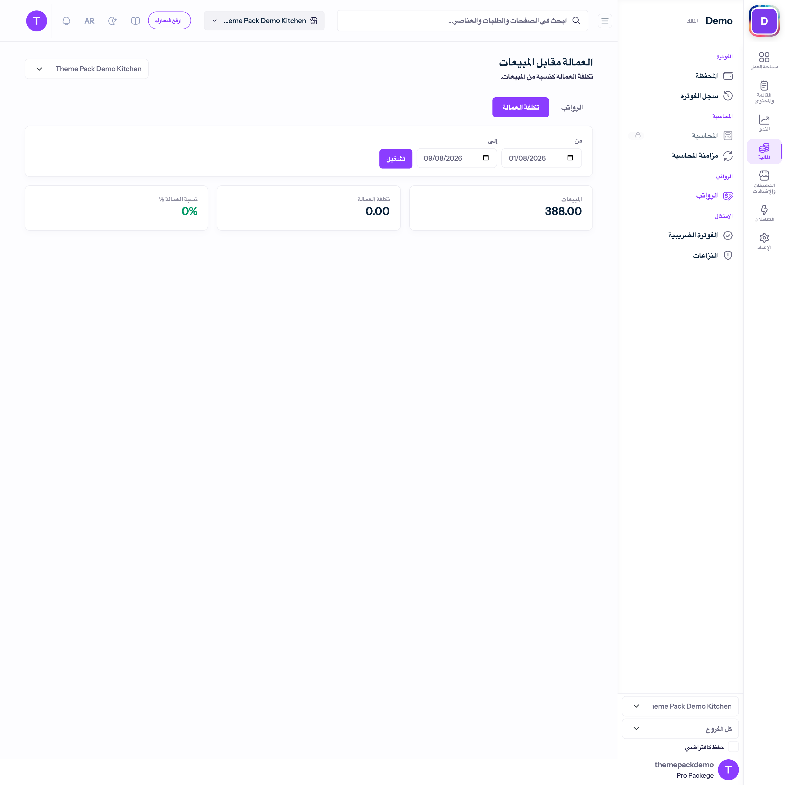

# دورات الرواتب

تحوّل دورة الرواتب نطاقًا زمنيًا إلى سطر واحد لكل موظف — ساعات العمل، والعمل الإضافي،
والإجازة المدفوعة، والإكراميات، والتعديلات، ورقم صافٍ — ثم تمرّ عبر مسودة ← مُقدَّمة
← معتمدة ← مدفوعة. يمكنك طباعة قسيمة راتب لكل شخص وتصدير ملف بنكي.

الصفحات مقيّدة خلف ميزة **الموارد البشرية والرواتب** (`payroll_suite`). وبدونها تحصل
على "غير متضمّنة في خطتك الحالية" أو صفحة الترقية. راجِع [الخطط والفوترة](plans-billing.md).

لا يوجد رابط في الشريط الجانبي. اذهب مباشرةً إلى:

- **دورات الرواتب** — `/payroll-runs`
- **العمالة مقابل المبيعات** — `/payroll-runs/labor/dashboard`

تحمل الصفحتان شريط تبويبين (**الرواتب**، **تكلفة العمالة**) لتنتقل بينهما، وقائمة
مطاعم منسدلة في أعلى اليمين إن كنت تملك أكثر من مطعم.

الرواتب لا تحرّك المال أبدًا. تعليم دورة كمدفوعة يسجّل أنك دفعتها؛ والملف البنكي ملف
CSV تسلّمه إلى مصرفك بنفسك.

## إنشاء دورة رواتب

في `/payroll-runs`، تأخذ بطاقة **دورة رواتب جديدة** **بداية الفترة** و**نهاية
الفترة**، ويبني زر **توليد** الدورة ويفتحها.

التوليد لفترة لها دورة مسبقًا يعيد بناء تلك الدورة من الصفر كمسودة. أما إذا كانت
الدورة القائمة لتلك الفترة معتمدة أو مدفوعة فتكون مقفلة وتحصل على "هذه الفترة مقفلة."
بدلًا من ذلك.

لكل موظف في المطعم يحسب المحرّك:

- **ساعات العمل** — من أزواج تسجيل الدخول/الخروج المكتملة في الفترة.
- **الأجر** — أجر الدور من ملف الموظف إن كان لدور الموظف أجر، وإلا فأجره الأساسي،
  وإلا فالأجر بالساعة على سجل الموظف. راجِع [ملفات الموظفين والإجازات](hr-employees.md).
- **العمل الإضافي** — الساعات فوق العتبة الأسبوعية (48 افتراضيًا، تُقاس بعدد أسابيع
  الفترة) تُدفع بالأجر مضروبًا في مُضاعِف (1.5 افتراضيًا).
- **ساعات الإجازة المدفوعة** — الإجازة المعتمدة في الفترة من نوع إجازة *مدفوعة*،
  تُحتسب بطول اليوم القياسي (8 ساعات افتراضيًا) لكل يوم، ونصف ذلك لطلب نصف يوم.
  الأنواع غير المدفوعة لا تضيف شيئًا.
- **الإكراميات** — الإكراميات على الطلبات التي قدّمها ذلك الموظف في الفترة.

صافي الراتب = الأجر الأساسي (الساعات العادية زائد ساعات الإجازة المدفوعة × الأجر) +
أجر العمل الإضافي + الإكراميات + التعديلات.

تُخزَّن عتبة العمل الإضافي ومُضاعِفه وطول اليوم القياسي لكل مطعم لكن بلا شاشة إعدادات —
فهي تستخدم القيم الافتراضية أعلاه ما لم تُغيَّر في الواجهة الخلفية.

## العمل على دورة

افتح دورة من القائمة (**فتح**) أو مباشرةً بعد توليدها. تعرض الترويسة شارة الحالة،
والصافي الإجمالي، وأزرار الخطوة الحالية.

يحتوي الجدول على صف واحد لكل موظف: العمل، والإجازة، والعمل الإضافي (ساعات)، والأساسي،
وأجر العمل الإضافي، والإكراميات، والتعديل، والصافي.

### التعديلات

ما دامت الدورة مسودة أو بانتظار الاعتماد، لكل صف نموذج صغير: اكتب **سببًا** و**مبلغًا**
(موجبًا لمكافأة، سالبًا لخصم) واضغط **+**. تتراكم التعديلات — تُجمَع الموجبة في
مكافآت، والسالبة في خصومات — ويُعاد حساب صافي الصف وإجمالي الدورة فورًا. لا يمكن
إضافة تعديلات بعد قفل الدورة (المعتمدة أو المدفوعة)، ولا توجد طريقة لإزالة تعديل.

### تجميع الإكراميات

فوق الجدول (وما دامت الدورة غير مقفلة) توجد بطاقة **تجميع الإكراميات**. اختر طريقة
واضغط **تجميع وتطبيق الإكراميات**:

- **حسب ساعات العمل**
- **حسب وزن الدور**
- **نسبة مئوية مخصّصة**

مجمع الإكراميات هو كل إكرامية على الطلبات المدفوعة في فترة الدورة. تطبيقه يستبدل
عمود الإكراميات في كل سطر بحصة كل شخص؛ والتقريب دقيق، مع ذهاب أي باقٍ إلى آخر مستلم.

ملاحظة: أوزان الأدوار والنسب المخصّصة نفسها ليس لها حقول إدخال في الصفحة، لذا تعمل
"حسب وزن الدور" و"نسبة مئوية مخصّصة" بلا أوزان مُدخَلة. و"حسب ساعات العمل" هي الطريقة
التي تتصرف كما هو موصوف اليوم.

### مسار الاعتماد

- **تقديم للاعتماد** — على مسودة. ينقلها إلى *بانتظار الاعتماد*.
- **اعتماد** — على دورة مُقدَّمة. يسجّل من اعتمدها ومتى، ويقفل الدورة ضد التحرير.
- **تعليم كمدفوعة** — على دورة معتمدة فقط. يختم تاريخ الدفع. محاولة تعليم دورة غير
  معتمدة كمدفوعة تُرفض.

إذا كانت محاسبة دفتر الأستاذ مُشغَّلة، فالاعتماد يقيّد الأجور وتعليمها كمدفوعة يقيّد
الدفع؛ وإلا فكلاهما بلا أثر.

## قسائم الرواتب

لكل صف زر **قسيمة راتب** يفتح صفحة قابلة للطباعة في تبويب جديد
(`/payroll-runs/{id}/payslip/{itemId}`). تعرض اسم الموظف، والفترة، ثم ساعات العمل،
وساعات الإجازة المدفوعة، وساعات العمل الإضافي، والأجر الأساسي، وأجر العمل الإضافي،
والإكراميات، والمكافآت، والخصومات، وصافي الراتب. يستخدم زر **طباعة / حفظ PDF** في
الأعلى نافذة الطباعة في متصفحك؛ ولا يظهر على المطبوعة.

قسائم الرواتب لا تُرسَل بالبريد الإلكتروني ولا تُبعث إلى الموظفين تلقائيًا — اطبعها
أو احفظها وأرسلها بنفسك.

## الملف البنكي

يُنزّل **الملف البنكي (CSV)** في ترويسة الدورة ملف `payroll-<run id>.csv` بصف واحد
لكل موظف: اسم الموظف، والهوية الوطنية (من ملف الموظف)، والمبلغ الصافي. إنه تصدير فقط —
لا يُنفَّذ أي دفع ولا يُتصَل بأي مصرف.

## العمالة مقابل المبيعات

`/payroll-runs/labor/dashboard` يقارن ما تنفقه على الأشخاص بما تجنيه.

اختر تاريخ **من** و**إلى** (الافتراضي: بداية هذا الشهر إلى اليوم) واضغط **تشغيل**.
تعرض ثلاث بطاقات:

- **المبيعات** — إجمالي الطلبات المدفوعة المُنشأة في النافذة.
- **تكلفة العمالة** — إجمالي صافي كل دورة رواتب تتداخل فترتها مع النافذة.
- **نسبة العمالة** — العمالة كنسبة مئوية من المبيعات، أو "—" عند غياب المبيعات.

تتحول النسبة إلى أحمر مع شارة **فوق العتبة** عندما تتجاوز عتبة المطعم (30% افتراضيًا).
تلك العتبة ليس لها شاشة إعدادات.

ولأن العمالة تأتي من دورات رواتب كاملة *تتداخل* مع النافذة بدل أن تُقسَّم يومًا بيوم،
اختر نافذة تطابق فترات رواتبك لتحصل على رقم ذي معنى.

## صفحة الرواتب الأخرى

يوجد تقرير ثانٍ أبسط على `/rota/payroll`، يُوصَل إليه من زر **الرواتب** في جدول
المناوبات: الساعات المجدولة مقابل المعمولة، والأجر والإكراميات، مع تصدير CSV وبلا
دورة أو اعتماد أو قسيمة راتب. استخدمه لفحص سريع؛ واستخدم دورات الرواتب عندما تحتاج
فعلًا إلى دفع أجور الناس. راجِع [جدولة الموظفين](staff-scheduling.md).

## صفحات ذات صلة

- [ملفات الموظفين والإجازات](hr-employees.md) — معدلات الأجور والإجازات المدفوعة
  التي تُغذّي الدورة.
- [جدولة الموظفين](staff-scheduling.md) — جدول المناوبات وتقرير الرواتب السريع.
- [الموظفون](staff.md) — سجلات الموظفين والأدوار وساعة الدوام.
- [الخطط والفوترة](plans-billing.md) — تفعيل ميزة الموارد البشرية والرواتب.
