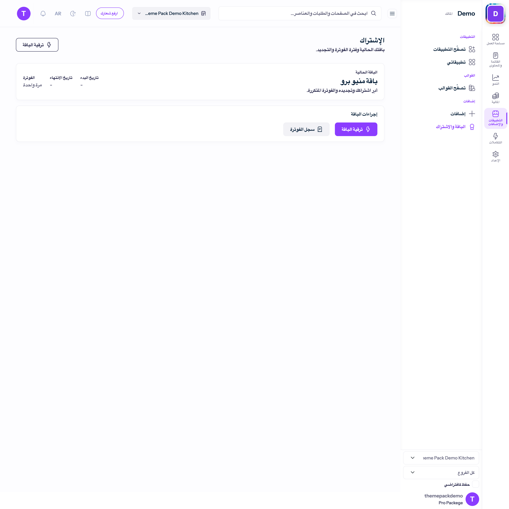

# الخطط والفوترة والاشتراكات

حسابك على خطة. تحدّد الخطة مقدار ما يمكنك فعله — كم مطعمًا يمكنك تشغيله، وكم مسح QR
تحصل عليه شهريًا، وكم فئة قائمة وصنفًا يمكن أن يحويها كل مطعم — وأي الميزات مُشغَّلة.
تشرح هذه الصفحة كيف تقرأ استهلاكك، وترقّي خطتك، وتشتري الإضافات، وتدير التجديدات
والفواتير.

## اختيار خطة

افتح صفحة **الأسعار** (رابط `pricing`، في ترويسة الموقع وتذييله، أو اذهب إلى
`/pricing`). تسرد كل خطة نشطة مع مبدّل فترة الفوترة:

- **شهري** — يُفوتَر كل شهر.
- **سنوي** — يُفوتَر مرة في السنة، عادةً بخصم. يظهر فقط عندما يكون للخطة سعر سنوي.
- **مدى الحياة** — دفعة واحدة لمرة واحدة، بلا تجديد. يظهر فقط عندما يكون للخطة سعر
  مدى الحياة.

بدّل المفتاح لترى سعر كل خطة لتلك الفترة. قد تُعرض أيضًا خطتان خاصتان:

- **مجانية** — الخطة التي تعود إليها تلقائيًا عند انتهاء خطة مدفوعة. لا يمكنك
  "شراؤها"؛ إذا اخترتها، تبقى على خطتك الحالية حتى تنتهي صلاحيتها ثم تنزل إلى المجانية.
- **تجريبية** — تجربة مجانية محدودة المدة لخطة مدفوعة. يمكن لكل حساب استخدام التجربة
  مرة واحدة فقط؛ وبعدها يُرفض الخيار.

للاشتراك، اختر خطة وفترة وتابِع إلى الدفع. يجب أن يكون لديك عنوان بريد إلكتروني
مُوثَّق أولًا — وإلا يعيدك الدفع إلى صفحة الأسعار مع مطالبة بالتوثيق.

## ماذا تعني الحدود

تحمل كل خطة مجموعة من الحدود، مُخزَّنة لكل خطة:

- **المطاعم** — كم مطعمًا (قائمة) يمكنك إنشاؤه.
- **المسح شهريًا** — مشاهدات رمز QR / القائمة المحتسبة لكل شهر تقويمي.
- **الفئات** — فئات القائمة المسموح بها لكل مطعم.
- **أصناف القائمة** — الأصناف المسموح بها لكل فئة.

قيمة الحد **بلا حدود** تعني عدم وجود سقف (داخليًا يُعامَل الرقم `999` على أنه بلا
حدود). كما تشغّل خطتك ميزات فردية أو تطفئها — مثل الطلب عبر الإنترنت أو QR الطاولة —
ويمكن للمشرف تعطيل ميزة على مستوى المنصة بغض النظر عن خطتك.

عندما تشتري [إضافة](#add-ons) ترفع حدًا، تُضاف السعة الزائدة فوق حد خطتك في كل مكان
يُطبَّق فيه الحد، فالرقم الذي تراه يتضمن أي إضافات بالفعل.

هناك حالة حدّية ظاهرة بدل أن تكون صامتة: الحدود المحدودة مسقوفة عند 998 (999 محجوز
ليعني بلا حدود). إذا كان أساس خطتك زائد الإضافات المشتراة سيبلغ أكثر من 998 لحدٍّ ما،
فالفائض غير مُمنوح — وتخبرك صفحة الإضافات بذلك (راجِع
[سعة الإضافات المقتطعة](#truncated-add-on-capacity)). حزم المسح معفاة من هذا السقف.

### الطلبات شهريًا (الباقة المجانية)

تتضمن بعض الخطط عددًا من الطلبات لكل متجر في كل شهر تقويمي (على juwri Cloud: 200
طلب في الباقة المجانية). وهو حد **مرن**: الطلبات التي تتجاوزه تبقى مقبولة، فلا يُردّ
أي عميل. عندما يبلغ المتجر 75% من العدد (150 من 200) يظهر لك إشعار أعلى لوحة التحكم
وتصلك رسالة بريد واحدة، وعندما يبلغ العدد يظهر إشعار آخر وتصلك رسالة تقترح خطة
بطلبات غير محدودة، ويبقى الإشعار في كل صفحات اللوحة حتى نهاية الشهر. تُحتسب الطلبات
المدفوعة وغير المدفوعة والملغاة لاحقًا كلها. يتبع الشهر المنطقة الزمنية لمتجرك، ويبدأ
العدّ من جديد في اليوم الأول من الشهر.

## رؤية استهلاكك

تعرض **لوحة التحكم** (صفحتك الرئيسية بعد تسجيل الدخول) شريط **استهلاك الخطة** بعدّادات
للمطاعم، ومسح هذا الشهر، وأصناف القائمة. يقرأ كل عدّاد `المستخدم / الحد`، أو
`المستخدم / بلا حدود` عندما تكون الخطة بلا سقف، مع شريط يوضّح مدى قربك.

كما ترى استهلاكًا سياقيًا حيث يهمّ:

- **مطاعمي** — المطاعم المستخدمة / الحد قرب زر الإنشاء.
- **منشئ القوائم** — الفئات والأصناف المستخدمة / الحد أثناء تحريرك لقائمة.

عندما تكون عند حدّ ما، يُحظر إجراء الإنشاء وتُوجَّه إلى الترقية. ارفع الحد بالانتقال
إلى خطة أكبر أو بشراء إضافة.

## الترقية أو تغيير الخطة

من صفحة **العضوية** (يُوصَل إليها من رابط "رقِّ الآن" في شعار التجربة، أو شعار
المتأخرات، أو مطالبات "رقِّ الخطة" قرب حدٍّ ما) اختر **تغيير الخطة** للعودة إلى
الأسعار، ثم اختر الخطة والفترة اللتين تريدهما. عندها يقوم الدفع بما يلي:

1. يطلب **تفاصيل الفوترة** (الاسم، والعنوان، والبلد، ورقم ضريبي اختياري). تُحفظ هذه
   وتُعاد على الفواتير المستقبلية.
2. يطبّق **قسيمة** إن أدخلتها (انظر أدناه).
3. يضيف أي **ضرائب** مهيّأة للخطة ولبلد فوترتك.
4. يطبّق **رصيد تناسب** إن كنت في منتصف دورة على خطة مدفوعة (راجِع
   [الفوترة السنوية والتناسب](#annual-billing-and-proration)).
5. يسلّمك إلى بوابة الدفع التي اخترتها للدفع.

لا يمكنك الدفع للخطة التي أنت عليها بالفعل — يرفضها الدفع ويعيدك إلى الأسعار. وإذا
بلغ السعر النهائي صفرًا (مثلًا قسيمة خصم 100%)، تُفعَّل الخطة فورًا بلا خطوة بوابة.

### القسائم

أدخِل رمز قسيمة عند الدفع. يمكن أن تكون القسيمة خصمًا بنسبة مئوية أو بمبلغ ثابت،
وتُرفض إن انتهت صلاحيتها، أو بلغت حد استخدامها، أو كانت مقيّدة بفترة فوترة غير التي
اخترتها. لا يُحتسب استخدام القسيمة إلا بعد نجاح الدفع.

## الفوترة السنوية والتناسب

تختلف الأسعار باختلاف الفترة — شهري أو سنوي أو مدى الحياة — والفترة التي تختارها
تُحمَل خلال الدفع إلى اشتراكك وفاتورتك.

إذا غيّرت الخطة أو الفترة **في منتصف الدورة** وأنت على خطة مدفوعة نشطة، يُضيف الدفع
رصيدًا مقابل الوقت غير المستخدم المتبقي على خطتك الحالية خصمًا من الرسم الجديد.
الرصيد هو المعدل اليومي للخطة القديمة مضروبًا في الأيام المتبقية حتى موعد انتهاء
خطتك الحالية، ويظهر في صفحة الدفع قبل أن تدفع ("متناسب"). يمكن للرصيد أن يخفّض
المبلغ المستحق لكنه لا يُنزله دون الصفر أبدًا. خطط مدى الحياة لا تخضع للتناسب.

## التجديدات والتحصيل المتعثّر

تعتمد طريقة تجديد الخطة المدفوعة على كيفية دفعك:

- مدفوعات **لمرة واحدة** (بما فيها مدى الحياة) لا تتجدّد تلقائيًا. عند انتهاء الفترة
  تسقط الخطة إلى المجانية ما لم تشترِ مجددًا.
- الاشتراكات **المتكررة** (المُعدَّة عبر Stripe أو PayPal أو Paddle) تتجدّد تلقائيًا
  عبر البوابة. يمكنك إيقاف التجديدات المستقبلية من صفحة **العضوية** عبر **إلغاء
  التجديد المتكرر**؛ وتبقى الخطة لك حتى تنتهي الفترة المدفوعة.

هناك أيضًا **تجديد تلقائي عبر المحفظة** اختياري: إذا اخترته وأبقيت رصيد [محفظة](wallet.md)
كافيًا، يخصم النظام من محفظتك لتجديد الخطة في نهاية كل فترة.

عندما يتعذّر تحصيل تجديد، لا تُقطع خدمتك فورًا. ينتقل الاشتراك إلى **متأخر** مع فترة
سماح (3 أيام افتراضيًا)، ويظهر شعار أحمر في لوحة التحكم يطلب منك تحديث طريقة دفعك.
تُرسَل رسائل تذكير مع اقتراب انتهاء الفترة وخلال نافذة السماح. وإذا ظلّ الرسم متعذّر
التحصيل بنهاية السماح، تنتهي صلاحية الخطة وتنزل إلى المجانية. أما الرسم الناجح فيعيدك
إلى النشاط.

## الفواتير وسجل الفوترة

افتح **سجل الفوترة** (صفحة `transactions`، المرتبطة من صفحة العضوية) لترى مدفوعاتك
الناجحة والمعلّقة. لكل دفعة ناجحة غير صفرية **فاتورة**: افتحها لعرض بند السطر،
والضرائب المطبّقة، وتفاصيل فوترتك. تحصل كل فاتورة على رقم فاتورة متسلسل أول مرة تُفتح
فيها.

استخدم **تنزيل PDF** على الفاتورة لحفظ نسخة أو طباعتها (يفتح الفاتورة القابلة للطباعة
ويشغّل نافذة الطباعة / الحفظ كـ PDF في متصفحك). المعاملات المجانية (صفرية المبلغ)
مثل التجارب ليس لها فاتورة.

## الإضافات

ترفع الإضافات حدًا معيّنًا دون تغيير خطتك. افتح **الامتدادات** في الشريط الجانبي تحت
**التطبيقات والإضافات ← الامتدادات** لرؤية حدودك الفعلية الحالية وشراء المزيد. تحت
علامة تاجر تجزئة خاصة به تكون هذه الصفحة مخفية.

في الأعلى تعرض الصفحة حدك الفعلي للمتاجر والمسح والفئات وأصناف القائمة، وعدّادًا
منفصلًا لـ **رسائل WhatsApp هذا الشهر** (محتسبة من مخصّصك، مع شارة "قريب من حدك" بعد
80%). عندما تتجاوز 80% من أي حد سعة، يظهر تحذير في الأعلى يسمّي أيها. "بلا حدود"
تعني أن الحد بلا سقف.

كتالوج الحزم تحدّده المنصة، لذا فالحزم والكميات والأسعار الدقيقة التي تراها في صفحة
الإضافات هي المرجع. يبدو الكتالوج الافتراضي هكذا (ما تمنحه كل حزمة):

| الإضافة | تمنح | الفوترة |
| --- | --- | --- |
| فتحة مطعم إضافية | +1 مطعم | لمرة واحدة |
| 10,000 مسح إضافي/شهر | +10,000 مسح ذلك الشهر | لمرة واحدة أو شهري |
| فئات قائمة إضافية | +10 فئات | لمرة واحدة |
| أصناف قائمة إضافية/فئة | +20 صنفًا | لمرة واحدة |
| 1,000 رسالة WhatsApp إضافية/شهر | +1,000 رسالة ذلك الشهر | لمرة واحدة أو شهري |

تُعرض الأسعار بعملة المنصة في صفحة الإضافات وقد تتفاوت حسب المنصة. حزم المطاعم
والفئات وأصناف القائمة هي زيادات سعة **دائمة**. أما حزم المسح و WhatsApp فهي مخصّصات
**شهرية** تُعاد ضبطها بنهاية الشهر التقويمي.

لشراء واحدة، اختر حزمة وادفع ببوابة مُفعَّلة أو من رصيد **محفظتك**. لا يُمنح شيء حتى
يُؤكَّد الدفع. لحزم المسح و WhatsApp يمكنك اختيار الفوترة **الشهرية**، التي تتجدّد
تلقائيًا كل دورة — عبر Stripe أو PayPal للمدفوعات بالبطاقة، أو بالخصم من محفظتك كل
شهر. يمكنك **إلغاء** إضافة شهرية من صفحة الإضافات؛ وتبقى السعة الزائدة حتى نهاية
الفترة التي دفعت ثمنها بالفعل.

الحزم والأسعار الدقيقة تحدّدها المنصة، لذا فما تراه قد يختلف عن الجدول أعلاه.

### سعة الإضافات المقتطعة

تُطبَّق الحدود المحدودة بسقف صارم قدره 998 (999 محجوز ليعني بلا حدود؛ مخصّصات المسح
معفاة). إذا بلغ أساس خطتك زائد حزم الإضافات المشتراة أكثر من 998 للمتاجر أو الفئات
أو أصناف القائمة، فالفائض فوق 998 غير مُمنوح. عندما يحدث ذلك تعرض صفحة الإضافات —
الصفحة التي اشتريت منها السعة — تحذيرًا في الأعلى يسمّي الحد المتأثر:

> خطتك زائد الإضافات تبلغ **1,010** صنف قائمة، لكن هذا الحساب مسقوف عند **998**.
> تواصل مع الدعم.

لا يغيّر الإشعار من التطبيق شيئًا — فهو موجود ليكون النقص ظاهرًا بدل أن يكون صامتًا.
إذا رأيته، تواصل مع الدعم (يمكن لمزوّد منصتك رؤية زوج المشترى-مقابل-الممنوح نفسه على
حسابك) لترتيب استرداد، أو تغيير خطة، أو حدٍّ بلا سقف.

### إتاحة الميزات

أسفل حزم السعة، قد يسرد قسم **إتاحة الميزات** مشتريات لمرة واحدة تشغّل ميزة واحدة
لحسابك بدل رفع حد. الميزة التي تملكها بالفعل — عبر خطتك، أو تجاوز من مشغّل، أو شراء
سابق — تُخفى من القائمة، ومحاولة شرائها رغم ذلك تخبرك ببساطة "لديك هذه الميزة بالفعل"
بدل احتساب مبلغ عليك مجددًا.

أتبحث عن ميزات لا عن سعة؟ صفحة الإضافات ترتبط بمتجر التطبيقات.

### إضافاتك

يسرد جدول **إضافاتك** في الأسفل كل ما اشتريته: الحزمة، والكمية التي منحتها، وانتهاء
صلاحيتها (أو **أبدًا**)، ومرجع معاملتها، ومتى اشتريتها، وحالة تجديدها — **تجديد تلقائي
عبر المحفظة**، أو **تجديد تلقائي بالبطاقة**، أو **ملغى**، أو لا شيء لشراء لمرة واحدة.
لا يظهر زر **إلغاء** إلا على اشتراك نشط.

## صفحات ذات صلة

- [المحفظة](wallet.md) — اشحن الرصيد وادفع منه ثمن الخطط أو الإضافات.
- [إعدادات الدفع](checkout-settings.md) — إعداد الطلب والدفع لمطاعمك (منفصل عن فوترة
  اشتراكك الخاص).
- [الكوبونات](coupons.md) — رموز الخصم التي تنشئها لعملائك (ليست نفس قسائم الاشتراك
  المُدخَلة عند دفع الخطة).

## ملاحظات وحدود

- **العملة** — تستخدم الخطط والفواتير عملة المنصة الواحدة؛ التسعير متعدد العملات لكل
  خطة غير متاح.
- **القسائم المقيّدة بالفترة** — يمكن حصر قسيمة بفترة فوترة، لكن علامة خصم "الفترة
  الأولى فقط" هي بيانات وصفية مُخزَّنة ولا تطبّقها البوابات المتكررة بعد.
