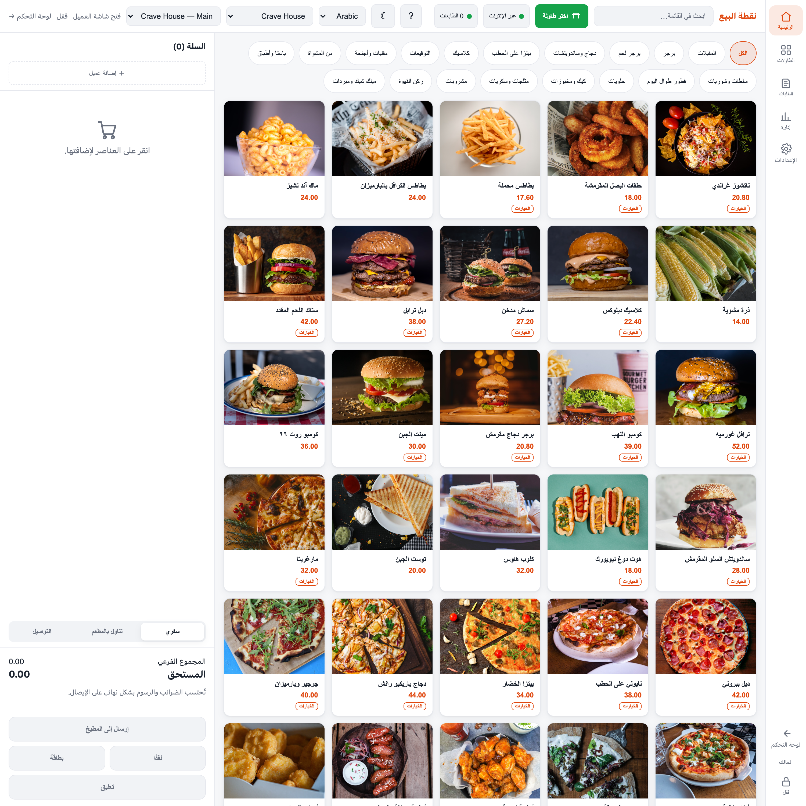

# نقطة البيع (POS)

سجل نقطة البيع هو صندوق دفع بملء الشاشة لاستقبال الطلبات عند الكاونتر أو على
الطاولة. ينقر الموظفون على أصناف القائمة، ويختارون نوع الطلب، ثم إما يرسلون
الطلب مباشرة إلى المطبخ أو يستوفون الدفع في الحال. كل ما يُسجَّل على السجل
يظهر في قائمة **الطلبات** نفسها التي تظهر فيها طلباتك عبر الإنترنت، وتظهر
الطلبات المرسلة على شاشة عرض المطبخ (KDS) فورًا.

## ما تحتاج إليه قبل أن تبدأ

- **باقة مفعَّل فيها نقطة البيع.** إذا كانت باقتك لا تتضمن نقطة البيع، يستجيب
  السجل بـ "POS is not enabled on this plan". تحقق من باقتك في صفحة
  **الاشتراك** أو اسأل مزوّد المنصة.
- **حسابات الموظفين (اختياري).** يمكنك أنت، المالك، تشغيل السجل بنفسك دائمًا من
  لوحة التحكم الخاصة بك. ولتمكين الموظفين من استخدامه، أنشئ حسابات ضمن
  **الموظفون** في الشريط الجانبي (قسم الفريق). تتضمن أدوار **المدير** و**الكاشير**
  و**النادل** صلاحية الوصول إلى نقطة البيع؛ أما دور **المطبخ** فلا. ويحصل المديرون
  إضافةً إلى ذلك على صلاحيات استرداد المبالغ وإغلاق الورديات. راجع
  [حسابات الموظفين](staff.md) لضبط الصلاحيات لكل شخص بدقة.
- يسجّل الموظفون الدخول على نطاق لوحة التحكم الخاصة بك بالبريد الإلكتروني وكلمة
  المرور الموجودَين في حساب الموظف. يرتبط كل موظف بمطعمك (وبفرعه، إن ثبَّتَّ له
  فرعًا)، لذا يكفي لصندوق دفع مخصص متصفحٌ مسجَّل الدخول بحساب ذلك الموظف.

## فتح السجل

افتح **صندوق نقاط البيع** في الشريط الجانبي (قسم المنصة) — يُفتح في علامة تبويب
جديدة كسجل داكن بملء الشاشة على `/pos`.

- إذا كنت تملك أكثر من مطعم، فإن أداة اختيار المطعم في الشريط العلوي تبدّل السجل
  بينها. ولا يستطيع الموظفون التبديل — فهم مثبَّتون على مطعمهم.
- إذا كان للمطعم فروع، تظهر أداة اختيار الفرع بجانبها. تُسجَّل الطلبات على الفرع
  المحدد؛ ويكون الفرع الافتراضي للموظفين المثبَّتين هو فرعهم.
- يعيدك رابط **لوحة التحكم ←** على اليمين (للمالك فقط).

## استقبال طلب

1. اختر فئة من الرقائق فوق شبكة الأصناف، أو **الكل**.
2. انقر على صنف لإضافته إلى السلة على اليمين. يزيد النقر على الصنف نفسه مرة أخرى
   كميته؛ استخدم زرَّي الطرح والجمع في سطر السلة لتعديلها (النزول إلى صفر يزيل
   السطر). لا يمكن إضافة الأصناف المنتهية.
3. اختر نوع الطلب: **سفري**، أو **تناول في المطعم**، أو **توصيل**.
4. أنهِ بأحد أزرار الإجراء الأربعة:
   - **إرسال إلى المطبخ** — ينشئ الطلب غير مدفوع ويضعه على شاشة عرض المطبخ.
     استوفِ الدفع لاحقًا (مثلًا، بعد الوجبة).
   - **نقدًا** — يستوفي الدفع نقدًا الآن (انظر أدناه)، ثم يرسل الطلب إلى المطبخ
     مدفوعًا.
   - **بطاقة** — يضع علامة أن الطلب مدفوع بالبطاقة ويرسله إلى المطبخ. لا يخصم
     السجل من البطاقة بنفسه؛ استخدم جهاز البطاقة الفعلي إلى جانبه.
   - **تعليق** — يوقف الطلب مؤقتًا. لا يصل الطلب المعلَّق إلى المطبخ ولا يخصم من
     المخزون حتى يُستأنف.

تعرض السلة مجموعًا فرعيًا جاريًا. تُحسب الأسعار دائمًا على الخادم من قائمتك —
لا يرسل السجل سوى معرّفات الأصناف والخيارات، لذا لا تستطيع شاشة مُلاعَب بها
تغيير أي سعر. تُحسم الضريبة ورسوم الخدمة نهائيًا على الإيصال.

### الأنواع والإضافات والملاحظات

الصنف الذي له أحجام أو مجموعات خيارات أو إضافات مدفوعة يفتح **ورقة تخصيص**
بدلًا من الوقوع مباشرة في السلة: اختر النوع (خيار واحد)، وأيًّا من خيارات
مجموعات الخيارات (أزرار اختيار عندما يُسمح بواحد فقط، ومربعات تأشير في غير
ذلك)، وأشِّر على **إضافة إضافات**، واضبط الكمية، وأضف ملاحظة مطبخ اختيارية
للسطر. تظهر الرسوم الإضافية للخيارات بجانب كل خيار؛ وكما في كل مكان على السجل،
يُعاد حساب السعر بواسطة الخادم من تعريفات قائمتك عند تسجيل الطلب.

### الخصومات والقسائم على الطلب

أسفل أسطر السلة، يطبّق صفَّا إضافة تعديلات على مستوى الطلب:

- **＋ خصم** — مبلغ أو نسبة مئوية تُحسم من الطلب (بدّل بين **مبلغ** و**%**)، مع
  عنصر تحكم **مسح الخصم** لإزالته.
- **＋ قسيمة** — أدخل أحد رموز [القسائم](coupons.md) الخاصة بك؛ يُتحقَّق منه على
  الخادم ويظهر على السلة عند تطبيقه.

### وجبات الكومبو

إذا كانت وجبات الكومبو مفعَّلة في حسابك، يعرض السجل رقاقة **الكومبوهات** بجانب
رقائق الفئات، وبلاطات الكومبو (المميَّزة بشارة **وجبة مجمّعة**) في شبكة الأصناف. يفتح
النقر على بلاطة كومبو ورقة إعداد: قسم واحد لكل خانة (يعرض الخيار الواحد أزرار
اختيار، وتعرض الخانات متعددة الاختيار مربعات تأشير)، مع فرض الخانات المطلوبة
والحد الأدنى/الأقصى للاختيارات، إضافةً إلى الكمية وملاحظة اختيارية. قد تحمل
الخيارات رسمًا إضافيًا يظهر بجانب الخيار. وكما في كل شيء على السجل، السعر الذي
تراه للعرض فقط — يعيد الخادم تسعير الكومبو من تعريفات الكومبو الخاصة بك عند
تسجيل الطلب.

تُبنى الكومبوهات نفسها في صفحة **وجبات الكومبو** بلوحة التحكم (على `/combos`):
اختر متجرًا، واجمع أصناف قائمة موجودة في خانات، وحدد السعر، وفعِّل كل كومبو أو
عطّله. لا يظهر الكومبو على السجل (وعلى الواجهة) إلا وهو مفعَّل وأصنافه قابلة
للبيع في الفرع المحدد.

## طرق الدفع

يمكن تسوية الطلب بـ **نقدًا**، أو **بطاقة**، أو **إلكتروني**، أو **أخرى**. تعرض
شاشة التسوية أسطر الطلب والمجاميع على اليسار وعناصر تحكم الدفع على اليمين:

- **نقدًا** — تأخذ لوحة أرقام مبلغ **النقد المقدَّم** وتعرض الباقي أثناء الكتابة.
  يُعاد حساب الباقي من إجمالي الطلب الحقيقي على الخادم. تُختَم المبيعات النقدية
  على وردية الدرج المفتوحة (انظر أدناه) كي يستقيم جرد الدرج.
- **بطاقة** — يسجّل الطلب مدفوعًا بالبطاقة. معالجة البطاقات المدمجة (مفاتيح
  البوابة الحية، وروابط الدفع على الطاولة، وأجهزة الدفع باللمس) مخطَّطة وليست
  متاحة بعد، لذا يحدث الخصم الفعلي على جهاز البطاقة المستقل لديك.
- **إكرامية** — رقائق سريعة لـ **بلا**، أو **10%**، أو **15%**، أو **20%**، أو
  مبلغ **مخصص**؛ يتحدّث المبلغ المستحق إلى **المطلوب تحصيله** متضمنًا الإكرامية.
- **تقسيم** — سوِّ الطلب على أجزاء (مثلًا نصف نقدًا ونصف بطاقة، أو لكل ضيف)؛
  يُسجَّل كل جزء على الطلب حتى يُدفع بالكامل. لمعرفة تدفق التقسيم الموجَّه للعميل
  على القائمة، انظر [تقسيم الفاتورة](split-bill.md).

يمكن أيضًا تطبيق قسيمة عند التسوية، وعندما يكون للطلب عميل مرتبط له رصيد ائتمان
في المتجر، يطبّق مفتاح **استخدام المحفظة** رصيده على المبلغ المستحق.

## التعامل مع النقد وورديات الدرج

تدعم نقطة البيع محاسبة درج سليمة، تُدار من لوحة **الإدارة** في السجل (تبويب
الوردية):

- مع عدم وجود وردية مفتوحة، أدخل **الرصيد الافتتاحي (نقد الدرج)** واضغط
  **فتح وردية** — وردية مفتوحة واحدة لكل مطعم وفرع في المرة.
- تُرفَق بها كل مبيعة نقدية تُسوّى أثناء فتح الوردية.
- أثناء تشغيل الوردية، يعرض **تقرير X (حتى الآن)** التقرير نفسه الذي يعرضه
  الإغلاق، دون إغلاق أي شيء.
- للإغلاق، أدخل **النقد المعدود (نهاية الوردية)** واضغط **إغلاق الوردية**
  (يتطلب صلاحية المدير **pos_shift_close**). يقارن النظام النقد المعدود بالنقد
  المتوقَّع (الرصيد الافتتاحي + المبيعات النقدية − الاستردادات النقدية) ويسجّل
  الزيادة/العجز.
- يُنتج الإغلاق بطاقة **تقرير Z**: **الطلبات**، **الرصيد الافتتاحي**، المبيعات
  حسب طريقة الدفع، **الإكراميات**، **الاستردادات**، **الإلغاءات**، **النقد
  المتوقَّع**، **النقد المعدود**، و**الزيادة / العجز**.

يحمل تبويب **التقارير** في لوحة الإدارة تقرير مبيعات نقطة البيع اليومي (المجاميع
حسب طريقة الدفع والموظف والساعة).

تُعالَج الأخطاء بأداتين مقيَّدتين بصلاحية المدير (صلاحية **pos_refund**)،
يُوصَل إليهما من مركز الطلبات في السجل: افتح لوحة تفاصيل الطلب واستخدم الزر
المناسب. يتطلب كل إجراء **سببًا** ويُسجَّل بشكل دائم مع الموظف الذي نفّذه:

- **إلغاء الطلب** — للطلبات غير المدفوعة. يلغي الإلغاءُ الطلبَ فيغادر المطبخ
  ويُعاد المخزون. لا يمكن إلغاء طلب مدفوع (يظهر الزر فقط على الطلبات غير
  المدفوعة وغير الملغاة).
- **استرداد** — للطلبات المدفوعة. يسجّل خروج المبلغ مع مبلغ وسبب؛ تعرض اللوحة
  المجموع الجاري لـ **المُسترَد بالفعل**، وتُحتسب الاستردادات النقدية على الدرج.

يمكن أيضًا نقل الطلبات بين الطاولات، ودمج الطاولات في مجموعة واحدة، من عرض
الطاولات (**دمج الطاولات** وورقة نقل الطلب).

## مركز الطلبات

تجمع لوحة الطلبات في السجل كل ما ليس السلة الحية في تبويبات: **المعلَّقة**
(الطلبات الموقوفة، استأنِفها للمتابعة)، و**الطلبات عبر الإنترنت** (الطلبات
المقدَّمة خارج السجل — من قائمتك العامة — كي يراها الكاونتر تصل)، و**سجل
الطلبات** (طلبات السجل الأخيرة؛ يفتح السطرُ لوحةَ التفاصيل مع إعادة الطباعة
والإلغاء والاسترداد)، و**دون اتصال** (الطلبات المصطفّة أثناء انقطاع الاتصال، مع
شارة تعرض عدد المصطفّة). تحصل المتاجر التي تستخدم موافقات الطلبات أيضًا على تبويب
**الموافقات**.

## الإيصالات وتذاكر المطبخ

لكل طلب نقطة بيع إيصالٌ قابل للطباعة بعرض 80mm على `/pos/orders/{id}/receipt`
(يُفتح جاهزًا للطباعة). يعرض الإيصال اسم مطعمك وعنوانه وهاتفه، ورقم الطلب،
والنوع والطاولة، وكل سطر بكميته وسعره، والإضافات، والمجموع الفرعي، والضريبة،
ورسوم الخدمة، والإكرامية، والخصم، والإجمالي الكلي، و — للنقد — المبلغ المقدَّم
والباقي. يستخدم سطر الضريبة **معدل الضريبة** الذي ضبطتَه في
**المتاجر ← تعديل**.

إضافة `?format=kitchen` إلى العنوان نفسه تطبع تذكرة مطبخ بدلًا من إيصال العميل.

يمكنك أيضًا إعادة طباعة أي طلب من صفحة **الطلبات** في لوحة التحكم — تفتح أيقونة
الإيصال في السطر لوحةً بها زر طباعة. افتراضيًا، تمر الطباعة عبر مربع حوار الطباعة
في المتصفح. إذا تضمنت باقتك **توجيه الطباعة**، تضيف صفحة **الطباعة** في لوحة
التحكم طباعةً مباشرة — ملفات تعريف طابعة لكل فرع ولكل محطة مطبخ مع طباعة تلقائية
عند وصول طلبات جديدة. راجع [الطباعة](printing.md) لكليهما.

## عرض المخطط

تتوفر شاشة مخطط مخصصة على `/pos/floor`. تعرض حالة كل طاولة — الطاولات المشغولة
بإجمالي طلبها والطاولات الفارغة بعدد مقاعدها — ويمكن نقل طلب بين الطاولات، ما
يضع علامة أنه للتناول في المطعم على الطاولة الجديدة. رتّب طاولاتك على
[مخطط الأرضية](floor-map.md) كي تظهر على هذه الشاشة.

## إعدادات نقطة البيع

يمكن للمديرين والمالكين فتح إعدادات نقطة البيع من السجل (أو مباشرة على
`/pos/settings`). تتيح لك صفحة الإعدادات ضبط سلوك الطباعة والمحطات لكل فرع:

- **الطباعة التلقائية** — إيقاف، الإيصال فقط، تذكرة المطبخ فقط، أو كلاهما.
- **النسخ** — عدد النسخ المطبوعة (من 1 إلى 5).
- **اسم المحطة** — تسمية لهذا السجل (حتى 40 حرفًا)، مفيدة عند تشغيلك أكثر من
  صندوق دفع.
- **دقائق القفل التلقائي** — مدة بقاء السجل خاملًا قبل أن يقفل نفسه (من 0 إلى
  120؛ 0 يعني أبدًا).

تُحفظ الإعدادات لكل فرع (أو لكل مطعم عند عدم تحديد فرع).

## الشاشة الموجَّهة للعميل

افتح شاشة العميل من رابط رأس السجل، أو اذهب إلى `/pos/display` مباشرة. هذه شاشة
ثانية مخصصة لشاشة موجَّهة للعميل مثبَّتة عند الكاونتر. تعكس السلة الحالية آنيًا
باستخدام قناة بث مع احتياطي استقصاء كل خمس ثوانٍ، فيرى العميل الأصناف والمجاميع
أثناء تسجيلك لها.

## فتح القفل بالتبديل السريع

عندما يُقفَل السجل (بعد مهلة القفل التلقائي، أو يدويًا)، تظهر طبقة رمز PIN أو كلمة
مرور. يتوفر مساران لفتح القفل:

- **PIN** — يُدخل الموظف رمزه من 4 إلى 6 أرقام. يبدّل السجل إلى جلسة ذلك الموظف
  (يتحدّث الاسم والدور على الشاشة)، فيمكن لعدة موظفين مشاركة صندوق دفع واحد دون
  تسجيل الخروج.
- **كلمة المرور** — يعيد المالك المصادقة بكلمة مرور حسابه.

## العمل دون اتصال

يستمر السجل في العمل خلال انقطاع إنترنت قصير:

- الشاشة والقائمة مخزَّنتان مؤقتًا، فيظل السجل يُحمَّل.
- تُصطف الطلبات المسجَّلة أثناء انقطاع الاتصال في المتصفح (تعرض لافتة "Offline —
  orders will send when back online" مع عدد المصطفّة) وتُرسَل تلقائيًا عند عودة
  الاتصال. تُزال التكرارات من الإعادة، فلا يُنشأ الطلب مرتين أبدًا.
- تُسوَّى المدفوعات المأخوذة أثناء انقطاع الاتصال عند مزامنة الطلب — سوِّ على
  الإيصال بمجرد وصوله.

## القيود الحالية

- لا يوجد خصم بطاقة مدمج: مفاتيح بوابة البطاقة الحية ودعم أجهزة الدفع باللمس
  مخطَّطة وليست متاحة بعد. تُسجَّل مدفوعات البطاقة فقط؛ ويحدث الخصم الفعلي على
  جهاز البطاقة المستقل لديك.

## صفحات ذات صلة

- [إدارة الطلبات](orders.md) — أين تظهر طلبات نقطة البيع، والحالات، وإعادة طباعة
  الإيصالات.
- [حسابات الموظفين](staff.md) — الأدوار، وصلاحيات نقطة البيع، والوصول لكل شخص.
- [نظرة عامة على لوحة التحكم](dashboard-overview.md) — تخطيط الشريط الجانبي وأداة
  تبديل المتجر/الفرع.
- [تقسيم الفاتورة](split-bill.md) — تمكين ضيوف تناول الطعام من تقسيم الدفع.
