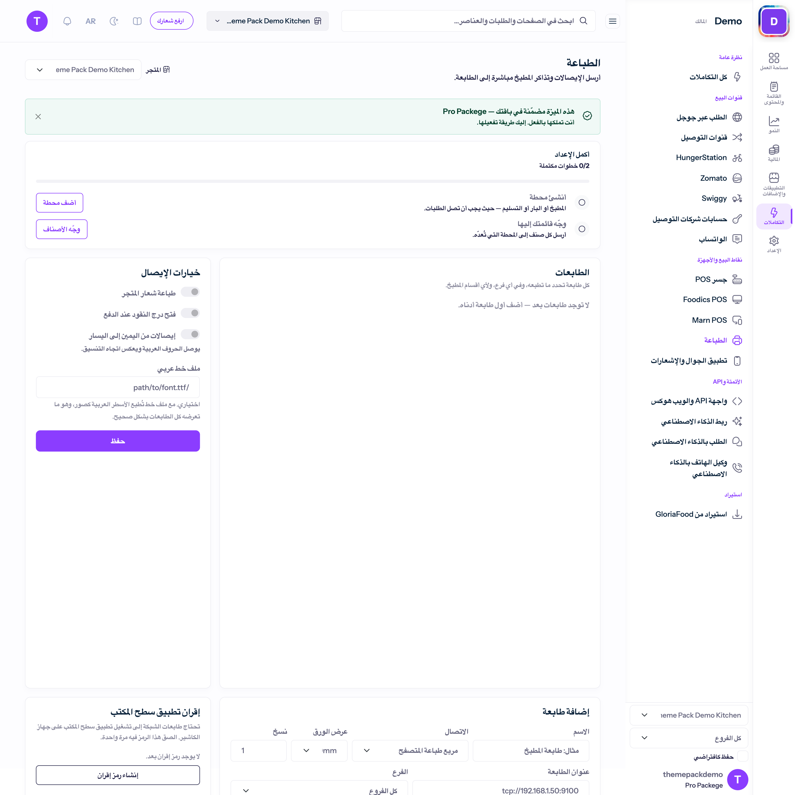

# طباعة التذاكر والإيصالات

يطبع النظام نوعين من الورق: **إيصال** للعميل (الأسعار والمجاميع والدفع) و**تذكرة
مطبخ** (خط كبير، بلا أسعار، مع ملاحظات الأصناف). كلاهما مصمَّم لورق حراري لفافة
قياسي بعرض 80mm. لا توجد خدمة طباعة سحابية من طرف ثالث للتسجيل فيها؛ فمساران
للطباعة مدمجان:

- **الطباعة عبر المتصفح** (متاحة دائمًا) — تُفتح الإيصالات والتذاكر في نافذة
  وتُطبع عبر مربع حوار الطباعة الاعتيادي في متصفحك.
- **الطباعة المباشرة** (ميزة **توجيه الطباعة**، حيث تتضمنها باقتك) — تحدّد صفحة
  **الطباعة** في لوحة التحكم ملفات تعريف الطابعات التي تستقبل المهام مباشرة: لكل
  فرع، ولكل محطة مطبخ، مع طباعة تلقائية عند وصول طلبات جديدة. راجع
  [صفحة الطباعة](#the-printing-page) أدناه.

## ماذا يُطبع ومتى

- **عند وصول طلب جديد عبر الإنترنت** — مع إعداد توجيه الطباعة، يطبعه دون تدخّل
  ملفُّ تعريف طابعة مشترك في حدث **الطلب الجديد** مع تفعيل **الطباعة تلقائيًا**.
  بدون توجيه الطباعة، لا يُطبع شيء تلقائيًا: تنبّهك صفحة **الطلبات** (صوت وتحديث
  تلقائي، موصوفان أدناه) فيكون الطلب على الشاشة جاهزًا للطباعة بنقرة واحدة.
- **عند النقر على طباعة الإيصال في صفحة الطلبات** — يُفتح إيصال مضغوط لذلك الطلب
  في نافذة صغيرة ويظهر مربع حوار الطباعة.
- **عند فتح رابط إيصال طلب نقطة البيع** — يُفتح الإيصال بعرض 80mm (أو تذكرة
  المطبخ) ويستدعي مربع حوار الطباعة فورًا. يوفّر السجل أيضًا زرَّي **طباعة إيصال**
  / **طباعة تذكرة** مباشرة بعد إرسال الطلب.

## إعادة طباعة أي طلب من صفحة الطلبات

1. في الشريط الجانبي للوحة التحكم، افتح **الطلبات**.
2. جِد الطلب وافتحه. تعرض لوحةٌ تفاصيلَ الطلب: الوقت، والعميل، والنوع، والهاتف،
   والعنوان، والرسالة، والأصناف بأنواعها وإضافاتها، والمجاميع.
3. انقر على **اطبع الإيصال**. تُفتح نافذة صغيرة بتخطيط على هيئة إيصال (اسم مطعمك
   وعنوانه في الأعلى، وتفاصيل الطلب، وسطر شكر) ويظهر مربع حوار الطباعة في متصفحك.

إذا لم تظهر النافذة الصغيرة، فقد حجب متصفحك النافذة المنبثقة. اسمح بالنوافذ
المنبثقة لعنوان لوحة التحكم وحاول مجددًا.

## تنبيهات الطلبات الجديدة في صفحة الطلبات

تفحص صفحة الطلبات وجود طلبات جديدة كل 25 ثانية تقريبًا. يوجد زرّا تبديل في أعلى
الصفحة:

- **صوت الطلب الجديد** (أيقونة الجرس) — يشغّل نغمة عند وصول طلب جديد.
- **الطباعة التلقائية للطلبات الجديدة** (أيقونة الطابعة) — يحدّث الصفحة عند وصول
  طلب جديد، فيكون أحدث طلب على الشاشة وجاهزًا للطباعة. ورغم الاسم، لا يرسل هذا
  المفتاح أي شيء إلى الطابعة بنفسه؛ فما زلت تنقر على **اطبع الإيصال**. وللطباعة
  الحقيقية دون تدخّل، أعدّ طابعة في [صفحة الطباعة](#the-printing-page) بدلًا من
  ذلك.

يُحفظ الزرّان لكل جهاز ومتصفح، فشغّلهما على حاسوب الكاونتر أو المطبخ حيث تريد
التنبيهات فعلًا. أبقِ علامة تبويب المتصفح تلك مفتوحة — فالتنبيهات لا تعمل إلا
وصفحة الطلبات مفتوحة.

## إيصالات نقطة البيع وتذاكر المطبخ

لكل طلب نقطة بيع إيصالٌ قابل للطباعة على `/pos/orders/{id}/receipt`. يجب أن تكون
مسجَّل الدخول كمالك أو كموظف له صلاحية الوصول إلى نقطة البيع، وأن يكون الطلب
تابعًا لمطعمك. تفتح الصفحة مربع حوار الطباعة من تلقائها ولها زر **طباعة** لإعادة
الطباعة.

يعرض إيصال العميل اسم مطعمك وعنوانه وهاتفه، ورقم الطلب، ونوع الطلب والطاولة،
والتاريخ والوقت، وكل صنف بكميته وسعره، والإضافات، والمجموع الفرعي، والضريبة،
ورسوم الخدمة، والإكرامية، والخصم، والإجمالي الكلي، وطريقة الدفع، و — للنقد —
المبلغ المقدَّم والباقي. يستخدم سطر الضريبة معدل الضريبة المضبوط في صفحة تعديل
مطعمك. نص التذييل افتراضه "Thank you!"؛ ويُحترَم تجاوزُ تذييل لكل متجر عند ضبطه
على الحساب، لكن لا يوجد له حقل في لوحة التحكم بعد.

أضِف `?format=kitchen` إلى العنوان نفسه للحصول على تذكرة مطبخ بدلًا من ذلك: رقم
الطلب ونوعه بخط كبير، والطاولة والوقت، ثم كل صنف بخط عريض كبير مع نوعه وإضافاته
وأي ملاحظة صنف مميَّزة بنجمة. بلا أسعار — فهي مخصصة لممر التسليم، لا للعميل.

راجع [نقطة البيع](pos.md) للسجل نفسه.

## صفحة الطباعة

عندما تتضمن باقتك **توجيه الطباعة**، يظهر عنصر **الطباعة** في الشريط الجانبي.
تدير الصفحة ملفات تعريف الطابعات — تقرّر كل طابعة ماذا تطبع، وفي أي فرع، ولأي
محطات مطبخ. لكل طابعة تضبط:

- **الاسم** — مثلًا "ممر المطبخ" أو "الكاونتر".
- **الاتصال** — كيف تصل المهام إلى الطابعة: **مربع حوار طباعة المتصفح**، أو
  **USB / تسلسلي (هذا المتصفح)**، أو **USB (WebUSB)**، أو **أندرويد (RawBT)**،
  أو **طابعة شبكة (تطبيق سطح المكتب)**. تظهر الطابعة المدمجة لكشك Sunmi هنا
  للقراءة فقط (تُضبط في صفحة الكشك).
- **عرض الورق** — 80mm (48 عمودًا) أو 57mm (32 عمودًا).
- **عنوان الطابعة** — لطابعات الشبكة، `tcp://ip:9100`؛ اتركه فارغًا لطابعات USB
  والطباعة عبر المتصفح.
- **عنوان تطبيق سطح المكتب** — حيث يعمل تطبيق الطباعة على سطح المكتب، لطابعات
  الشبكة.
- **الفرع** — **كل الفروع** لطابعة على مستوى المتجر، أو فرع واحد.
- **النسخ** — من 1 إلى 5.
- **محطات المطبخ** — قصر تذاكر المطبخ على محطة أو أكثر من [المحطات](kds.md)
  ("فارغ = كل صنف على تذكرة واحدة")، كي لا تصل أصناف الشواية أبدًا إلى طابعة
  البار.
- **يطبع** — أي أحداث تتولاها هذه الطابعة: **الطلب الجديد**، **مدفوع**، **تذكرة
  المطبخ**، **تقرير الوردية**.
- مفتاحا **الطباعة تلقائيًا** و**مُفعَّل**.

استخدم **طباعة اختبارية** على ملف تعريف للتحقق من الاتصال، و**حذف** لإزالته.
تُسلَّم المهام بواسطة أيًّا كان مالكُ اتصال الطابعة — صفحة نقطة البيع المفتوحة
لطابعات USB، أو تطبيق RawBT على جهاز أندرويد، أو تطبيق سطح المكتب لطابعات الشبكة
— لذا أبقِ ذلك الجهاز يعمل للطباعة دون إشراف.

## إعداد طابعة (الطباعة عبر المتصفح)

تحدث الطباعة عبر المتصفح على الحاسوب أو الجهاز اللوحي الذي يعرض صفحة الطلبات أو
نقطة البيع:

1. وصِّل طابعتك الحرارية (USB أو شبكة أو Bluetooth) وثبِّتها على مستوى نظام
   التشغيل كي تظهر في مربع حوار طباعة المتصفح.
2. استخدم ورق لفافة بعرض 80mm. تخطيطات الإيصال والتذكرة بعرض 72mm لتلائم المنطقة
   القابلة للطباعة في طابعة 80mm.
3. في مربع حوار الطباعة، اختر الطابعة الحرارية، واضبط الهوامش على لا شيء، وأطفئ
   الترويسات والتذييلات. تتذكر معظم المتصفحات هذه الخيارات.
4. جعلُ الطابعة الحرارية الطابعةَ الافتراضية للجهاز يجعل كل طباعة بنقرة واحدة.

أي طابعة يراها المتصفح ستعمل — فطابعة A4 عادية تطبع التخطيطات نفسها، لكن على ورق
أكبر فقط.

## غير متاح بعد

- **الطباعة السحابية من طرف ثالث** — لا يوجد تكامل مع PrintNode أو خدمة مستضافة
  مماثلة. تعمل الطباعة دون إشراف عبر مسارات توجيه الطباعة المدمجة بدلًا من ذلك
  (USB على صفحة نقطة بيع مفتوحة، أو RawBT على أندرويد، أو تطبيق سطح المكتب
  لطابعات الشبكة)، لذا يجب أن يظل جهاز على شبكتك مشغَّلًا.
- **تذييل إيصال مخصص** — نص التذييل على إيصال نقطة البيع ليس له إعداد في لوحة
  التحكم بعد (يُحترَم تجاوزٌ لكل متجر عند ضبطه على الحساب).
- بدون ميزة **توجيه الطباعة** في باقتك، كل ما ورد أعلاه في
  [صفحة الطباعة](#the-printing-page) — الطباعة التلقائية دون إشراف، والتوجيه لكل
  محطة ولكل فرع، وأعداد النسخ — غير متاح، وتكون الطباعة عبر مربع حوار المتصفح
  فقط.

## صفحات ذات صلة

- [إدارة الطلبات](orders.md) — صفحة الطلبات حيث تقيم إعادة الطباعة وتنبيهات
  الطلبات الجديدة.
- [نقطة البيع](pos.md) — السجل، وتسوية المدفوعات، وروابط الإيصال/تذكرة المطبخ.
- [نظام عرض المطبخ (KDS)](kds.md) — المحطات التي يبني عليها التوجيه لكل محطة من
  التذاكر.
- [الكشك](kiosk.md) — الطابعة المدمجة لكشك Sunmi.
