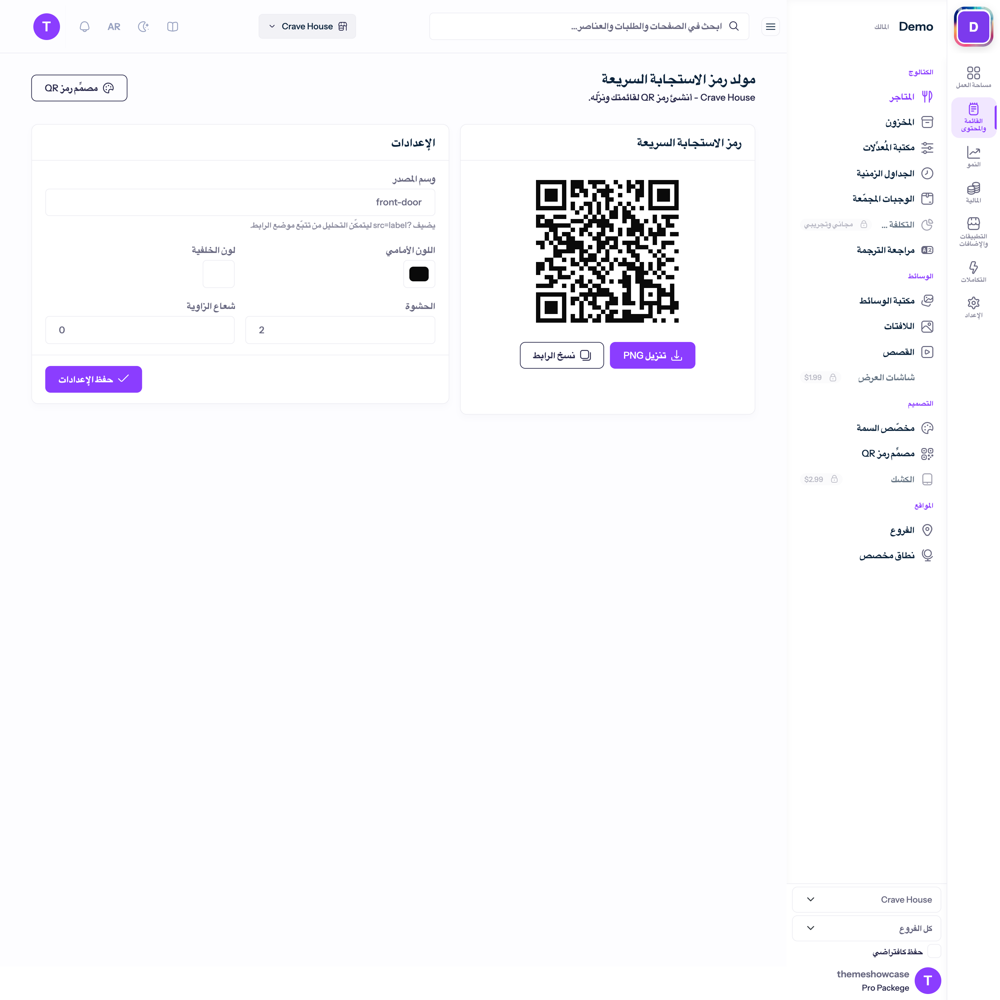

# رموز QR والمشاركة

لكل مطعم قائمة عامة على عنوان الويب الخاص به. ورموز QR هي الطريقة الرئيسية التي
يصل بها الزبائن إليها: يوجّهون كاميرا الهاتف نحو رمز على الطاولة أو الباب أو
نشرة، فتُفتح القائمة. يغطي هذا الدليل أداة إنشاء QR، والرموز لكل طاولة ولكل فرع،
والتنزيل والطباعة، وروابط الأطباق القابلة للمشاركة، وأين تجد الرابط العام نفسه.

## أين يوجد رابطك العام

يُبنى رابط القائمة العامة من معرّف مطعمك النصي (slug)، مثلًا
`https://yourdomain.com/your-restaurant`. لست مضطرًا لكتابته — فلوحة التحكم
تربطه لك.

في قائمة **المتاجر**، تحمل كل بطاقة مطعم صفًّا صغيرًا من الأيقونات في الزاوية
العلوية من صورة غلافها. تفتح أيقونة السهم القائمة العامة الحية في علامة تبويب
جديدة، وتفتح أيقونة QR أداة إنشاء QR. يستخدم كلاهما العنوان العام نفسه، فما
تعاينه هو تمامًا ما سيراه الزبون الذي يمسح رمزك.

إذا كنت قد أعددت [نطاقًا مخصصًا](custom-domain.md)، فسيستخدم الرابط العام ذلك
النطاق بدلًا من عنوان المنصة.

## أداة إنشاء QR

افتح أداة إنشاء QR من أيقونة QR على بطاقة مطعم، أو من قائمة مهام الإعداد، أو من
مخطط الأرضية. عنوان الصفحة **مولّد رمز QR** ولها جزآن: معاينة **رمز QR** حية على
اليسار ونموذج **الإعدادات** على اليمين.

يرمّز الرمزُ دائمًا رابطَ قائمتك الخاصة — لا يمكنك توجيهه إلى عنوان عشوائي.
ويحمل الرابط الموجود في الرمز أيضًا وسمَ تتبّع مسح مخفيًّا (`qr-id`) كي تُحتسب
الزيارات الواردة عبر الرمز مسحاتِ QR في [التحليلات](analytics.md) الخاصة بك.

يمكنك تخصيص مظهر الرمز:

- **لون المقدمة** — لون مربعات الرمز (الافتراضي قريب من الأسود).
- **لون الخلفية** — اللون خلف الرمز (الافتراضي أبيض).
- **الحشو** — الحد الهادئ حول الرمز، من 0 إلى 5 (الافتراضي 2). أبقِ بعض الحشو كي
  تجد الماسحات الرمز بموثوقية.
- **نصف قطر الزاوية** — يُدوِّر زوايا صورة المعاينة، من 0 إلى 50 بكسل بخطوات
  مقدارها 10 (الافتراضي 0). يؤثّر هذا في إطار الصورة، لا في النمط القابل للمسح.

تتحدّث المعاينة حيًّا مع تغييرك للألوان. استخدم مقدمة داكنة على خلفية فاتحة
للمسح الأكثر موثوقية؛ فالتباين المنخفض جدًا قد يجعل الرمز غير قابل للقراءة.

اضغط **احفظ هذه الإعدادات** لتخزين اختياراتك للون والحشو والقطر وتسمية المصدر كي
يُعاد استخدامها في كل مكان يُولَّد فيه الرمز.

### تسمية المصدر

يضيف حقل **تسمية المصدر** وسمًا قصيرًا إلى الرابط (`?src=your-label`) كي تعرف
تحليلاتك من أين جاء المسح — مثلًا `front-door` أو `flyer` أو `table-tent`. اكتب
تسمية قصيرة (حتى 64 حرفًا)؛ تُهذَّب تلقائيًا إلى معرّف نصي ملائم للرابط. استخدم
تسميات مختلفة على الرموز التي تضعها في أماكن مختلفة لمقارنة أي المواضع يجلب أكثر
المسحات.

## التنزيل والطباعة

في جزء المعاينة:

- **تنزيل PNG** يحفظ الرمز الحالي كصورة PNG عالية الدقة (1024×1024). استخدم هذا
  الملف للطباعة على حوامل الطاولات، أو الملصقات، أو الستيكرات، أو التغليف.
- **نسخ الرابط** ينسخ رابط القائمة الدقيق الذي يشير إليه الرمز، كي تلصقه في
  رسالة أو توقيع بريد إلكتروني أو نبذة على مواقع التواصل.

لا يوجد مربع حوار طباعة مدمج — نزّل ملف PNG واطبعه من برنامج الصور أو المستندات
الخاص بك بأي حجم تحتاجه. ولأن الرمز يُولَّد كمتجه ويُنقَّط عند 1024 بكسل، فإنه
يظل واضحًا حتى عند تكبيره لملصق.

## رموز QR لكل طاولة

إذا كانت باقتك تتضمن رموز QR للطاولات، يمكنك منح كل طاولة رمزها ورابطها الخاص.
الزبون الذي يمسح رمز طاولة يصل إلى القائمة وتلك الطاولة مرفقة به بالفعل، وهو ما
ينساب إلى الطلبات وطلبات مناداة النادل وخدمة الطاولة.

افتح **الطاولات وQR** — يظهر الزر على شاشة القائمة بأيقونة QR. عنوان الصفحة
**الطاولات ورموز QR**.

- اضغط **طاولة جديدة** وأدخل رقم طاولة لإنشائها.
- يحمل كل صف طاولة زر **QR** (يفتح أداة إنشاء QR معدَّة مسبقًا لتلك الطاولة)، وزر
  **نسخ الرابط** (ينسخ رابط تلك الطاولة الفريد)، وزر **تعديل**، وزر **حذف**.

عندما تفتح أداة إنشاء QR لطاولة محددة، تتيح لك قائمة **الطاولة** المنسدلة في
الإعدادات التبديل بين الطاولات، ويتضمن الرمز والرابط المولَّدان تلك الطاولة.
قائمة الطاولات مشتركة مع [مخطط الأرضية](floor-map.md)، فتعرض الشاشتان دائمًا
مجموعة الطاولات نفسها. وإذا كان لمطعمك أكثر من فرع، فإن أداة اختيار الفرع في
أعلى صفحة الطاولات تقصر القائمة على فرع واحد في المرة.

رموز QR للطاولات ميزة باقة. إذا لم تكن شاشة **الطاولات وQR** متاحة في حسابك، فإن
باقتك الحالية لا تتضمنها.

## رموز QR لكل فرع

إذا كان لعلامة مطعمك [فروع](branches.md) متعددة، يمكنك توليد رمز منفصل لكل موقع.
يفتح كل رمز فرع القائمة معدَّة مسبقًا لذلك الفرع، عارضةً أصنافه وأسعاره وساعات
عمله الخاصة.

افتح **الفروع** في الشريط الجانبي واضغط **رموز QR للفروع**. تعرض الصفحة بطاقة
لكل فرع، لكل منها صورة QR خاصة به، ورابط الفرع، وزر **فتح** لمعاينته، وزر
**تنزيل** يحفظ رمز ذلك الفرع كملف PNG.

## روابط الأطباق القابلة للمشاركة

على القائمة الموجَّهة للعميل، يمكن مشاركة الأطباق كلًّا على حدة. تحمل كل بطاقة
طبق زر مشاركة صغيرًا (أيقونة سهم مشاركة). النقر عليه:

- على الهواتف التي تدعمه، يفتح ورقة المشاركة الأصلية للجهاز باسم الطبق وسعره
  ورابط للقائمة — جاهزة للإرسال إلى WhatsApp أو الرسائل أو تطبيقات التواصل.
- على الأجهزة الأخرى، ينسخ الرابط إلى الحافظة (تتحول الأيقونة لحظيًّا إلى علامة
  صح للتأكيد)، مع العودة إلى مطالبة نسخ عند الحاجة.

يشير الرابط المشترَك إلى القائمة والطبق المحدد مثبَّت فيها، فيفتح المستلِم
القائمة عند ذلك الطبق. يتوفر زر المشاركة هذا في [ثيمَي](themes.md) العميل Aurora
وModern.

ملاحظة: تستخدم معاينة التواصل الاجتماعي الغنية (بطاقة الصورة والسعر الكبيرة التي
تعرضها بعض التطبيقات عند لصق رابط) حاليًا صورة ووصف مطعمك على مستوى المطعم، لا
صورة لكل طبق. صورة معاينة كل طبق الموصوفة في الخطط المبكرة ليست متاحة بعد — فما
زال الرابط يفتح الطبق الصحيح، لكن المعاينة المنشورة هي معاينة المطعم.

## نصائح

- اطبع الرموز كبيرة بما يكفي للمسح من مسافة ذراع — فالرمز على حامل طاولة ينبغي
  ألا يقل عن بضعة سنتيمترات عرضًا.
- اختبر كل رمز بكاميرا هاتف حقيقية قبل طباعة دفعة.
- استخدم تسميات المصدر لمقارنة المواضع، ورموزًا لكل طاولة أو لكل فرع كي تعرف
  بالضبط من أين نشأ كل مسح وطلب.
