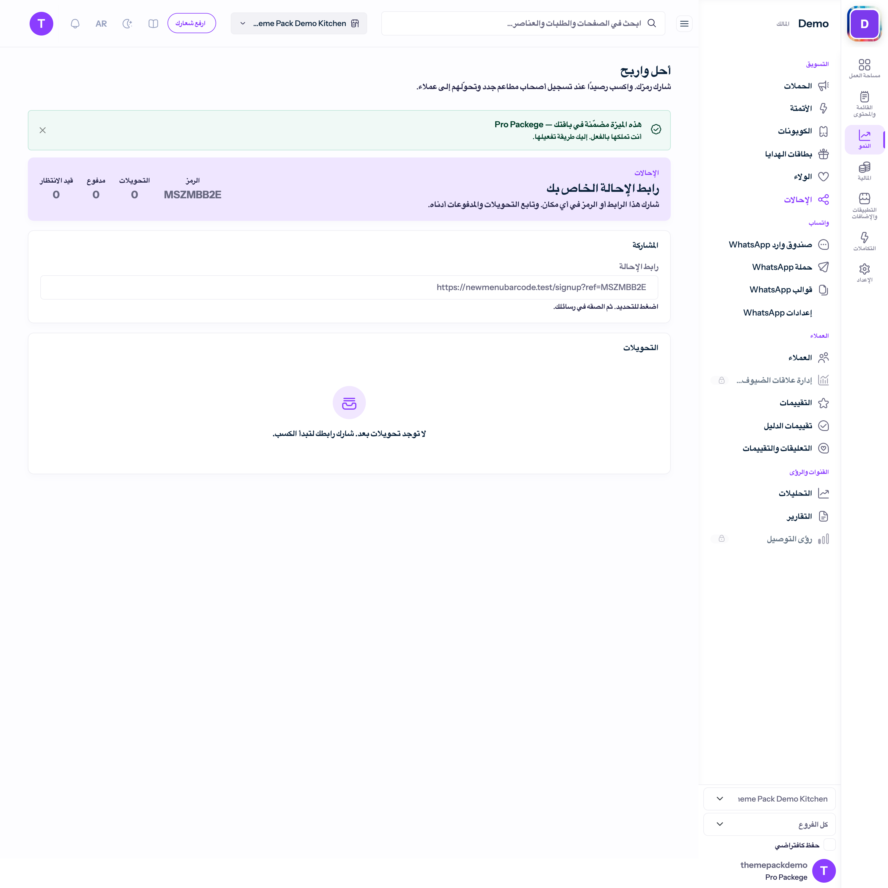

# برنامج الإحالة



يكافئك برنامج الإحالة — أنت مالك المطعم — على جلب مالكين جدد إلى المنصة. تحصل
على رمز إحالة شخصي ورابط مشاركة؛ وعندما يسجّل أحد عبره، تُنسب عملية التسجيل إليك
وتُدرَج مكافأة في قائمة الانتظار لمراجعة فريق المنصة. هذا منفصل عن
[برنامج الولاء](loyalty.md)، الذي يكافئ عملاءك على تكرار الطلبات.

## فتح صفحة الإحالة

انقر على **الإحالات** في الشريط الجانبي للوحة التحكم (أيقونة المشاركة). عنوان
الصفحة **أحِل واكسب** وتوجد على `/referral`. وهي متاحة لكل حساب مالك — لا شيء
يجب تفعيله أو ضبطه أولًا.

يُنشأ رمز الإحالة الخاص بك تلقائيًا أول مرة تفتح فيها الصفحة (أو أول مرة تسجّل
فيها)، فيكون لديك دائمًا واحد جاهز.

## رمزك ورابطك

يعرض شريط الترويسة **رمزك** الشخصي: ثمانية أحرف، حروف وأرقام، فريد لك (مثلًا
`K7KQ2M9F`). وأسفله، تحمل بطاقة **المشاركة** رابط إحالتك الكامل في حقل للقراءة
فقط — انقر على الحقل لتحديده، ثم انسخه والصقه في الرسائل أو منشورات التواصل أو
رسائل البريد الإلكتروني.

الرابط هو صفحة تسجيل المنصة (`/signup`) مع رمزك مرفقًا كمعامل `ref`:

```
https://your-platform.example/signup?ref=YOURCODE
```

يمكن لأي شخص أيضًا كتابة الرمز يدويًا — إلحاق `?ref=YOURCODE` بعنوان صفحة
التسجيل يعمل تمامًا كالنقر على رابطك. قبل أن تشارك، افتح الرابط المعبَّأ مسبقًا
مرة للتأكد من أنه يصل إلى صفحة التسجيل؛ فإن لم يفعل، شارك صيغة
`/signup?ref=YOURCODE` أعلاه بدلًا من ذلك.

## كيف تُتتبَّع الإحالات

1. **النقرة** — عندما يفتح أحد صفحة التسجيل برمز إحالة صالح، تُحتسب النقرة
   ويُتذكَّر الرمز في متصفحه لمدة **30 يومًا**. ولا يلزمه التسجيل على الفور.
2. **التسجيل** — إذا سجّل خلال تلك الأيام الثلاثين (على المتصفح والجهاز نفسه)،
   يُسجَّل **تحويل** على رمزك. ويُمسح الرمز المتذكَّر بعد استخدامه.
3. **تحويل واحد لكل حساب جديد** — لا يمكن نسبة مستخدم جديد إلا مرة واحدة، ولا
   يمكنك إحالة نفسك.

إذا مسح الزائر ملفات تعريف الارتباط، أو بدّل المتصفحات، أو سجّل بعد أكثر من 30
يومًا من النقر، فلا تُنسب عملية التسجيل.

## المكافآت والحالات

يبدأ كل تحويل كمكافأة رصيد معلَّقة (يحدّد المنصةُ المبلغَ — حاليًا رصيد ثابت لكل
تسجيل، وهو نفسه لكل مُحيل؛ وليس شيئًا يمكنك تغييره). ومن هناك يراجعه مسؤول
المنصة:

- **معلَّق** — مسجَّل، بانتظار مراجعة المنصة.
- **معتمَد** — مقبول من المنصة؛ يُحتسب ضمن أرباحك.
- **مدفوع** — دُفع الرصيد لك.
- **مرفوض** — رُفض (مثلًا، اشتباه بإساءة استخدام)؛ لا يكسب شيئًا.

يتولى فريق المنصة عمليات الدفع يدويًا — فاعتماد التحويل لا يضيف مالًا إلى حسابك
فورًا. إذا كان لديك تحويلات معتمَدة ولم تستلم الرصيد، تواصل مع دعم المنصة.

## قراءة إحصاءاتك

يعرض شريط الترويسة في صفحة الإحالة أربعة أرقام حية:

- **الرمز** — رمز إحالتك.
- **التحويلات** — إجمالي التسجيلات المنسوبة إليك، عبر كل الحالات.
- **مدفوع** — كم تحويلًا في الصفحة الحالية مدفوع.
- **معلَّق** — كم في الصفحة الحالية ما زال بانتظار المراجعة.

أسفل بطاقة المشاركة، يسرد جدول **التحويلات** كل تسجيل منسوب، الأحدث أولًا، 20 في
الصفحة:

- **مستخدم جديد** — اسم مستخدم الحساب الذي سجّل.
- **المكافأة** — مبلغ الرصيد المرفق بذلك التحويل.
- **الحالة** — الشارة الموصوفة أعلاه.
- **التاريخ** — منذ متى سجّل.

حتى أول تحويل لك، يعرض الجدول "No conversions yet. Share your link to start
earning."

## نصائح

- شارك الرابط الكامل بدلًا من الرمز المجرَّد — فالرابط يسجّل النقرة ويخزّن النسبة
  تلقائيًا.
- لا تُحتسب التسجيلات المُحالة إلا للحسابات الجديدة تمامًا. فدعوة موظفيك إلى مطعم
  قائم (انظر [حسابات الموظفين](staff.md)) ليست إحالة.
- رمز الإحالة المستخدَم داخل Menu Studio لأرصدة الذكاء الاصطناعي الإضافية نظام
  منفصل ولا يظهر في هذه الصفحة.

## صفحات ذات صلة

- [البدء](getting-started.md) — ما يراه المالك الجديد بعد التسجيل عبر رابطك.
- [أختام الولاء](loyalty.md) — مكافآت لعملائك، لا لك.
- [القسائم](coupons.md) — رموز خصم للطلبات على قائمتك الخاصة.
