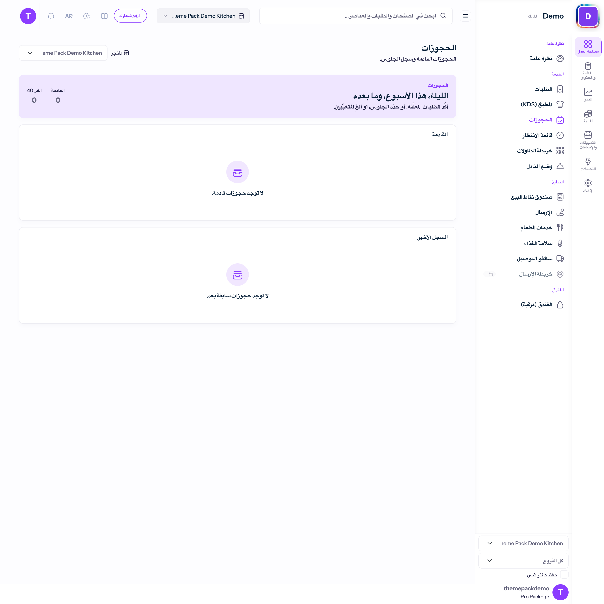

# الحجوزات

تجمع صفحة الحجوزات طلبات حجز الطاولات من قائمتك العامة وتتيح لك إدارتها عبر
دورة حياتها: راجِع الطلب، وأجلِس المجموعة عند وصولها، أو ألغِ حجزًا لم يحضر. يغطي
هذا الدليل مصدر الحجوزات، ومعنى كل حالة، وما يمكنك فعله من لوحة التحكم.

## أين تجدها

انقر على **الحجوزات** في الشريط الجانبي للوحة التحكم (أيقونة التقويم، أسفل
العملاء مباشرة وفوق قائمة الانتظار). الصفحة للمالك فقط وتعرض المطاعم التابعة
لحسابك فقط.

في أعلى الصفحة:

- إذا كان لديك أكثر من مطعم، تبدّل قائمة منسدلة في الزاوية العلوية اليمنى أي
  مطعم تعرض حجوزاته.
- إذا كان للمطعم المحدد فروع، يفلتر الفرعُ الذي اخترته في أداة تبديل سياق الشريط
  الجانبي القوائمَ أيضًا — فترى فقط حجوزات الفرع الحالي. راجع
  [الفروع](branches.md) لمعرفة كيف تعمل أداة التبديل.

يعرض شريط الترويسة عدّادين: كم حجزًا قادمًا لديك، وكم حجزًا سابقًا في قائمة
السجل أدناه.

## كيف تصل الحجوزات

يحجز الضيوف من صفحة قائمتك العامة: تدفق حجز **احجز طاولة** حيث يُدخل الضيف اسمه،
وهاتفه، وبريده الإلكتروني، والتاريخ والوقت، وعدد أفراد المجموعة (حتى 50)، وملاحظة
اختيارية. يُنشئ الإرسالُ حجزًا بحالة **معلَّق** ويعرض للضيف تأكيدًا في الحال.

أمران ينبغي معرفتهما عن الحجز العام:

- إنه اختياري لكل متجر ومعطَّل افتراضيًا. فعّله بإعداد **قبول حجوزات الطاولات**
  في صفحة تعديل المطعم. تعرض جميع قوالب القائمة الحديثة السبعة عشر تدفق الحجز
  بمجرد تفعيله — انظر [مصفوفة قدرات الثيمات](theme-capability-matrix.md).
- نموذج الحجز محدود المعدل (10 إرسالات في الدقيقة لكل زائر، إضافةً إلى حد لكل
  فرع) لمنع إساءة الاستخدام، ولا يقبل سوى التواريخ المستقبلية.

لا تُرسَل للضيوف رسالة تأكيد تلقائية بالبريد الإلكتروني أو الرسائل النصية —
تخبرهم الورقة "We'll confirm your booking shortly"، فالأمر متروك لك للتواصل معهم
عبر الهاتف أو البريد الإلكتروني الذي تركوه.

## صفحة الحجوزات

للصفحة قائمتان:

- **القادمة** — كل حجز مستقبلي ما زال حيًّا (معلَّق أو مؤكَّد)، مرتَّب من الأقرب
  أولًا. يعرض كل صف اسم الضيف وهاتفه، والتاريخ والوقت، وعدد أفراد المجموعة، وعمود
  طاولة، وشارة الحالة، وأزرار إجراءات سريعة.
- **السجل الأخير** — آخر 40 حجزًا مما هو في الماضي أو محلول بالفعل (جلس، أو
  أُلغي، أو لم يحضر)، الأحدث أولًا.

شارات الحالة ملوَّنة بالرموز: المؤكَّد أخضر، والمعلَّق كهرماني، والجالس أزرق،
والملغى أو الذي لم يحضر أحمر.

## الحالات

الحجز دائمًا في إحدى خمس حالات:

- **معلَّق** — طلب جديد من نموذج الحجز العام، بانتظار أن تتصرف حياله. تُحتسب
  الحجوزات المعلَّقة ضمن القادمة.
- **مؤكَّد** — مقبول. تحصل الحجوزات المنشأة عبر نقطة الإضافة الخاصة بلوحة التحكم
  على هذه الحالة تلقائيًا.
- **جالس** — وصلت المجموعة وجلست. يغلق هذا الحجز وينقله إلى السجل.
- **ملغى** — لن يحدث الحجز.
- **لم يحضر** — لم تصل المجموعة أبدًا. مثل الملغى، ينقل الحجز إلى السجل.

## تحديث حجز

لكل صف في قائمة القادمة زرَّا إجراء سريعين:

- **جالس** — اضغطه عند وصول المجموعة. ينتقل الصف إلى السجل الأخير.
- **ملغى** — اضغطه لإلغاء الحجز.

هذان هما الزران الوحيدان على الصفحة. لا يوجد زر "تأكيد" منفصل للطلبات المعلَّقة —
فالحجز المعلَّق يبقى ببساطة في قائمة القادمة حتى تُجلِسه أو تلغيه، لذا عامِل
الصفوف المعلَّقة كقائمة مهامك للوردية. (تقبل نقطة الحالة الأساسية أيضًا قيمتَي
المؤكَّد ولم يحضر، لكن الصفحة الحالية لا تعرض أزرارًا لهما.)

لا يمكنك تعديل تفاصيل ضيف الحجز أو وقته أو عدد أفراد مجموعته بعد إنشائه، ولا توجد
طريقة لإضافة حجز يدويًا من هذه الصفحة — انظر القائمة أدناه.

## تعيين الطاولة

تحوي قائمة القادمة عمود **طاولة**. يعرض رقم طاولة عند تسجيله مع الحجز، وشرطة في
غير ذلك. لا تتضمن الحجوزات العامة طاولة أبدًا، فعمليًا يكون هذا العمود فارغًا
عادةً.

لا يوجد حاليًا عنصر تحكم على الصفحة لتعيين طاولة أو تغييرها، ولا ترتبط الحجوزات
بالطاولات على [مخطط الأرضية](floor-map.md) في الواجهة — فهذا الربط مخطَّط لكنه
غير موصول بعد. إذا أردت تتبّع أي طاولة ينبغي أن تحصل عليها مجموعة، احتفظ بملاحظة
عند منصة الاستقبال في الوقت الراهن.

## غير متاح بعد

ما يلي مخطَّط أو موصول جزئيًا في الشيفرة، لكنك لن تجده في لوحة التحكم اليوم:

- نموذج لإضافة حجز حضور مباشر أو هاتفي يدويًا. نقطة الخادم موجودة (وتضع علامة
  مؤكَّد على هذه الحجوزات تلقائيًا)، لكن لا صفحة في لوحة التحكم تعرض النموذج بعد.
- رسائل تأكيد تلقائية بالبريد الإلكتروني أو الرسائل النصية للضيف. يوجد قالب بريد
  إلكتروني في الشيفرة لكن لا شيء يرسله.
- قواعد الإتاحة — ساعات العمل، أو الفترات الزمنية، أو حد للأشخاص لكل فترة. يقبل
  النموذج العام أي تاريخ ووقت مستقبليين، فالحجز المزدوج ممكن وينبغي أن تراجع
  الطلبات المعلَّقة فورًا.
- تعيين الحجوزات لطاولات مخطط الأرضية الحقيقية، بما في ذلك حارس الحجز المزدوج
  المدمج (لا حجزان نشطان على طاولة واحدة خلال 90 دقيقة). المنطق موجود على جانب
  الخادم لكنه غير موصول بأي شاشة.
- تذكيرات الحجز قبل موعد الحجز.

## صفحات ذات صلة

- [مصفوفة قدرات الثيمات](theme-capability-matrix.md) — قوالب القائمة التي تعرض
  تدفق الحجز.
- [مخطط الأرضية والطاولات](floor-map.md) — تخطيط صالة الطعام وحالات الطاولات
  الحية.
- [قائمة الانتظار](waitlist.md) — اصطفاف مجموعات الحضور المباشر عندما تمتلئ
  الصالة.
- [الفروع](branches.md) — كيف تقصر أداة تبديل سياق الفرع ما تراه.
- [الطلبات](orders.md) — الطلبات على الطاولة بمجرد جلوس المجموعة.
