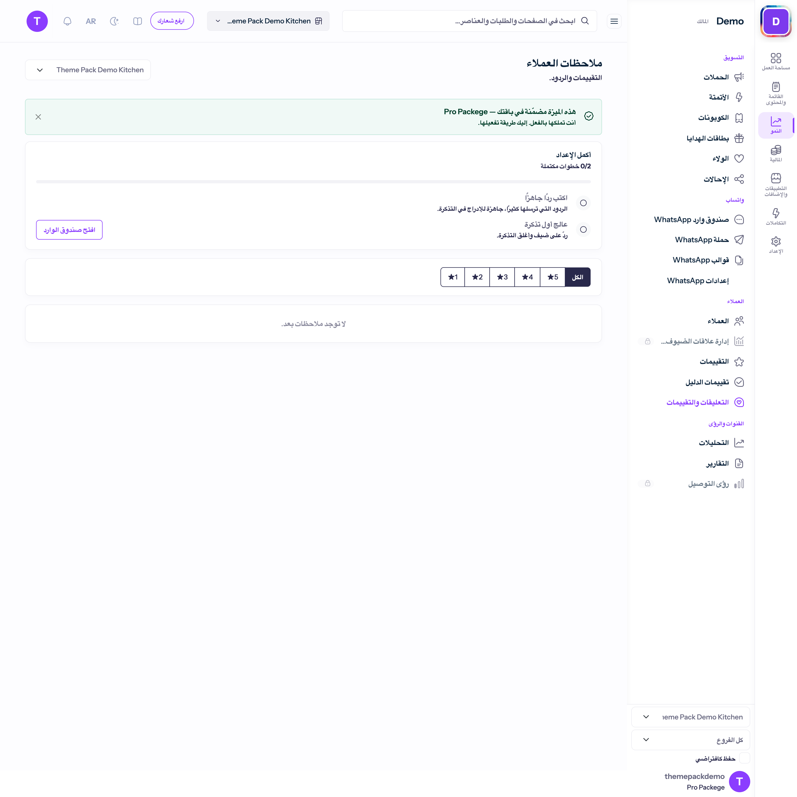

# المراجعات والتقييمات والملاحظات

تغطي هذه الصفحة الطرق الثلاث التي يمكن بها للزبائن تقييم طعامك ومشاركة ملاحظاتهم: تقييمات النجوم لكل صنف التي تشرف عليها، ومطالبة بعد الطلب تُرسل الزبائن السعداء إلى صفحة مراجعتك على Google، واستطلاع قصير "ما مدى احتمال أن توصي بنا" (NPS) يُعرض بعد إتمام الدفع.

هذه ميزات منفصلة لها مواضع مختلفة في لوحة التحكم. اقرأ الأقسام أدناه لترى أيها موصول بالكامل بواجهة متجرك اليوم وأيها يُجمَع في الخلفية.

## تقييمات الأصناف ومراجعاتها

يمكن أن يحمل كل صنف قائمة تقييم نجوم متوسطًا حقيقيًا (من 1 إلى 5) إضافةً إلى عدد، مخزَّنًا على الصنف ومعروضًا على بطاقة القائمة. تُسجَّل المراجعات في جدول `menu_reviews` ويمكنك الإشراف عليها.

كيف يُخزَّن التقييم عند إرساله:

- تُقيَّد الدرجة بين 1 و5.
- يُجرَّد أي نص مراجعة من HTML ويُقصَّر إلى 500 حرف.
- بصمة جلسة (IP + المتصفح + الصنف) تمنع الزائر نفسه من تقييم الصنف نفسه مرتين.
- تُحفظ المراجعات الجديدة معتمَدة فورًا، ويُعاد حساب متوسط الصنف وعدده على الفور.

ولأن المراجعات تُعتمَد تلقائيًا، يتحدّث التقييم العام للصنف دون أن تفعل شيئًا. تشرف بعد وقوعها برفض أي شيء غير مرغوب فيه (انظر أدناه)، ما يعيد حساب المتوسط.

مهم: الأداة الموجَّهة للزبون التي تتيح للعميل إرسال مراجعة صنف فعليًا ليست موصولة بقوالب الواجهة بعد. نقطة الإرسال (`POST {store}/review`، المسار `restaurant.submitReview`) وتسميات الأزرار موجودة، لكن لا ثيم حاليًا يعرض نموذج تقييم للزبائن. عمليًا، تبقى متوسطات الأصناف فارغة حتى تُضاف هذه الأداة، أو حتى تُنشأ التقييمات بطريقة أخرى. شاشة الإشراف وعرض المتوسط على البطاقة كلاهما مبنيّ وجاهز لحين وصولها.

## الإشراف على المراجعات

افتح المراجعات من الشريط الجانبي الأيسر (أيقونة النجمة). تفتح شاشة المراجعات لمطعمك على `stores/{store}/reviews`.

تعرض الصفحة:

- شريط ملخّص بمتوسط التقييم وأعداد المعلَّق / المعتمَد / المرفوض (تعكس الأعداد الصفحة الحالية من النتائج).
- قائمة مراجعات، 20 في الصفحة، الأحدث أولًا، كل منها يعرض صنف القائمة، ودرجة النجوم، ونص المراجعة، وشارة حالة، ومنذ متى تُركت.

لكل مراجعة يمكنك:

- الاعتماد — يضع علامة معتمَدة عليها ويضمّنها في المتوسط العام للصنف.
- الرفض — يضع علامة مرفوضة عليها ويزيلها من المتوسط.

يعيد الاعتماد أو الرفض حساب `rating_avg` و`rating_count` لذلك الصنف من المراجعات المعتمَدة المتبقية، فتتحدّث بطاقة القائمة العامة فورًا.

يُخزَّن نص المراجعة في حقل `body` في كل مكان (الإرسال، والتخزين،
وعرض الإشراف)، فتظهر درجة النجوم والتعليق المكتوب كلاهما
بشكل صحيح على شاشة الإشراف.

## أين تظهر التقييمات للزبائن

على قائمة العميل، تقرأ بطاقات الأصناف `rating_avg` / `rating_count` المخزَّنَين. يختلف السلوك بحسب الثيم: بعض الثيمات (مثل Vivid وVelvet) تعرض تقييمًا حقيقيًا فقط عند وجوده وتخفيه في غير ذلك، بينما ما زالت بعض الثيمات الأقدم تعود إلى رقم زخرفي بديل عندما لا يكون للصنف تقييمات حقيقية. إذا أردت تدقيق ثيم معيّن بخصوص هذا، انظر [الثيمات](themes.md).

## مطالبة مراجعة Google بعد الطلب

بعد أن يُتم الزبون طلبًا، يمكن للواجهة عرض بطاقة ودودة "تستمتع بوجبتك؟ اترك لنا مراجعة" بها زر يفتح صفحة مراجعتك على Google (أو غيرها) في علامة تبويب جديدة. ولا تظهر إلا إذا ضبطت رابط مراجعة.

لإعدادها:

1. اذهب إلى نموذج تعديل مطعمك (المطاعم، ثم عدّل المطعم).
2. جِد حقل رابط مراجعة Google والصق الرابط الكامل لصفحة مراجعتك.
3. احفظ.

بمجرد ضبطه، تظهر بطاقة المراجعة على شاشة نجاح الطلب في ثيمات Aurora وClassic وModern وOrange. ولا يعرضها كل ثيم واجهة — فإن لم يعرضها ثيمك، فببساطة لن تظهر البطاقة. يفتح الرابط في علامة تبويب جديدة ولا يقاطع تدفق إتمام الدفع أو الدفع أو WhatsApp — فلا إعادة توجيه تلقائية، مجرد زر. اترك الحقل فارغًا لإخفاء البطاقة.

## استطلاع NPS بعد تناول الطعام

تعرض شاشة نجاح الطلب في ثيمات Aurora وCrave وGlow وMatcha أيضًا استطلاعًا قصيرًا: "ما مدى احتمال أن توصي بنا؟" بأزرار من 0 إلى 10. عندما ينقر الزبون على رقم:

- تُحفظ الدرجة في جدول `nps_responses` على مطعمك.
- بصمة جلسة يومية تمنع الزائر نفسه من الإرسال أكثر من مرة في اليوم.
- تستبدل الأداةُ نفسَها برسالة شكر. في ثيم Aurora تتباين هذه الرسالة بحسب الدرجة (أدفأ للدرجات العالية، واعتذارية للدرجات المنخفضة)؛ وتعرض الثيمات الأخرى سطر شكر ثابتًا واحدًا.

تقبل نقطة الاستطلاع (`POST {store}/nps`، المسار `restaurant.submitNps`) أيضًا تعليقًا اختياريًا، وإن كانت أدوات الاستطلاع ترسل حاليًا الدرجة فقط.

ملاحظة: تُجمَع ردود NPS وتُخزَّن، لكن لا يوجد ملخّص أو تقرير NPS موجَّه للمالك في لوحة التحكم بعد. ولا توجد حاليًا شاشة مدمجة لعرض متوسط الدرجة أو التعليقات المجموعة. إذا احتجت هذه البيانات، فهي متاحة حاليًا من قاعدة البيانات مباشرة فقط.

## تحديد المعدل

كلتا نقطتَي إرسال المراجعة وNPS مقيَّدتا المعدل للحماية من البريد المزعج والإرسالات الآلية. وبالاقتران مع بصمتَي مرة لكل جلسة ومرة في اليوم، يُبقي هذا الإرسالات المتكررة خارجًا.

## ملاحظة عن صفحة الملاحظات العامة

صفحة "/feedback" الخاصة بالمنصة نفسها (في تصفّح الموقع الرئيسي) نموذج تواصل عام يرسل بريدًا إلى عنوان التواصل الذي ضبطته. وهي منفصلة عن تقييمات الزبائن واستطلاع NPS الموصوفَين أعلاه، وغير مرتبطة بأي مطعم أو طلب محدد.

## صفحات ذات صلة

- [أصناف القائمة](menu-items.md) — حيث تظهر تقييمات الأصناف على البطاقات.
- [الثيمات](themes.md) — أي ثيم واجهة يعرض مطالبات نجاح الطلب.
- [الطلبات](orders.md) — تدفق إتمام الدفع الذي تتبعه مطالبات المراجعة وNPS.
- [العملاء](customers.md) — التقاط تفاصيل تواصل الزبون عند إتمام الدفع.
