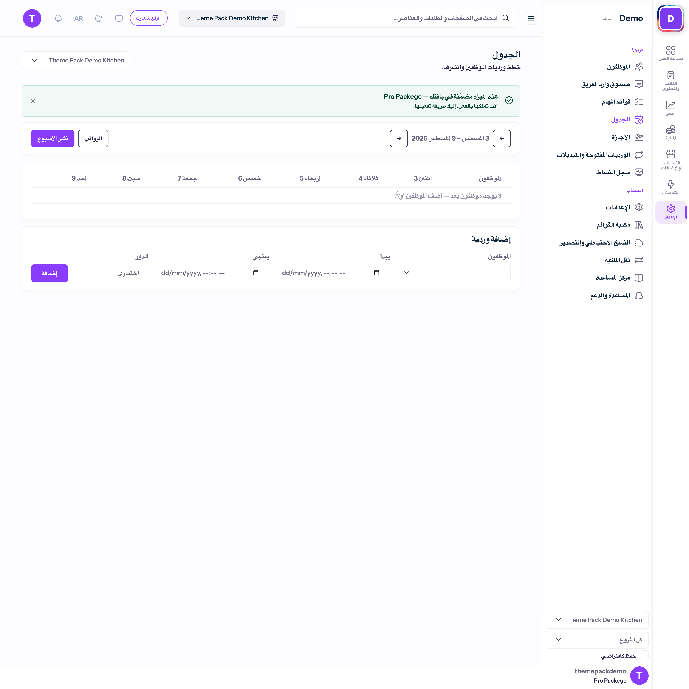

# جدولة الموظفين (الروتا)

الروتا شبكة أسبوعية: صف لكل موظف، وعمود لكل يوم. تضيف الورديات، وتنشر الأسبوع،
وعندها فقط يراه موظفوك. وتتولى صفحة مرافقة الورديات المفتوحة والمطالبات
والتبديلات.

كلتا الصفحتين مرتبطتان من مجموعة **الفريق** في الشريط الجانبي عند تفعيل ميزتهما:
**الجدول** (الشبكة الأسبوعية، على المسار `/rota` أيضاً) و**الورديات المفتوحة والتبديلات**
(على المسار `/rota-plus` أيضاً).

كلتا الصفحتين محكومتان بالميزات. تحتاج الروتا إلى تفعيل ميزة **Staff Rota &
Scheduling** (`staff_rota`) لحسابك؛ أما الورديات المفتوحة والتبديلات فتقع خلف
ميزة **دردشة الفريق** (`team_comms`). وإذا كانت الميزة مطفأة تظهر لك رسالة "not
included in your current plan" أو صفحة الترقية بدل الشاشة. انظر
[الخطط والفوترة](plans-billing.md).

يجب أن يوجد الموظفون قبل أن تتمكن من جدولتهم — أضفهم أولاً على صفحة
[الموظفين](staff.md).

## الشبكة الأسبوعية

افتح `/rota`. إذا كنت تملك أكثر من مطعم، اختر أيّها من القائمة المنسدلة أعلى اليمين؛
فتُعاد الصفحة تحميلاً لذلك المطعم.

يُظهر شريط الترويسة الأسبوعَ الذي تنظر إليه (من الاثنين إلى الأحد) مع سهمَي **←**
و**→** للتنقل أسبوعاً إلى الوراء أو الأمام، ورابط **الرواتب**، وزر
**نشر الأسبوع**.

تسرد الشبكة أدناه كل موظف في المطعم المختار مع دوره تحته، وسبعة أعمدة للأيام.
وتظهر كل وردية في خلية يومها بالصيغة `HH:MM–HH:MM`. وتُظلَّل الورديات المنشورة
بالأخضر؛ أما غير المنشورة فتظهر عادية بحدود، فتلمح بنظرة سريعة ما أُبلغ به فريقك وما
لم يُبلغ. وتحذف **×** على الوردية إياها فوراً.

إذا لم يكن للمطعم موظفون بعد ترى "No staff yet — add staff first."

## إضافة وردية

تأخذ بطاقة **إضافة وردية** أسفل الصفحة:

- **الموظفون** — يُختار من موظفي المطعم المحدد.
- **يبدأ** و**ينتهي** — منتقيات التاريخ والوقت. يجب أن تكون النهاية بعد البداية.
- **الدور** — نص حر اختياري، حتى 32 حرفاً (مثلاً "bar" أو "close"). هذا هو الدور
  المسجّل على الوردية، منفصلٌ عن دور الموظف نفسه.

الورديات الليلية لا مشكلة فيها — فقط اضبط تاريخ النهاية على اليوم التالي.

التداخلات مسموح بها لكنها مُعلَّمة: إذا تداخلت الوردية الجديدة مع وردية أخرى للشخص
نفسه، يقول التأكيد "Shift saved — note: it overlaps another shift for this staff
member." أما الورديات المتتالية (تنتهي إحداها تماماً حين تبدأ التالية) فلا تُحسب
تداخلاً.

لا توجد استمارة تعديل — ولتغيير وردية، احذفها بـ **×** وأضفها من جديد.

## نشر الأسبوع

تُنشأ الورديات الجديدة غير منشورة. ولا يرى الموظف وردية غير منشورة أبداً.

ينشر **نشر الأسبوع** كل وردية تقع بدايتها في الأسبوع الذي تعرضه حالياً (من الاثنين
00:00 إلى الأحد 23:59) للمطعم المحدد. ويخبرك التأكيد بعدد الورديات التي نُشرت.
والنشر مجدداً بعد إضافة مزيد من الورديات آمن — فهو ببساطة ينشر كل ما في ذلك
الأسبوع.

بمجرد النشر، تصبح ورديات الموظف متاحة لتطبيق الموظفين، الذي يقدّم الورديات ابتداءً
من اليوم وحتى 14 يوماً تالياً. هذه نقطة نهاية بيانات (`/staff-app/shifts`)؛ ولا
توجد بعد شاشة روتا في تطبيق الموظفين نفسه. انظر [تطبيق الموظفين](staff-app.md).

## الورديات المفتوحة والمطالبات والتبديلات

`/rota-plus` هي وحدة الموافقات للورديات غير المسندة ببساطة. ولها ثلاث لوحات للمطعم
المحدد:

- **الطلبات المعلقة** — ورديات طالب بها أحدهم، تظهر بوقت بداية الوردية ومعرّف الموظف
  المطالِب. وينقل **إعتماد** الوردية إلى ذلك الشخص، ويغلقها، ويعلّم المطالبة على
  أنها موافَق عليها.
- **الورديات المفتوحة** — الورديات المطروحة حالياً في المجمّع، مع شارة حالة مطالبتها إن
  وُجدت.
- **طلبات التبديل** — التبديلات في حالة المطلوب أو المقبول، تظهر بمعرّف الوردية
  ومعرّف الموظف الطالب ومعرّف الموظف المستهدَف. ولا يظهر **إعتماد** إلا على تبديل
  *مقبول*؛ والموافقة عليه تعيد إسناد الوردية إلى الموظف المستهدَف.

خلف الكواليس يسجّل النظام أيضاً توفّر الموظفين لكل يوم من الأسبوع
(مفضَّل / غير متوفر)، ويمكنه التحذير حين تقع وردية في يوم يكون فيه أحدهم غير متوفر
أو في إجازة موافَق عليها.

### ما لم يُبنَ بعد

- **لا يوجد زر "open this shift".** توجد نقطة النهاية التي تطرح الوردية في المجمّع،
  لكن لا شبكة الروتا ولا `/rota-plus` تعرض زراً يستدعيها. وعملياً لا يمتلئ المجمّع
  إلا إذا فُتحت الورديات بطريقة أخرى.
- **لا توجد شاشة مطالبة أو تبديل موجّهة للموظفين.** المطالبة بوردية مفتوحة، وقبول
  تبديل، وضبط التوفّر كلها مُنفَّذة في الخلفية، لكن تطبيق الموظفين لا يكشفها بعد —
  فقد يبقى `/rota-plus` فارغاً.
- **لا شاشة للتوفّر.** يُخزَّن التوفّر ويُستخدم لتحذيرات التعارض لكن لا توجد صفحة
  لإدخاله.

## تقرير الرواتب من الروتا

يفتح زر **الرواتب** على الروتا (أو `/rota/payroll` مباشرة) تقريراً للقراءة فقط.
وهو لا يحرّك أي مال — إنه ملخّص تصدّره.

اختر تاريخ **من** و**إلى** (افتراضياً: بداية هذا الشهر إلى اليوم) واضغط **تشغيل**.
ولكل موظف في المطعم المحدد تحصل على:

- **الساعات المجدولة** — الساعات من ورديات الروتا التي تبدأ في الفترة.
- **الساعات المنجزة** — الساعات من أزواج تسجيل الدخول/الخروج المكتملة. وإذا كان أحدهم لا
  يزال مسجَّل الدخول، لا يُحسب ذلك الزوج وتظهر شارة برتقالية "open" تبيّن عدد
  الأزواج غير المكتملة.
- **المعدل** — الأجر بالساعة للموظف.
- **ادفع** — الساعات المعمولة × الأجر.
- **الإكراميات** — الإكراميات على الطلبات التي قدّمها ذلك الموظف في الفترة.

ينزّل **تصدير CSV** الجدول نفسه باسم `payroll_<from>_<to>.csv`، بالأعمدة Staff،
Role، Scheduled hours، Worked hours، Open clock pairs، Rate، Pay، Tips.

هذا التقرير منفصل عن سير عمل تشغيل الرواتب الكامل — انظر [الرواتب](payroll.md).

## صفحات ذات صلة

- [الموظفون](staff.md) — أنشئ الموظفين الذين تجدولهم.
- [تطبيق الموظفين](staff-app.md) — حيث تُقدَّم الورديات المنشورة.
- [الموارد البشرية وملفات الموظفين](hr-employees.md) — الإجازات، التي تتعارض مع
  الورديات.
- [الرواتب](payroll.md) — تشغيل الرواتب وقسائم الأجور وتجميع الإكراميات.
