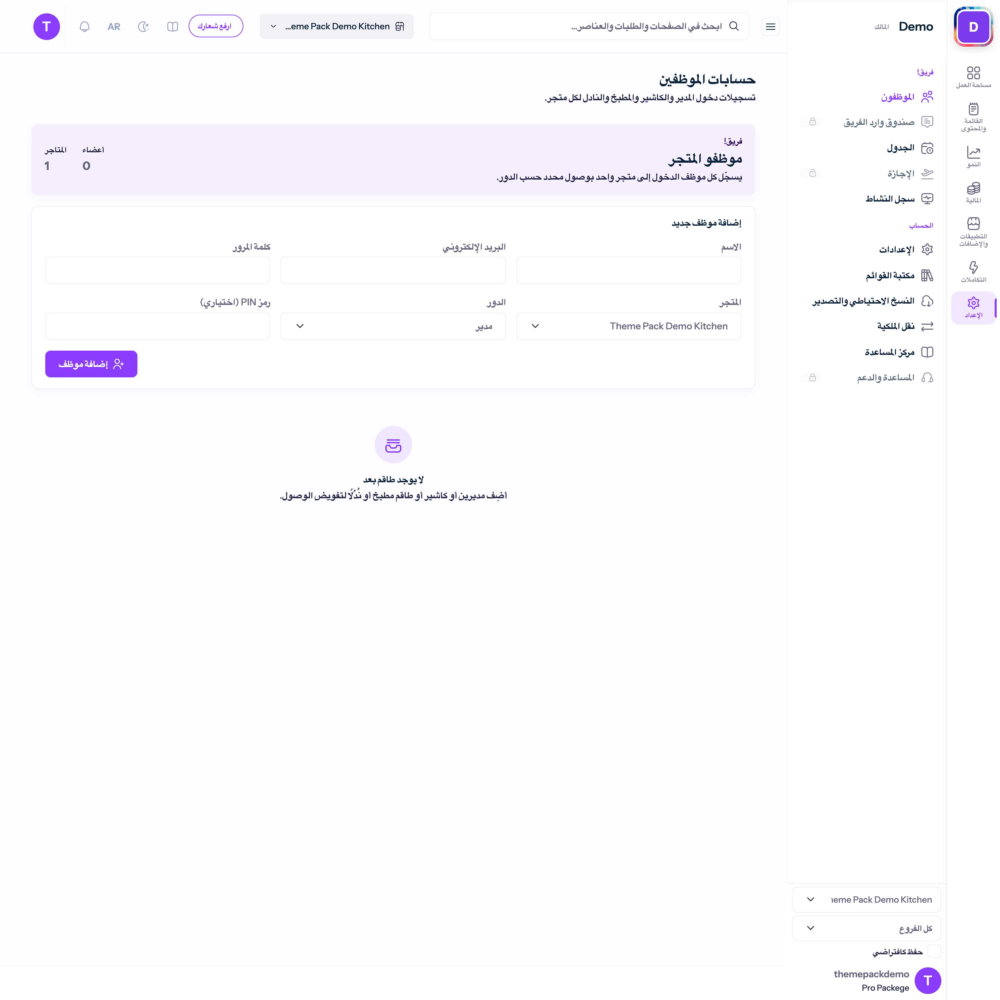

# الموظفون والأدوار

تتيح لك حسابات الموظفين منح فريقك حسابات دخول خاصة بهم بدل مشاركة كلمة مرور المالك. ينتمي كل موظف إلى مطعم واحد، ويسجّل الدخول ببريده الإلكتروني وكلمة مروره الخاصين، ولا يرى سوى أجزاء لوحة التحكم التي يسمح بها دوره. وتحتفظ أنت دائماً بصلاحية المالك الكاملة؛ بينما يحصل الموظفون على عرض مقلَّص من لوحة التحكم نفسها.

تدير الموظفين من عنصر **الموظفون** (أيقونة المستخدمين، ضمن مجموعة **الفريق**) في الشريط الجانبي للوحة التحكم.

## إضافة موظف

افتح **الموظفون** في الشريط الجانبي. إذا لم تكن قد أنشأت أي مطاعم بعد، لا تظهر استمارة الإضافة — أنشئ مطعماً أولاً. وإلا فاملأ استمارة **إضافة موظف جديد**:

- **الاسم** (مطلوب) — حتى 80 حرفاً.
- **البريد الإلكتروني** (مطلوب) — يجب أن يكون فريداً بين كل حسابات الموظفين. وهو ما يسجّلون به الدخول.
- **كلمة المرور** (مطلوب) — 6 أحرف على الأقل. شاركها مع الموظف؛ فيستخدمها لتسجيل الدخول.
- **المطعم** (مطلوب) — المطعم الوحيد الذي يمكن لهذا الشخص العمل فيه. والموظفون مقيَّدون بمطعم واحد.
- **الدور** (مطلوب) — مدير، أو أمين صندوق، أو مطبخ، أو نادل. انظر الجدول أدناه.
- **PIN (اختياري)** — رقم من 4 إلى 6 خانات يُستخدم لتسجيل الدخول السريع على أجهزة نقاط البيع/المطبخ المشتركة (انظر [تسجيل الدخول بـ PIN](#pin-sign-in)).

انقر **إضافة موظف** لإنشاء الحساب. ويصبح الموظفون الجدد نشطين فوراً.

يُدرَج الموظفون الحاليون أسفل الاستمارة، مجمّعين حسب المطعم، مع عرض الاسم والبريد الإلكتروني والدور وما إذا كان الحساب نشطاً. ولإزالة أحدهم، استخدم زر **إزالة** على صفّه وأكّد. وإزالة موظف تلغي وصوله في الحال.

بحسب ما هو مفعَّل لمتجرك، قد يحمل الصف أيضاً مفتاح **الوصول إلى حساب النزيل** (ميزات الفنادق — انظر أدناه) ورابط **ملف الموارد البشرية** (منظومة الموارد البشرية). ولا توجد اليوم استمارة تعديل عامة على هذه الصفحة — ولتغيير اسم شخص أو دوره أو رمز PIN أو كلمة مروره، أزل الحساب وأضفه من جديد.

## الأدوار وما يمكن لكلٍّ منها رؤيته

الدور حزمة ثابتة من الصلاحيات. وعند تسجيل موظف الدخول، يخفي الشريط الجانبي الأقسام غير المسموح له باستخدامها، ويحظر الخادم أيضاً الروابط المباشرة إلى تلك الصفحات (فيحصلون على خطأ "forbidden")، فلا يمكن الالتفاف على قيد الدور بكتابة رابط URL.

| Role | Can access |
| --- | --- |
| **مدير** | الطلبات، وتحرير القائمة، والكوبونات، والتحليلات، وKDS، والعملاء، ونقطة البيع (بما فيها الاستردادات وإغلاق الورديات)، وكشوف الفنادق (على المتاجر المفعّل فيها الفنادق) |
| **كاشير** | الطلبات، وKDS، ونقطة البيع |
| **المطبخ** | KDS فقط |
| **نادل** | الطلبات ونقطة البيع |

ما تفتحه كل صلاحية في لوحة التحكم:

- **الطلبات** — قائمة الطلبات: عرض الطلبات، وتحديث الحالة، والإكمال، والحذف.
- **تحرير القائمة** — فتح شاشة تحرير المطعم، وباني QR، وتحرير الفئات وأصناف القائمة (بما في ذلك التوليد بالذكاء الاصطناعي، والاستيراد/التصدير بـ CSV، والمتغيّرات والإضافات)، وحفظ إعدادات المطعم.
- **الكوبونات** — منطقة الكوبونات.
- **التحليلات** — لوحة التحليلات، والتصديرات، والمراجعات.
- **KDS** — نظام شاشة المطبخ (انظر [شاشة المطبخ](kds.md)).
- **العملاء** — قائمة العملاء، وتفاصيل العملاء، والتصديرات.

يحمل المديرون وأمناء الصندوق والنُّدُل أيضاً وصول نقطة البيع، الذي يحكم طرفية نقطة البيع و(للمديرين) الاستردادات وإغلاق الورديات. وتُفتح نقطة البيع من مشغّل **POS** لا من صفحة لوحة تحكم عادية — انظر [نقطة البيع](pos.md).

كل ما لا يُدرَج لدور ما محظور. فمثلاً، لا يستطيع موظف المطبخ فتح الطلبات أو التحليلات أو إعدادات المطعم. ولا يستطيع الموظفون أيضاً فتح صفحة إدارة الموظفين نفسها — فالمالك وحده من يضيف أعضاء الفريق أو يزيلهم.

## وصول الكشوف (متاجر الفنادق)

على المتاجر المفعّل فيها ميزات الفنادق، يُظهر كل صف موظف على صفحة **الموظفون** مفتاح **الوصول إلى حساب النزيل**. وهو يمنح أو يلغي صلاحية `hotel_folio` لذلك الشخص — الصلاحية التي تحكم شاشات كشوف حسابات النزلاء المالية وإجراءاتها: قائمة الإقامات والكشوف، وتسجيل الوصول، وتسوية الرسوم، وتسجيل المغادرة/الشطب.

**يملك المديرون وصول الكشوف افتراضياً** (كالاستردادات وإغلاق الورديات)؛ أما أمناء الصندوق والنُّدُل وموظفو المطبخ فلا يملكونه. اقلب المفتاح على صف لمنحه لغير مدير، أو لسحبه من مدير. ومن دون الصلاحية، يحصل الموظف على خطأ "forbidden" على شاشات الكشوف، ويُخفى عنصر التنقل **الإقامات**.

انظر [إقامات الفنادق وكشوف تحميل الرسوم على الغرفة](hotel-folios.md) لسير عمل الكشوف نفسه.

## ما يمكن للموظفين رؤيته عبر المطاعم والفروع

يرتبط الموظف بمطعم واحد بالضبط ولا يمكنه رؤية سوى طلبات ذلك المطعم وقائمته وتقاريره. ومحاولة فتح بيانات مطعم آخر تُعيد خطأ "forbidden"، حتى بالرابط المباشر. وهذا يُبقي كل فريق محصوراً بمكان عمله.

يتشارك الموظفون هيكل لوحة التحكم نفسه معك، لكن مبدّل المتجر لديهم مثبَّت على مطعمهم المسند إليهم. ويوجد التثبيت على مستوى الفرع في البيانات الأساسية لكنه لا يُضبَط من استمارة الإضافة الحالية، فيرى الموظفون كل فروع مطعمهم افتراضياً.

## كيف يسجّل الموظفون الدخول

يستخدم الموظفون صفحة تسجيل دخول منفصلة عن تسجيل دخول المالك:

- **تسجيل دخول الموظفين:** `/staff/login`

يُدخِلون بريدهم الإلكتروني وكلمة مرورهم كموظفين (مع خيار "remember me"). وعند النجاح يصلون إلى لوحة التحكم العادية على `/dashboard`، مقيَّدةً بدورهم. وإذا كان البريد أو كلمة المرور خاطئاً، أو كان الحساب قد أُزيل، يرون الرسالة "Invalid staff credentials or inactive account."

خلف الكواليس، يحمّل تسجيل الدخول كموظف أيضاً مساحة عمل المالك حتى تملك لوحة التحكم البيانات الصحيحة، لكن الموظف لا يرى أبداً سوى أقسامه المسموح بها. ويُسجَّل وقت آخر تسجيل دخول له.

لتسجيل الخروج، يستخدم الموظفون إجراء تسجيل الخروج، الذي يعيدهم إلى صفحة تسجيل دخول الموظفين. والعنوان القديم `/staff/portal` ليس وجهةً حقيقية — فزيارته تعيد التوجيه إلى لوحة التحكم فقط.

لا يستخدم الموظفون أبداً استمارة تسجيل دخول المالك. وإذا تعذّر على موظف الدخول، فتأكّد من أن: الحساب لا يزال موجوداً في قائمة Staff لديك، وأن البريد وكلمة المرور صحيحان، وأن الحساب نشط، وأنهم يستخدمون `/staff/login` لا تسجيل دخول المالك الرئيسي.

## تسجيل الدخول بـ PIN

رمز PIN الاختياري هو رمز من 4 إلى 6 خانات لتسجيل الدخول السريع على الأجهزة المشتركة — جهاز مطبخ لوحي أو طرفية نقطة بيع يتشاركها كثير من الموظفين. ولا يلزم أن تكون رموز PIN فريدةً إلا ضمن المطعم الواحد. ويُستخدم تسجيل الدخول بـ PIN في تطبيق الموظفين وطرفية نقطة البيع، لا في تسجيل الدخول عبر لوحة التحكم على الويب (الذي يستخدم دائماً البريد وكلمة المرور). وإذا تركت PIN فارغاً، يسجّل الموظف الدخول ببريده وكلمة مروره في كل مكان.

للتجربة الجوالة للموظفين (الطلبات، وKDS، وتسجيل الدخول للورديات، والإكراميات) التي تستخدم هذه الحسابات أيضاً، انظر [تطبيق الموظفين](staff-app.md).

## صفحات ذات صلة

- [إقامات الفنادق وكشوف تحميل الرسوم على الغرفة](hotel-folios.md) — شاشات الكشوف التي يحكمها مفتاح **الوصول إلى حساب النزيل**.
- [تطبيق الموظفين](staff-app.md) — تطبيق PWA للجوال الذي يستخدمه الموظفون للطلبات وKDS وتسجيل الدخول للورديات.
- [نقطة البيع](pos.md) — طرفية نقطة البيع التي يسجّل الموظفون دخولهم إليها.
- [شاشة المطبخ](kds.md) — شاشة KDS لدورَي المطبخ والمدير.
- [الطلبات](orders.md) — قائمة الطلبات التي يعمل منها الموظفون ذوو صلاحية الطلبات.
- [سجل النشاط](activity-log.md) — سجلّ للإجراءات، بما في ذلك وقت إنشاء الموظفين.
