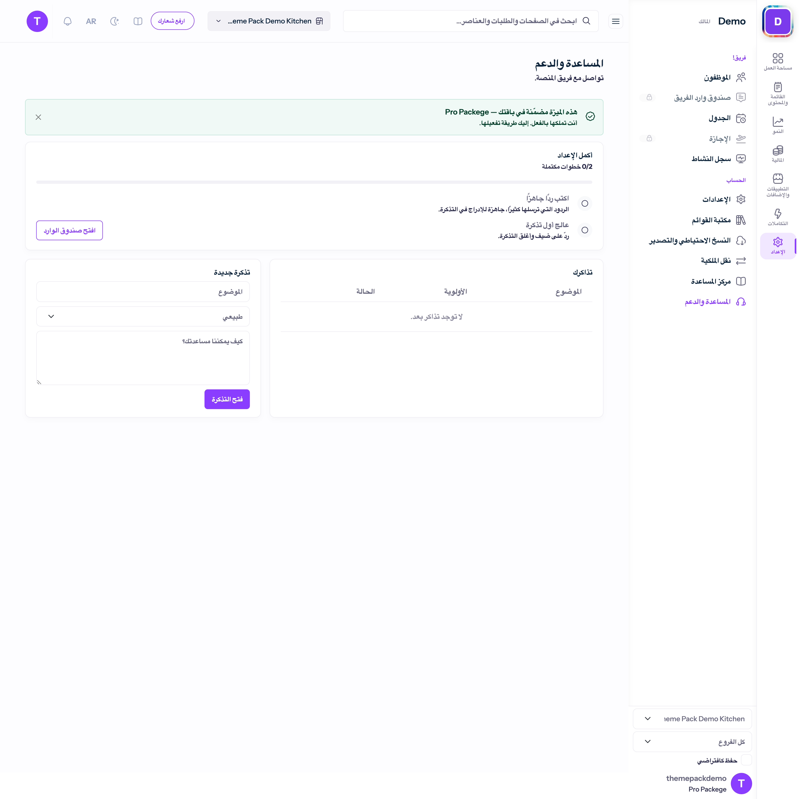

# تذاكر الدعم وصندوق ملاحظات العملاء

تُطرح شاشتان مترابطتان معاً خلف الميزة نفسها:

- **المساعدة والدعم** — تذاكرك الخاصة الموجّهة إلى فريق المنصة.
- **التعليقات والتقييمات** — تقييمات استبيان ما بعد الطلب التي يتركها لك زبائنك.

كلتاهما ميزتان مدفوعتان. وإذا كانت خطتك لا تشملهما، يعرض الشريط الجانبي عناصر
مقفلة بدل الصفحات.

---

# Help & support (تذاكر إلى المنصة)

استخدم هذا حين تحتاج إلى القائمين على المنصة، لا إلى عملائك.

## فتح الصفحة

انقر **المساعدة والدعم** في الشريط الجانبي ضمن **الإعداد ← الحساب**. الصفحة معنونة
بـ **المساعدة والدعم** وتقع على `help`. وهي لكل **حساب** لا لكل مطعم — فلا يوجد
مبدّل متجر، ولا ترى سوى التذاكر التي فتحتها.

## فتح تذكرة

في لوحة **تذكرة جديدة**:

- **الموضوع** — مطلوب، حتى 180 حرفاً.
- Priority — **منخفض**، أو **طبيعي** (الافتراضي)، أو **عالية**، أو **عاجلة**.
- **How can we help?** — مطلوب، حتى 4,000 حرف.

انقر **فتح التذكرة**. فتُنقَل مباشرة إلى محادثة التذكرة، وتبدأ التذكرة بالحالة
**مفتوح**.

## المحادثة

يسرد **تذاكرك** كل تذكرة فتحتها، الأحدث أولاً، مع موضوعها وأولويتها وحالتها.
انقر موضوعاً لفتح المحادثة.

تُظهر المحادثة كل رسالة مع **أنت** أو **الدعم** ككاتب لها، ومنذ متى أُرسلت.
ويقع مربع رد في الأسفل — اكتب وانقر **إرسال** (حتى 4,000 حرف). والرد يعيد التذكرة
إلى **مفتوح**.

بمجرد أن تصبح التذكرة **تم الحل** أو **مغلق** يختفي مربع الرد؛ افتح تذكرة
جديدة إن احتجت إلى المتابعة.

يمكن لموظفي الدعم ترك ملاحظات داخلية على تذكرتك. ولا تُعرَض لك تلك أبداً — فأنت لا
ترى إلا الرسائل الموجَّهة إليك.

---

# صندوق ملاحظات العملاء

يجمع صندوق الملاحظات تقييمات النجوم من استبيان ما بعد الطلب ويتيح لك الرد على كلٍّ
منها أو إغلاقها.

## من أين تأتي التقييمات

تنشئ المنصة طلب ملاحظات لكل طلب **مكتمل أو مسلَّم** قدّمه عميل مسجَّل الدخول، بعد
ساعتين من انتهاء الطلب. وتعمل عملية المسح كل ساعة وتنظر ثلاثة أيام إلى الوراء،
وتنشئ طلباً واحداً فقط لكل طلب. أما طلبات الضيوف فلا تولّد طلب ملاحظات أبداً.

يحصل العميل على رابط استبيان خاص. وعلى الاستبيان يختار من 1 إلى 5 نجوم ويمكنه
إضافة تعليق حتى 2,000 حرف. ولا يمكن استخدام الرابط إلا مرة واحدة — والعودة إلى
استبيان مكتمل تُظهر "This survey was already completed."

بعد أن يُرسلوا:

- **4 أو 5 نجوم** — يُوجَّهون إلى رابط مراجعتك العامة، إن كنت قد ضبطت واحداً لذلك
  المطعم.
- **1 إلى 3 نجوم** — يبقون على صفحة شكر خاصة، ويأتيك التقييم بدل أن يذهب إلى
  قائمة عامة.

كما تُكتَب تقييمات نجمة أو نجمتين في [سجل النشاط](activity-log.md) كإشارة تقييم
منخفض.

## فتح الصندوق

انقر **التعليقات والتقييمات** في الشريط الجانبي ضمن **النمو ← العملاء**، أو اذهب مباشرة إلى
`/customer-feedback`. الصفحة معنونة بـ **ملاحظات العملاء**؛ استخدم مبدّل المتجر
في ترويسة الصفحة لتبديل المطعم.

ترى حتى 100 تقييم مُجاب عنه لذلك المطعم، الأحدث تقديماً أولاً. وتُظهر أزرار
التصفية في الأعلى **الكل** أو تقييم نجوم مفرداً من 5★ نزولاً إلى 1★. أما الطلبات
التي لم يجب عنها العميل فلا تُدرَج.

تُظهر كل بطاقة تقييم النجوم، ومنذ متى قُدِّم، ورقم الطلب، وتعليق العميل، وردّك بمجرد
كتابته.

## الرد والإغلاق

على أي بطاقة غير مغلقة:

- اكتب في مربع **Reply…** وانقر **إرسال**. يُحفَظ ردّك على الملاحظة (حتى 2,000 حرف)
  ويُعرَض على البطاقة بصيغة "You replied". والإرسال مجدداً يستبدل الرد السابق.
- انقر **إغلاق** لتعليم الملاحظة على أنها عولجت. وتُظهر البطاقة المغلقة شارة
  **مغلق** وتفقد مربع الرد وزر الإغلاق معاً.

## النطاق والحدود

- الملاحظات محصورة بمطاعمك؛ وملاحظات مالك آخر تُعيد "not found".
- يُخزَّن ردّك على السجل لفريقك. ولا يُرسَل بالبريد الإلكتروني إلى الزبون من هذه
  الصفحة.
- الإغلاق باتجاه واحد من هذه الصفحة — فلا يوجد زر إعادة فتح.

## صفحات ذات صلة

- [المراجعات والتقييمات والملاحظات](reviews-feedback.md) — مراجعات الأصناف،
  وضبط المراجعات، وطلب مراجعة Google، واستبيان NPS.
- [الطلبات](orders.md) — الطلبات التي تُطلِق استبياناً.
- [العملاء](customers.md) — الزبائن وراء التقييمات.
- [سجل النشاط](activity-log.md) — حيث تُسجَّل إشارات التقييم المنخفض.
