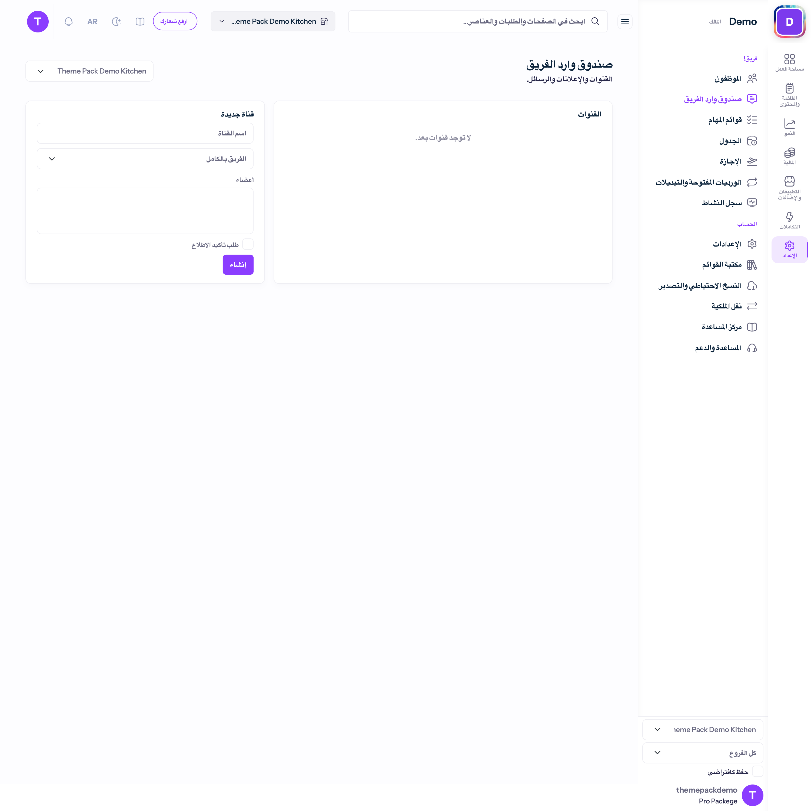

# صندوق الفريق وقوائم المهام وملاحظات الورديات

صندوق الفريق مراسلة داخلية لمطعمك: قنوات للفريق بأكمله، أو لمجموعات أصغر، أو
إعلانات باتجاه واحد. وتضيف الميزة نفسها قوائم مهام يومية للفتح والإغلاق، ولوحة
لملاحظات تسليم الوردية.

تحتاج هذه الصفحات إلى تفعيل ميزة **دردشة الفريق** (`team_comms`) لحسابك؛ ومن دونها
تحصل على "not included in your current plan" أو صفحة الترقية. انظر
[الخطط والفوترة](plans-billing.md).

لا توجد روابط في الشريط الجانبي. اذهب مباشرة إلى:

- **صندوق وارد الفريق** — `/team`
- **قوائم المهام وملاحظات الورديات** — `/team/checklists`

استخدم القائمة المنسدلة للمطعم أعلى يمين الصندوق إذا كنت تملك أكثر من مطعم.

## القنوات

يسرد `/team` قنواتك، الأحدث نشاطاً أولاً، لكلٍّ منها شارة نوعها وعدد أحمر للرسائل
التي لم تقرأها. ويظهر "No channels yet." حين لا توجد أي قنوات.

تنشئ بطاقة **قناة جديدة** واحدة:

- **اسم القناة** — حتى 120 حرفاً.
- **النوع** — **الفريق بالكامل**، أو **مجموعة**، أو **إعلان**.
- **أعضاء** — اختيار متعدد لموظفي المطعم. اضغط مفتاح Ctrl (Cmd على جهاز Mac)
  لاختيار عدة أشخاص. وأنت دائماً عضو في كل قناة تنشئها.
- **طلب تأكيد الاطلاع** — يعلّم القناة على أنها قناة يُتوقَّع فيها من
  الموظفين الإقرار بالرسائل، لا مجرد قراءتها.

لا يمكن إعادة تسمية القنوات أو أرشفتها أو حذفها من هذه الصفحة، ولا يمكن إضافة
أعضاء بعد الإنشاء.

## القراءة والنشر

انقر قناةً لفتح محادثتها. تظهر الرسائل الأقدم أولاً، لكلٍّ منها المرسِل ("You"
لرسائلك أنت، وإلا فمعرّف الموظف) ومنذ متى أُرسلت. وفتح المحادثة يعلّم كل ما فيها
على أنه مقروء لديك، فتُمسح شارة غير المقروء.

ينشر المربع في الأسفل رسالة — حتى 4000 حرف — بـ **إرسال**. والنشر يرفع القناة إلى
أعلى قائمة الصندوق.

الرسائل نص عادي. ولا توجد مرفقات أو تحرير أو حذف أو تفاعلات على هذه الصفحة، وتظهر
أسماء الموظفين كمعرّفات لا كأسماء في المحادثة.

## قوائم المهام

يشغّل `/team/checklists` مهامك المتكررة للفتح والإغلاق والمهام اليومية. ويختار
منتقي التاريخ أعلى اليمين اليومَ؛ وهو افتراضياً اليوم ويُعيد التحميل عند التغيير.

فتح الصفحة لتاريخ ما ينشئ مرات تنفيذ قائمة مهام ذلك التاريخ من كل قالب نشط، فتكون
قوائم اليوم موجودة ببساطة حين تصل. وفعل ذلك مرتين لا يكرّر شيئاً.

يسرد **قوائم مهام اليوم** كل مرة تنفيذ باسم قالبها، وشارة نسبة مئوية، وسطراً لكل
مهمة. انقر الدائرة لتأشير مهمة، وانقر مجدداً لإلغاء تأشيرها؛ ويُسجَّل من أشّرها
ومتى. وإذا لم يكن هناك شيء مجدوَل ترى "No checklists for this date."

### إنشاء قالب

تأخذ بطاقة **قالب قائمة مهام جديد**:

- **الاسم**
- **جدولة** — **الافتتاح**، أو **الإغلاق**، أو **يومي**
- **المنتجات** — مهمة واحدة لكل سطر في مربع النص؛ وتُتجاهَل الأسطر الفارغة.

اضغط **إنشاء**. يبدأ القالب بتوليد مرات تنفيذ من التاريخ التالي الذي تفتح فيه
الصفحة. ولا يمكن تحرير القوالب أو حذفها هنا، والجدول تسمية فحسب — إذ يولّد كل قالب
نشط مرة تنفيذ واحدة لكل تاريخ بغض النظر عن الجدول الذي اخترته.

## ملاحظات الورديات

بطاقة **ملاحظات الوردية** على الصفحة نفسها لوحة تسليم للتاريخ المحدد. تُدرَج الملاحظات
الموجودة لذلك التاريخ الأحدث أولاً؛ ويضيف المربع أدناه واحدة (حتى 2000 حرف) بـ
**إضافة ملاحظة**. وترتبط الملاحظات بالتاريخ المعروض في المنتقي. ولا يمكن تحريرها أو
حذفها.

## ما يراه الموظفون

تُدار القنوات وقوائم المهام والملاحظات الموصوفة هنا كلها من لوحة تحكم المالك. أما
الجانب الموجَّه للموظفين من محادثة الفريق — قراءة الموظفين للقنوات، والرد،
والإقرار بالإعلانات، أو تأشير قوائم المهام من هواتفهم — فلا يُكشَف بعد في تطبيق
الموظفين، فمن الأفضل اليوم عدّ هذا سجلاً للمالك والمدير لا محادثة ثنائية الاتجاه مع
فريقك.

## صفحات ذات صلة

- [الموظفون](staff.md) — الموظفون الذين تضيفهم إلى القنوات.
- [جدولة الموظفين](staff-scheduling.md) — الورديات المفتوحة والتبديلات، التي
  تستخدم ميزة Team Chat نفسها.
- [تطبيق الموظفين](staff-app.md) — ما يمكن لفريقك فعله من هواتفهم.
- [الخطط والفوترة](plans-billing.md) — تفعيل ميزة Team Chat.
