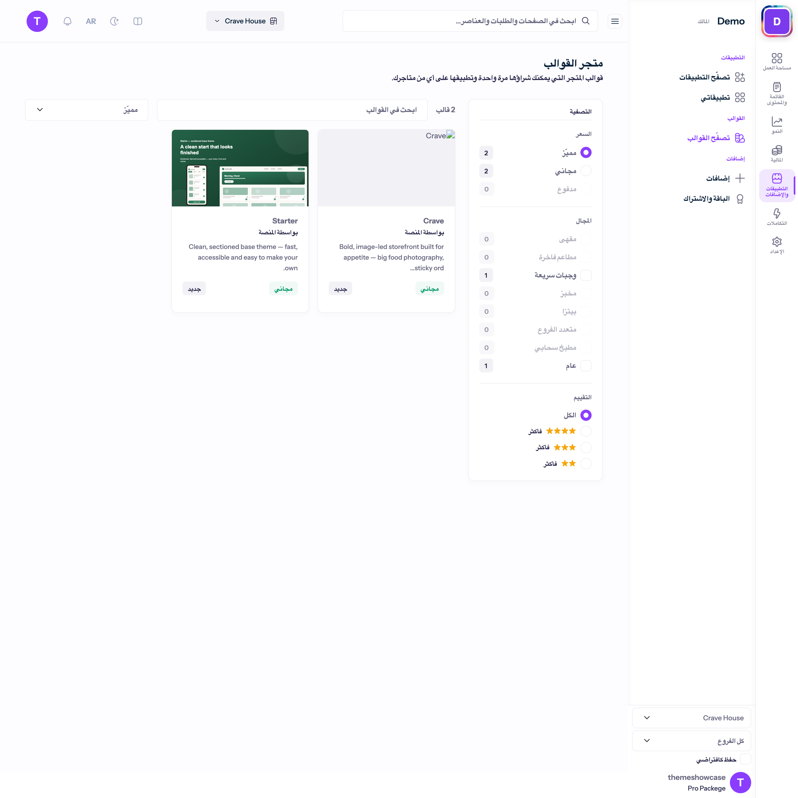

# سمات واجهة المتجر وأداة التخصيص

يُتحكَّم في مظهر قائمتك العامة من ثلاثة مواضع: أداة اختيار القالب في
صفحة تعديل المطعم (القالب الذي تستخدمه قائمتك)، وأداة تخصيص السمة
في الشريط الجانبي (الألوان والخطوط والنصوص والأقسام للقوالب التي تدعم
ذلك)، ومتجر السمات (سمات من جهات خارجية يمكنك شراؤها وتطبيقها).
يغطي هذا الدليل الثلاثة جميعًا، إضافة إلى الوضع الفاتح/الداكن والخطوط
المخصصة واللمسات الموسمية.

## اختيار قالب القائمة

يُعرَض كل مطعم من خلال قالب واحد. تختاره عند إنشاء المطعم، ويمكنك
تغييره في أي وقت:

1. اذهب إلى **المتاجر** في الشريط الجانبي وافتح صفحة تعديل المطعم.
2. افتح تبويب **التصميم** وابحث عن قسم **الصور والقالب**.
3. يعرض معرض القوالب كل قالب متاح كبطاقة تحمل صورة معاينة واسمًا
   ووصفًا مختصرًا. انقر على بطاقة لاختيارها ثم احفظ.

لا يمس تبديل القالب بيانات قائمتك أبدًا — تبقى العناصر والفئات والصور
والطلبات كما هي. يتغير تخطيط الصفحة العامة فقط.

ملاحظات:

- القائمة التي تراها منسَّقة من قبل المنصة. إذا سُحب قالب من أداة
  الاختيار، تستمر المطاعم التي تستخدمه بالفعل في عرضه — فلن تُجبر
  أبدًا على ترك قالب اخترته.
- تُطبَّق سمات المتجر من صفحة المتجر لا من هذا المعرض (انظر أدناه).
  يحتفظ المطعم الذي يستخدم سمة من المتجر باختياره في المكان نفسه،
  بحيث يعمل كل شيء آخر في صفحة التعديل بالطريقة ذاتها.

## أداة تخصيص السمة

افتح **مخصّص السمة** في الشريط الجانبي (أيقونة لوحة الألوان).
هذا محرر بلا برمجة: تغيّر القيم (الألوان والخطوط والعناوين ومفاتيح
التبديل)، وتعاينها بشكل خاص، وتنشرها عندما ترضى عنها. تدعمها جميع
القوالب الحديثة الرسمية الـ 17، وتجلب سمات المتجر مجموعات إعداداتها
الخاصة التي يحددها مطوّر السمة.

الأساسيات:

1. اختر مطعمًا من القائمة المنسدلة أعلى الصفحة.
2. تسرد اللوحة اليسرى إعدادات السمة في مجموعات خلف شريط أيقونات —
   الألوان والطباعة ونصوص المحتوى ومفاتيح تبديل الأقسام وما إلى ذلك،
   مع مربع بحث يعثر على أي إعداد عبر جميع المجموعات. تُظهر الإعدادات
   المعدَّلة شارة عدّاد لكل مجموعة، ولكل حقل زر إعادة تعيين خاص به،
   ويتراجع **Ctrl/Cmd-Z** عن آخر تعديلاتك (حتى 50 خطوة).
3. تعرض اللوحة اليمنى معاينة حية لقائمتك الفعلية تتحدث أثناء الكتابة —
   دون حاجة إلى الحفظ لرؤية التغيير. يمكنك تبديل المعاينة بين سطح
   المكتب والجوال، وبين لغات قائمتك (بما في ذلك اللغات من اليمين إلى
   اليسار مثل العربية).
4. تُحفظ التغييرات كـ **مسودة** مرئية لك وحدك. انقر **انشر** لجعلها
   حية؛ حتى ذلك الحين يظل الزبائن يرون آخر مظهر منشور، ويمكنك تجاهل
   المسودة في أي وقت. إذا غادرت الصفحة وثمة تغييرات غير محفوظة، يُطلب
   منك التأكيد أولًا.

ما وراء الأساسيات:

- **الإعدادات المسبقة ولوحات الألوان.** تأتي كل سمة بإعدادات مسبقة
  جاهزة بصور مصغّرة — مرِّر المؤشر لمعاينة أحدها على قائمتك الفعلية،
  وانقر لتجهيزه كمسودة (لا يُنشر الإعداد المسبق تلقائيًا أبدًا).
  وتمنحك مجموعة من لوحات الألوان المنسَّقة وزر خلط عشوائي وميزة
  **palette from logo** (التي تستخرج الألوان من شعارك المرفوع) نقاط
  انطلاق سريعة.
- **حارس التباين.** إذا فشل مزيج ألوان في تباين إمكانية الوصول، تظهر
  لافتة تحذير تسمّي الزوج وتعرض إصلاحًا بنقرة واحدة إلى أقرب درجة
  ناجحة. إنه يحذّر — ولا يمنع النشر أبدًا.
- **النقر للتعديل.** فعّل وضع التحديد وانقر على أي قسم مباشرة في
  المعاينة؛ يمرِّر المحرر إلى إعدادات ذلك القسم ويميّزها.
- **إعادة ترتيب الأقسام.** يمكن إعادة ترتيب السمات التي تُعرَض في
  أقسام بمقابض السحب (أو مفاتيح الأعلى/الأسفل) في مجموعة **الأقسام**.
- **نصوص لكل لغة.** في السمات التي تدعم ذلك، تُظهر إعدادات النص
  (العناوين، أسطر الترحيب) تبويبًا لكل لغة قائمة بحيث تحصل كل لغة على
  صياغتها الخاصة، مع رجوع منطقي إلى بديل عند ترك لغة فارغة.
- **منتقي الوسائط.** توفّر إعدادات الصور خيار **اختر من المكتبة**
  لتتمكن من إعادة استخدام أي شيء موجود بالفعل في
  [مكتبة الوسائط](media-library.md) بدلًا من إعادة رفعه.
- **أزواج الخطوط.** تقدّم الطباعة أزواج خطوط منسَّقة مستضافة ذاتيًا
  (كلها تدعم العربية)؛ وتُقدَّم الخطوط من المنصة، لا من شبكة توصيل
  محتوى (CDN) خارجية.
- **سجل الإصدارات.** يُؤخذ لكل نشر لقطة. تسرد لوحة السجل الإصدارات،
  وتُظهر ما تغيّر بين أي إصدار والحالة الراهنة، وتتراجع بنقرة واحدة
  (يُجهَّز التراجع كمسودة، لتراجعه قبل أن يصبح حيًا).
- **التصدير / الاستيراد.** نزّل إعدادات سمتك كملف JSON واستوردها في
  مكان آخر؛ يجري التحقق من صحة عمليات الاستيراد مقابل السمة وتُجهَّز
  كمسودة، مع تقرير بأي شيء تعذّر تطبيقه.
- **النسخ بين المتاجر.** انسخ مظهر متجر إلى متجر آخر من متاجرك ضمن
  عائلة السمة نفسها — يُجهَّز مجددًا كمسودة في المتجر الهدف.

يُعامَل كل ما تُدخله كبيانات ويجري التحقق من صحته مقابل مخطط إعدادات
السمة نفسها — لا تقبل أداة التخصيص أبدًا HTML أو نصوصًا برمجية أو CSS
خام، فلا يمكن كسر سمة (أو إساءة استخدامها) من خلالها.

إذا كان مطعمك يستخدم قالب Page View، تُظهر أداة التخصيص أيضًا لوحة
**مصدر عرض القائمة**: اعرض كتيّبًا مبنيًا من بيانات قائمتك الحية،
أو ارفع ملف PDF جاهزًا للطباعة (حتى 20 ميغابايت) لعرضه كما هو. عند
رفع ملف PDF يمكنك إضافةً النقر على **استيراد العناصر إلى قائمتي أيضًا**
ليقرأ الذكاء الاصطناعي ملف PDF ويضيف أطباقه كعناصر قائمة قابلة
للتعديل — لا تُستبدل العناصر الموجودة. انظر
[مولّد القائمة بالذكاء الاصطناعي](ai-menu-generator.md).

تُحفظ إعدادات أداة التخصيص لكل مطعم على حدة وتبقى صامدة أمام تحديثات
إصدار القالب في سمات المتجر.

## الوضع الفاتح والداكن

في صفحة تعديل المطعم، ضمن تبويب **التصميم** في قسم **Images and
template**، يقدّم منتقي **وضع المظهر** الخيارات **تلقائي** و **فاتح**
و **داكن**:

- **تلقائي** — تتبع القائمة إعداد جهاز الزبون.
- **فاتح** / **داكن** — تفرض ذلك المظهر على الجميع.

يدعم قالب Aurora هذا بالكامل: فهو يأتي بنسختين فاتحة وداكنة، ويحترم
اختيارك في Theme mode، ويُظهر للزبائن أيضًا مفتاح تبديل شمس/قمر على
القائمة نفسها. يُحفظ اختيار الزبون في مفتاح التبديل الخاص به على جهازه
ويتغلّب على إعدادك الافتراضي. تتبع بعض القوالب الأخرى (مثل Minimal)
إعداد الوضع الفاتح/الداكن لجهاز الزبون تلقائيًا لكنها لا تقرأ بعدُ
تجاوز Theme mode، وبعضها يأتي بمظهر واحد ثابت. أما أي قالب مدعوم بأداة
التخصيص فيمكنك دائمًا ضبط ألوانه مباشرة في أداة تخصيص السمة.

## الخطوط

طريقتان لتعيين خط قائمتك، وكلتاهما في صفحة تعديل المطعم ضمن تبويب
**التصميم** في قسم **الصور والقالب**:

- **خط القائمة** — قائمة منسدلة منسَّقة من خطوط الويب (Inter وPoppins
  وLato وMontserrat وRoboto وOpen Sans وRaleway وNunito وSource Sans 3
  وPlayfair Display وMerriweather وDancing Script وBebas Neue وSora)،
  أو "Default (system font)".
- **رفع خط مخصص** — ارفع خط علامتك التجاري الخاص كملف `.woff2`،
  حتى 2 ميغابايت. يُقبل تنسيق woff2 فقط. يستبدل رفع ملف اختيار القائمة
  المنسدلة؛ ويعيدك رابط **إزالة** بجانب الملف الحالي إلى القائمة
  المنسدلة/الافتراضي.

يُطبَّق الخط المختار عبر القائمة مع بديل آمن: إذا فشل تحميل الخط على
جهاز الزبون، ترجع القائمة إلى خط النظام بدلًا من أن تنكسر. تُظهر بعض
القوالب المدعومة بأداة التخصيص (مثل Aurora) أيضًا إعداد خط للنص
الأساسي داخل أداة تخصيص السمة، وينطبق على النص المنسَّق لتلك السمة.

## اللمسات الموسمية

يطبّق قالب Aurora تلقائيًا ألوان لمسات موسمية خفيفة خلال نوافذ
الأعياد — لمسة حمراء احتفالية من 1 ديسمبر إلى 6 يناير، ولمسة ذهبية
في أوائل أبريل كتقريب لرمضان. هذا تلقائي ومعتمد على التاريخ؛ ولا يوجد
حاليًا إعداد للمالك لفرض لمسة أو اختيار أخرى مختلفة أو إيقاف اللمسات،
ولا تطبّق القوالب الأخرى لمسات موسمية.

## متجر السمات

يسرد المتجر على `/marketplace` (المرتبط أيضًا من تنقّل الموقع) سمات
من جهات خارجية بناها مطوّرون مستقلون وراجعتها المنصة قبل النشر. تعرض
صفحة كل سمة:

- السعر (أو **مجاني**)،
- رابط **Live preview (demo store)** — السمة معروضة على بيانات
  نموذجية، لتتمكن من تجربتها قبل الشراء دون كشف قائمتك الخاصة،
- أدوات الشراء والتطبيق (سجّل الدخول أولًا).

الشراء والتطبيق:

1. في صفحة السمة، انقر **شراء الترخيص** (للسمات المدفوعة). يُخصم السعر
   من محفظة حسابك — اشحنها أولًا إذا كان الرصيد غير كافٍ. يرخّص الشراء
   الواحد حسابك بأكمله: يمكنك تطبيق السمة على أي عدد من مطاعمك، ولا
   يُحصّل منك ثمنها مرتين أبدًا عند شرائها مجددًا. تتخطى السمات
   المجانية هذه الخطوة.
2. اختر مطعمًا في القائمة المنسدلة **تطبيق على هذا المطعم** وانقر
   على تطبيق. تُعرَض قائمتك فورًا بأحدث إصدار منشور من السمة.

تُخصَّص سمات المتجر عبر أداة تخصيص السمة نفسها كالقوالب الرسمية،
باستخدام الإعدادات والأقسام التي حدّدها مطوّر السمة.

## تحديثات السمات

يشحن مطوّرو سمات المتجر التحسينات كإصدارات منشورة جديدة. لا تُفرَض
التحديثات على قائمتك أبدًا: يظل مطعمك مثبَّتًا على الإصدار الذي طبّقته
حتى تختار الانتقال، وتُحفظ إعدادات أداة التخصيص لديك عندما تفعل ذلك —
فالإعدادات تُخزَّن بمعزل عن الإصدار، عمدًا.

تكشف المنصة نقطة نهاية للمالك تسرد مطاعمك التي يتوفر لها إصدار منشور
أحدث وتطبّق التحديث (اختياريًا على إصدار منشور محدد بدلًا من الأحدث).
لا تتوفر بعدُ شاشة لوحة تحكم مخصصة لذلك؛ كما أن إعادة تطبيق السمة من
صفحتها في المتجر تنقل المطعم أيضًا إلى أحدث إصدار منشور.

## صفحات ذات صلة

- [البدء](getting-started.md) — إنشاء مطعم، بما في ذلك اختيار القالب
  الأولي.
- [رموز QR والمشاركة](qr-codes.md) — أين يوجد رابط قائمتك العامة.
- [مولّد القائمة بالذكاء الاصطناعي](ai-menu-generator.md) — استيراد
  PDF/الصور المستخدَم في زر الاستيراد بقالب Page View.
- للمطورين: يُغطّى بناء سمات المتجر وتقديمها في وثائق المطوّرين على
  [Learn: themes](../../dev/learn-themes.md).
