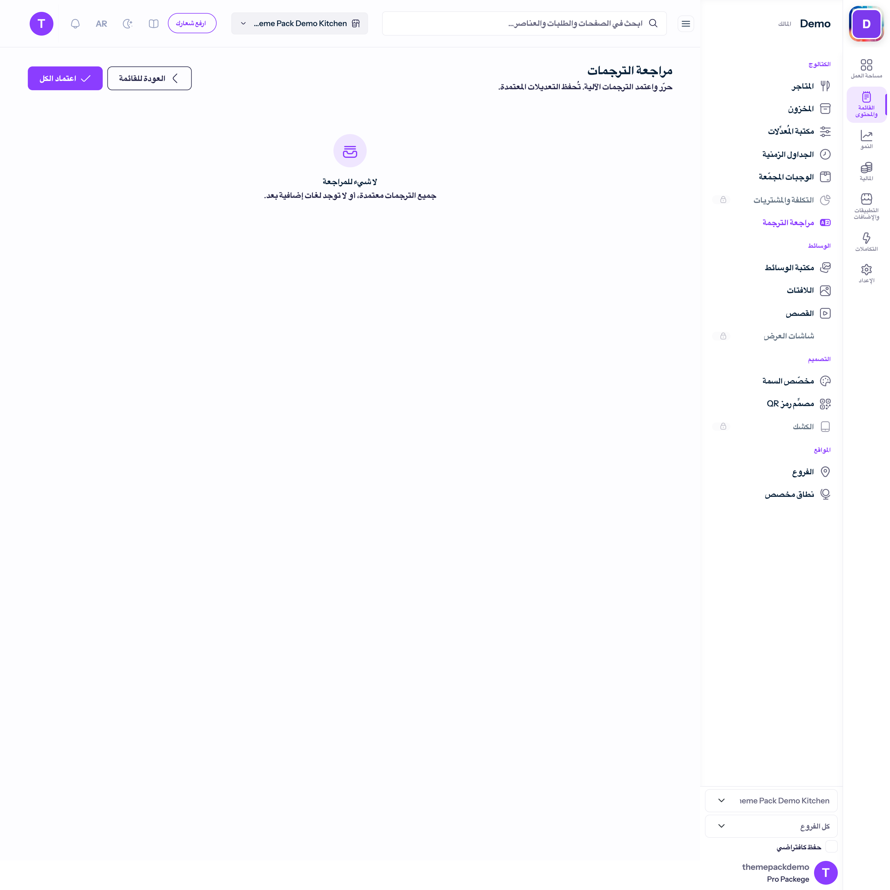

# ترجمات القائمة

قدّم قائمتك بعدة لغات. تكتب كل عنصر مرة واحدة بلغتك، وتدع الذكاء الاصطناعي يملأ اللغات الأخرى، ثم تراجع النتائج وتوافق عليها قبل أن يراها الزبائن. تُعالَج اللغات من اليمين إلى اليسار مثل العربية تلقائيًا.

## كيف تعمل الترجمات

يخزّن كل من الفئة والعنصر ووصف العنصر وخيار المتغيّر والإضافة نصه الأساسي إضافةً إلى مجموعة من الترجمات مفهرسة حسب اللغة. يرى الزبائن النسخة التي تطابق اللغة التي يختارونها في قائمتك العامة؛ وإذا كانت ترجمة مفقودة، يرجعون إلى النص الأساسي.

أنت لا تدير الترجمات حقلًا بحقل في محرر القائمة أبدًا. بل بدلًا من ذلك:

1. تختار اللغات التي تدعمها قائمتك وأيها الافتراضية (اللغة التي كُتب بها نصك الأساسي).
2. تشغّل الترجمة التلقائية بالذكاء الاصطناعي لملء الفراغات.
3. تراجع الترجمات الآلية وتوافق عليها.

## اختيار اللغات المدعومة

افتح مطعمًا، واذهب إلى Edit، ثم تبويب Languages.

- ضع علامة على كل لغة تريد تقديم قائمتك بها ضمن قائمة اللغات.
- اضبط Default Language على اللغة التي تُكتب بها فعليًا أسماء عناصرك وأوصافها. هذه لغتك المصدر.

قائمة اللغات المتاحة يتحكم فيها مسؤول المنصة، لذا لا يمكنك الاختيار إلا من بين اللغات التي جرى تفعيلها للمنصة.

تضبط أيضًا رمز عملتك وإشارتها وموضعها في التبويب نفسه. احفظ المطعم لتخزين اختياراتك.

## الترجمة التلقائية بالذكاء الاصطناعي

بمجرد أن يكون للمطعم أكثر من لغة قائمة واحدة، يظهر زر Translate missing في الإجراءات العلوية لمحرر القائمة (صفحة Menu الخاصة بالمطعم).

1. انقر Translate missing. يُفتح مربع حوار بعنوان "Translate menu with AI".
2. أكّد الحقل "My menu is currently written in" — هذه هي اللغة المصدر التي يترجم منها الذكاء الاصطناعي. يكون افتراضيًا لغتك الافتراضية المحفوظة.
3. يعرض مربع الحوار اللغات التي ستُملأ فيها الترجمات المفقودة.
4. انقر Start translation.

مهم: اختر اللغة التي كُتبت بها عناصرك فعليًا. إذا ترجمت من لغة لم تُكتب بها قائمتك، أو من قائمة فارغة، فستحصل على نتائج خاطئة أو فارغة. ترفض الأداة العمل إذا لم يكن في قائمتك فئات أو عناصر.

إذا اخترت لغة مصدر تختلف عن لغتك الافتراضية المحفوظة، يصبح ذلك الاختيار اللغة الافتراضية الجديدة للمطعم.

### ماذا يُترجَم

يملأ الذكاء الاصطناعي الفراغات فقط. لكل لغة هدف، يترجم:

- أسماء الفئات
- أسماء العناصر وأوصافها
- عناوين خيارات المتغيّرات
- عناوين الإضافات

لا يمس أبدًا ترجمة عدّلتها ووافقت عليها يدويًا. ولا يعيد ترجمة ترجمة آلية إلا عندما تكون قد غيّرت منذ ذلك الحين النص الأساسي الكامن وراءها (تُوسَم الترجمة القديمة عندئذ بأنها متقادمة).

### أثناء التشغيل

تعمل الترجمة في الخلفية لأن استدعاءات الذكاء الاصطناعي بطيئة. يعرض الزر تقدمًا حيًا ("Translating French (2/4)"، وهكذا) ويعيد تحميل الصفحة عند الانتهاء. إذا ظل على "Waiting to start" لفترة طويلة، فقد لا يكون العامل الخلفي (cron) على موقعك قيد التشغيل — تواصل مع مزوّدك.

عند الانتهاء ترى ملخصًا مثل "Translation complete. 12 items, 3 categories."

### نبرة الترجمة والمسرد

ضمن Edit، يحتوي تبويب Marketing على قسم "AI menu translation" فيه إعدادان اختياريان يشكّلان مخرجات الذكاء الاصطناعي:

- Translation tone — Neutral (افتراضي)، أو Formal، أو Casual.
- Glossary — مصطلح واحد لكل سطر. اكتب مصطلحًا بمفرده لإبقائه دون تغيير في كل لغة (مثل اسم علامة تجارية كـ "Big Mac")، أو اكتب "term = translation" لفرض ترجمة محددة (مثل "Coke = كوكاكولا").

المسرد مفيد لأسماء العلامات التجارية والأطباق المميزة والكلمات التي كان الذكاء الاصطناعي سيترجمها بشكل خاطئ لولاه.

## مراجعة الترجمات والموافقة عليها

لا يُوثَق بالترجمات الآلية حتى توافق عليها. انقر Review translations (بجانب Translate missing) لفتح شاشة المراجعة.

يعرض كل عنصر وفئة ما زال يحتاج إلى انتباه نصه المصدر وصفًا لكل لغة. تحمل كل ترجمة شارة حالة:

- Missing — لا ترجمة بعد.
- AI — مملوءة بترجمة آلية، لم تُعتمد بعد.
- Outdated — كانت مترجمة آليًا، لكنك عدّلت النص الأساسي منذ ذلك الحين، لذا تحتاج إلى إعادة الترجمة.
- Low confidence — كان الذكاء الاصطناعي غير متأكد من هذه النتيجة؛ تحقق منها بعناية.
- Approved — روجعت ومُوثوق بها.

للموافقة على الترجمات:

- عدّل النص في مربع Translation (وDescription translation) إذا لزم الأمر، ثم انقر Save & approve في ذلك الصف. يمسح هذا علامة الآلية ويميّزها بأنها معتمدة.
- أو انقر Approve all في الإجراءات العلوية لقبول كل ترجمة آلية كما هي في خطوة واحدة.

تعلّم الموافقة على ترجمة أو تعديلها النظامَ أيضًا: سيُعيد استخدام صياغتك المعتمدة للنص المصدر نفسه في المرة القادمة، لذا نادرًا ما تصحّح العبارة نفسها مرتين.

تختفي من شاشة المراجعة الصفوف التي اعتُمدت فيها كل لغة، لذا فإن الشاشة الفارغة تعني أنه لم يبقَ شيء للمراجعة.

## اللغات من اليمين إلى اليسار

تُوسَم اللغات بأنها من اليسار إلى اليمين أو من اليمين إلى اليسار من قبل مسؤول المنصة. عندما يعرض زبون قائمتك بلغة من اليمين إلى اليسار مثل العربية أو العبرية أو الفارسية، تقلب القائمة العامة اتجاه تخطيطها تلقائيًا — لا تُعدّ أنت أي شيء. يُظهر مثال المسرد أعلاه ("Coke = كوكاكولا") نصًا عربيًا مخزَّنًا كترجمة ثابتة.

## لغة لوحة التحكم

تغطّي ترجمات القائمة ما يراه الزبائن. أما لوحة التحكم نفسها — كل صفحة
وقائمة وزر ورسالة تعمل فيها أنت وطاقمك — فهي أيضًا مترجمة بالكامل،
بما في ذلك ترجمات كاملة بالعربية والأردية والهندية والروسية
والصينية، مع تطبيق تخطيط من اليمين إلى اليسار تلقائيًا للعربية
والأردية. إذا كان مسؤول منصتك قد فعّل منتقي اللغة، يظهر منتقٍ للغة في
الشريط العلوي للوحة التحكم؛ واللغات المعروضة هي تلك التي فعّلها
المسؤول للمنصة.

## تصدير الترجمات واستيرادها

إذا كنت تفضّل الترجمة في جدول بيانات، يتضمن تصدير القائمة بصيغة CSV عمود `name_<code>` وعمود `description_<code>` لكل لغة غير افتراضية، ويقرأ الاستيراد تلك الأعمدة نفسها مجددًا. انظر [استيراد القائمة وتصديرها](menu-import-export.md).

## صفحات ذات صلة

- [عناصر القائمة](menu-items.md)
- [فئات القائمة](menu-categories.md)
- [استيراد القائمة وتصديرها](menu-import-export.md)
- [مولّد القائمة بالذكاء الاصطناعي](ai-menu-generator.md)
