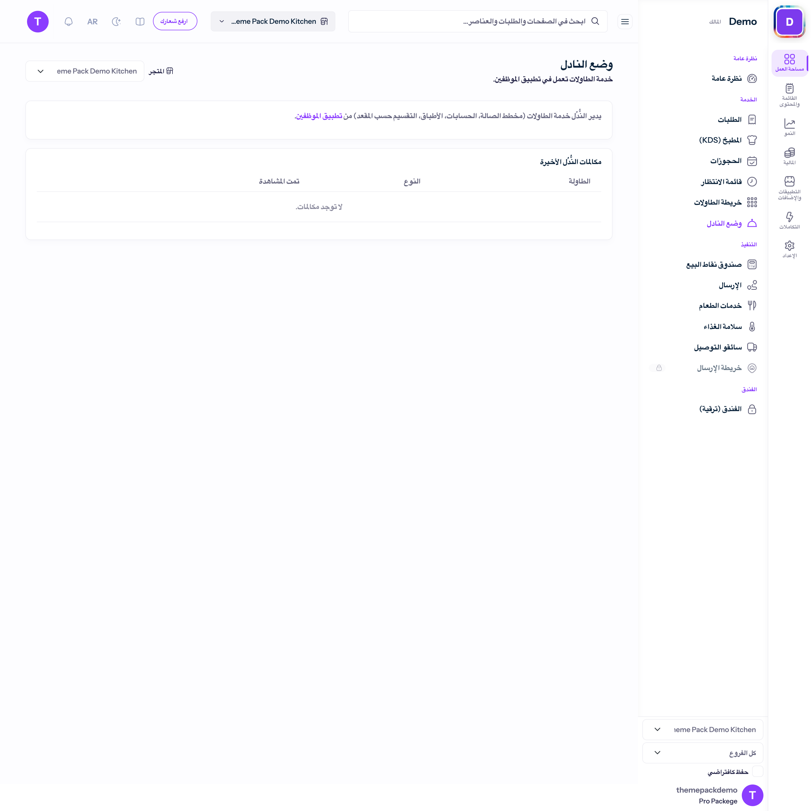

# وضع النادل



وضع النادل هو طبقة الخدمة بجانب الطاولة: يعمل النُّدُل على طلب عند
الطاولة — بإضافة عناصر إلى فاتورة مفتوحة، وتعليق الأطباق وإطلاقها،
وتقسيم الفاتورة حسب المقعد، ودمج طاولتين — ويستجيبون لنقرات "call
waiter" و"request bill" التي يجريها الزبائن من قائمة QR.

جانب لوحة التحكم منه عبارة عن وحدة تحكم **وضع النادل** صغيرة واحدة
تعرض نداءات النُّدُل الأخيرة. أما العمل الفعلي بجانب الطاولة فيحدث في
[تطبيق الطاقم](staff-app.md).

## فتح وحدة التحكم

لا يوجد رابط في الشريط الجانبي لهذه الصفحة. افتحها مباشرة على:

```
/waiter-mode
```

استخدم منتقي المتجر في شريط إجراءات الصفحة لتبديل المطعم الذي تنظر
إليه. لا يوجد بالصفحة منتقي فرع.

تعرض وحدة التحكم شيئين:

- سطرًا يوجّه النُّدُل إلى تطبيق الطاقم للعمل بجانب الطاولة.
- **مكالمات النُّدُل الأخيرة** — أحدث 30 نداءً للمطعم المختار، مع **الطاولة**
  و **النوع** (Call waiter أو Request bill) و **تمت المشاهدة** (علامة صح بمجرد
  أن يُقرّ نادل بالنداء، وشرطة خلاف ذلك).

هذه القائمة للقراءة فقط. لا يمكنك الإقرار بنداء من لوحة التحكم؛ فذلك
يحدث في تطبيق الطاقم.

## من أين تأتي نداءات النُّدُل

يرفع الزبون نداءً من قائمة واجهة المتجر على هاتفه، لذا لا يظهر الزر
إلا عندما:

- يكون **نداء النادل** مضبوطًا على Yes في تبويب إعدادات **الطلبات**
  للمطعم (عدّل المطعم)، و
- يكون الزبون في جلسة على الطاولة (QR عند الطاولة).

يُسجَّل نوعان: `call_waiter` و `request_bill`. يخزّن كل نداء رقم
الطاولة وعلامة رؤيته — لا شيء عن الزبون.

## الخدمة بجانب الطاولة في تطبيق الطاقم

السطح الفعلي لوضع النادل هو مجموعة من نقاط نهاية تطبيق الطاقم ضمن
`/staff-app/waiter/…`. تتطلب كل واحدة منها كل ما يلي، وإلا رفضت:

- أن يكون عضو الطاقم مسجّل الدخول في [تطبيق الطاقم](staff-app.md)؛
- أن يكون المتجر مسموحًا له باستخدام وضع النادل (انظر
  [تشغيله](#turning-it-on))؛
- أن يمتلك عضو الطاقم صلاحية **الطلبات** (انظر [الطاقم](staff.md)).

ما تفعله طبقة الخدمة بجانب الطاولة:

- **حالة القاعة** — كل طاولة عليها طلب مفتوح، وحالة مشتقة: `seated`
  (طلب لكن دون عناصر)، أو `ordered`، أو `food_ready` (كل عنصر جاهز أو
  مُقدَّم)، أو `check_requested` (الطلب مطلوبة فاتورته أو معلّق).
- **إضافة عناصر إلى طلب مفتوح** — عنصر وكمية ورقم مقعد (1–99) ورقم
  طبق (1–9) لكل سطر، مع علامة **تعليق** اختيارية. العناصر المنفدة
  (المعلَّمة بـ 86) والعناصر من مطعم آخر تُتخطى بدلًا من أن تُضاف. لا
  يُدخل النادل الأسعار أبدًا؛ ويُشتق إجمالي الطلب دائمًا من القائمة.
- **إطلاق طبق** — تدخل العناصر المعلّقة لرقم ذلك الطبق طابور المطبخ
  وتحصل على طابع زمني للإطلاق. حتى الإطلاق، يبقى العنصر المعلّق على
  الطلب لكنه لا يصل أبدًا إلى [KDS](kds.md).
- **التقسيم حسب المقعد** — يُرجع مجموعًا فرعيًا لكل مقعد مبنيًا من سعر
  القائمة لكل عنصر، باستخدام رقم المقعد المسجَّل على السطر. تقع
  العناصر بلا مقعد في المقعد 0.
- **دمج طاولتين** — ينقل كل عنصر من طلب مفتوح إلى طلب آخر في المطعم
  نفسه. يُلغى الطلب المصدر ويُختم بملاحظة "merged into #N"، فيصبح
  الدمج قابلًا للتتبع.
- **نداءات النُّدُل** — يسرد النداءات غير المرئية، ويعلّم واحدًا بأنه
  مرئي.

ملاحظة: هذه السلوكيات مبنية ومُقيَّدة بالبوابات، لكن شاشات تطبيق
الطاقم لا تعرض بعدُ تبويب نادل. اليوم يُظهر تطبيق الطاقم (PWA)
الطلبات وعرض القاعة وإنشاء الطلبات بجانب الطاولة وعرض المطبخ وقوائم
المهام والرسائل — أما نقاط نهاية وضع النادل أعلاه فهي قابلة للوصول
لكن ليس لها زر خاص بها بعد.

## تشغيله

وضع النادل ميزة مُقيَّدة بالبوابات. لا يعمل إلا عند تحقق كلا الشرطين:

- أن يكون مفتاح الإيقاف على مستوى المنصة لـ `waiter_mode` مشغَّلًا
  (إعداد للمشرف الأعلى — ويأتي **مطفأً** افتراضيًا)، و
- أن تتضمنه خطة مالك المتجر (`waiter_mode` مُقيَّد بالخطة؛ راجع قائمة
  ميزات خطتك).

إذا فشل أي من التحققين، تُحجب صفحة وحدة التحكم وتُرجع كل نقطة نهاية
نادل في تطبيق الطاقم رمز 403. انظر [الخطط والفوترة](plans-billing.md).

## صفحات ذات صلة

- [تطبيق الطاقم](staff-app.md) — كيف يسجّل الطاقم الدخول، وعرضا القاعة
  والمطبخ.
- [خريطة القاعة والطاولات](floor-map.md) — تخطيط صالة الطعام الذي تأتي
  منه أرقام الطاولات.
- [نظام عرض المطبخ (KDS)](kds.md) — حيث تصل الأطباق المُطلَقة.
- [تقسيم الفاتورة](split-bill.md) — تقسيم الفاتورة من جانب لوحة التحكم.
- [الطاقم](staff.md) — صلاحية **الطلبات** التي يتطلبها وضع النادل.
