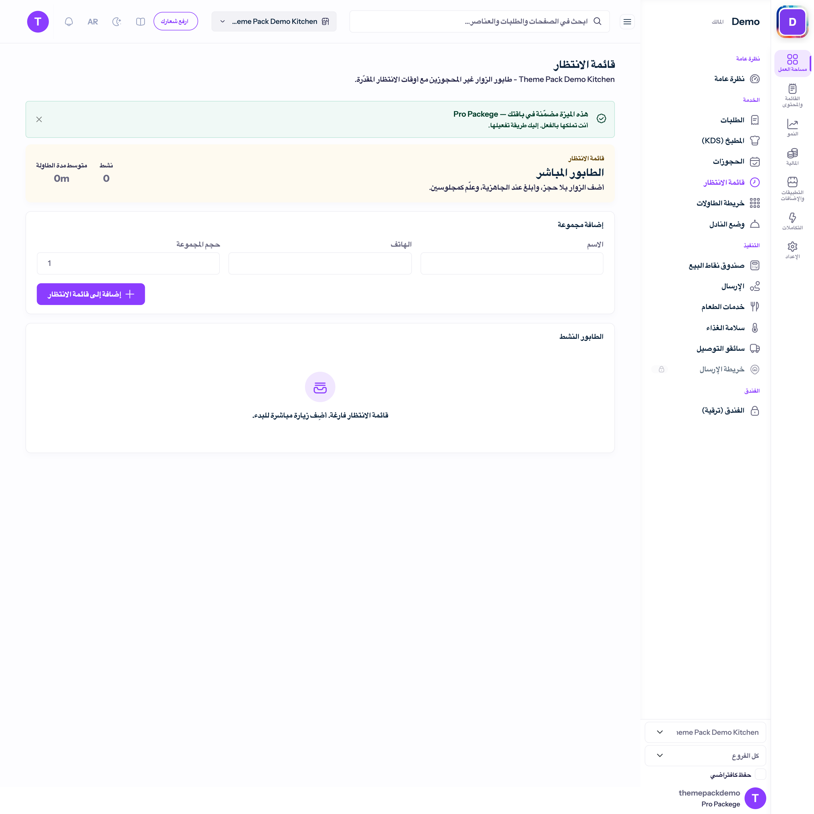

# قائمة الانتظار

عندما تمتلئ صالة الطعام لديك، تتيح لك قائمة الانتظار إضافة المجموعات الوافدة إلى طابور، ومنح كل واحدة وقت انتظار تقديريًا، ومراسلتها نصيًا عندما تصبح طاولتها جاهزة، وتعليمها بأنها جلست أو غادرت. إنها تحلّ محل القائمة الورقية عند منضدة الاستقبال.

## أين تجدها

في الشريط الجانبي للوحة التحكم، افتح **قائمة الانتظار** (أيقونة الساعة). يظهر الرابط بمجرد أن يكون لديك مطعم واحد على الأقل، ويفتح طابور مطعمك الأول. يحتفظ كل مطعم بقائمة انتظار منفصلة خاصة به.

تتكون الصفحة من أربعة أجزاء: شريط عدّ حي في الأعلى، ونموذج **إضافة مجموعة**، وجدول **الطابور النشط**، وجدول **السجل الأخير** تحته.

## إضافة مجموعة وافدة

املأ نموذج **إضافة مجموعة** واختر **إضافة إلى قائمة الانتظار**:

- **الاسم** — مطلوب، حتى 120 حرفًا.
- **الهاتف** — اختياري، حتى 30 حرفًا. أضفه إذا أردت مراسلة الضيف نصيًا عندما تصبح طاولته جاهزة.
- **حجم المجموعة** — مطلوب، رقم من 1 إلى 99.

تنضم المجموعة الجديدة إلى أسفل الطابور بالحالة **قيد الانتظار**. يخزّن النظام لها وقت انتظار مُقدَّرًا على الفور (انظر أدناه).

## كيف يعمل تقدير الانتظار

وقت الانتظار المُقدَّر لكل مجموعة تقدير بسيط: موضعها في الطابور مضروبًا في متوسط وقت دوران الطاولة. يكون متوسط وقت الدوران افتراضيًا **20 دقيقة**، ويُظهر الشريط العلوي القيمة المستخدمة حاليًا بوصفها **متوسط مدة الطاولة**.

التقدير تقريبي عمدًا. يُحسب مرة واحدة، عند إضافة المجموعة، من عدد المجموعات المنتظرة أمامها بالفعل. ولا يُعاد حسابه تلقائيًا مع تحرّك الطابور، لذا عامل الرقم المُقدَّر كدليل تقريبي لا كوعد.

## إدارة الطابور

يسرد جدول **الطابور النشط** كل مجموعة ما زالت **قيد الانتظار** أو **تم الإشعار**، مرتبةً بحسب وقت انضمامها (الأقدم أولًا). عمود **#** هو موضعها الحي. لكل مجموعة لديك هذه الإجراءات:

- **إشعار** — يظهر فقط بينما المجموعة ما زالت **قيد الانتظار**. يخبر الضيف بأن طاولته جاهزة (التفاصيل أدناه).
- **إجلاس** — يعلّم المجموعة بأنها **تمت الجلسة** ويزيلها من الطابور النشط.
- **غادر** — يعلّم المجموعة بأنها **غادر** (غادرت أو لم تحضر) ويزيلها من الطابور النشط.

تسقط المجموعات التي جلست والتي غادرت من القائمة النشطة وتنتقل إلى **السجل الأخير**، التي تعرض أحدث 50، بالأحدث أولًا.

## إخطار الضيف بأن طاولته جاهزة

يؤدي اختيار **إشعار** لمجموعة منتظرة أمرين:

1. إذا أعطت المجموعة رقم هاتف، تُرسل لها رسالة نصية: اسمها، واسم مطعمك، وملاحظة للحضور إلى منضدة الاستقبال.
2. تغيّر حالتها إلى **تم الإشعار** وتسجّل الوقت.

بعض الأمور التي يجب معرفتها:

- **عدم وجود رقم هاتف** لا بأس به. تظل المجموعة معلَّمة بـ **تم الإشعار**؛ لكن لا توجد رسالة نصية لإرسالها، فنادِ على اسمها عند المنضدة.
- **يُحترَم إلغاء الاشتراك.** إذا كان رقم الضيف قد ألغى الاشتراك من رسائلك النصية، فلا تُرسل أي رسالة وتبقى المجموعة **قيد الانتظار** مع ملاحظة تطلب منك مناداتها بالاسم بدلًا من ذلك. يستخدم هذا قائمة إلغاء الاشتراك نفسها المستخدمة في رسائلك النصية الأخرى.
- **تستخدم الرسائل النصية إعداد SMS الخاص بك.** تمر رسائل جاهزية الطاولة عبر خدمة SMS نفسها التي تمر بها رسائل طلباتك ورموزك لمرة واحدة، فتستخدم بيانات اعتماد SMS التي أعددتها. إذا لم تكن قد ربطت مزوّد SMS حيًا، تُحاكى عملية الإرسال وتُسجَّل بدلًا من تسليمها فعليًا — تظل الحالة تتحدث فيعمل سير العمل، لكن الضيف لن يستقبل رسالة نصية حقيقية حتى يتوفر مفتاح مزوّد حي. انظر [WhatsApp والرسائل النصية](whatsapp.md).

## السماح للضيوف بالانضمام من هواتفهم

يمكن لبعض سمات القائمة العامة (واجهة متجر Aurora) عرض زر **انضم لقائمة الانتظار** ليضيف الضيوف أنفسهم دون مضيف. يطلب النموذج الاسم وحجم المجموعة ورقم هاتف اختياريًا للإخطار النصي، ثم يؤكد موضعهم ووقت انتظارهم المُقدَّر على الشاشة. تصل المجموعات التي تنضم بهذه الطريقة إلى **الطابور النشط** نفسها التي تديرها من لوحة التحكم.

لا يظهر هذا الزر العام إلا عندما تكون قائمة الانتظار مفعّلة لتلك الواجهة وتدعمها السمة، لذا قد لا يكون متاحًا على سمتك الحالية. النموذج العام محدود المعدل للحماية من البريد المزعج.

## الحالات في لمحة

- **قيد الانتظار** — في الطابور، لم يُنادَ بعد.
- **تم الإشعار** — أُخبرت بأن طاولتها جاهزة.
- **تمت الجلسة** — جلست؛ انتقلت إلى السجل.
- **غادر** — غادرت أو لم تحضر؛ انتقلت إلى السجل.

## ذات صلة

- [الحجوزات](reservations.md) — طاولات محجوزة مسبقًا، بخلاف الوافدين.
- [خريطة القاعة](floor-map.md) — انظر أي الطاولات شاغرة قبل أن تُجلِس مجموعة.
- [WhatsApp والرسائل النصية](whatsapp.md) — إعداد المزوّد الذي يرسل رسائل جاهزية الطاولة.

## ملاحظات وحدود

- قائمة الانتظار لكل مطعم على حدة، ولا يمكن إدارتها إلا للمالك (وطاقم لوحة التحكم).
- يُخزَّن متوسط وقت الدوران الكامن وراء تقدير الانتظار لكل مطعم على حدة، لكن لا توجد حاليًا شاشة إعدادات لتغييره في لوحة التحكم، لذا يبقى عمليًا عند القيمة الافتراضية 20 دقيقة ما لم يُضبط بطريقة أخرى.
