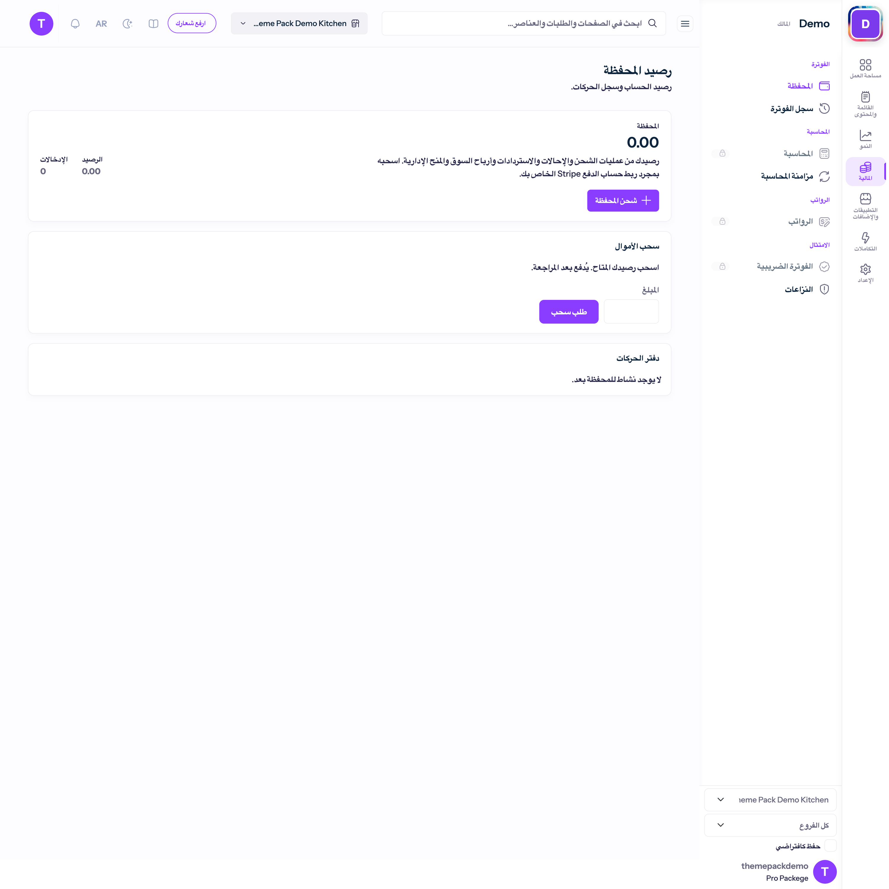

# المحفظة والأرصدة

محفظتك هي رصيد ائتماني على حسابك في المنصة — رصيد متجر يمكنك إنفاقه
على الإضافات والسمات وتجديدات الاشتراك. إنه مال تحتفظ به لدى المنصة،
لا إيرادات مطعم: مدفوعات زبائنك مقابل الطلبات تمر عبر بوابات الدفع
الخاصة بك ولا تصل إلى هنا أبدًا.

يُسجَّل كل حركة دخول أو خروج من المحفظة في سجل، فيكون الرصيد دائمًا
هو المجموع الدقيق لتاريخه.

## فتح المحفظة

انقر **المحفظة** في الشريط الجانبي للوحة التحكم (أيقونة المحفظة).
توجد الصفحة على `/wallet` وتعرض:

- **الرصيد** الحالي في شريط الترويسة
- زر **شحن المحفظة** (عندما تكون تعبئة الرصيد الذاتية مفعّلة)
- بطاقة **سحب الأموال** لسحب أرباح المتجر
- **السجل (Ledger)** — أحدث 30 حركة في محفظتك

## من أين يأتي الرصيد

يُضاف الرصيد إلى محفظتك عبر:

- **عمليات التعبئة (Top-ups)** — تدفع عبر بوابة دفع فيُضاف المبلغ
  (انظر أدناه).
- **منح المنصة** — يستطيع فريق المنصة إضافة رصيد إلى حسابك، مثلًا
  كبادرة حسن نية أو عرض ترويجي.
- **أرباح المتجر** — إذا كنت تبيع سمات على متجر المنصة، تُدفع حصتك من
  كل عملية بيع إلى المحفظة.
- **عمليات السحب المُعادة** — إذا رُفض طلب سحب، يعود المبلغ مباشرة إلى
  رصيدك.

تُراجَع مكافآت الإحالة ويدفعها فريق المنصة — انظر
[برنامج الإحالة](referrals.md) لمعرفة كيفية عملها.

## التعبئة

1. في صفحة المحفظة، انقر **شحن المحفظة**.
2. اختر أحد المبالغ المُعدّة مسبقًا، أو اكتب **مبلغًا مخصصًا**. يعرض
   النموذج الحدين الأدنى والأقصى المسموح بهما؛ وتُرفض المبالغ خارج هذا
   النطاق.
3. اختر **طريقة دفع** من البوابات المفعّلة.
4. انقر **إعادة ملء**. تُوجَّه إلى صفحة الدفع لإتمام الخصم.

يُضاف الرصيد لحظة تأكيد البوابة للدفع — لا قبل ذلك أبدًا. لا يمكن
إضافة رصيد عملية تعبئة مؤكَّدة إلا مرة واحدة، حتى إن أرسل مزوّد الدفع
تأكيدات مكررة.

يُحدِّد المنصةُ الحدَّ الأدنى والأقصى والمبالغ المُعدّة مسبقًا
(الافتراضات المعتادة: الحد الأدنى 5، والأقصى 1,000، والمُعدّة مسبقًا
10 / 25 / 50 / 100، بعملة المنصة). ويمكن للمنصة أيضًا إيقاف تعبئة
الرصيد الذاتية بالكامل، وعندئذ لا يظهر الزر.

تظهر مدفوعات التعبئة في مكانين: كصف **إيداع** في سجل المحفظة، وكدفعة
"Wallet top-up" في صفحة **سجل الفوترة** لديك (`/transactions`)،
حيث يمكنك عرض الفاتورة وتنزيلها. انظر
[الخطط والفوترة](plans-billing.md) لمزيد عن تلك الصفحة.

## على ماذا يمكنك إنفاقه

- **الإضافات** — يمكن دفع حزم السعة لمرة واحدة من المحفظة عند إتمام
  شراء الإضافة (يُعطَّل خيار المحفظة إذا كان رصيدك لا يغطي السعر).
- **اشتراكات الإضافات** — يمكن تمويل الإضافات الشهرية من المحفظة
  وتتجدد تلقائيًا (القسم التالي).
- **تجديدات الخطة** — يمكن أن يتجدد اشتراكك الرئيسي تلقائيًا من
  المحفظة (القسم التالي).
- **سمات المتجر** — تُشترى السمات المدفوعة برصيد المحفظة.
- **رسوم الاستخدام** — تحصّل بعض الميزات المُقاسة (مثل رسائل WhatsApp
  المفوترة عبر المنصة) من المحفظة لكل استخدام.

لا يمكنك أبدًا إنفاق أكثر من رصيدك؛ ويُرفض أي خصم قد يجعل المحفظة
بالسالب.

## التجديد التلقائي من المحفظة

### اشتراك الخطة

إذا كان التجديد التلقائي من المحفظة مفعّلًا في حسابك، فإن دورة الفوترة
كل ساعة على المنصة تخصم سعر تجديدك من المحفظة عند انتهاء فترة اشتراكك،
فتستمر خطتك دون انقطاع. تُحصَّل كل فترة مرة واحدة بالضبط.

إذا كان الرصيد منخفضًا جدًا، يُتخطى التجديد ويدخل الاشتراك حالة
**متأخر** مع فترة سماح (3 أيام افتراضيًا، تحددها المنصة) قبل أن
ينتهي. تستقبل رسائل تذكير قبل الانتهاء (بمهلة 7 و3 و1 يوم)، ويوم
الانتهاء، وفي منتصف فترة السماح — فتعبئة سريعة أثناء السماح يليها
تجديد تُبقيك على خطتك.

التجديد التلقائي من المحفظة للخطة الرئيسية اختياري ويفعّله حاليًا
فريق المنصة لكل حساب — لا يوجد مفتاح خدمة ذاتية في لوحة التحكم بعد.
اطلب من مسؤول المنصة إن أردت تفعيله.

### اشتراكات الإضافات

بالنسبة إلى الإضافات الشهرية تختار هذا بنفسك عند إتمام الشراء: اختر
**Monthly (auto-renew)** كوضع فوترة و **المحفظة** كطريقة دفع. يُحصَّل
الشهر الأول فورًا؛ وبعد ذلك تخصم دورة يومية من المحفظة قُبيل انتهاء
كل شهر مدفوع وتمدّد الإضافة.

إذا تعذّر على المحفظة تغطية تجديد، تُعلَّم الإضافة بأنها متأخرة وتصلك
رسالة واحدة تطلب منك التعبئة. يُعاد محاولة التجديد يوميًا؛ وإذا بقيت
الإضافة غير مدفوعة أسبوعًا بعد انتهائها، يُوقَف التجديد التلقائي
وتنقضي. يمكنك إدارة اشتراكات الإضافات من صفحة **إضافات**.

## قراءة السجل

تسرد بطاقة **السجل (Ledger)** في صفحة المحفظة أحدث 30 حركة، بالأحدث
أولًا. يعرض كل صف:

- **متى** — الوقت النسبي للإدخال.
- **النوع** — **إيداع** (مال داخل، شارة خضراء) أو **خصم** (مال
  خارج).
- **ملاحظة** — السبب، مثل "Wallet top-up" أو "addon_purchase" أو
  "subscription_renewal" أو "withdrawal".
- **المبلغ** — بإشارة: تظهر الائتمانات بعلامة `+` بادئة، والمخصومات
  سالبة.

السجل قابل للإلحاق فقط؛ لا تُحرَّر الإدخالات أو تُحذف أبدًا، فيساوي
الرصيد دائمًا مجموع الصفوف.

## سحب أرباح المتجر

إذا كانت لديك أرباح متجر في المحفظة، تتيح لك بطاقة **سحب الأموال** طلب
سحب:

1. أدخل مبلغًا (حتى رصيدك) وانقر **طلب سحب**.
2. يُخصم المبلغ من المحفظة فورًا ويُحتجز بينما تراجع المنصة الطلب.
   تُرفض الطلبات التي تتجاوز رصيدك.
3. تُدفع عمليات السحب المُوافَق عليها؛ وتُعاد المرفوضة مباشرة إلى
   المحفظة.

عندما تكون مدفوعات Stripe مفعّلة لدى المنصة، يظهر زر **Connect Stripe
for payouts** — إعداد لمرة واحدة مع Stripe لتذهب عمليات السحب
المُوافَق عليها مباشرة إلى حسابك المصرفي. يمكنك استئناف إعداد غير مكتمل
في أي وقت من البطاقة نفسها.

تُدرَج طلبات السحب الأخيرة لديك وحالاتها أسفل نموذج السحب.
