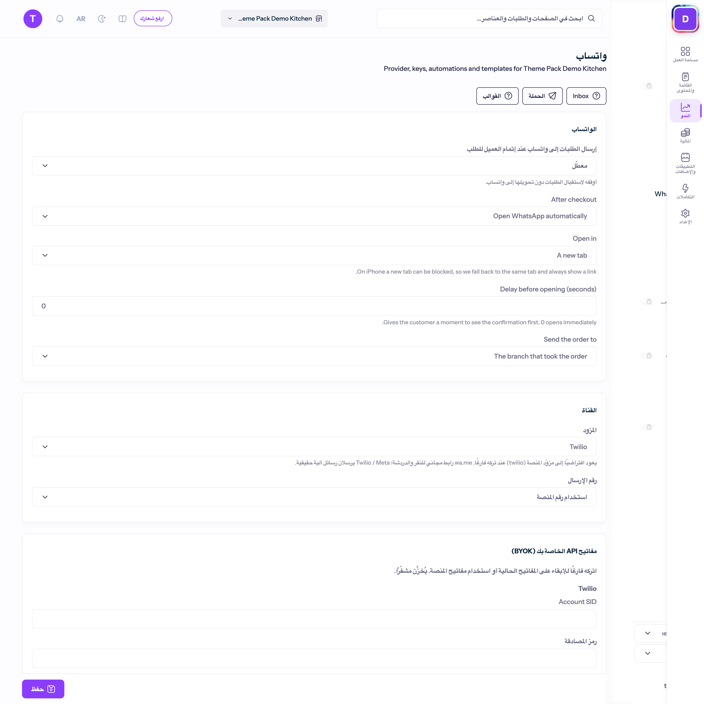

# واتساب

WhatsApp قناة مراسلة خاصة بكل مطعم على حدة. يمكن للعملاء التواصل معك عبر
الدردشة، ويمكنك إرسال تأكيدات الطلبات وتحديثات الحالة وردود صندوق الوارد
والرسائل التسويقية الجماعية. لكل مطعم مجموعته الخاصة من صفحات WhatsApp.

لفتحها، انتقل إلى **المتاجر** في الشريط الجانبي واضغط زر **WhatsApp**
على بطاقة المطعم. يفتح ذلك صفحة الإعدادات الخاصة بهذا المطعم. يحتوي أعلى
صفحة الإعدادات على أزرار تربط بصفحات **صندوق الوارد** و**الحملة** و**القوالب**
للمطعم نفسه.

تنتمي هذه الصفحات إلى حساب مالك المطعم. لا يرى مستخدمو لوحة الموظفين زر
WhatsApp إلا عندما يملكون صلاحية تعديل القائمة، والصفحات نفسها متاحة للمالك
فقط.

## اختيار مزوّد الخدمة

في صفحة الإعدادات، تتضمن بطاقة **القناة** قائمة منسدلة **المزود** بثلاثة
خيارات:

- **wa.me link (free)** — بلا واجهة برمجية وبلا تكلفة. تفتح أزرار الطلب على
  قائمتك دردشة WhatsApp مع رقمك ورسالة معبأة مسبقًا؛ ويرسلها العميل بنفسه.
  هذا هو الخيار الافتراضي المدمج والبديل الاحتياطي المضمون: إذا فشل مزوّد
  حقيقي أو لم يكن مُعدًّا، يتراجع التطبيق إلى رابط wa.me حتى يظل بإمكان
  العميل الوصول إليك.
- **Twilio** — يرسل رسائل تلقائية حقيقية عبر واجهة WhatsApp من Twilio.
- **Meta Cloud API** — يرسل رسائل تلقائية حقيقية عبر WhatsApp Cloud API من
  Meta.

إذا تركت المزوّد دون تحديد، يستخدم المطعم المزوّد الافتراضي للمنصة. يوضح
تلميح القائمة المنسدلة أي مزوّد هو حاليًا.

يستطيع Twilio وMeta فقط إرسال الرسائل التلقائية (التأكيدات وتحديثات الحالة
والرسائل الجماعية وردود روبوت الدردشة). لا يحمل رابط wa.me أي هوية إرسال،
لذا لا يمكنه تنفيذ الأتمتة أو الرسائل الجماعية — فهو للنقر والدردشة فقط.

## رقم المنصة مقابل مفاتيحك الخاصة (BYOK)

تختار القائمة المنسدلة **رقم الإرسال** بين:

- **استخدام رقم المنصة** — تُرسل الرسائل عبر مفاتيح توفّرها المنصة.
- **Use my own number (BYOK)** — "أحضر مفاتيحك الخاصة": تقدّم بيانات اعتماد
  Twilio أو Meta الخاصة بك، وتُرسل الرسائل من رقم WhatsApp الخاص بك.

أدخِل بيانات اعتماد BYOK في بطاقة **Your API keys (BYOK)**:

- **Twilio** — Account SID وAuth Token وFrom number (مثل
  `whatsapp:+14155238886`).
- **Meta Cloud API** — Access Token وPhone Number ID وApp Secret وWebhook
  Verify Token.

تُخزَّن المفاتيح مشفّرة. يؤدي ترك حقل فارغًا إلى الإبقاء على المفتاح المحفوظ
الحالي (أو مفتاح المنصة) — فإعادة حفظ النموذج لا تمحو أبدًا أي سر مخزَّن.
بمجرد حفظ مفاتيح لمزوّد ما، يُعتبر مُعدًّا.

يتطلب Meta وجود webhook حتى تصل الرسائل الواردة وإيصالات التسليم إلى
التطبيق. يظهر عنوان webhook الخاص بـ Meta كتلميح بجوار حقل Webhook Verify
Token في صفحة الإعدادات؛ انسخه إلى إعدادات تطبيق Meta الخاص بك.

### أمان الرسائل الواردة — سر التوقيع وتسجيل المُرسِل

الرسائل الواردة عبر webhook **مُتحقَّق من توقيعها وتفشل بأمان**: تُرفض أي
رسالة يتعذّر التحقق من صحتها، ولا تمرّ. يجب تحقّق شرطين معًا حتى تصل
الرسائل على رقمك الخاص:

1. **حفظ سر التوقيع.** بالنسبة لـ Meta هو **سر التطبيق**؛ وبالنسبة لـ Twilio
   هو **رمز المصادقة**. بدونه، تُرفض الرسائل الواردة على رقمك الخاص كليًا.
2. **تسجيل رقم الإرسال الخاص بك.** يؤدي حفظ صفحة الإعدادات إلى تسجيل هوية
   المُرسِل الخاصة بك (Meta: رقم Phone Number ID؛ Twilio: رقم From) بحيث
   يمكن مطابقة الرسالة الواردة مع مطعمك قبل التحقق من توقيعها. إذا أعددت
   BYOK قبل وجود هذا النظام، **أعد حفظ صفحة إعدادات WhatsApp مرة واحدة**
   لتسجيل رقمك — وحتى تفعل ذلك، لا يمكن نسب رسائلك الواردة إلى متجرك.

تُظهر بطاقة **Your API keys (BYOK)** الحالة الراهنة لكل مزوّد:
"Inbound messages are signature-verified with your key" (بالأخضر) عندما
يكون كلا الشرطين متوفرَين، أو تحذير أحمر يخبرك بأي من الشرطين مفقود — "No
signing secret saved…" أو "Your sending number is not registered yet — save
this page once to register it."

ملاحظة عن الفوترة: الرسائل المُرسَلة عبر مفاتيحك الخاصة (BYOK) وروابط wa.me
المجانية لا تحتسبها المنصة. تُحتسب فقط عمليات الإرسال الحقيقية عبر واجهة
برمجية على مفاتيح المنصة ضمن باقتك أو محفظتك.

## أرقام wa.me ورسالة الطلب

تتيح لك بطاقة **WhatsApp Numbers (wa.me)** إدراج ما يصل إلى عشرة أرقام
WhatsApp ورسالة طلب افتراضية **wa.me Order Message**. تشغّل هذه أزرار
النقر للدردشة على قائمتك العامة بغض النظر عن المزوّد الذي اخترته، لكي يبقى
لدى العملاء دائمًا وسيلة لمراسلتك.

تُطبَّع الأرقام تلقائيًا لصيغة wa.me: تُزال المسافات والشرطات وبادئة
`whatsapp:`، وتُحوَّل الأرقام العربية-الهندية (٠-٩ / ۰-۹) إلى أرقام
لاتينية — بحيث يعمل الرقم المكتوب بالأرقام العربية بدلًا من إفراغه بصمت.

## الأتمتة

تحتوي بطاقة **الأتمتة** على ثلاثة إعدادات للتشغيل/الإيقاف وأسماء
القوالب التي تستخدمها:

- **Send order confirmation on WhatsApp** — يراسل العميل عند تقديم طلب.
  يستخدم **اسم قالب تأكيد الطلب** (مثل `order_confirm`).
- **Send status updates on WhatsApp** — يراسل العميل عند تغيّر حالة الطلب.
  يستخدم **اسم قالب تحديث الحالة** (مثل `order_status`).
- **AI chatbot auto-reply to inbound messages** — يرد تلقائيًا على رسائل
  العملاء باستخدام **موجّه نظام روبوت المحادثة** الذي تُدخِله.

يجب أن تستخدم الرسائل التلقائية المُرسَلة خارج نافذة الـ 24 ساعة قالبًا
معتمدًا. راجع "نافذة الـ 24 ساعة" أدناه وسجّل أسماء قوالبك في صفحة
[Templates](#templates).

يوجد أيضًا تذكير بالسلة المتروكة يراسل العملاء بشأن الطلبات غير المدفوعة.
يتحكم فيه إعداد منفصل هو `customer_cart_whatsapp` وقالب السلة الخاص به،
ويعمل وفق جدول زمني كل ساعة.

## صندوق الوارد

تعرض صفحة **صندوق الوارد** رسائل WhatsApp الواردة للمطعم، مجمّعة في محادثة واحدة
لكل عميل، الأحدث أولًا. تُظهر المحادثات التي تتضمن رسائل لم تجب عنها شارة
عدّ "new".

اكتب ردًا في محادثة واضغط **إرسال** للرد بشكل مباشر. تخرج الردود كرسائل
خدمة مجانية ضمن النافذة، ويؤدي إرسال ردّ إلى وضع علامة على رسائل ذلك العميل
غير المُجابة كمُعالَجة. لا يعمل صندوق الوارد وتحديثات التسليم إلا مع مزوّد
حقيقي (Twilio أو Meta) يكون webhook الخاص به متصلًا — فرابط wa.me لا يمكنه
استقبال ردود داخل التطبيق.

## القوالب

يتطلب WhatsApp قوالب رسائل معتمدة مسبقًا لمراسلة العملاء خارج نافذة الـ 24
ساعة. صفحة **القوالب** هي المكان الذي تسجّل فيه القوالب التي سبق أن
اعتمدتها على Twilio أو Meta، لكي يعلم التطبيق أنه يستطيع إرسالها.

لكل قالب تُدخِله:

- **الاسم** — يجب أن يتكوّن من حروف صغيرة وأرقام وشرطات سفلية فقط (مثل
  `order_confirm`).
- **المزود** — Meta أو Twilio.
- **اللغة** — رمز لغة القالب.
- **الفئة** — Marketing أو Utility أو Authentication.
- **الحالة** — Draft أو Pending أو Approved أو Rejected.
- **المحتوى** — نسخة اختيارية من نص القالب للرجوع إليها.

يعيد الحفظ استخدام الصف عندما يكون المزوّد والاسم واللغة موجودين مسبقًا،
لذا فإن إعادة الحفظ تحدّث بدلًا من التكرار. استخدم إجراء الإزالة لحذف قالب
لم تعد بحاجة إليه.

تسجيل قالب هنا لا ينشئه أو يقدّمه إلى Meta أو Twilio — فلا يزال عليك اعتماد
القوالب في لوحة تحكم مزوّدك الخاص. هذه الصفحة سجل بالأسماء المسموح للتطبيق
بإرسالها.

## نافذة الـ 24 ساعة

يسمح WhatsApp للشركات بإرسال رسائل حرة (غير قالبية) فقط خلال 24 ساعة من آخر
رسالة واردة من العميل. داخل هذه النافذة تكون الرسالة رسالة خدمة مجانية؛
وخارجها يلزم قالب معتمد. يفرض التطبيق ذلك للمزوّدين الحقيقيين: إذا حاولت
إرسال نص حر خارج النافذة، يُتخطّى الإرسال بنتيجة "requires template outside
24h window". لهذا يجب أن تطابق أسماء قوالب الأتمتة والحملات لديك القوالب
المعتمدة.

## الحملات (الرسائل التسويقية الجماعية)

ترسل صفحة **الحملة** رسالة تسويقية إلى جمهور المطعم المشترك. تعرض عدد
**Opted-in audience** الحالي — العملاء الذين اشتركوا ولم يرسلوا STOP. أنشئ
رسالة، وسمِّ اختياريًا قالبًا تسويقيًا معتمدًا، ثم أرسل. تُوضع الرسالة في
طابور لكل مستلم، وتُوزَّع على مدى زمني لاحترام حدود الإنتاجية، ويُعاد التحقق
من إلغاء الاشتراك والموافقة لكل مستلم عند وقت الإرسال.

يُطبَّق ضابطان وقائيان:

- يتطلب التسويق قالبًا تسويقيًا معتمدًا على Meta أو Twilio.
- إذا كان تقييم جودة رقم WhatsApp الخاص بك منخفضًا (مُعلَّمًا)، تُوقَف
  الحملات مؤقتًا وستظهر لك رسالة تطلب منك معالجة صحة الرقم قبل إرسال
  التسويق. يحمي هذا الرقم من مزيد من الضرر.

للرسائل النصية القصيرة والقنوات الأخرى، راجع [الحملات](campaigns.md).

## كلمات إلغاء الاشتراك

يتحكم العملاء بموافقتهم التسويقية عبر الرد على رقم WhatsApp الخاص بك:

- **STOP** أو **UNSUBSCRIBE** أو **CANCEL** أو **QUIT** يلغي اشتراكهم. لن
  يتلقّوا بعد ذلك الرسائل التسويقية الجماعية.
- **START** أو **SUBSCRIBE** أو **YES** أو **UNSTOP** يعيد اشتراكهم.

تُطابَق هذه الكلمات المفتاحية تلقائيًا على الرسائل الواردة. تتخطّى الحملات
دائمًا العملاء الذين ألغوا اشتراكهم، حتى لو أُعيد رقمهم لاحقًا إلى جمهور.

## الاحتفاظ بالبيانات والخصوصية

تُنقَّح نصوص رسائل WhatsApp المخزَّنة تلقائيًا بعد مدة احتفاظ (90 يومًا
افتراضيًا). تُبقي عملية تنظيف يومية على أعداد الرسائل وبياناتها الوصفية
لأغراض الفوترة والتدقيق، لكنها تجرّد نص الرسائل من المحادثات الواردة
والسجلات الصادرة الأقدم.

إذا طلب منك عميل محو بياناته، يمكن للتطبيق نسيان جهة اتصال: فيحذف محادثات
صندوق الوارد الخاصة بها، ونافذة الجلسة، وسجل الموافقة، وينقّح سجلات رسائلها
الصادرة. يُحتفظ عمدًا بكبح إلغاء الاشتراك حتى لا يُعاد تسويق رقم منسي عن
طريق الخطأ لاحقًا.

## صفحات ذات صلة

- [الحملات](campaigns.md) — التسويق عبر القنوات
- [الطلبات](orders.md) — تأكيدات الطلبات وتحديثات الحالة
- [وكلاء الذكاء الاصطناعي](ai-agents.md) — سلوك روبوت الدردشة التلقائي
