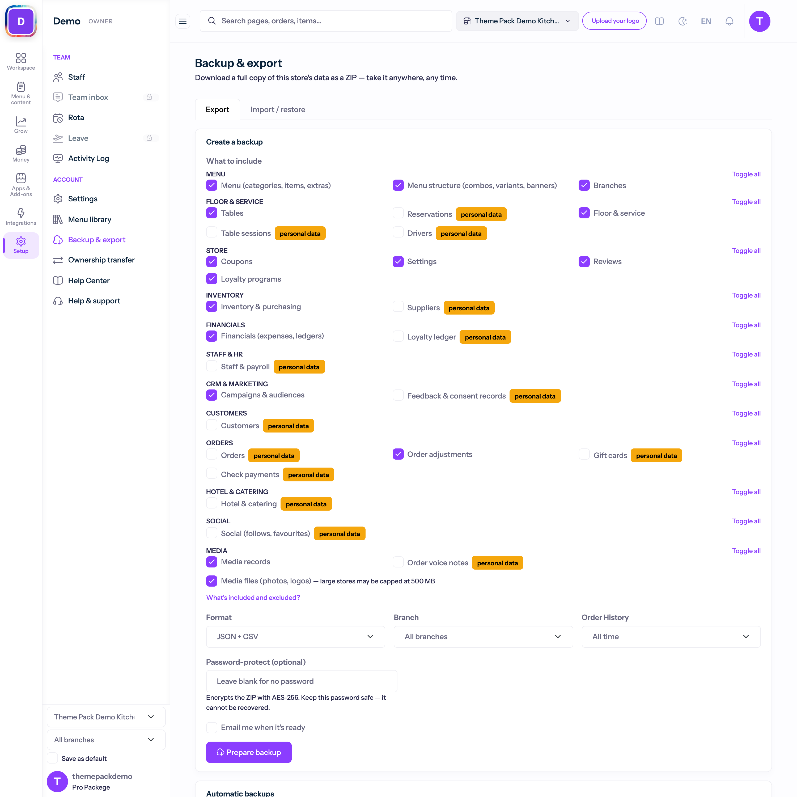

# Backup, export and restore

Download a full copy of your restaurant's data as a ZIP whenever you like,
have one prepared automatically every week or month, and restore a backup
into a store with a preview of exactly what will change before anything is
written. Open **Backup & export** in the dashboard sidebar under **Setup →
Account** (cloud-download icon); the page also lives at `/backup` on your
dashboard domain. It always works on the store currently selected in the
dashboard store switcher. Only the store's owner can use it — staff accounts
cannot reach the page, and every download is re-checked against ownership.

## Creating a backup

Open the **Export** tab and use the **Create a backup** card:

1. **What to include** — a checkbox list of every dataset, grouped (Menu,
   Store, Inventory, Financials, Staff & HR, CRM & marketing, Customers,
   Orders, Floor & service, Hotel & catering, Social, Media). Each group has
   a **Toggle all** link. Datasets that contain personal data (customers,
   orders, reservations, staff, suppliers, gift cards and similar) carry a
   **personal data** badge, and ticking any of them shows a reminder that
   you should only export personal data you are allowed to hold and move.
2. **Media files** — actual photos and logos can be bundled into the ZIP.
   Very large stores are capped at 500 MB of media per export; everything
   else still exports and the manifest says what was skipped.
3. **Format** — **JSON + CSV** (the default), **JSON only**, or **CSV
   only**. JSON is the format the importer restores from; CSV opens in a
   spreadsheet.
4. **Branch** — export **All branches** or narrow branch-scoped data to one
   branch.
5. **Order history** — **All time**, **Last 90 days**, **Last 30 days**, or
   a **Custom range** with from/to dates.
6. **Password-protect (optional)** — enter a password to encrypt the ZIP
   with AES-256. Keep the password safe: it cannot be recovered. If the
   server cannot encrypt, the field is disabled and says so.
7. **Email me when it's ready** — tick to get an email with a download link
   once the archive is built.

Click **Prepare backup**. Archives are built in the background; the **Your
backups** list below shows each one with its status, size and a download
button once ready. The page keeps your 20 most recent backups per store, and
you can delete any backup you no longer need. Creating and downloading
backups is rate-limited, so a burst of requests may ask you to wait.

What's in the ZIP: the datasets you ticked plus a manifest listing exactly
what shipped. Secret credentials (payment and gateway keys, tokens,
certificates) and system records are always excluded — this is a curated,
portable export, not a raw database dump.

## Automatic backups

The **Automatic backups** card sets up a single recurring schedule per
store:

- **Frequency** — **Weekly** or **Monthly**.
- The same dataset, format, branch and order-history options as a manual
  backup, plus the **Email me** notification.
- Automatic backups are never password-protected.

The card shows whether the schedule is **On** and when the next run is due;
**Turn off** removes it. Scheduled archives appear in the same **Your
backups** list as manual ones.

## Importing / restoring

The **Import / restore** tab restores a backup ZIP into the current store —
useful for recovering data or moving a store between accounts (see
[Ownership transfer](ownership-transfer.md) for moving the store itself).

1. Upload a backup ZIP (up to 500 MB). The file is validated and nothing is
   written yet.
2. The import appears in the list with a **preview**: a dry-run plan of what
   will be created and updated, dataset by dataset, plus a warning if the
   archive came from a different store.
3. Review the plan, then **confirm** to apply it. The import runs in the
   background; the list shows its progress and final status. You can discard
   an uploaded import at any point before confirming.

If a file cannot be read as a valid backup, the upload is rejected with the
reason and nothing changes.

## Related pages

- [Menu import and export (CSV)](menu-import-export.md) — the lighter
  CSV-only tool for bulk-editing just the menu.
- [Ownership transfer](ownership-transfer.md) — hand a whole store to
  another account, or move a branch between your own stores.
- [Media library](media-library.md) — where the exported photos live.
