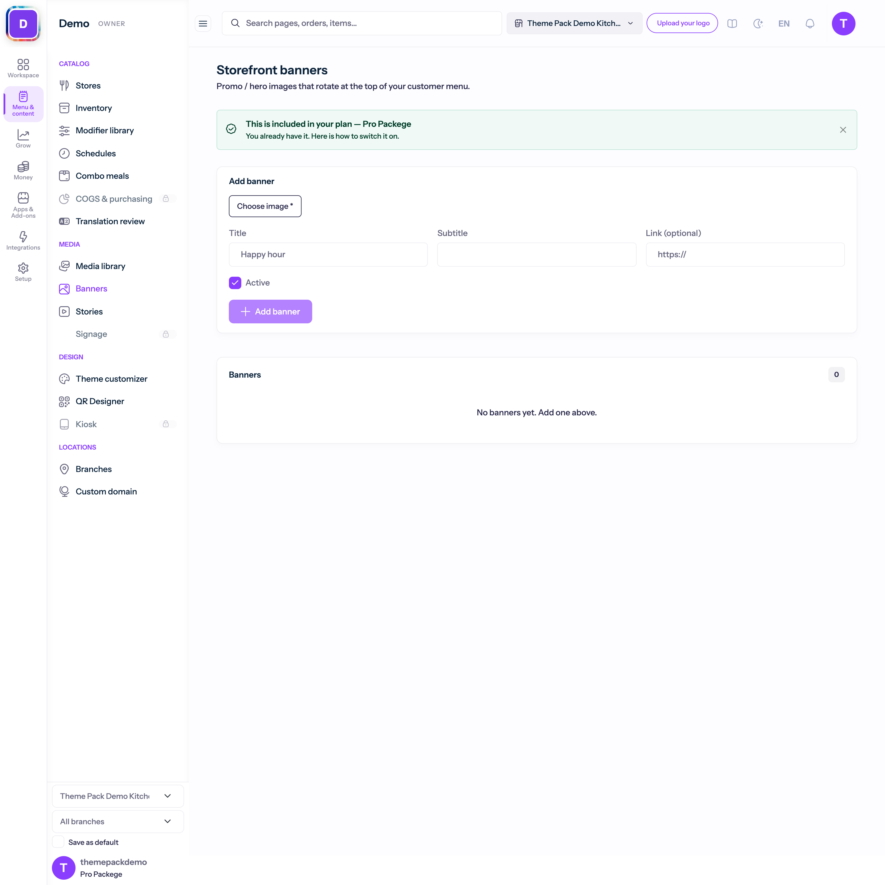

# Banners and daily specials

There are two ways to promote offers on your customer menu: **storefront
banners** (promo images that rotate at the top of the menu) and **daily
specials** (a per-item flag that puts dishes in a highlighted "Today's
specials" section). Both are managed from your dashboard and appear
automatically on the public menu.

## Storefront banners

Banners are promo or hero images — "Happy hour", "Ramadan offer", "New
burger" — that rotate in a slider at the top of your customer menu. Open
**Banners** in the dashboard sidebar to manage them. If you have more than one
restaurant, pick the restaurant from the dropdown at the top of the page
first; banners belong to a single restaurant.

Each banner has:

- **Image** (required) — picked from your media library's *banner* folder.
  Click **Choose image** to open the picker; you can upload new images there
  too (JPG, PNG, WebP, or GIF, up to 8 MB each).
- **Title** and **Subtitle** — optional text overlaid on the image.
- **Link (optional)** — a full URL (https://...). If set, tapping the banner
  opens the link in a new tab.
- **Active** — only active banners show on the storefront. Untick it to hide
  a banner without deleting it (it shows a "Hidden" badge in the list).

### Add a banner

1. Open **Banners** in the sidebar and select the restaurant.
2. In the **Add banner** card, click **Choose image** and pick or upload an
   image.
3. Fill in the title, subtitle, and link if you want them.
4. Leave **Active** ticked and click **Add banner**.

New banners are added to the end of the rotation.

### Edit, reorder, or delete

- **Edit** — click **Edit** on a banner card to change its image, text, link,
  or active state in a dialog, then click **Save**.
- **Reorder** — drag banner cards up or down in the list. The order saves
  automatically and controls the slide order on the menu.
- **Delete** — click **Delete** and confirm. Deleting a banner does not
  delete its image; the image stays in your media library for reuse.

### Where banners appear

Banners render on the modern menu themes: Aurora, Nebula, Pulse, Velvet, and
Vivid show them in a shared slider above the menu, while Crave, Glow, and
Matcha have their own styled banner strip. Older templates (Classic, Modern,
Dark, and similar) do not display banners. If there are no active banners,
nothing is shown — there is no empty placeholder. See
[Menu themes](themes.md) for choosing a theme.

Banner text is shown as typed; it is not translated when a customer switches
menu language.

## Daily specials

A daily special is a normal menu item with the **Daily special** checkbox
ticked. Open your menu workspace (see [Managing menu
items](menu-items.md)), edit an item, and tick **Daily special** in the
Dietary checkbox row. The item gets a "Special" badge in the menu builder.

On the modern themes (Aurora, Nebula, Pulse, Crave, Glow, Matcha) all items
flagged as daily specials are pulled into a dedicated "Today's specials"
section near the top of the menu, styled per theme (for example "Chef's Daily
Selection" on Aurora and Nebula). The section only appears when at least one
item is flagged, and shows a limited number of items — six to eight depending
on the theme. Sold-out specials still appear but are marked sold out and
cannot be opened.

To hide the specials section entirely (or move it), open **Stores**,
edit the restaurant, and use the **Public menu section order** control: each
section, including **Daily specials**, has a **Visible** checkbox and up/down
arrows.

## Scheduling

There is no date scheduler for banners: a banner shows whenever its **Active**
box is ticked, so switch it off yourself when a promotion ends. A text
announcement banner with an automatic from/to date window has been specced
but is planned, not yet available.

Daily specials are also a manual flag — the "Today's specials" section does
not reset overnight. If you want a special to appear only at certain times,
combine the **Daily special** checkbox with the item's **Scheduled
availability** fields (a From/To time window plus day-of-week checkboxes) in
the item dialog. The availability window is shown on the item's card on the
menu. See [Managing menu items](menu-items.md) for the item dialog.

## Related pages

- [Managing menu items](menu-items.md) — item flags, photos, and scheduled
  availability.
- [Menu themes](themes.md) — which theme your customers see.
- [Media library](media-library.md) — uploading and managing banner images.
- [Campaigns](campaigns.md) — promoting offers by message instead of on the
  menu.
