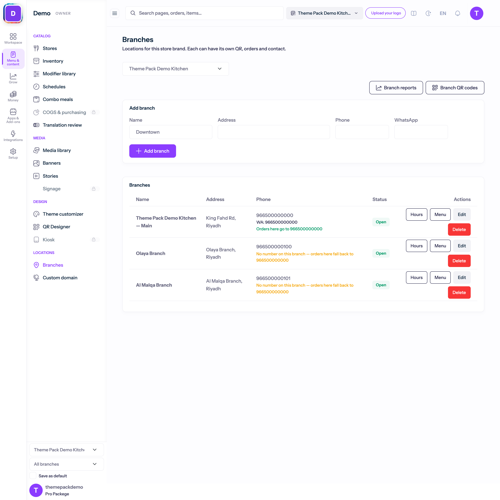

# Multi-branch

If your restaurant brand runs more than one location, branches let you manage them all under one account. Every branch shares the same menu but can have its own address, phone, opening hours, QR codes, per-item pricing and availability, orders, and reports.

You reach branches from the **Branches** item (map-pin icon) in the dashboard sidebar. If you only ever run a single location you can ignore this feature — a restaurant always has one default branch and behaves exactly as before.

## Creating branches

Open **Branches** in the sidebar. At the top, pick which restaurant you are managing (if you own more than one). Then use the **Add branch** form and fill in:

- **Name** (required) — the location name, for example "Downtown" or "Airport Road".
- **Address**, **Phone**, **WhatsApp** — all optional contact details for that location.

New branches are created active. Each branch you add is given the next position in the list, so they stay in a stable order.

To edit a branch, use the **Edit** button on its row. Besides name and contact details you can set:

- **Active** — turn the whole branch on or off.
- **Timezone** — used to work out whether the branch is open right now.
- **Accepting orders** — pause or resume online orders without deactivating the branch.
- **Closed message** — text shown to customers when the branch is not taking orders.

### Opening hours

Each branch has a weekly opening-hours grid, opened from the **Hours** button on the branch row (a row per day with an open time, a close time, and a "closed" checkbox). Overnight windows are supported — a close time earlier than the open time (for example 18:00 to 02:00) is treated as spanning midnight. If you leave hours empty, the branch is treated as always open.

A branch's live status is worked out from these settings and shown as one of: **open**, **closed** (outside hours), **paused** (not accepting orders), or **inactive** (branch switched off).

### Deleting a branch

Use the **Delete** button on a branch row. A restaurant must always keep at least one branch, so you cannot delete the last one. When you delete a branch, any tables assigned to it are not removed — they fold back into the default branch so they stay visible on your [QR codes](qr-codes.md) and [Floor map](floor-map.md) screens.

## Per-branch menus and visibility

Every branch serves the same menu by default. To make a location different, use the **Menu** button on a branch row (the "Branch menu & pricing" screen). For each item you can:

- **Turn the item off at this location** — untick "Available here" and the item is hidden from that branch's menu and cannot be ordered there.
- **Override the price** — enter a branch price to charge a different amount at this location. Leave it blank to use the item's base price.

Items you never touch here keep their default behaviour: available everywhere at the base price. So you only ever configure the exceptions.

On the customer side, the branch travels with the QR code or link (see below). When a customer is browsing a specific branch, the menu shows only the items available at that branch and uses that branch's prices.

## Branch QR codes

From the Branches page, **Branch QR codes** gives you a per-branch QR/link for each location. Each one deep-links to your public storefront with the branch attached (a `?branch_id=` on the store URL), so scanning a location's code opens that branch's menu, pricing, and availability. Print each branch's code for its own tables. For general QR management see [QR codes](qr-codes.md).

## Branch reports

**Branch reports** (from the Branches page, or the chart icon) gives you a side-by-side comparison of all branches for one restaurant. Pick a date range of the **last 7, 30, or 90 days**. For each branch the table shows:

- **Status** (open / closed / paused / inactive)
- **Orders** in the period
- **Revenue**
- **Average per order**
- **Top item** — the best-selling item at that branch by quantity

A totals summary at the top adds up orders and revenue across all branches. This is a comparison view — for a deeper look at one branch's numbers use the main [Analytics](analytics.md) and [Orders](orders.md) pages with a branch selected.

## Branch context in the dashboard

The sidebar footer has a store and branch switcher. When you have more than one branch, you can pick the branch the whole dashboard is scoped to, or choose **All branches**. Your selection sticks for the session, so pages like Orders and Analytics filter to the branch you picked.

You can also save the current selection as your default when switching, so a branch (and store) is pre-selected each time you log in. If a saved default later becomes invalid — for example the branch was deleted — the dashboard quietly falls back to "all branches" rather than showing an error.

Some pages also accept an explicit `?branch_id=` in the URL, which overrides the session selection for that page only. A `branch_id` of 0 or empty means "all branches".

## Staff and their default branch

When you add or edit a [staff member](staff.md), you can pin them to a single branch. A branch-pinned staff member is locked to that branch everywhere in the dashboard — they cannot switch to other locations. The branch you assign must belong to the same restaurant as the staff member.

Leave the branch blank to give a staff member access across all branches; in that case they can still choose a **default branch** for themselves from the switcher, which just pre-selects a branch at login without locking them to it.

Staff branch assignment also flows through to the [Staff app](staff-app.md), which has its own multi-branch switcher for staff who work across locations.

## Cloning a store

When you open a similar location, you can **clone** an existing store instead of
rebuilding it from scratch. Cloning copies the menu and settings, and can also
copy the store's **tables and rooms** — each cloned table gets a fresh, unique
QR code so scanning a table at the new location can never open the original
store. Clone, then adjust the details (name, address, hours) for the new site.

## Related pages

- [Staff](staff.md) — assigning staff to branches
- [QR codes](qr-codes.md) — table and branch QR management
- [Orders](orders.md) and [Analytics](analytics.md) — filter by the selected branch
- [Floor map](floor-map.md) and [Kitchen display](kds.md) — branch-aware operations
