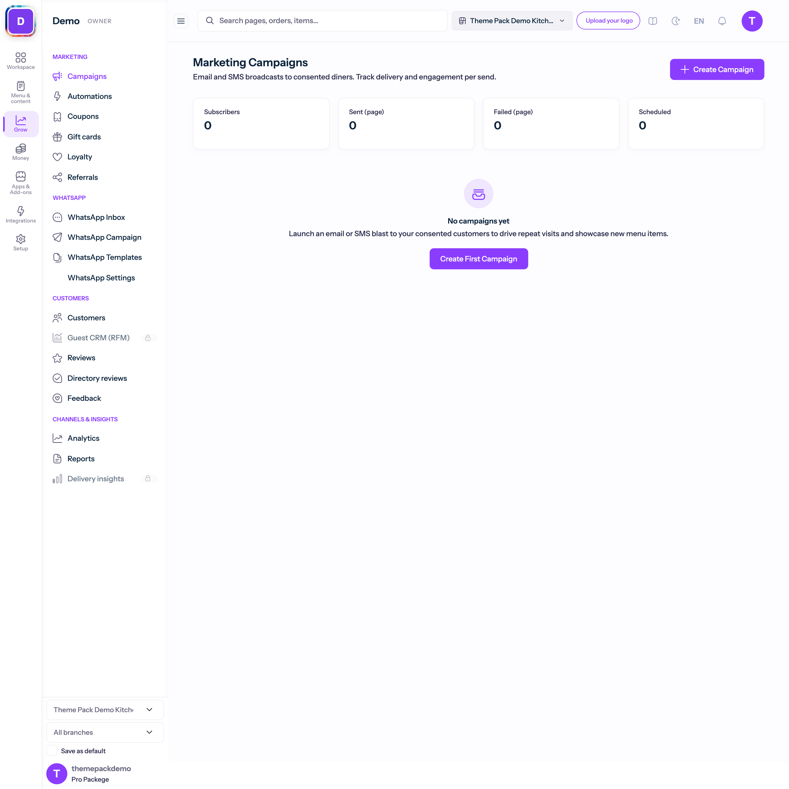

# Email and SMS campaigns

Campaigns let you send one-off email or SMS broadcasts — promotions, new menu
items, "we miss you" messages — to customers who agreed to hear from you. You
find them in the dashboard sidebar under the **Grow** group as **Campaigns**
(the megaphone icon). The same page tracks delivery for every send.

Campaigns only ever go to consented customers. This is enforced by the system,
not just the form — a customer without marketing consent is never messaged,
even if they appear in your customer list.

## Who receives a campaign

Your audience is the customers of the selected restaurant who have
**marketing consent**. Customers grant it themselves, typically by ticking the
marketing opt-in checkbox when they register an account on your public menu.
The **Customers** page in the sidebar shows which customers have consented,
and the Campaigns page header shows your total subscriber count.

At send time the campaign resolves the audience again, so anyone who
unsubscribed since you scheduled it is excluded automatically.

## Create a campaign

1. Open **Campaigns** in the sidebar and click **Create Campaign**.
2. In the **Audience** panel, pick the restaurant, the channel
   (**Email** or **SMS**), and a segment:
   - **All consented** — every consented customer of that restaurant.
   - **Recent (≤ 30d)** — customers who ordered, or joined, in the last
     30 days.
   - **Lapsed (> 30d)** — customers whose last order (or signup, if they
     never ordered) is more than 30 days ago.
3. In the **Message** panel, write your content:
   - **Subject** — email campaigns only, up to 255 characters. Required
     for email.
   - **Body** — the message itself. Use `{name}` anywhere in the subject
     or body and it is replaced with each customer's name (or "Customer"
     if none is stored).
   - For SMS, keep it short — one SMS segment is 160 characters, and the
     system adds "Reply STOP to unsubscribe." to the end of every
     marketing SMS.
4. In the **Schedule** panel, either leave **Scheduled at** blank to send
   immediately, or pick a future date and time.
5. Click **Launch Campaign**.

There is no preview of the audience size per segment on the compose page, and
a campaign cannot be edited or cancelled after launch, so double-check the
segment and message before you click.

## How sending works

Sending happens in the background, so launching a large campaign does not
freeze your dashboard. When the campaign runs, it builds the recipient list
from your consented customers, then sends each message individually. A failed
send is retried once, after a short delay. Each recipient gets their own
delivery status (pending, sent, or failed) that you can inspect in the report.

Messages are skipped and marked failed when the customer has no email address
(email campaigns) or no phone number (SMS campaigns).

## Campaign reports

The Campaigns list shows every campaign with its channel, segment, status
badge (scheduled, sending, sent), and sent/failed counts. Click **Report** on
any campaign to see:

- Audience size, sent and failed totals, and the delivery rate.
- The channel, subject, segment, schedule, and full message body.
- A per-recipient **Delivery log** with each customer's name, the email or
  phone used, the timestamp, the status, and the error message for any
  failure (for example "Customer email is empty").

Open and click tracking is not available — the report covers delivery only.

## Unsubscribes and opt-outs

- **Email** — every campaign email includes an unsubscribe link. The link is
  valid for 30 days; clicking it removes the customer's marketing consent and
  shows a confirmation page with your restaurant name. They are skipped on
  all future campaigns (email and SMS) until they opt in again.
- **SMS** — every marketing SMS ends with "Reply STOP to unsubscribe."
  Replying STOP (or UNSUBSCRIBE, CANCEL, END, QUIT) records an opt-out for
  that phone number, and future marketing SMS silently skip it. Replying
  START (or SUBSCRIBE, YES) removes the opt-out. Keyword handling requires
  your SMS provider's inbound webhook to be pointed at the platform; if you
  use your own Twilio account, ask your platform administrator to confirm it
  is configured.

Transactional messages (order confirmations, status updates, login codes) are
not affected by marketing opt-outs — they are tied to an action the customer
took, not to marketing consent.

## SMS setup

SMS needs provider credentials before real messages go out:

1. Go to **Integrations → Overview → All integrations** in the sidebar.
2. On the **Twilio SMS** card, enter your **Account SID**, **Auth token**,
   and **From number**, tick **Enable provider**, and click **Save**.
3. Use **Test connection** to confirm the credentials work.

Your own keys take priority; without them, sends fall back to the platform's
default SMS provider if one is configured. If neither exists, SMS sends are
simulated (logged but not delivered) — useful for testing, but remember that
a "sent" status in that state means no real message went out. Standard SMS
rates from your provider apply to every message.

Email campaigns need no setup — they use the platform's existing mail
delivery.

## Transactional SMS notifications

Besides marketing campaigns, the SMS channel powers automatic notifications
you can switch on per restaurant. Open the restaurant's edit page, go to the
**Marketing** tab, and find **Customer SMS alerts**:

- **Order-received SMS** — texts the customer a confirmation with the order
  number and total as soon as their order arrives.
- **Status-update SMS** — texts the customer whenever you change their
  order's status (see [Orders](orders.md)).

Both use the phone number the customer entered at checkout and require SMS
credentials in Integrations. Customers can also log in to your public menu
with a one-time SMS code instead of a password; the code request is
rate-limited to prevent abuse. All SMS activity — campaigns, alerts, and
login codes — is logged with a status so failures can be traced.

## Related pages

- [Orders](orders.md) — order statuses that trigger status-update SMS.
- [Coupons](coupons.md) — create a discount code to include in a campaign.
- [Loyalty program](loyalty.md) — another way to bring diners back.
