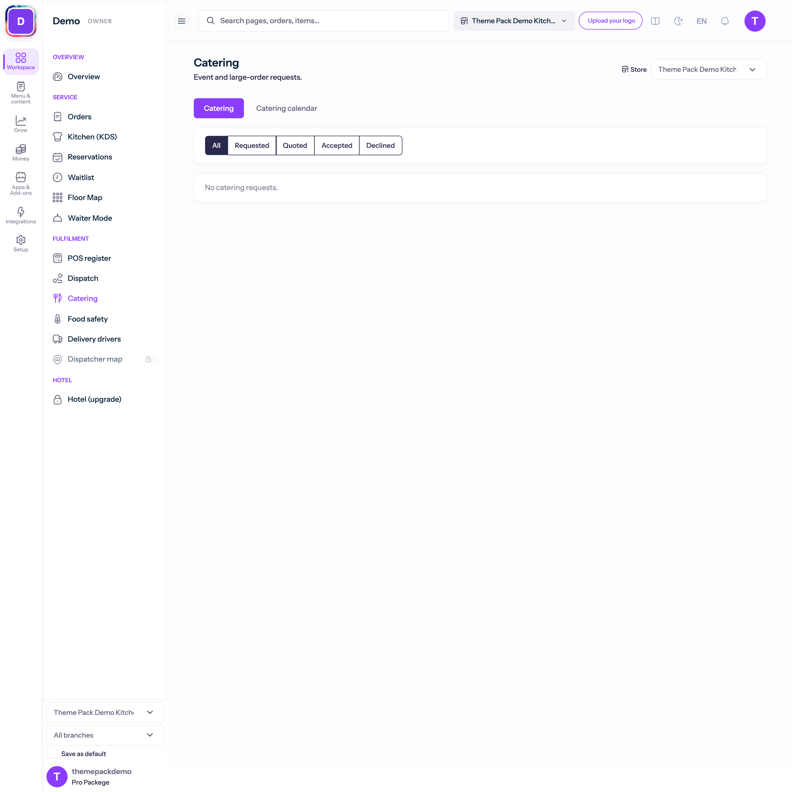

# Catering and event requests

Catering lets diners send you an enquiry for a large order or an event — a date,
a headcount and a note — instead of placing a normal order. You reply with a
quote, and once you accept it the platform creates a real scheduled order for
the event date.

Catering is a paid feature. If your plan does not include it, the sidebar shows
a locked **Catering** entry instead of the page.

## Switching the request form on

The public catering form appears on your menu page only when the store option
`catering_enabled` is set for that restaurant, **and** catering is included in
your plan.

There is no field for `catering_enabled` in the dashboard forms in this release
— ask the platform operator to enable it for your store. The related settings
are also operator-set:

- `catering_min_lead_days` — how many days' notice you need. The public form
  refuses an event date earlier than that, with the message "Catering needs at
  least N day(s) notice."
- `catering_min_spend` — a minimum quote value. Accepting a quote below it is
  rejected with "Catering minimum spend is …".
- `catering_deposit_enabled` — whether a deposit can be charged for a request.

## The public form

When enabled, a **Catering & Events** section appears on the menu page with the
fields:

- **Your name** (required)
- **Phone** and **Email**
- **Event date & time** (required — the picker starts at the earliest date your
  lead time allows)
- **Headcount** (required, at least 1, defaults to 20)
- a free-text box, "Tell us about your event"

Submitting creates a request with status **Requested**. The form is rate-limited
to 10 submissions a minute.

## The requests page

Click **Catering** in the sidebar under **Workspace → Fulfilment**. The page is
titled **Catering** and shows one restaurant at a time; switch stores with the
selector in the page header.

You see up to 100 requests, most recent event date first, with filter buttons
for **All**, **Requested**, **Quoted**, **Accepted** and **Declined**. Each card
shows the customer's name and status badge, the event date and time, the
headcount, the phone and email they gave, their message, the quote once you have
sent one, and a link to the order once one exists.

## Quoting, accepting and declining

On a **Requested** or **Quoted** card:

- **Quote** — type a total and click **Quote**. The status becomes **Quoted**.
  You can re-quote a request as many times as you need; the latest figure wins.
- **Decline** — sets the status to **Declined**. There is no undo button.

On a **Quoted** card:

- **Accept → create order** — creates a takeaway order for the event, scheduled
  at the event date and time, with the customer's name, phone, branch and note
  copied across, and flagged as a catering order. The request moves to
  **Accepted** and now links to that order.

Two things can block an accept:

- The quote is below your configured minimum spend.
- The restaurant has no menu items at all — you are told to add a menu item
  before accepting.

If the request did not pre-select items, the order is created with a single
line: a catering-only item if you have one, otherwise your first active menu
item. Adjust the order afterwards on the [Orders](orders.md) page.

Because the order is scheduled for the event date, it stays pending and does not
fire in the kitchen when you accept it — it is released at its own fire time.

## Calendar and pipeline

The **Catering calendar** tab (reachable from the tab strip on the Catering
page) shows:

- **Events this month** — every request with an event date in the chosen month,
  with time, name, headcount and status. Change the month with the month picker
  in the page header.
- A pipeline board with a column per stage: Requested, Quoted, Accepted,
  Fulfilled, Closed, Declined — up to 50 cards each.

Two extra buttons live on the board:

- **Fulfill** on an accepted event — marks it **Fulfilled**. Only accepted
  events can be fulfilled.
- **Close** on a fulfilled event — marks it **Closed**.

## Scope and limits

- Requests belong to one restaurant. A request id that is not yours returns
  "not found".
- Declining and closing are one-way from this page; there is no reopen button.
- Quote notes can be saved through the quote action but are not shown back on
  the requests list in this release.

## Related pages

- [Orders](orders.md) — where the accepted catering order lands.
- [Menu items](menu-items.md) — creating the catering-only items an accepted
  request draws on.
- [Branches](branches.md) — assigning a request to a location.
