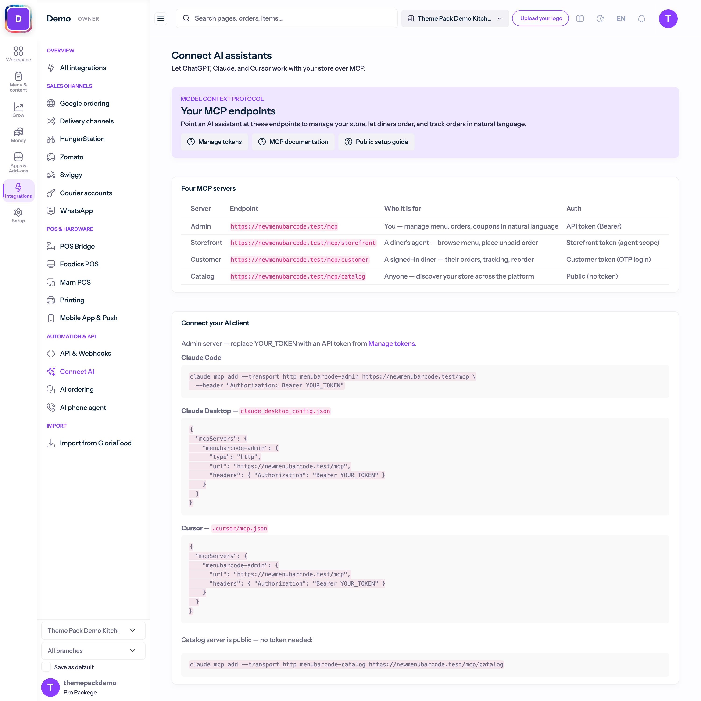

# Connect AI

The **Connect AI** page (`/connect-ai` in your dashboard) is the one place
that gathers everything an AI assistant needs to work with your account. If
you use an AI tool that speaks MCP (the Model Context Protocol) — Claude,
Cursor, and a growing list of others — this page gives you the endpoint
addresses and ready-made configuration snippets to paste in. You don't write
any code.

## The four servers

The page lists four MCP endpoints, each meant for a different person:

- **Admin** — for *you*. Connect your own AI assistant and manage your menu,
  orders and coupons in plain language. Authenticates with one of your
  regular [API tokens](api-tokens.md).
- **Storefront** — for a *diner's* AI agent: it can browse your menu and
  place an unpaid order on their behalf. Authenticates with a per-store
  storefront token that carries the `agent` scope.
- **Customer** — for a *signed-in diner*: their own orders, tracking and
  reordering. The diner's agent signs in the same way the diner does, with a
  one-time code.
- **Catalog** — public discovery of your store, no token at all. Connecting
  it costs nothing and makes your store findable by AI tools.

## What's on the page

- **The endpoint table** — the four server addresses with who each is for
  and how it authenticates.
- **Copy-paste client config** — working snippets for popular AI clients
  (a one-line terminal command or a small JSON block, depending on the
  client). Replace the placeholder with a real token and you're connected.
- **Your per-store agent tokens** — a list of the storefront tokens you've
  issued, with their scopes, so you can see at a glance which stores are
  open to diner agents. Tokens themselves are created and revoked on the
  [API tokens](api-tokens.md) page.

## Where to go deeper

Connect AI is deliberately the friendly front door. The technical detail —
what tools each MCP server exposes, request formats, the full API — lives in
the developer documentation linked from the page (the **MCP documentation**
button, which opens the `/developers` reference). Hand that link to whoever
builds on your account; you only need this page and a token.

Related owner pages: [API tokens](api-tokens.md), [AI agents](ai-agents.md),
[Apps and integrations](apps-integrations.md).
