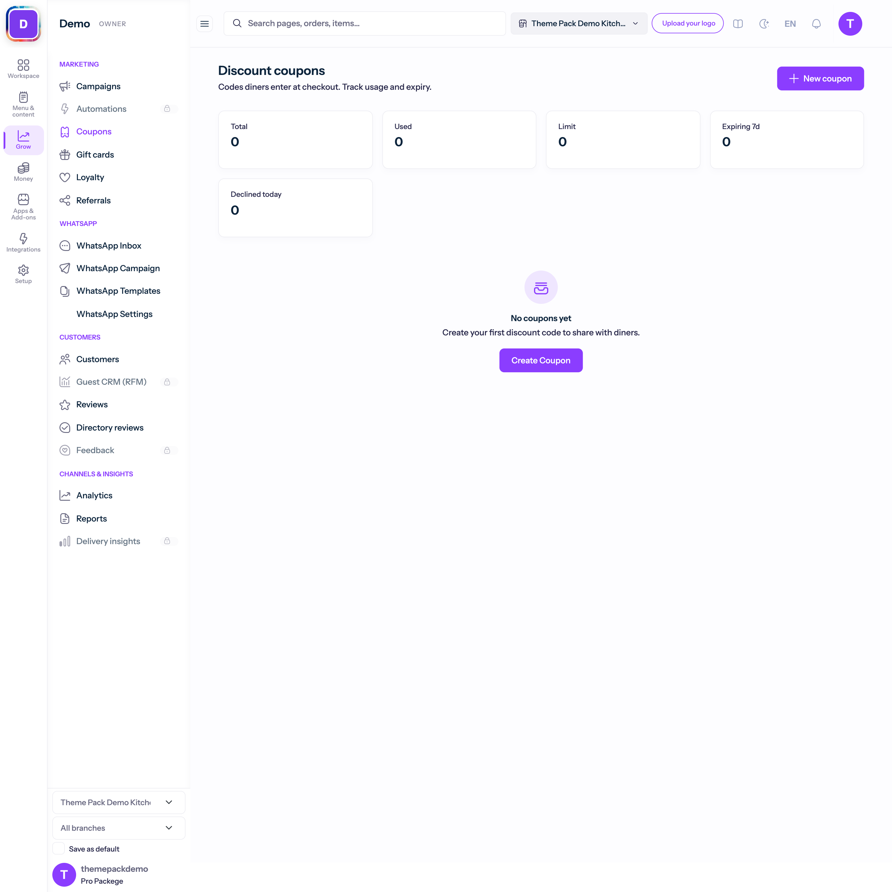

# Coupons

Coupons are discount codes your customers type in at checkout on your public
menu. You create and manage them in the dashboard under **Coupons** in the
sidebar (the ticket icon). A coupon takes either a percentage or a fixed
amount off the order subtotal, and you can cap how many times it can be used
and when it expires.

## Turn on coupons for a restaurant

The promo code box only appears on your public menu when coupons are enabled
for that restaurant:

1. Open the restaurant's edit page and go to the **Ordering** tab
   ("Checkout and service options").
2. Turn on the **Coupons** toggle.
3. Save.

With the toggle off, customers never see a promo code field, even if you have
active coupons. The field appears in the cart, labelled **Promo Code** with an
**Apply** button, on every modern menu template — see the
[theme capability matrix](theme-capability-matrix.md) for what each template
supports.

## Create a coupon

1. Open **Coupons** in the sidebar and click **New coupon**.
2. Fill in the form:
   - **Coupon code** — up to 32 characters, for example `WELCOME10`. It is
     stored in uppercase and must be unique. This is the exact code diners
     type at checkout.
   - **Type** — **Percentage** (percent off the subtotal) or **Fixed amount**
     (a flat amount off).
   - **Percent off / Amount off** — the discount value.
   - **Max redemptions** — how many times the code can be used in total.
     Leave it blank for effectively unlimited (9999).
   - **Max per customer** — how many times one diner may use this code. Leave
     it blank for no per-diner cap. Redemptions are recorded in a redemption
     ledger with a database-level uniqueness gate, so two simultaneous orders
     can never push a diner past the cap.
   - **Expiry date** — the last day the code works. Leave it blank for no
     expiry.
3. Click **Create Coupon**.

When you edit a coupon that has a per-diner cap, a **Coupon redemptions** card
below the form lists who redeemed it and when.

### Other limits enforced at checkout

Codes can also carry a **minimum order amount** (the code only applies once
the cart subtotal reaches that figure) and a **branch lock** (the code only
works at one branch). Both are enforced by the server whenever they are set on
a code, but the current coupon form does not expose fields for them. A
**free delivery** coupon type (waives the delivery charge without discounting
the subtotal) is likewise honoured at checkout but cannot be created from this
form.

To stop a code early, delete it or edit its expiry date to a past date.

## The coupon list

The **Coupons** page shows all your codes, 20 per page, newest first. The
header strip shows five tiles: **Total** (all your coupons), **Used**
(redemptions), **Limit** (combined redemption limit), **Expiring 7d** (codes
that expire within 7 days), and **Declined today** — how many diners were
refused a coupon today because it was used up. Zero is healthy; a non-zero
count means a code hit its limit and you may want to raise it.

Each row shows the code, its type (Percentage or Fixed badge), the discount
value, a **Used / Limit** counter with a progress bar (plus a red **Used up**
badge once a code is exhausted and a "Max N per diner" note when a per-diner
cap is set), and the expiry date (green while valid, red once expired,
**Never** if none). Use the row actions to **Edit** a coupon or delete it
(with a confirmation prompt). Editing lets you change every field, including
the code itself.

## What customers see at checkout

1. In the cart, the customer types the code into the **Promo Code** field and
   clicks **Apply**.
2. The server checks the code and replies immediately:
   - unknown code — "Coupon code is invalid."
   - past its expiry date — "Coupon code is expired."
   - all redemptions used — "Coupon code usage limit exceeded."
3. If the code is valid, a discount line is added to the totals and the
   grand total drops.

The discount is always calculated on the server, never in the browser:

- **Percentage** coupons take that percent of the items subtotal.
- **Fixed amount** coupons take the flat amount, capped at the subtotal — a
  coupon can never push an order below zero.
- Delivery charge, tax, and tip are added on top of the subtotal as usual;
  the discount is then subtracted from the final total. Tax is calculated on
  the pre-discount subtotal.

When the order is placed, the code is validated again on the server and the
redemption is **claimed atomically** before any discount is written — every
settlement path (storefront checkout, POS, add-on activation, wallet promo)
goes through the same claim. Only a successful claim increases the **Used**
counter and stores the discount on the order. Applying a code in the cart
without completing the order does not use up a redemption.

Because the claim is atomic, a code can never be redeemed past its limit even
when two orders race for the last slot. The order that loses the race is
placed **at full price** — no discount is written — and the decline is counted
on the **Declined today** tile on the Coupons page. If a diner reports paying
full price despite entering a valid code, check that tile: the code most
likely ran out at the moment they ordered. On the POS, an exhausted code is
reported distinctly ("usage limit exceeded") from an invalid one.

## Scope and limits

- Coupons belong to your account, not to a single restaurant. If you run
  several restaurants under one account, a code works at any of them that has
  the **Coupons** toggle turned on.
- Codes are matched against your own coupons; another owner's codes never
  work on your menus.
- These restaurant coupons are separate from the subscription coupons the
  platform admin can offer on plan checkout — those are managed by the
  platform, not from your dashboard.

## Store credit (refunds and pay-with-credit)

Store credit is spendable balance a signed-in customer holds with your
restaurant — separate from loyalty points (points are a rewards tally, credit is
money).

- **Refund an order to store credit.** When a signed-in customer asks for a refund
  on an order, choose **Approve refund to store credit** on that order to return its value
  as credit instead of to the original payment method. It is idempotent —
  refunding the same order twice never double-credits.
- **Customers pay with credit.** In their account area a customer sees their
  balance and can toggle **Pay with store credit** at checkout. The credit is applied
  server-side, capped at both their balance and the amount due; the remainder is
  paid the usual way. Credit is spend-only (no cash-out) in this release.

## Promo code redemption on wallet

Customers can also redeem a promo code directly on the [Wallet](wallet.md)
page (`wallet/redeem` route). Entering a valid code credits the corresponding
amount to the customer's wallet balance. This uses the same coupon codes but
applies the value as wallet credit rather than a checkout discount.

## Related pages

- [Theme capability matrix](theme-capability-matrix.md) — which menu templates
  show the promo-code field.
- [Managing orders](orders.md) — where discounted orders appear and how
  totals are shown.
- [Dashboard overview](dashboard-overview.md) — finding your way around the
  sidebar.
- [Analytics](analytics.md) — tracking how promotions affect sales.
