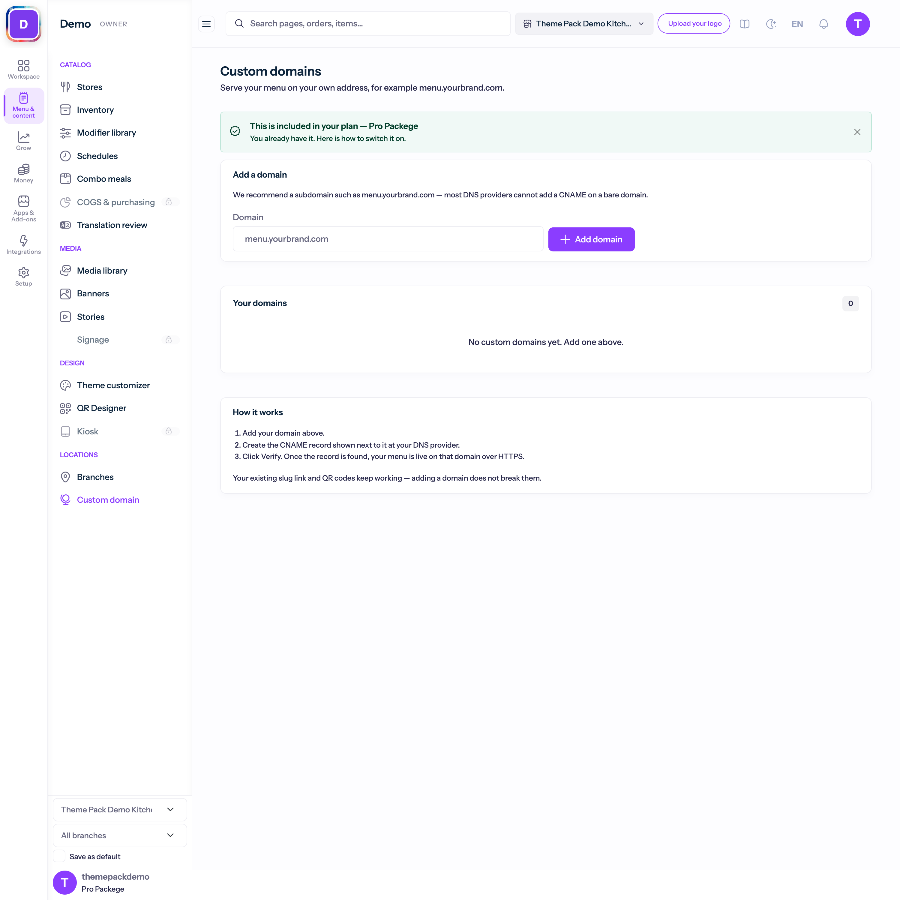

# Custom domain

By default your menu lives at `https://your-domain/your-slug` (see [QR codes
and sharing](qr-codes.md)). With a custom domain you can serve the same menu
on your own address instead — for example `menu.yourbrand.com`. This guide
covers adding a domain, the DNS record you need to create, verification, and
HTTPS.

## How it works

You add your domain in the dashboard, point it at the platform with a single
DNS record at your domain registrar, and click **Verify**. Once the platform
can see the record, the domain goes live: anyone who visits it sees your
restaurant's public menu. Your original slug link keeps working alongside it,
so existing QR codes and printed links are not affected.

Each restaurant can have its own custom domain, and a restaurant can have more
than one. A given domain can only be connected to one restaurant on the whole
platform — if a domain is already taken you will see "That domain is already
registered."

## Before you start

You need:

- A domain you own (bought from a registrar such as Namecheap, GoDaddy, or
  Cloudflare).
- Access to that domain's DNS settings, so you can add a record.

We recommend using a subdomain such as `menu.yourbrand.com` or
`order.yourbrand.com` rather than the bare domain (`yourbrand.com`). Most DNS
providers do not allow the record type you need (a CNAME) on a bare domain, so
a subdomain is the reliable choice.

## Add your domain

1. Go to **Stores** in the sidebar and open the restaurant's edit page.
2. Click the **Domains** tab.
3. Type your domain into **Add a domain** (for example `menu.yourbrand.com`)
   and click **Add domain**.

The domain appears in the list below with a **Pending** badge. The page also
shows the **CNAME target** — the platform address your DNS record must point
to. Keep this page open; you will need that value in the next step.

## Point your DNS

At your DNS provider (usually the company you bought the domain from), add a
CNAME record:

- **Type:** CNAME
- **Host / Name:** the subdomain part, for example `menu`
- **Value / Points to:** the CNAME target shown on the Domains tab

Save the record. DNS changes usually take effect within a few minutes, but
some providers can take up to an hour.

If your provider cannot add a CNAME (for example on a bare domain), the
platform also accepts a TXT record containing your domain's verification
token as proof of ownership. The token is not shown in the dashboard, so if
you need this route, contact support and they can give it to you. Note that a
TXT record only proves ownership — the domain still has to point at the
platform for visitors to reach your menu.

## Verify

Back on the **Domains** tab, click **Verify** next to your domain. The
platform does a live DNS lookup:

- If the record is found, the badge changes to **Verified** and you will see
  "Verified! Your menu will serve on this domain." The domain is live
  immediately.
- If not, you will see "DNS not detected yet. Add the TXT record shown and
  try again in a few minutes. A CNAME alone does not verify a domain." This almost always means DNS has not finished
  propagating — wait a few minutes and click **Verify** again. There is no
  limit on retries.

Verification is a one-time step. Once a domain shows **Verified** it stays
verified; you do not need to re-verify later.

## HTTPS and SSL

You do not need to buy or install an SSL certificate. Once a domain is
verified, the platform's servers issue a certificate for it automatically and
your menu is served over HTTPS. If the browser padlock does not appear within
about 15 minutes of verifying, contact support.

## What customers see

Visiting your custom domain shows the restaurant's public menu — the same
page as your slug link, with ordering, themes, and languages all working as
normal. The menu is served at the root of the domain (`menu.yourbrand.com`
itself, not a subpath).

Your QR codes keep encoding the platform link, so nothing breaks when you add
a domain. If you want printed material to show your own address instead,
update it after the domain is verified.

## Removing a domain

On the **Domains** tab, click **Remove** next to the domain. The domain stops
serving your menu immediately and becomes available to register again. Your
slug link is unaffected.

## Troubleshooting

- **"That domain is already registered"** — the domain is connected to
  another restaurant (possibly one of your own). Remove it there first, or
  use a different subdomain.
- **Verify keeps failing** — check the CNAME's value exactly matches the
  CNAME target shown in the dashboard, with no typos. Use a DNS checker such
  as your provider's own lookup tool to confirm the record is visible, then
  try again.
- **Domain is verified but shows another site** — your DNS record points
  somewhere else. Verification via TXT record proves ownership but does not
  route traffic; the CNAME (or equivalent) must point at the platform for
  visitors to reach your menu.
- **Invalid domain error when adding** — enter just the domain name
  (`menu.yourbrand.com`), without `https://` or a trailing slash.
