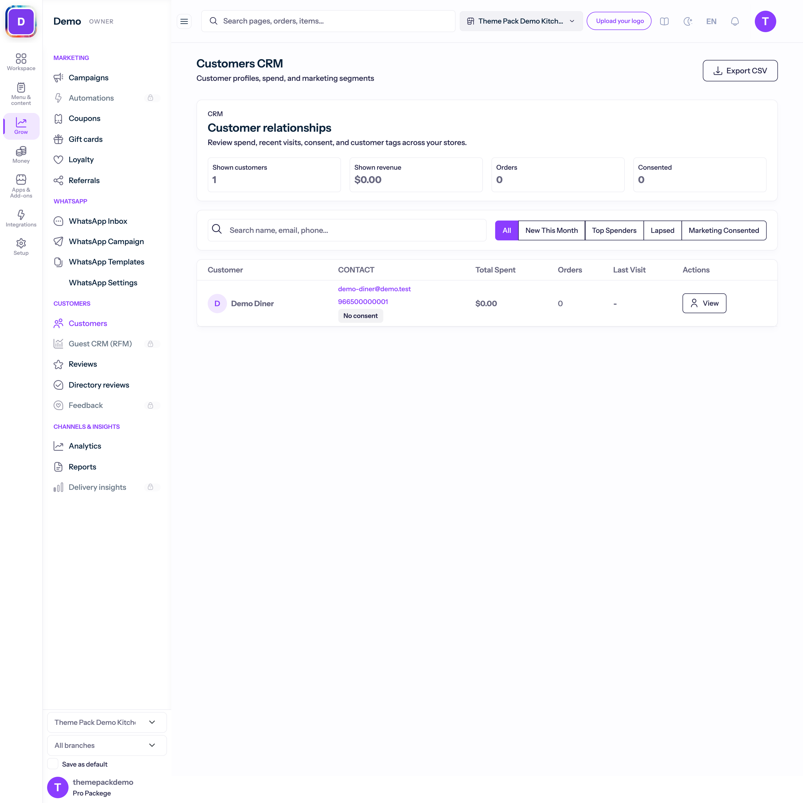

# Customers (CRM)

Every diner who orders from you or creates an account is stored as a customer record, scoped to your restaurant. The Customers area of the dashboard is your built-in CRM: a searchable list, per-customer profiles with lifetime spend and order history, tags and notes, and a CSV export. This page explains how customers are captured, how diners log in, and how to work with the list.

## Where to find it

In the dashboard sidebar, click **Customers**. This opens the customer list at `/customers`. Opening it requires the `customers` staff permission — a staff member whose role lacks it is blocked from the page (owners always have access). The list is strictly limited to your own restaurant(s) — you can never see another owner's customers.

## How customers get created

There are three ways a customer record appears in your list:

- **Checkout capture.** When a guest places an order and provides a name, phone number, or email, a customer record is upserted automatically (matched by email first, then phone, so the same person is not duplicated). The record's source is set to `checkout`.
- **Account registration.** A diner who registers an account on your ordering page (see below) becomes a customer.
- **SMS login.** A diner who logs in with a phone one-time code is found-or-created by phone number.

Marketing consent is only recorded when the diner explicitly ticks the "email/SMS me offers" box at checkout — it is never pre-checked. When they consent, the record stores `marketing_consent` (and/or `sms_consent`) along with a consent timestamp. A captured customer without consent is still saved so you keep their order history, but they are not marketing-consented.

## Customer accounts and login (for diners)

Whether diners can or must log in is controlled per restaurant. In your restaurant's **Settings** (Restaurant edit page), the **Customer login** field has three choices:

- **Default** — guest-only. No login is shown; ordering works exactly as it does without accounts.
- **Optional** — diners can order as a guest or log in.
- **Required** — diners must log in before ordering.

With "Optional", guests can still order without an account — login is simply offered alongside it. "Required" is the only mode that makes an account mandatory before ordering.

Logged-in diners get an account page on your ordering site at `/{store}/customer/account` where they can:

- Edit their profile (name, email, phone, birthday) and their marketing/SMS consent.
- Save and manage delivery addresses (one is marked default and prefilled at checkout).
- See their full order history and re-order a past order in one tap (unavailable items are skipped).

Diners can log in three ways: email and password, phone one-time code (OTP) via SMS, or account registration. These are all handled on the public ordering page, not in your dashboard.

## The customer list

The list shows 20 customers per page, ordered by most recent order by default. Each row shows the name, email, phone, order count, total spent, last order, and consent state.

**Search** — type in the search box to match on name, email, or phone.

**Segments** — quick filter buttons narrow the list:

- **New This Month** — customers created since the start of the current month.
- **Top Spenders** — sorted by total spend, highest first.
- **Lapsed** — no order in the last three months.
- **Marketing Consented** — only customers who opted in to marketing.

Selecting a segment reloads the list with that filter applied. Clear it by searching again or reloading the page.

## Customer profiles

Click a customer to open their profile. It shows:

- **Header stats** — LTV (lifetime value / total spent), total order count, and last visit date.
- **Details** — email, phone, source, consent date, and a badge showing whether they have marketing consent.
- **Tags and notes** — editable. Tags are comma-separated quick labels (for example "VIP, Frequent"); notes are private, internal, and never shown to the customer. Click **Save Notes** to store them.
- **Order history** — every order this customer placed, with date, type, table or address, and status, plus counts of completed and active orders.

### How the totals are calculated

Lifetime value, order count, and last-order date are maintained as the customer orders. When an order is confirmed/paid, the customer's order count is incremented, the order total is added to their total spent, and their last-order date is set to now. These are the numbers shown on the profile and used by the Top Spenders and Lapsed segments.

## Exporting customers

Click **Export CSV** on the list to download your customers as a spreadsheet. Any active search or segment filter is applied to the export — and it covers every customer that matches the filter, not just the page you are viewing — so you can, for example, filter to **Marketing Consented** and export just that group. The file includes ID, name, email, phone, order count, total spent, last order, marketing consent, tags, notes, and join date. Respect privacy law when using exported contact data — only market to customers who consented.

## Sending offers and campaigns

The CRM stores consent so you can market to the right people, but there is no "send offer" button on the customer profile or list itself. Marketing messages are sent from the separate campaigns and messaging tools (email, SMS, and WhatsApp), which can target your consented customers. Use the **Marketing Consented** segment or the CSV export to build your audience.

## What is planned but not on this page

- A one-click "send offer to this customer/segment" action from the CRM is described in the internal spec but is not built into the Customers pages today; use the campaign tools instead.
- Editing a customer's core contact details (name, email, phone) from the dashboard is not available — owners can edit only tags and notes here. Diners edit their own contact details from their account page.

## Related pages

- [Orders](orders.md)
- [Checkout settings](checkout-settings.md)
- [Campaigns](campaigns.md)
