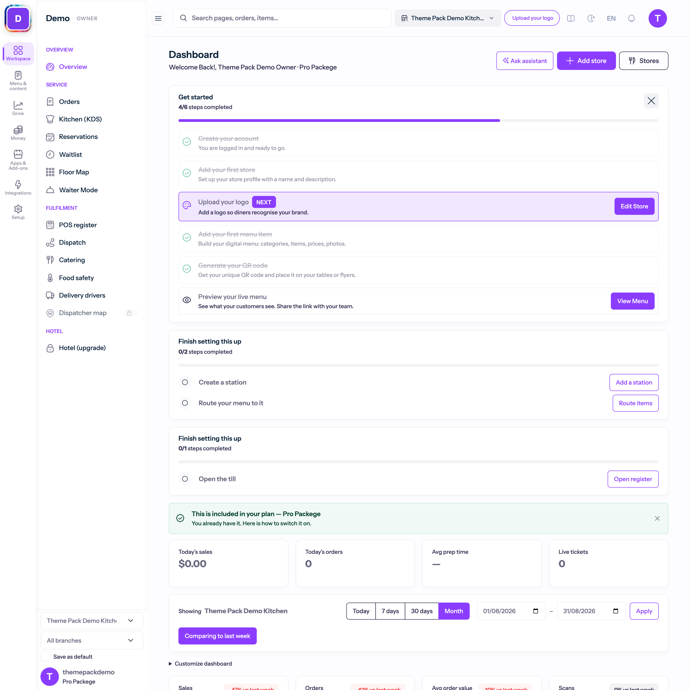

# Dashboard overview

The home dashboard is the first page you see after logging in. It lives at
`/dashboard` (the "Overview" item at the top of the sidebar) and summarises
scans, orders, restaurants, and plan usage across everything you own.

## What the stats mean

A **period bar** at the top scopes the page: preset chips for **Today**,
**7 days**, **30 days**, and **Month**, a custom from–to date range with
**Apply**, and a compare toggle. The same period model is shared with the
[Analytics](analytics.md) page.

Below it, owners see four KPI cards for the selected period, each with a
trend pill against the previous period and a small sparkline:

- **Sales** — revenue from successful orders.
- **Orders** — order count.
- **Avg order value** — sales divided by orders.
- **Scans** — QR/menu views.

Staff members see **Orders**, **Scans**, **Peak day** (highest daily scan
count), and **Stores** instead, and no billing sections.

If some of your older orders have not yet been included in the revenue
snapshots, a warning appears under the cards: **"Sales figures are still being
backfilled — N older orders are not counted yet."** The sales numbers are
correct for everything counted; ask your provider to run the order-totals
backfill to close the gap. The notice disappears once every order is counted.

Further down, owners see a **Plan usage** card with meters for what your plan
allows. Each shows how much you have used against your plan's limit (for
example "3 / 10"), or "Unlimited" when your plan has no cap. Limits include
any add-on boosts you have purchased. If a meter is close to full, upgrade
your plan or buy an add-on under Account > Add-ons.

An **Account health** card (dismissible) shows your recent resource usage as
five tiles: **Menu requests**, **Orders**, **Failed checkouts**, **AI
credits**, and **Storage (MB)**. **Failed checkouts** counts orders that
failed partway through creation and were rolled back — a healthy store shows
0 or a small number; a sudden spike after nothing changed on your side is
worth reporting to your provider. Declined coupons are counted separately, on
the **Declined today** tile of the [Coupons](coupons.md) page.

## Charts and lists

- **Scans overview** — a daily line chart of scans for the current month.
  For deeper reports (devices, hours, languages, repeat visitors), open
  Grow > Analytics in the sidebar.
- **Quick access** — shortcut buttons to Add restaurant, Orders, Analytics,
  Kitchen display, Customers, and Settings.
- **Your restaurants** — your five most recent restaurants, each with links to
  view the public menu page and its orders. "View all" opens the full list.
- **Recent billing** — your last few plan/add-on transactions. Staff see an
  audience snapshot (unique, repeat, and total visitors) instead.

## Setup checklist

New accounts see a setup checklist card on the dashboard. It has six steps
that tick themselves off from real data: create your account, add your first
restaurant, upload a logo, add a menu item, generate your QR code, and preview
your live menu (the last two complete after your menu gets its first scan).
A progress bar shows how many steps are done. Each unfinished step has a
button that takes you to the right page. You can dismiss the checklist at any
time; it stays hidden afterwards.

## Alerts and banners

Banners appear above the dashboard content when something needs attention:

- **Trial countdown** — while you are on a free trial, a banner shows how many
  days are left. It turns red at two days or fewer, and switches to "Your free
  trial has expired." once the trial ends. The banner links to the upgrade
  page so you can pick a paid plan.
- **Payment failed** — if a subscription renewal payment fails, a red banner
  asks you to update your payment method to avoid interruption, with a link
  to your subscription page.
- **Announcements** — notices published by the platform team (maintenance,
  new features, and so on). Each has a dismiss button; dismissed announcements
  stay hidden on that browser.

The trial countdown and payment-failed banners appear on every dashboard page.
Announcements appear on the overview page only.

## Switching store and branch

If you own more than one restaurant, or a restaurant with branches, the
dashboard is always scoped to one store (and optionally one branch). The
current selection is shown in the **sidebar footer**, just above your account
name.

To switch:

1. Click the store name in the sidebar footer to open the switcher.
2. Pick a store from the **Store** dropdown. The page reloads scoped to that
   store.
3. If the store has branches, pick a branch from the **Branch** dropdown, or
   choose **All branches** to see combined data.
4. Tick **Save as my login default** if you want this selection every time
   you log in.

Notes on how the selection behaves:

- The selection is remembered for your current session. Your saved login
  default (if any) applies when you start a new session.
- Opening any page that belongs to a specific restaurant (for example a
  restaurant's menu editor) automatically switches the sidebar to that store,
  so the rest of the dashboard follows along.
- Branch pickers inside individual pages update the sidebar selection too.
- Staff accounts pinned to a single branch cannot change the branch — the
  dropdown is locked to their branch.
- If a saved default store or branch is later deleted or you lose access to
  it, the dashboard quietly falls back to your first store and all branches.

## Finding your way around the sidebar

The sidebar is grouped into five sections. Some items only appear when the
feature is enabled on your installation or included in your plan:

- **Workspace** — Overview, Restaurants, Orders, Customers, Reservations,
  Waitlist, Kitchen (KDS), Kitchen stations, Modifier library, Banners,
  Media library, Branches, Floor map, Inventory.
- **Grow** — Campaigns, Coupons, Reviews, Loyalty, Referrals, Analytics.
- **Team** — Staff, Activity log.
- **Platform** — POS register (opens in a new tab), Theme customizer,
  AI ordering, HungerStation, and Reseller portal (only if you run a
  reseller account).
- **Account** — Integrations, API & Webhooks, Delivery drivers, Wallet,
  Add-ons, Settings.

Waitlist, Floor map, Reviews, and Loyalty need at least one restaurant before
they appear. Your account name and current plan are shown at the very bottom
of the sidebar; clicking them opens Settings.

## Setting a goal

You can set a monthly goal that tracks your progress on the dashboard and the
[analytics](analytics.md) page. Post to the dashboard goal endpoint (the
`dashboard/goal` route) to save one:

- **Goal type** — Scans, Orders, or Revenue. Only one type is active at a
  time.
- **Goal value** — the target number for the month (0 clears the goal).

When a goal is active, the matching KPI card on the analytics page shows a
progress bar with your percentage toward the target. On the dashboard, the
scans chart reflects the goal when the type is set to scans.

## Tips

- The "Add restaurant" button at the top right of the dashboard is the
  fastest way to create a new QR menu.
- The plan name shown in the welcome header (and in the sidebar footer) is
  your current subscription; plan start and expiry dates are on the
  subscription page.
- Staff members see a reduced dashboard: their workspace note ("You are
  managing ... as ...") replaces the owner welcome, and billing sections are
  hidden.
