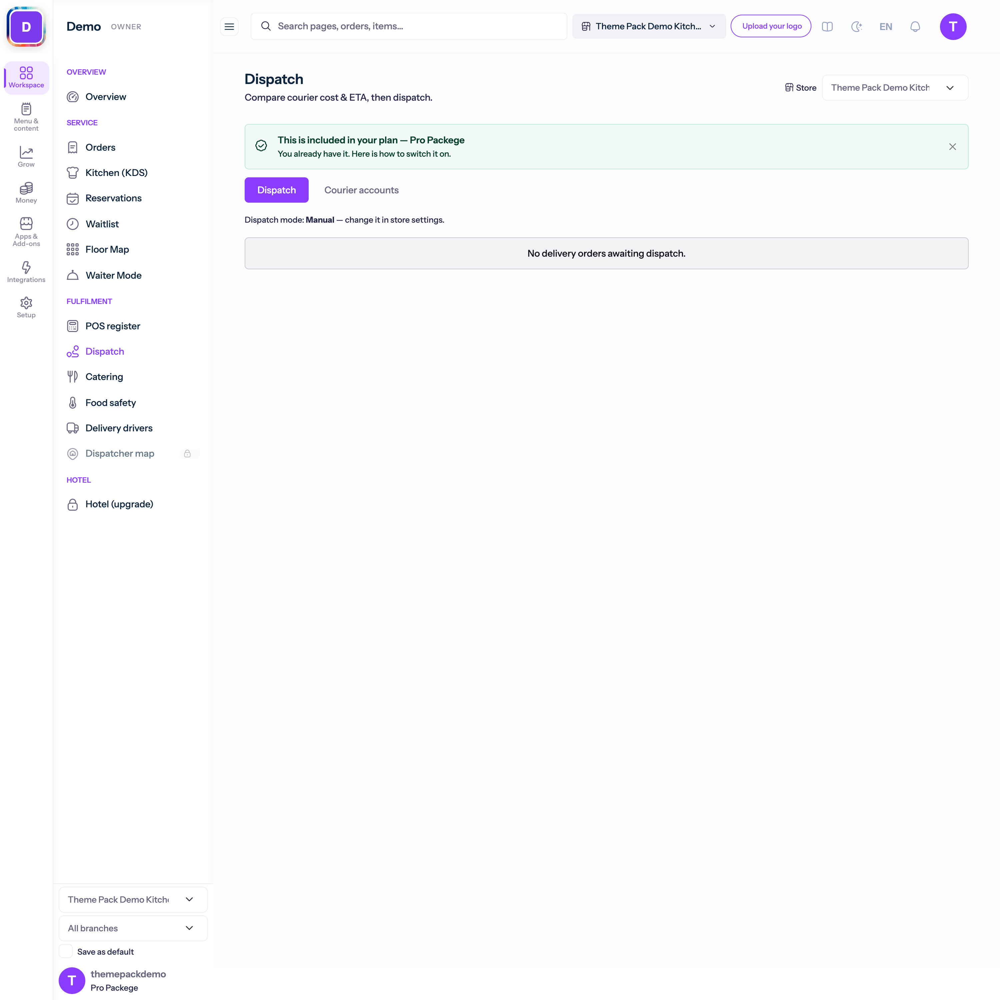

# Delivery and drivers



Delivery is one of the three ordering types customers can pick at checkout
(alongside on-table and takeaway). This guide covers switching delivery on,
setting a delivery charge and a minimum order value, managing your own
delivery drivers, following a delivery from assignment to drop-off, reading
the delivery insights report, and receiving orders from the HungerStation
aggregator.

## Turning delivery on

Open your restaurant's settings (edit the restaurant) and go to the
**Ordering** tab. The delivery fields there are:

- **Delivery ordering** — set to Yes to offer delivery at checkout.
- **Delivery charge** — a flat fee added to every delivery order.
- **Minimum order value** — delivery orders below this subtotal are held
  back at checkout with a minimum-order notice; the customer must add more
  before they can place the order. Leave it at 0 for no minimum.

When a customer chooses delivery, the checkout captures their phone number
and a delivery address; both are attached to the order and shown to you and
to the assigned driver.

Delivery zones — named areas with their own fees, or a delivery radius around
the restaurant — are planned but not yet available. Today there is one flat
delivery charge and one minimum for the whole restaurant, and the platform
does not restrict how far away the customer's address may be.

## Managing drivers

Open **Delivery drivers** in the sidebar (truck icon). The page lets you
create a driver, share their one-time app token, and see their delivery
activity. It has two cards:

**Add driver** — enter a **Name** (required), and optionally **Phone**,
**Email**, and a **Restaurant**. Choosing "All restaurants" lets the driver
deliver for any of your restaurants; picking one restricts them to it.

When you save, a one-time **app token** is shown. Copy it immediately and
hand it to the driver — only a hashed form is stored, so the raw token
cannot be shown again. The token is what the driver uses to sign in to the
driver API (see below).

The **Drivers** table lists each driver with their phone, restaurant, **Last
location** (how long ago they last reported a GPS position, or "Never"), and
a Status badge. Row actions:

- **New token** — generates a replacement token (shown once, like the
  original) and immediately invalidates the old one. Use this if a token is
  lost or a phone is stolen.
- **Disable / Enable** — a disabled driver's token stops working instantly,
  but the driver record and history are kept.
- **Remove** — deletes the driver after a confirmation.

## Assigning deliveries and the delivery lifecycle

A delivery order moves through these statuses: pending, assigned, picked up,
out for delivery, and finally delivered or failed. Each step is timestamped,
and entering assigned, out-for-delivery, delivered, or failed fires a webhook
event (`order.driver_assigned`, `order.out_for_delivery`, `order.delivered`,
`order.delivery_failed`) if you have webhooks set up — see
[API webhooks](../dev/api/webhooks.md).

When your plan includes the driver features, the **Dispatcher map** page
(sidebar, next to Dispatch) is the dashboard way to assign: it shows live
**Drivers** (with a freshness dot and last GPS position) alongside
**Unassigned orders**, and each unassigned order carries one-click buttons
for the suggested drivers — nearest first, with the distance shown. Pressing
a driver's button assigns the delivery. A separate **Dispatch** page compares
third-party courier cost and ETA per order and dispatches to a courier
service instead of your own driver.

Only your own drivers can be assigned, and a driver restricted to one
restaurant cannot be assigned to another restaurant's orders.

**For your developer:** assignment is also available on the owner API —
`POST /api/v1/stores/{id}/orders/{orderId}/assign` with the driver's id,
authenticated by one of your API tokens. Drivers themselves work against
their own token-authenticated endpoints under `/api/v1/driver`: list assigned
deliveries (`?active=1` hides finished ones), update the status (picked up,
out for delivery, delivered, or failed — they cannot assign orders), attach a
short note, and report GPS position. The **Driver app API docs** button on
the Delivery drivers page opens the full endpoint reference. A packaged
driver mobile app with background GPS and push notifications is specced but
not yet built; today a driver integration uses these API endpoints directly.

## Live tracking

Two tracking surfaces exist:

- **Customer tracking page** — every order gets a private track link. It
  shows the order's status timeline (received, preparing, ready, and, for
  delivery, picked up / out for delivery / delivered) that refreshes
  automatically. See [Orders](orders.md) for details.
- **Driver position via the API** — when a driver reports their location,
  the Delivery drivers page shows how fresh their last position is, and the
  public track endpoint (`GET /api/v1/track/{token}`) returns the driver's
  name, phone, and last coordinates — but only while the order is picked up
  or out for delivery, never before or after. Custom storefronts or apps can
  use this to draw a live map.

## Delivery insights

Delivery insights answers "when and where does my delivery demand happen?" It
is a read-only report — there is nothing to configure on it.

There is no sidebar link. Open it directly at:

```
/delivery-insights
```

A restaurant dropdown at the top switches which restaurant you are looking at.
There is no branch selector and no date-range picker; each panel uses its own
fixed window.

**Demand forecast** — the next 7 days, one row per day: projected **Orders**,
projected **Revenue**, and a suggested **Staff** count. Underneath, a
**Tomorrow — suggested prep** row lists items with a suggested quantity. If
your order history is too short the panel says so instead of guessing.

**Demand heat grid** — delivery orders by weekday and hour over the last 8
weeks, as a 7-row by 24-column grid. Darker blue means more orders, and hovering
a cell shows the exact weekday, hour and count. The total for the window is
printed above the grid. With no delivery orders in the window it says so.

**Top delivery areas** — the most frequent keywords found in your delivery
addresses, with a count each. This is approximate text matching, not geocoding:
it groups on words in the address, so treat it as a rough guide to which
neighbourhoods you serve rather than a map.

**Courier GPS points** — how many real coordinates have been captured from
courier tracking (see [Live tracking](#live-tracking) above). It reports the
number of points available; the panel itself does not draw a map, and notes
that a map layer renders them where courier tracking is active.

Delivery insights is a gated feature. It opens only when the platform
kill-switch for `demand_forecast` is on (a superadmin setting — it ships
**off** by default) and the store owner's plan includes it. `demand_forecast`
is plan-gated — it is available on plans that include it. See
[Plans and billing](plans-billing.md).

## HungerStation

If you sell on HungerStation, the platform can receive HungerStation orders
directly so they appear in your Orders list and kitchen display like any
other order. Open **HungerStation** in the sidebar (bike icon) and pick the
restaurant at the top. A banner shows whether that restaurant is Connected,
and the page has three cards:

- **Connect credentials** — enter your own HungerStation partner credentials
  (client id and client secret from the HungerStation Partner Portal, plus
  an optional chain id and webhook secret) and press **Save & connect**.
  Credentials are yours alone (bring your own keys), stored encrypted, and
  never shared with other accounts.
- **Branch → vendor mapping** — match each of your
  [branches](branches.md) to its HungerStation vendor id (and chain id if you
  have one). Incoming orders are routed to the right restaurant through this
  mapping, so it must be filled in before orders can flow.
- **Event log** — the 50 most recent inbound and outbound HungerStation
  events (direction, kind, order, success flag, time) for troubleshooting.

Once connected, incoming HungerStation orders are created as delivery orders
with their HungerStation order code attached; menu items are matched by SKU,
and any unrecognised item is flagged on the order rather than silently
dropped. Duplicate webhook deliveries never create duplicate orders. Status
sync back to HungerStation and a catalog-push service are built as well.

Note: the integration is fully built and tested against a simulated
HungerStation client, but the live connection to HungerStation's production
API is not switched on platform-wide. Ask your platform administrator before
relying on it for real orders.

## Other delivery platforms

Groundwork exists for receiving orders from other delivery platforms (such as
Uber Eats) through a generic inbound webhook (`POST /webhook/delivery/{provider}`),
but it is scaffolding only — there is no owner-facing setup page or
production-ready connection yet. HungerStation is the only aggregator with a
full integration today.
