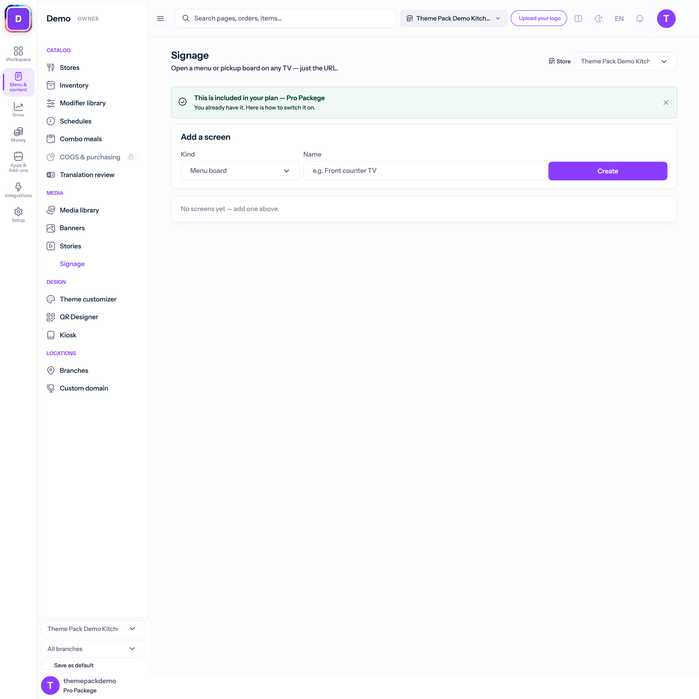

# Digital signage screens



Digital signage puts a screen on your wall without installing anything on it.
You create a screen in the dashboard, get a private web address, and open that
address in the TV's browser. Two kinds exist: a big-type **menu board** that
rotates through your categories, and a **pickup / status** board that shows
which orders are being prepared and which are ready.

## Opening the page

There is no sidebar link. Open it directly at:

```
/signage
```

Use the store picker in the action bar to switch restaurant. There is no branch
selector on this page.

## Adding a screen

Fill in **Add a screen**:

- **Kind** (required) — **Menu board** or **Pickup / status**.
- **Name** — optional, up to 120 characters, for example "Front counter TV".
  With no name, the card shows the kind instead.

Press **Create**. Each screen gets its own random token, and is created active.

## Each screen's card

Every screen appears as a card showing its QR code (in your store's QR design —
see [QR codes](qr-codes.md)), its name, an **active** or **off** badge, the
board kind, and its address:

```
/signage/{token}
```

Click the address box to select it, or press **Open** to launch the board in a
new tab. Point the TV's browser at that address once and leave it there.

The buttons on the card:

- **Turn off / Turn on** — an inactive screen's address stops working
  immediately. Turning it back on restores the same address.
- **New token** — issues a fresh token after a confirmation. **The old address
  stops working**, so any TV still on it goes dead until you re-open the new
  one. Use this if a link has leaked.
- **Delete** — removes the screen after a confirmation.

**The token is the only credential.** Anyone with the link sees the board, with
no sign-in. Treat it like a password: don't publish it, and rotate it if it
gets out.

## What each board shows

### Menu board

Your active categories in their configured order, each with its active,
in-stock items and prices. Sold-out (86'd) items are hidden, and a category
with no items left is dropped entirely rather than shown empty. The board
rotates through categories every 8 seconds and re-fetches the menu every 60
seconds, so an 86 or a price change reaches the wall within a minute without
anyone touching the TV.

### Pickup / status board

Two columns — **Preparing** and **Ready** — built from live orders in those
statuses, up to 60 at a time, newest activity first. Each entry shows the order
number and the customer's **first name only**. Scheduled orders that have not
been released yet stay off the board. It refreshes every 10 seconds, and shows
"Screen unavailable" if the address stops being valid.

If the board's request is refused, that is what you will see — check the screen
is still active and the feature is still on.

Screens can be pinned to a single branch, and the pickup board then only shows
that branch's orders. The dashboard form does not yet expose a branch field, so
today every screen you create covers the whole restaurant.

A pickup screen also carries an optional configuration block (voice announce,
auto-clear minutes, brand colour and logo, promo panel). There is no dashboard
editor for it, and the shipped pickup board page does not render those options —
only auto-clear is applied, and only if a value has been set outside the
dashboard.

## Turning it on

Digital signage is a gated feature. Boards serve only when both of these hold:

- the platform kill-switch for `digital_signage` is on (a superadmin setting —
  it ships **off** by default), and
- the store owner's plan includes it (`digital_signage` is plan-gated; check
  your plan's feature list).

If either check fails, every board address returns "not found" — the same
answer as a wrong token, so nothing about your account leaks to whoever holds
the link. The dashboard page is blocked by the same two checks. See [Plans and
billing](plans-billing.md).

## Signage or the order-status board?

Both put a screen in the room, and they are separate features:

- A signage **pickup** board shows order numbers with first names, is created
  per screen with its own secret token, and can be pinned to a branch.
- The [order-status board](order-status-board.md) shows **daily token numbers
  only** — no names at all — lives at a public address built from your store
  slug, and is switched on from the restaurant's settings.

Use the order-status board when the screen faces a public dining room and you
want no customer data on the wall.

## Related pages

- [Order status board](order-status-board.md) — the token-number Preparing/Ready screen.
- [Menu categories](menu-categories.md) and [menu items](menu-items.md) — what the menu board renders.
- [QR codes and sharing](qr-codes.md) — the branded QR design used on each screen card.
- [Branches](branches.md) — per-branch scoping of a pickup board.
