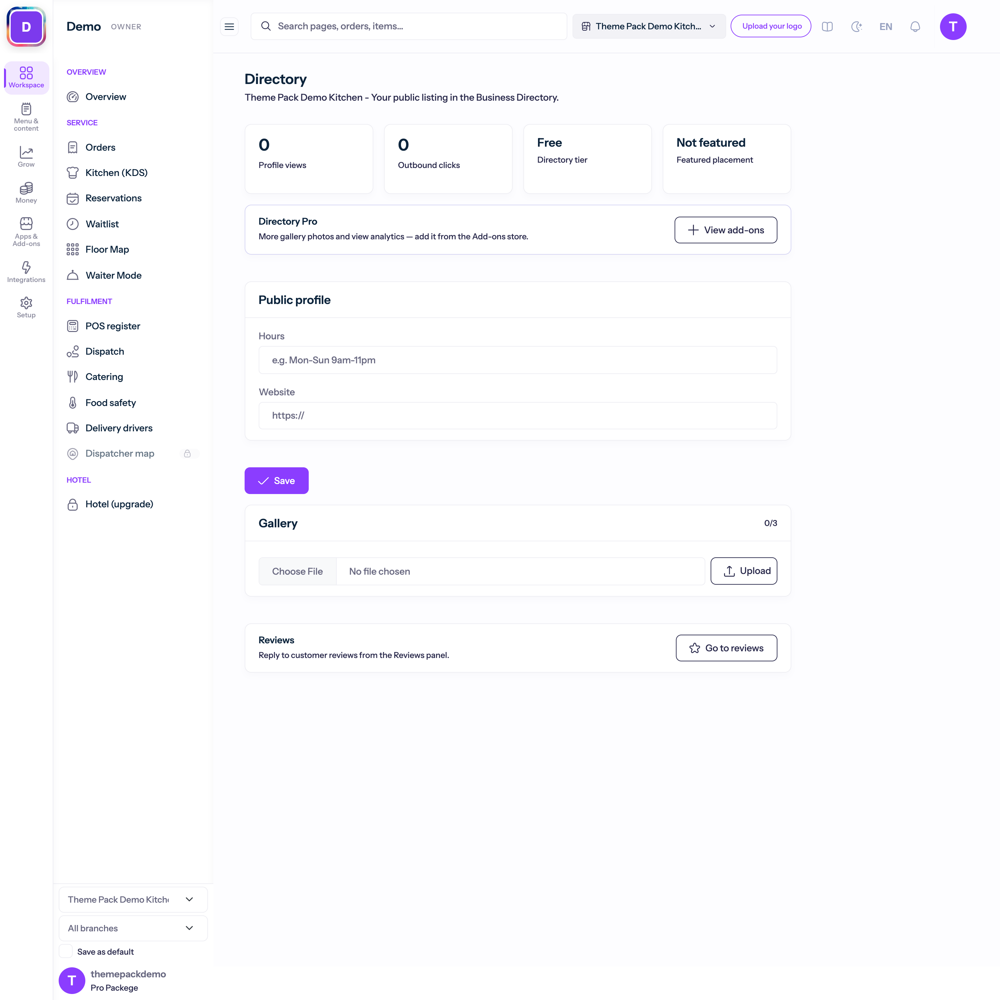

# Business Directory listing

The Business Directory is a public "explore" surface where diners browse
restaurants by city and cuisine, on a list and on a map. Your store can have
a listing there with its own profile page, photo gallery, hours, website
link and reviews — and you can pay for extra placement to stand out. This
page covers what a listing is, the **Directory** tab in your dashboard, and
what the paid tiers buy.

The directory is a platform-level module: your platform provider decides
whether it is switched on at all and which cities it covers. If it is off,
the public pages and your Directory tab are simply absent — nothing on your
side is lost.

## How listings appear to diners

Diners browse the directory's explore pages by city, filter by cuisine, and
see results on a map with pins. Each listing has a public profile page with
the essentials: name, cuisines, hours, gallery photos, an outbound link to
your menu or website, and customer reviews. Anyone can also report a problem
with a listing, and a business can request removal of an unclaimed listing
about it.

Some listings start out **unclaimed** — created from public data before the
business joined the platform. If you find an unclaimed listing for your
restaurant, open it and follow its claim link: you sign in, submit the
claim, and confirm through a verification link. Once approved, the listing
is yours to manage from the dashboard.

## The Directory tab

Open **Directory** in the sidebar. The tab appears once your store has a
directory presence — a claimed listing, or a marketplace opt-in (see
[Marketplace listing](marketplace-listing.md)). It shows:

- **Profile views** and **Outbound clicks** — how many diners saw your
  listing and clicked through.
- **Directory tier** — Free or Pro.
- **Featured placement** — Featured, Pending curation, or Not featured.

Below the stats:

- **Public profile** — set your **Hours** (free text, e.g. "Mon-Sun
  9am-11pm") and **Website**. **Cuisines** are assigned by the directory
  team, so they stay consistent across the whole directory; the tab shows
  which ones your listing carries.
- **Gallery** — upload photos of your food and space. The free tier includes
  3 photos; **Directory Pro** raises the cap to 12. Remove a photo with the
  × on its corner.
- **Reviews** — replies to customer reviews happen in your normal
  **Reviews** panel; the tab links straight to it with **Go to reviews**.

## What paid placement buys

Two add-ons upgrade your listing, both bought from the **Add-ons store**
(the Directory tab shows a **View add-ons** shortcut when you are on the
free tier):

- **Directory Pro** — the bigger 12-photo gallery and view analytics.
- **Directory Featured Placement** — puts your listing in the featured spots
  at the top of results. Buying it requests the placement; the directory
  team curates featured spots, so your tab shows **Pending curation** until
  it goes live, then **Featured**.

Neither tier is required for a normal listing — the free profile, hours,
website link, 3-photo gallery and reviews are included.

## Related pages

- [Marketplace listing](marketplace-listing.md) — selling through the
  platform's delivery marketplace (a separate opt-in).
- [Reviews, ratings and feedback](reviews-feedback.md) — reading and
  replying to customer reviews.
- [Plans, billing and subscriptions](plans-billing.md) — buying and managing
  add-ons.
- [Media library](media-library.md) — managing the images you upload.
