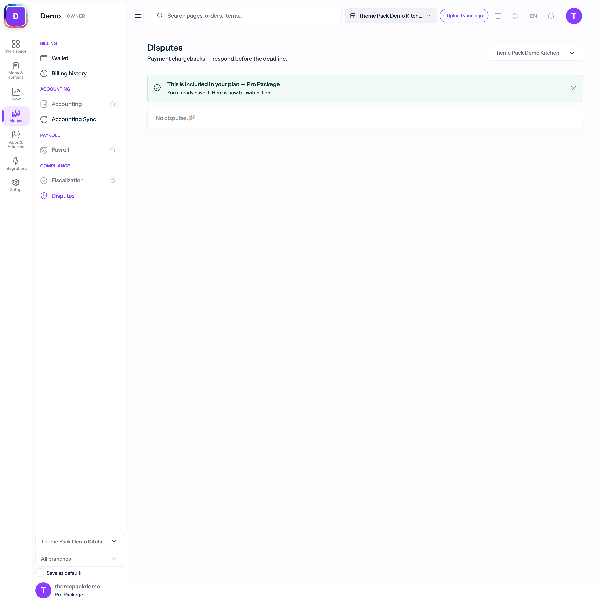

# Disputes and chargebacks

A dispute (chargeback) is a customer asking their card issuer to reverse a
payment. The **Disputes** page lists disputes raised against your Stripe
payments, counts down the evidence deadline, and lets you send your written
evidence to Stripe without leaving the dashboard.

Disputes is a paid feature. If your plan does not include it, no **Disputes**
entry appears in the sidebar.

## Opening the page

Click **Disputes** in the sidebar under **Money → Compliance**. The page is
titled **Disputes** and shows one restaurant at a time; use the store selector
in the page header to switch.

## Where the list comes from

Disputes arrive automatically from Stripe's `charge.dispute.*` webhooks — you do
not add them by hand. Each event is matched back to the charge or payment intent
on one of your transactions, which is how the dispute is attached to the right
restaurant and order. Repeated webhook deliveries update the same dispute rather
than creating duplicates, and you get an alert the first time a dispute opens.

Only Stripe disputes appear here.

## Reading the list

Open disputes are shown first, ordered by how soon the evidence is due, up to
100 rows. Each row shows:

- **Opened** — the date the dispute was raised.
- **Amount** — currency and value.
- **Reason** — Stripe's reason code (for example `fraudulent`,
  `product_not_received`).
- **Status** — Stripe's status. Open disputes are amber; **won** is green;
  everything else is grey.
- **Respond by** — a countdown to Stripe's evidence deadline. It turns amber
  within three days and shows **overdue** in bold red once the deadline passes.
- **Order** — the order number, when the dispute could be traced to one.

**Open in Stripe** on any row opens that dispute in the Stripe dashboard.

## Submitting evidence

On an open dispute, click **Submit evidence** (or **Update evidence** if you
have sent some already). A form expands with Stripe's written evidence fields:

- Product description
- Customer name
- Customer email address
- Billing address
- Shipping address
- Shipping carrier
- Shipping tracking number
- Service date
- Refund policy disclosure
- Cancellation policy disclosure
- Uncategorized text

Fill in whatever applies — each field takes up to 20,000 characters — and click
**Send to Stripe**. You must complete at least one field; an empty form is
rejected with "Add at least one piece of evidence before submitting."

Once accepted, the row records when the evidence was sent. Submitting again
**replaces** what you sent before, so re-send everything you want Stripe to see,
not just the changes.

### What can go wrong

- **"This dispute is already closed."** — closed disputes cannot be answered
  from here.
- **"Connect Stripe for this store before submitting evidence."** — the store
  has no Stripe key of its own and the platform has none configured either.
- **"Stripe rejected the evidence: …"** — Stripe's own error message, passed
  through unchanged.

## Files and receipts

Only text evidence can be sent from this page. Receipts, signed delivery proof
and any other **file** evidence must still be uploaded in the Stripe dashboard —
use the **Open in Stripe** link on the row.

## Scope and limits

- The list is scoped to the current restaurant, and evidence is always submitted
  against a dispute belonging to that restaurant.
- Evidence goes to the store's own Stripe secret key if it has one, otherwise to
  the platform's key.
- Disputes from gateways other than Stripe are not tracked here.

## Related pages

- [Orders](orders.md) — the order a dispute points back to.
- [Checkout settings](checkout-settings.md) — connecting Stripe to a store.
