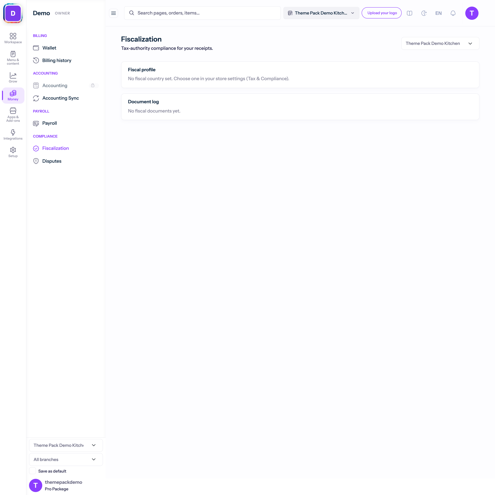

# Fiscalization (tax-authority compliance)

Some countries require restaurant receipts to be registered with the tax
authority — cleared before printing, or reported afterwards. The
**Fiscalization** console shows your restaurant's fiscal profile, the log of
documents sent to the authority, and the onboarding or credential forms for the
country you operate in.

Fiscalization is a paid feature and each country must also be switched on by the
platform. If your plan does not include it, the sidebar shows a locked
**Fiscalization** entry. If your country is not switched on, the page opens but
shows "This country is not enabled by the platform yet." and the setup forms
stay hidden.

## Before you start: your fiscal identity

Fiscalization reads its identity fields from the restaurant's edit page, in the
**Tax & Compliance** block (which is only shown when fiscalization is available
on your installation):

- **Fiscal country** — chooses the profile. The countries that ship with a
  profile are Saudi Arabia, Jordan, Egypt, United Arab Emirates, Bahrain,
  Kuwait, Oman, Qatar, Iraq, Algeria, Morocco and Tunisia.
- **Legal name** — the registered name used on documents. If left blank, the
  restaurant title is used.
- **VAT / Tax registration number**.
- **Commercial registration (CR) number**.

Save the restaurant before going to the console.

## The console

Click **Fiscalization** in the sidebar under **Money → Compliance**. The page is
titled **Fiscalization**; use the store selector in the page header to switch
restaurant.

The **Fiscal profile** card shows the country and its code, the profile's
default VAT rate, and the driver mode — `clear_before_print` (the document must
be cleared by the authority before you hand over the receipt) or
`report_after_print` (the receipt prints and is reported afterwards). With no
fiscal country set, the card tells you to choose one in your store settings.

The profiles that ship with a live driver are Saudi Arabia (VAT 15%, report
mode), Jordan (VAT 16%, clear mode) and Egypt (VAT 14%, report mode). Other
countries provide the profile — VAT rate, receipt fields and QR — without a
submission driver.

## Saudi Arabia — ZATCA device onboarding

For a restaurant whose fiscal country is **SA**, a **ZATCA device onboarding**
card appears. It onboards one device (a branch till) into ZATCA's Fatoora
system.

1. Generate an OTP in the FATOORA portal.
2. Fill in the form:
   - **Device key (per branch)** — a name you choose for this device. It becomes
     the certificate's common name.
   - **Branch ID (optional)** — the branch in your dashboard this device belongs
     to.
   - **FATOORA OTP** — 6 to 12 characters.
3. Click **Onboard**.

What the platform does with that, in one pass:

1. Creates (or reuses) the device record.
2. Requests a **compliance CSID** from ZATCA using your legal name and VAT
   number.
3. Runs six compliance sample documents.
4. If those pass, requests the **production CSID**.

The result is reported back as "Device onboarded." plus the device's new status,
or "Onboarding failed:" with the message ZATCA returned. Onboarded devices are
listed with their status in the **Devices** card.

The receipt QR code uses the five-tag TLV form (seller name, VAT number,
timestamp, total, tax amount) until a live driver supplies the full tag set.

## Jordan — JoFotara credentials

For fiscal country **JO**, a **JoFotara credentials** form asks for the
**Client ID**, **Secret Key** and **Activity Number** from the JoFotara portal.
Click **Save**. The values are stored in the platform's encrypted credential
vault, never as plain settings.

## Egypt — ETA credentials and POS devices

For fiscal country **EG** there are two cards.

**ETA credentials** takes the taxpayer **RIN** and the POS device **Client ID**
and **Client Secret** from the ETA portal. Click **Save**.

**Register POS device** takes:

- **Device serial** (required)
- **Branch code**
- **Branch ID (optional)**

Click **Register**. The device is stored with status `registered` and appears in
the **Devices** card. Registering also creates a private callback secret for
this restaurant, which is how ETA's later valid/invalid notification is
authenticated and matched back to your documents — a document flips to
**accepted** or **rejected** when that notification arrives.

## The document log

The bottom card lists the 50 most recent fiscal documents for the restaurant:
number, type, status, total with currency, and the date created. Statuses show
green for **accepted**, red for **rejected**, grey otherwise.

A **Resubmit** button appears on rejected documents. It puts the document back
in the queue for another submission attempt. Documents that are already
**accepted** or **superseded** cannot be resubmitted — you get "Document already
finalized."

## Scope and limits

- Everything on this page is scoped to the current restaurant. A document
  belonging to another restaurant returns "not found".
- Credentials are per restaurant, not per account.
- The credential and device forms only appear for SA, JO and EG, and only when
  the platform has switched that country on.
- This page reflects what the platform submits and what the authority replies.
  It is not a substitute for advice from your accountant or from the tax
  authority about your own registration obligations.

## Related pages

- [Accounting](accounting.md) — your ledger and VAT report.
- [Printing](printing.md) — receipt printing and routing.
- [Branches](branches.md) — the locations devices are registered against.
