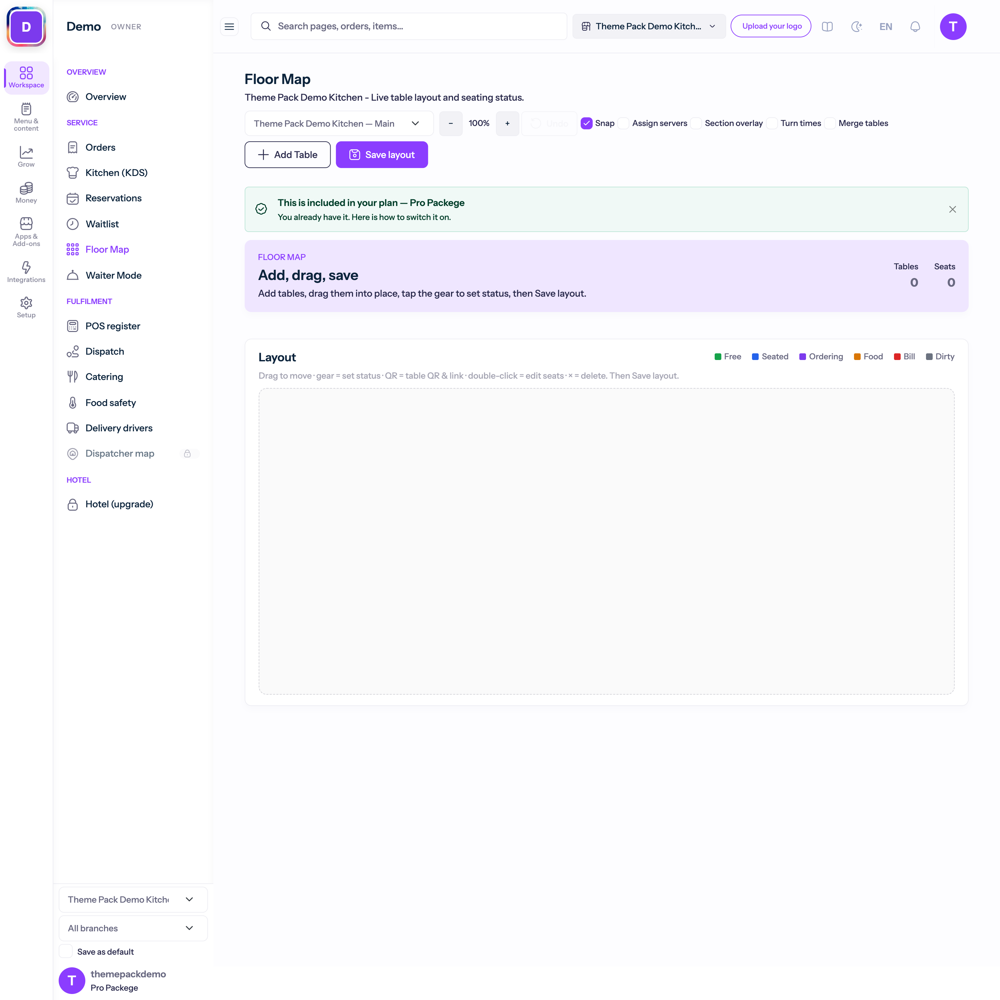

# Floor map and tables

The floor map is a visual editor for your dining room. You drag tables onto a canvas to match your real layout, set how many seats each has, group them into rooms and sections, assign a server, and set each table's live status. It uses the same tables as your QR codes and on-table ordering, shown as a plan instead of a list.

## Who can use it

The floor map is owner-only. Each floor plan belongs to the restaurant it was created under, and the editor only loads restaurants owned by the signed-in account. Staff members and other users cannot open another owner's floor map.

## Opening the floor map

In the dashboard sidebar, open **Floor map** (grid icon). You can also reach it from the **Tables & QR** screen using the **Floor Map** button.

If you run more than one restaurant, a restaurant picker appears in the top action bar so you can switch which floor plan you are editing. A **Branch** dropdown appears next to it whenever the restaurant has branches set up, so you can switch which branch's layout you are editing. Each branch keeps its own separate layout, so switch branches before arranging tables.

The header shows two running totals for the current branch: **Tables** (how many tables are placed) and **Seats** (the sum of their seat counts).

## Adding and arranging tables

- **Add table** places a new table on the canvas. It is numbered automatically (one higher than your highest table number), starts with 4 seats and a square shape, and appears near the top-left.
- **Drag** a table to move it. Dragging works with a mouse, a touchscreen tablet, or a pen.
- **Snap** (checkbox, on by default) rounds each table to a 20-pixel grid when you drop it, so rows line up neatly. Turn it off for free placement.
- **Zoom in / Zoom out** scale the canvas between 50% and 200% so you can fit a large room on screen. The current zoom shows as a percentage.
- **Undo** reverses your last table move (it remembers up to the last 50 moves).
- The **×** button on the corner of a table deletes it.

Table positions and edits are not stored until you press **Save layout**. Saving writes every table's position, shape, seats, room, section, server, note, and capacity range in one go, and the button briefly shows a confirmation.

## Editing a table's details

Double-click a table to edit it through a short series of prompts:

1. **Seats** — the physical seat count (1 to 50). This updates the seat total in the header.
2. **Capacity range** — an optional minimum and maximum party size, entered as `min-max` (for example `2-4`). Leave it blank to clear it. The range is kept within the seat count, and if you enter it backwards it is corrected automatically.
3. **Room / zone** — an optional label such as `Patio`, `Bar`, or `Main`. Leave blank to clear. Rooms let you group tables loosely on the plan.

Tables are square by default. The saved layout also supports circle and rectangle shapes, but this editor does not currently expose a control to switch a table's shape.

## Sections and servers

Turn on the **Assign servers** checkbox, then tap a table (a tap, not a drag) to walk through:

1. **Section name** — a short grouping such as `Terrace` or `Window` (blank clears it).
2. **Assign server** — pick from a numbered list of your active staff, or `0` for none.
3. **Table note** — a short note such as VIP, birthday, or an allergy. A pin marker appears on any table that has a note.

Turn on **Section overlay** to colour each table by its section and reveal a **Section coverage** summary underneath the canvas. Coverage lists each server (plus an Unassigned group) with how many tables and how many covers (seats) they are responsible for.

## Live table status

Each table carries a status. Click the gear on a table to open the status picker and choose one:

- **Free** (green)
- **Seated** (blue)
- **Ordering** (purple)
- **Food** (amber)
- **Bill** (red)
- **Dirty** (grey)

A colour legend sits above the canvas. Setting a status here saves immediately, so you do not need to press Save layout for it. The status you set is stored as the table's own status. This editor shows that stored status and does not refresh on a timer. In the staff-facing live views a table left **Free** instead takes its colour from any live order on it (pending, preparing, ready, or bill-requested), so the plan can double as an at-a-glance view of the room; those always-on views are the [POS floor screen](pos.md) and the [staff app](staff-app.md), not this editor.

## Table QR codes and links

Each table has a **QR** button. It opens a small menu with:

- **Open QR builder** — jumps to the QR builder for that specific table, where you can print or download its code.
- **Copy link** — copies that table's public ordering link to your clipboard.

These are the same per-table links and codes as the [Tables & QR](qr-codes.md) screen, so a code you print from either place points diners to the same table.

## Turn times and utilization

Turn on the **Turn times** checkbox to load an analytics panel covering the last 30 days for the current branch. It is built from completed on-table orders and shows:

- **Overall average turn** in minutes and the total number of orders.
- **Busiest tables** — the tables with the most completed orders, with each one's average turn time.
- **By section** — the same breakdown grouped by section.
- **Orders by hour** — a bar chart of order volume across the 24 hours of the day, so you can see your busy dayparts.

## Multiple branches

Everything on this screen is scoped to the branch selected in the top bar. Tables, layout, status, sections, and turn-time analytics all belong to that one branch. To build the plan for another branch, switch the **Branch** dropdown and arrange its tables separately.

## Related pages

- [Tables and QR codes](qr-codes.md) — printing and managing table codes and links.
- [POS floor screen](pos.md) and the [staff app](staff-app.md) — the live, staff-facing service views.
- [Branches](branches.md) — setting up the branches whose floor plans you edit here.
