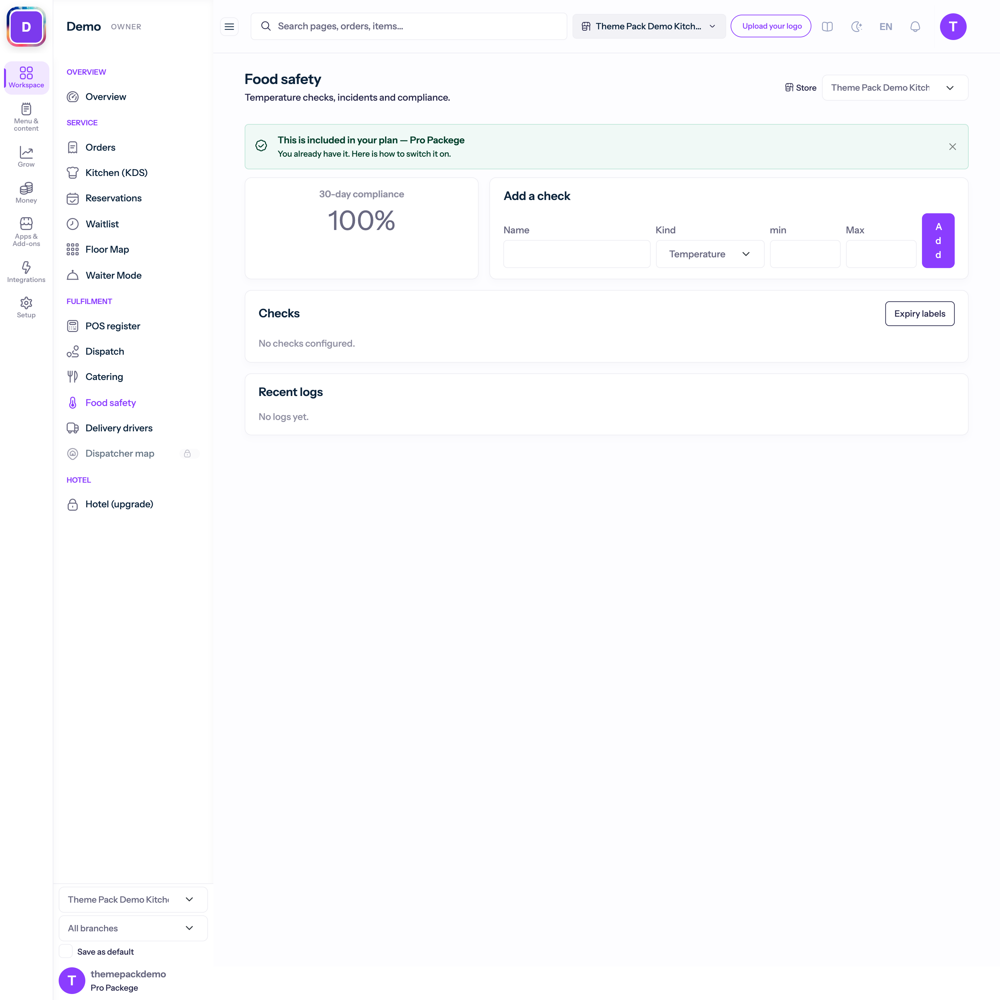

# Food safety



Food safety turns your fridge-temperature and cleaning routine into a record
you can show an inspector. You define the checks your team must complete, staff
log the readings from their phones, out-of-range readings are flagged as
breaches, and the page reports a rolling compliance rate. It also prints
use-by labels for prepped items.

## Opening the page

There is no sidebar link. Open it directly at:

```
/food-safety
```

Use the store picker in the action bar to switch restaurant. There is no branch
selector on this page.

The page has four parts: a compliance figure, an **Add a check** form, the list
of **Checks**, and **Recent logs**.

## Compliance

**30-day compliance** is a single percentage at the top left. It is completed
check-days divided by expected check-days over the last 30 days, where:

- expected counts each active check for every day it has existed inside the
  window (a check you added yesterday only owes one day, not thirty);
- completed counts each distinct check-and-day that has at least one log.

A restaurant with no active checks shows 100%.

## Defining checks

Fill in **Add a check**:

- **Name** (required, up to 120 characters) — for example "Walk-in fridge" or
  "Fryer oil".
- **Kind** — **Temperature**, **Appliance**, or **Cleaning**.
- **Min** and **Max** — the acceptable range. A logged reading outside this
  range is recorded as a breach. Leave both blank for a check with no numeric
  target (typical for cleaning tasks).

Checks are saved as **daily** frequency and added to the bottom of the list.

Each row in **Checks** shows the name, its kind, its min–max range as a badge,
and an "off" badge when it is disabled. Two buttons per row:

- **Disable / Enable** — an inactive check stops appearing in staff's due list
  and stops counting toward compliance, but its history is kept.
- **Delete** — removes the check after a confirmation.

## Staff logging

Staff log readings from the [staff app](staff-app.md), against these endpoints:

- `GET /staff-app/food-safety` returns the checks **still due today** — every
  active check that has not yet been logged on today's calendar date, in
  position order, with its name, kind and min/max.
- `POST /staff-app/food-safety/{checkId}` logs a reading: an optional numeric
  **value** and an optional **note** (up to 500 characters). The response says
  whether the reading was a breach.
- `POST /staff-app/food-safety-incident` records a free-form **note** (required,
  up to 1000 characters) as an incident. Incidents are always marked as a
  breach so they surface in the log, and they are stamped with the staff
  member's branch.

Every log records who filed it and when. All three endpoints require a
signed-in staff member and a store that is allowed to use food safety; an
unentitled store gets a 403 rather than an empty list.

Note: the endpoints are live, but the staff PWA does not yet render a
food-safety screen — there is no tab for it in the app shell today.

## Recent logs

The bottom card lists the 60 most recent logs, newest first: **When**, **Kind**,
**Value** (with a degree sign, or a dash when no number was recorded) and
**Note**. Any row that is a breach is highlighted in red and carries a
"breach" badge. Incidents appear here with the kind `incident`.

## Expiry labels

The **Expiry labels** button above the check list opens a printable label
sheet at:

```
/food-safety/labels
```

Fill in:

- **Items (one per line)** — one label is printed per non-blank line.
- **Prep date** — defaults to today.
- **Shelf-life (days)** — defaults to 3.

Press **Preview** to render the sheet, then **Print**. Labels print three to a
row; each shows the item name, the prep date, and a **Use by** date in red
(prep date plus the shelf-life days). The form itself is hidden when printing.

Nothing here is saved — the sheet is generated from what you type, each time.

## Turning it on

Food safety is a gated feature. It runs only when both of these hold:

- the platform kill-switch for `food_safety` is on (a superadmin setting — it
  ships **off** by default), and
- the store owner's plan includes it (`food_safety` is plan-gated; check your
  plan's feature list).

If either check fails the dashboard page is blocked and the staff endpoints
return 403. See [Plans and billing](plans-billing.md).

## Related pages

- [Staff app](staff-app.md) — where staff would log checks from their phone.
- [Staff](staff.md) — who can sign in to the staff app.
- [Inventory and stock](inventory.md) — the prepped items you are labelling.
