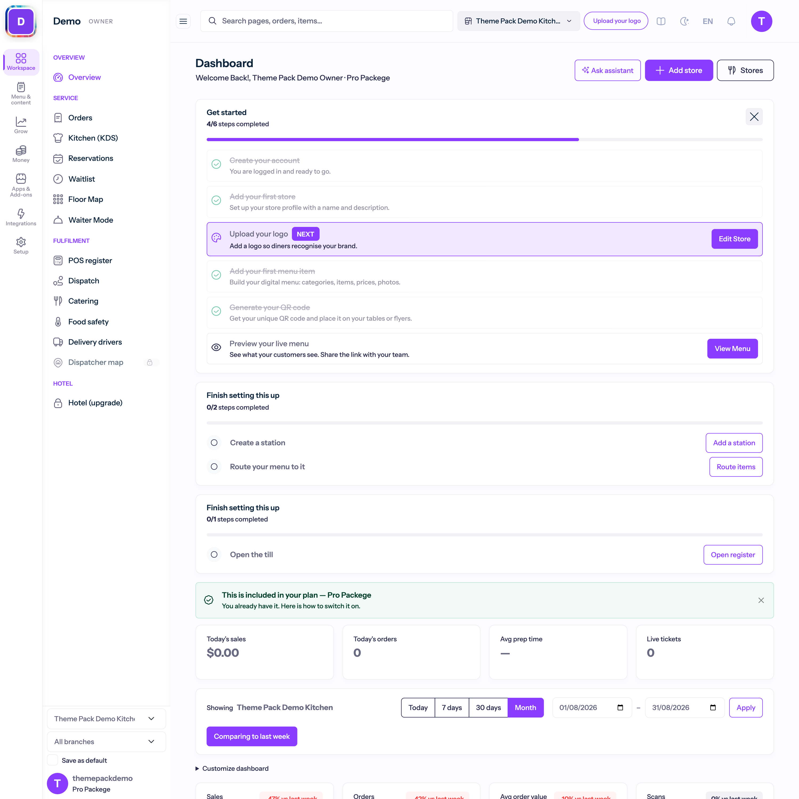

# Getting started

This guide takes you from a new account to a live QR menu that customers can
scan. The whole flow takes about ten minutes: sign up, create a restaurant,
add a menu item, and print your QR code.

## Create your account

1. Open the site and go to the sign-up page at `/signup` (the "Sign up" or
   "Get started" button on the home page).
2. Fill in a username (2-16 characters, letters, numbers, dashes, and
   underscores only), your email address, and a password (at least 6
   characters). A display name is optional; if you skip it, your username is
   used. You may also need to accept the terms and pass a captcha check.
3. Submit the form. You are logged in immediately and land on your dashboard.

Two emails are sent right away: one with your account details and one asking
you to verify your email address. Which plan you start on (free, a trial, or
a specific plan) is decided by the platform's registration settings — check
the plan card on your dashboard to see what you got.

If the sign-up page says registration is closed, the platform owner has
disabled public registration; contact them for an invite.

## Verify your email

Click the link in the verification email before you try to create a
restaurant. On most installations, unverified accounts cannot publish
content — if you see "Verify your email address to post any content", the
verification link is what you are missing. You can request a new email from
the verification notice shown in the dashboard.

## First look: the dashboard

After logging in you land on the Overview page (`/dashboard`). New accounts
get two helpers:

- A short spotlight tour that points out the key areas: adding menu items,
  sharing your QR code, customising your menu's look, and inviting staff.
  You can skip it at any time; it only shows once.
- A "Get started" checklist card that tracks your setup progress: create your
  account, add your first restaurant, upload your logo, add your first menu
  item, generate your QR code, and preview your live menu. Steps tick
  themselves off automatically as you complete them, and each unfinished step
  has a button that takes you to the right page. Dismiss the card with the X
  once you are done.

See [Dashboard overview](dashboard-overview.md) for what the stats and charts
mean.

## Create your first restaurant

A "restaurant" is your public menu page: it gets its own web address, QR code,
menu, and ordering. To create one:

1. In the sidebar, open Workspace > Restaurants, then click "New restaurant"
   (or use the checklist's "Add restaurant" button).
2. Step 1 — Basics: pick a **store type** first (Restaurant is the default —
   see [Choosing your store type](store-types.md) if you're setting up
   something other than a restaurant), then enter the name, an optional slug
   (this becomes your public URL, for example `olive-table`; letters,
   numbers, and hyphens only — if you leave it blank one is generated from
   the name), a brand color, subtitle, a timing note, phone, address, and a
   short description. Name, address, and description are required.
3. Step 2 — Template: upload your logo and a cover image (PNG or JPG, up to
   2 MB each — both are required) and pick a menu template. The template
   controls how your public menu looks; you can change it later.
4. Step 3 — Confirm and save.

Your public page is live immediately at `https://your-domain/your-slug`.

How many restaurants you can create depends on your plan. If you see "Limit
exceeded, please upgrade your membership", you have used all your restaurant
slots — the Restaurants page shows your usage ("3 of 5 plan slots used") and
a "Manage plan" button.

## Add your first menu item

Menu items live inside categories, so create a category first:

1. Open Workspace > Restaurants and click your restaurant to reach its
   "Menu items" page.
2. Fill in the "New category" field with a name (for example "Starters" or
   "Drinks") and click "Add Category". You can add sub-categories later if
   you need them.
3. Click the add-item button on the category and fill in the item form. Only
   a name and a price are required. Everything else is optional: description,
   photo (PNG or JPG, up to 2 MB), veg/non-veg type, dietary flags (vegan,
   halal, gluten-free), spice level, "popular" and "daily special" badges,
   availability hours and days, nutrition facts, and stock tracking.
4. Save. The item appears on your public page immediately — there is no
   separate publish step.

Menu item counts are also limited by plan; the dashboard's usage meters show
how many you have left.

Shortcuts on the same page: "AI generate" builds a draft menu from a photo or
description of your existing menu, and "Import CSV" loads items in bulk from
a spreadsheet.

## Get your QR code live

1. Open Workspace > Restaurants and click the QR-code icon on your restaurant
   card (or use the checklist's "QR builder" button) to open the QR code
   generator.
2. The page shows your QR code, which always points at your public menu URL.
   Optional settings: pick a specific table (so scans are tagged to it), add
   a source label for analytics (for example `window-sticker`), and adjust
   the foreground color, background color, padding, and corner radius. Click
   "Save settings" to keep your styling.
3. Click "Download PNG" and print it, or "Copy link" to share the menu URL
   directly (WhatsApp, Instagram bio, Google Business profile).

Place the printed QR on tables, the counter, or flyers. Anyone who scans it
opens your live menu — no app needed. The first scan also ticks off the last
checklist steps on your dashboard.

## What's next

- Watch scans and orders come in on the [dashboard](dashboard-overview.md).
- Add more categories, photos, and item options (sizes, extras) from the
  Menu items page.
- Invite your team under Team > Staff with scoped roles (manager, cashier,
  kitchen, waiter).
- Explore Grow > Analytics once you have a few days of scans.
- Selling something other than food? See
  [Choosing your store type](store-types.md) for retail, car parts, pharmacy
  (OTC), and laundry/services.
