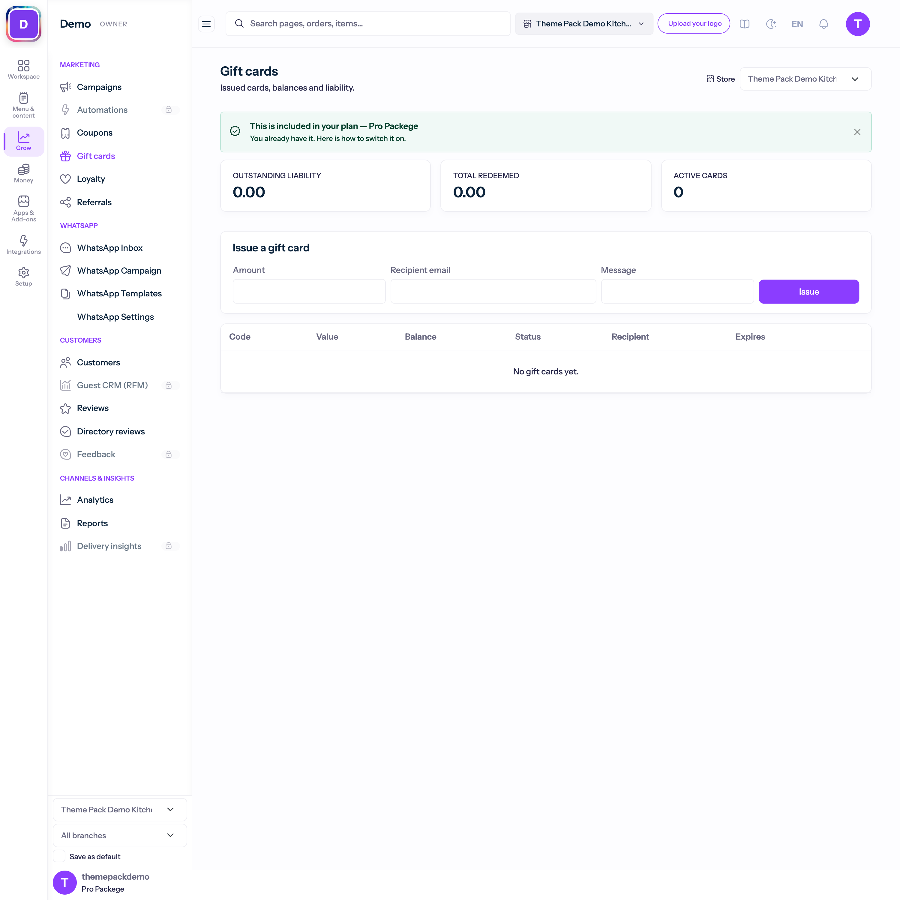

# Gift cards

Gift cards are prepaid balances your customers buy on your public menu and spend
at checkout. You can also issue cards by hand from the dashboard — for a
complaint, a promotion, or a card sold over the counter. Every card carries a
unique code, its own balance, and an optional expiry date.

Gift cards are a paid feature. If your plan does not include them the sidebar
shows a locked **Gift cards** entry instead of the page.

## Turn gift cards on for a restaurant

The purchase page and the checkout redemption box only appear when the feature
is switched on for that restaurant:

1. Open the restaurant's edit page and go to the **Ordering** tab
   ("Checkout and service options").
2. Set **Gift cards** to **Yes**.
3. Set the amounts on the same page:
   - **Gift card amounts (comma-separated)** — the preset buttons shown to the
     buyer. Default `25,50,100`.
   - **Gift card min amount** — default 5.
   - **Gift card max amount** — default 500.
   - **Gift card expiry (months, 0 = never)** — how long a card lasts from the
     day it is issued. Default 0, meaning cards never expire.
4. Save.

With the toggle off the public purchase page returns "not found" — a store never
advertises a feature it has not switched on.

## The owner page

Click **Gift cards** in the sidebar under **Grow → Marketing**. The page is
titled **Gift cards** and shows one restaurant at a time; use the store selector
in the page header to switch.

Three figures sit at the top:

- **Outstanding liability** — the total unspent balance across all active cards
  for this restaurant. This is money you still owe in goods.
- **Total redeemed** — the total value already spent against orders.
- **Active cards** — how many cards currently have status `active`.

Below that is the issue form, then a table of every card, 30 per page, newest
first. Each row shows the code, its original **Value**, the current **Balance**,
status, recipient email, and expiry date.

## Issue a card by hand

In **Issue a gift card**, fill in:

- **Amount** — required, between 1 and 100000.
- **Recipient email** — optional. If you fill this in, the card is emailed to
  that address as soon as it is created.
- **Message** — optional, up to 500 characters, included with the delivery.

Click **Issue**. The card is created **already funded and active** — there is no
payment step — and its code is shown in the success message. Manual issues are
recorded in the [activity log](activity-log.md).

## Adjust or void a card

Both actions are available on active cards only:

- **Adjust** — type a positive or negative amount in the `±` box and click
  **Adjust**. This moves the balance up or down and is written to the ledger, so
  the change is permanently traceable.
- **Void** — cancels the card and removes its remaining balance from your
  liability. You are asked to confirm. A voided card can no longer be redeemed
  and cannot be reactivated from this page.

Both actions are limited to cards belonging to your own restaurants; a card id
that is not yours returns "not found".

## What customers see

The purchase page lives at `<your menu URL>/gift-cards` — for example
`https://example.com/my-restaurant/gift-cards`. The modern menu themes (Aurora,
Crave, Feast, Glow, Matcha, Nebula, Pulse, Velora, Velvet, Vivid) link to it
from the menu page once the toggle is on.

The buyer chooses an amount (a preset, or any value between your min and max),
picks a payment method from the gateways you have installed, and can optionally
give:

- their own email (**purchaser email**),
- the **recipient email** and **recipient phone**,
- a **message**,
- a **scheduled send** date and time — the card is emailed then instead of
  immediately.

The card is created in a **pending** state and is not spendable. It becomes
active only when the payment gateway confirms the payment. A replayed or
duplicate gateway callback never funds a card twice.

Scheduled and previously failed deliveries are retried automatically every few
minutes by the platform.

### Add to Google Wallet

When you have **Google Wallet** turned on for the restaurant, a customer who is
signed in and views their account page sees a **Your gift cards** section listing
the cards they bought, each with an **Add to Google Wallet** button. Tapping it
saves that card — balance, code and QR — as a pass in their phone's Google Wallet,
which updates as they spend. The button appears only for the person who purchased
the card, and only while Wallet is enabled; if you leave Wallet off, nothing
changes for anyone. (Cards sent as a gift to someone else are reached from the
delivery email, not this section.)

## Spending a card

A customer redeems a card by entering its code at checkout. The card pays
**after** any coupon discount and any wallet credit — it reduces the amount due
rather than the price of the items — and it applies the smaller of the card
balance and what is still owed. A card only works at the restaurant that issued
it.

Codes look like `GC-XXXXXXXXXXXX` and are randomly generated, so they cannot be
guessed from an earlier card.

## Scope and limits

- Cards belong to a single restaurant, not to your whole account. If you run
  several restaurants, each has its own cards, liability and settings.
- Card value is held in the platform ledger, which is why the balance shown on
  the page and the liability figure always agree with what has actually been
  funded, spent and adjusted.
- Voiding is final from this page; there is no un-void button.

## Related pages

- [Coupons](coupons.md) — discount codes, which reduce the price rather than
  paying part of the bill.
- [Wallet and credits](wallet.md) — your own platform balance, a different
  thing from customer gift cards.
- [Plans, billing and subscriptions](plans-billing.md) — what your plan
  includes.
