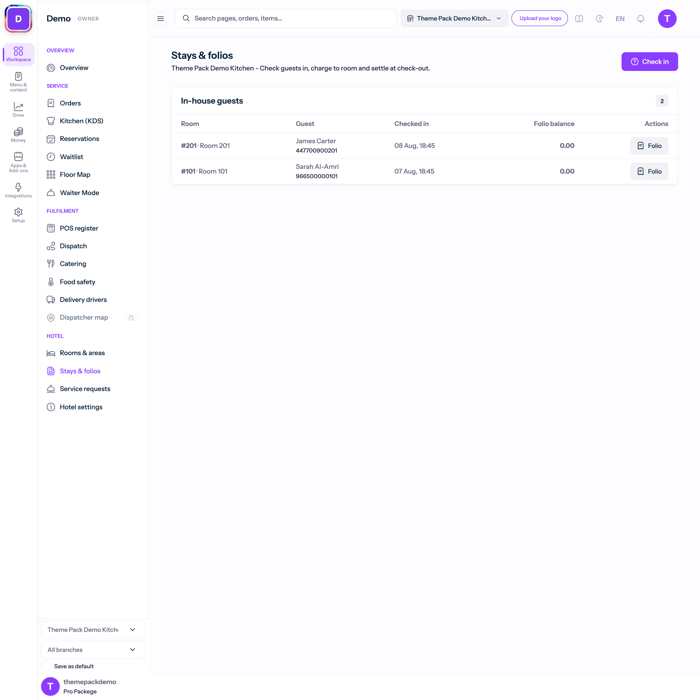

# Hotel stays and charge-to-room folios

If you serve food in a hotel, guesthouse or resort, the hotel module lets a
guest scan the QR code in their room, order room service, and charge the
order to their room instead of paying at checkout. Every charge lands on a
per-stay **folio** — a running account you settle when the guest checks out.
This page covers turning the module on, checking guests in and out, how
charge-to-room works for the guest, and reading and settling a folio.

The hotel module is available on a plan that includes it. If your plan does
not, the **Hotel** group in the sidebar shows a locked entry that explains how
to add it.

## Turning the hotel module on

1. Open **Hotel settings** in the sidebar's **Hotel** group.
2. In the **Hotel guest services** card, press **Turn on**.

Once on, the rest of the Hotel group appears: **Rooms & areas**, **Stays &
folios**, and **Service requests**. Turning the module off hides those pages
again; nothing is deleted.

## Setting up rooms

Rooms live on the **Rooms & areas** page and work like tables with a room
type: each room has a number, an optional label, and its own QR code you can
print and place in the room. A guest who scans a room's QR code lands on your
menu already linked to that room.

## Checking a guest in

1. Open **Stays & folios** in the sidebar.
2. Press **Check in**.
3. Pick the **Room** (rooms that already have an active stay are shown as
   occupied and cannot be picked), enter the **Guest name**, and optionally a
   **Phone**.
4. Press **Check in**.

This creates the stay and opens its folio at a zero balance. The **In-house
guests** table lists every active stay with its room, guest, check-in time
and live **Folio balance**; **Recent past stays** below keeps the last 50
closed ones. Each row has a **Folio** button that opens the statement.

Only one active stay can exist per room at a time — checking in to an
occupied room is refused.

## How the guest charges to their room

When a guest opens your menu through their room's QR code:

- A dismissible greeting banner shows their room ("Room 204 · Welcome").
- If the room has an active stay, checkout offers a **Charge to room**
  option alongside your normal payment methods.

To charge to the room the guest must enter a name that matches the registered
guest on the stay. The match is forgiving — "Sam" matches "Sam Carter" — but
a non-matching name is refused with a clear message and the guest is asked to
pay another way. Orders placed this way arrive in your order list as **Room
service** orders and post their total onto the folio automatically; the guest
pays nothing at checkout.

If no active stay exists on the room, the charge-to-room option simply is not
offered, so a guest can never charge to an empty room.

## Reading and settling a folio

Open **Stays & folios** and press **Folio** on a stay. The statement page
shows:

- **Statement** — every line with its date, description, **Charge** and
  **Payment** columns, then **Total charges**, **Total payments**, and
  **Balance due**.
- **Record payment** — take a payment against the balance at any time. Enter
  the **Amount** and pick a **Method** (Cash, Card, Online), then press
  **Record payment**. Partial payments are fine; a payment larger than the
  outstanding balance is rejected, so a folio can never go negative.
- **Print** — a printable copy of the statement to hand to the guest.

Charges are what the guest owes; payments bring the balance back toward
zero. Each room-service order posts to the folio exactly once, even if the
network hiccups and the order is retried.

## Checking out

The **Check out** button on the folio page requires a zero balance — settle
the folio first with **Record payment**. If you decide to forgive a remaining
balance instead, use **Write off & check out**: it zeroes the balance with an
explicit write-off entry (kept on the statement, so the history stays honest)
and closes the stay. Closed stays move to **Recent past stays** and their
folios can no longer be charged.

## Who on your team can use this

Folio actions move money, so they sit behind a per-person **Folio access**
switch:

- Staff with the manager role have folio access by default.
- For anyone else, open **Staff** in the sidebar and flip the **Folio
  access** switch on their row (the switch appears once the hotel module is
  live).

A staff member without folio access does not see **Stays & folios** in their
sidebar at all, and any direct attempt to open a folio page or record a
payment is refused. Rooms, service requests and hotel settings are not
affected by this switch.

## For your developer

The folio is an account on the same double-entry ledger that powers wallets
and store credit. The balance and statement are always computed from the
ledger entries recorded against the stay's folio account — treat those
entries as the source of truth. Do not key anything off the stay's stored
folio-account pointer: it can be empty on a stay whose folio was opened
lazily, while the ledger entries for that stay are complete and correct.
Order charges are idempotent per order (ref `hotel_folio:order:{id}`), and
settlements carry their own idempotency reference.

## Related pages

- [Floor map and tables](floor-map.md) — rooms are managed like tables, with
  areas and QR codes.
- [QR codes and sharing](qr-codes.md) — printing per-room codes.
- [Managing orders](orders.md) — where room-service orders appear.
- [Staff and roles](staff.md) — roles, permissions, and the Folio access
  switch.
