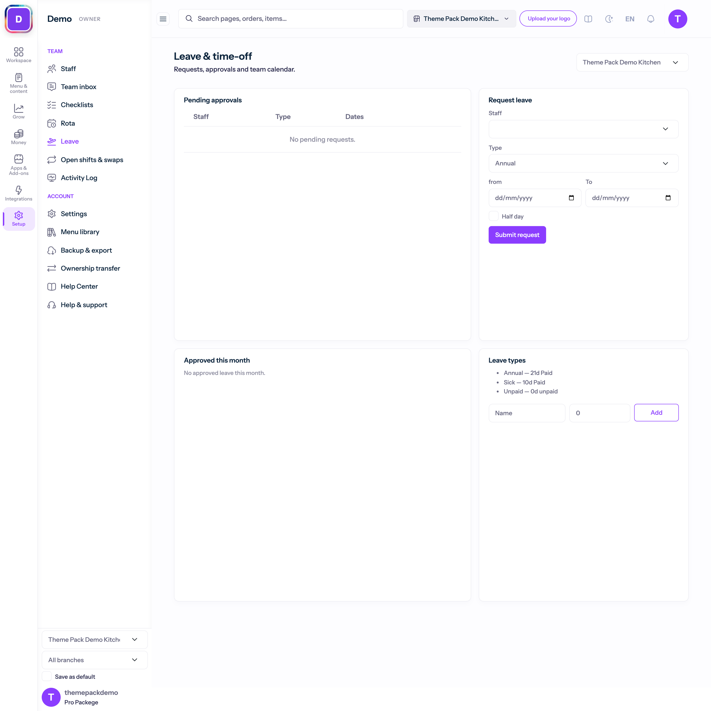

# Employee files and leave

Two pages cover the people side of your team: an **employee file** per staff
member (personal details, documents, wage rates, onboarding) and a **leave**
page for time-off requests, approvals and a month view.

Both need the **HR & Payroll** feature (`hrm_suite`) enabled for your account.
Without it the pages return "not included in your current plan" or the upgrade
page. See [Plans and billing](plans-billing.md).

## Opening an employee file

Go to **Staff** in the sidebar. When the HR feature is on, each staff row gains
an **HR file** button. It opens `/staff/{id}/hrm` — the direct URL if you
prefer, using the staff member's id. There is no separate sidebar entry.

You only ever see files for staff that belong to you; anything else 404s.

The page is split into four cards.

### Profile

Free-form employment details, all optional:

- **National ID / Iqama** (up to 40 characters)
- **Date of birth**
- **Address**
- **Emergency contact** and **Emergency phone**
- **Employment start**
- **Contract type** — Full time, Part time or Casual
- **Base wage** — a number; used as the hourly rate in payroll when no
  role-specific rate is set.

**Save profile** stores them.

### Wage rates by role

Underneath, you can set an hourly rate per role: **Manager**, **Cashier**,
**Kitchen** or **Waiter**. Pick the role, type a rate, press **Set**. Setting a
role twice overwrites the previous rate. Existing rates are listed above the
form.

Payroll uses the rate matching the staff member's role first, then their base
wage, then whatever hourly rate is on the staff record. See
[Payroll](payroll.md).

### Onboarding

The first time you open an employee file, a five-item checklist is created
automatically:

1. Documents uploaded
2. PIN set
3. Trained on POS
4. Trained on KDS
5. Uniform issued

Click the circle next to an item to tick it (and click again to untick). The
badge and progress bar at the top of the card show completion as a percentage.
The list is fixed — you cannot add or rename items.

### Documents

A small vault per employee. To upload, choose:

- **Kind** — Contract, Id, Health cert, or Custom.
- **Expiry** — optional date.
- **File** — JPG, JPEG, PNG or PDF, up to 5 MB.

Uploaded documents are listed with their kind, expiry date, a **View** link
that opens the file in a new tab, and a **×** to delete. A document nearing its
expiry date gets an orange **expiring** badge.

Note that stored files are served from public storage, so anyone with the file
URL can open it. Do not upload documents you would not be comfortable sharing
by link.

## Leave and time-off

Open `/leave` directly — there is no sidebar link. Use the restaurant dropdown
at the top right if you own more than one.

The first time you open the page for a restaurant, three leave types are
created for you:

- **Annual** — paid, 21 days a year
- **Sick** — paid, 10 days a year
- **Unpaid** — unpaid, 0 days

### Pending approvals

The main table lists every pending request for the restaurant, earliest first:
staff member, leave type, and the date range. If the requested dates collide
with shifts already on the rota, an orange **shift conflict** badge appears —
it is a warning only, nothing is blocked.

**Approve** or **Reject** decides the request and stamps who decided it and
when. A request can only be decided once; deciding an already-decided request
is refused.

### Approved this month

Below the queue, a list of leave approved for the month you are viewing, as
`staff — type: from → to`. The month comes from the `month` query parameter
(format `YYYY-MM`, defaulting to the current month) — there are no
previous/next month buttons on the page, so change the URL to look at another
month, for example `/leave?month=2026-09`.

### Requesting leave on someone's behalf

The **Request leave** card creates a pending request for any staff member of the
restaurant:

- **Staff** and **Type** dropdowns
- **From** and **To** dates — the end date must not be before the start
- **Half day** checkbox
- **Submit request**

The request lands in the pending queue for you to approve. Staff cannot file
their own requests — there is no staff-side leave screen.

### Leave types

The last card lists your types as `name — Nd paid/unpaid` and lets you add one:
a **Name**, the annual allowance in **Days**, then **Add**. Types added this way
are unpaid; the paid flag is only set on the three seeded types. Types cannot be
edited or deleted from this page.

Paid leave matters for pay: an approved request on a **paid** type adds hours to
the employee's pay run, valued at the standard day length. Unpaid leave adds
nothing. See [Payroll](payroll.md).

Each type also carries an annual allowance, and the system can work out a
remaining balance (allowance minus approved days this year), but the leave page
does not display balances.

## Related pages

- [Staff](staff.md) — creating staff members and their roles.
- [Staff scheduling](staff-scheduling.md) — the rota that leave conflicts with.
- [Payroll](payroll.md) — where wage rates and paid leave turn into pay.
- [Plans and billing](plans-billing.md) — enabling the HR & Payroll feature.
