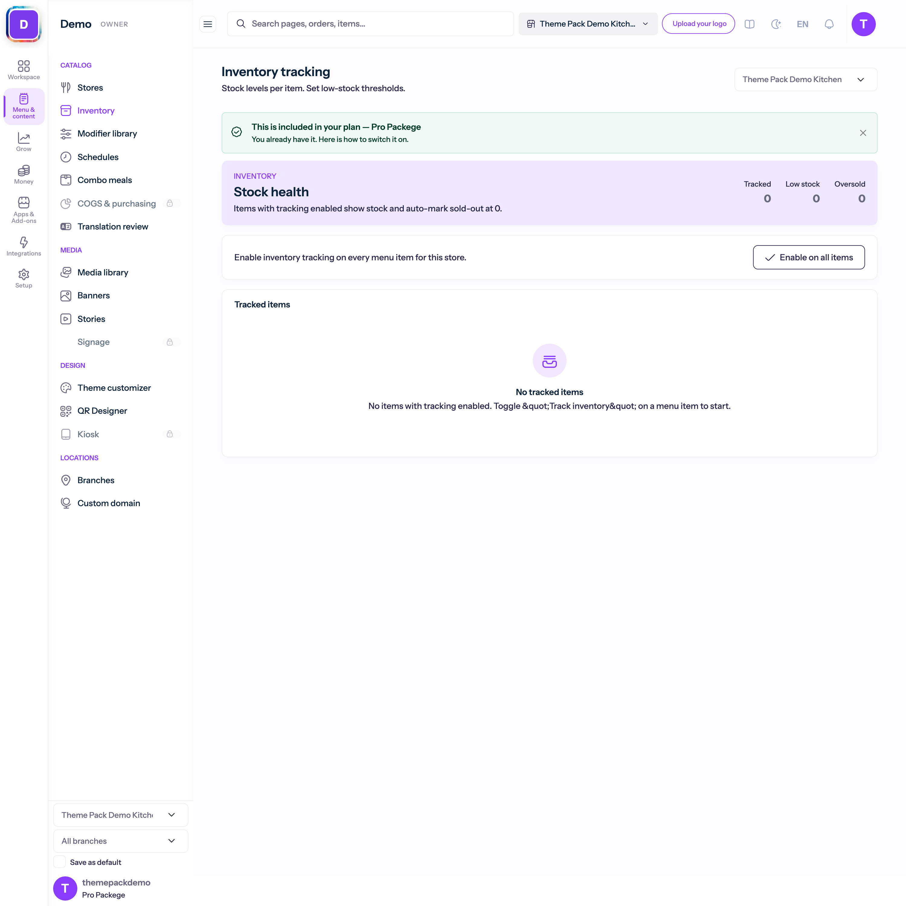

# Inventory and stock

Inventory keeps your stock levels honest: it stops you selling what you have
run out of, tells you what to reorder, and (in advanced mode) works out what
each dish costs you to make. Open **Inventory** in the sidebar (under the
package icon), or go to `/inventory` directly.

There are two ways to track stock, and you can use either one per restaurant:

- **Simple mode** (the default) counts finished menu items. When a dish sells,
  its own stock count drops by one. Good if you just want "12 burgers left,
  mark sold out at 0".
- **Advanced mode** tracks raw ingredients. You build a recipe for each dish,
  and every sale deducts the ingredients that dish uses. This unlocks
  suppliers, purchase orders, stock counts, a waste log, and food-cost
  reports.

If you own more than one restaurant, use the restaurant dropdown at the top of
each inventory page to choose which one you are working on. Inventory is
owner-scoped: you only ever see stock for restaurants you own.

## Simple mode: per-item stock

The main Inventory page lists every menu item that has tracking switched on,
lowest stock first. Each row shows:

- **Stock quantity** — how many you have. Edit it inline and press Save.
- **Low-stock threshold** — when the count reaches this number or below, the
  item is flagged as low stock in the summary at the top of the page. The
  threshold is shown here but set when editing the menu item (see
  [Menu items](menu-items.md)).

An item only appears here once **Track inventory** is enabled on it. Turn it on
per item when editing the menu item (see [Menu items](menu-items.md)), or use
the **Enable on all items** button on the Inventory page to switch tracking on
for every item in the selected restaurant at once.

When an item's stock reaches 0 it is automatically marked **sold out** and
hidden from ordering. Restocking it (setting the quantity above 0) clears the
sold-out flag automatically.

### The Oversold counter

The **Stock health** header at the top of the Inventory page shows three
figures: **Tracked** (items with tracking on), **Low stock**, and
**Oversold**. Stock is deducted atomically when an order is placed, so two
simultaneous orders can never both take the last unit — but if an order
arrives for stock the counter did not have (for example the count was set too
high and sold through), the sale is still accepted, the item is clamped to 0
and marked sold out, and the event is counted here.

**Oversold** at 0 is healthy. A non-zero count turns red, shows when the last
oversell happened ("Last: …"), and gains a **Clear** button. Restock or
correct the item's count, then press **Clear** to reset the counter — the
confirmation reads "Oversell counter cleared."

## Switching to advanced (ingredient-level) mode

Inventory mode is stored per restaurant. In advanced mode, sales deduct recipe
ingredients instead of per-item counts, and the ingredient-level pages
described below apply. A control to flip a restaurant between simple and
advanced mode is not yet surfaced on the Inventory page (planned); the advanced
pages themselves are reached directly by the URLs given in the sections below.

## Ingredients

Ingredients are your raw stock — flour, cheese, cups, and so on. Open them from
the ingredient inventory page (`/inventory/ingredients`). For each ingredient
you record:

- **Name**.
- **Unit** — one of grams, kilograms, millilitres, litres, each, dozen, or
  pack.
- **Par level** — your reorder point. When stock drops to par or below, the
  ingredient is flagged **below par**. A par of 0 means no alert.
- **Cost per unit** — used for stock valuation, food costing, and waste
  costing.
- **Opening stock** — the amount you have on hand when you add it.

The page header shows how many ingredients you have, how many are below par,
and the total **stock value** (quantity times unit cost across all
ingredients).

Every change to an ingredient's stock is written to an immutable ledger, so the
number you see always matches its recorded history. Use **Adjust** to change
stock by hand in four ways:

- **Receive** — add stock (for example, a delivery), optionally with a unit
  cost.
- **Use** — remove stock manually.
- **Waste** — remove stock and record it as waste.
- **Set** — correct the count to an exact figure (the system records the
  difference).

The **History** link on each ingredient shows its recent stock movements —
purchases, sales, waste, adjustments, and count corrections — with the running
balance after each one.

## Recipes

A recipe is the list of ingredients (and how much of each) that go into one
portion of a menu item. Recipes are what let a sale deduct raw stock. Open
recipes from the ingredient page or at `/inventory/recipes`, pick a restaurant,
then edit the recipe for any menu item.

For each line you choose an ingredient and the quantity used per portion. From
the recipe the system works out:

- **Recipe cost** — the total ingredient cost to make one portion.
- **Food-cost percentage** — recipe cost divided by the menu price. A useful
  margin check: lower is better.

Menu items without a recipe simply are not deducted at ingredient level.

## How stock is deducted when you sell

When an order is placed — through your online store, the API, or the
[POS](pos.md) — stock is reduced automatically. Which deduction runs depends on
the restaurant's inventory mode:

- **Simple mode:** the menu item's own stock quantity drops by the amount
  ordered, and the item is marked sold out at 0.
- **Advanced mode:** for every item that has a recipe, each recipe ingredient
  is deducted by its per-portion quantity times the amount sold. Items without
  a recipe are skipped, and the per-item count is not touched.

It is one or the other per restaurant, not both at once. If you void a line
item on the POS, its quantity is added back to that item's per-item count.

## Suppliers

Suppliers are the vendors you buy ingredients from. Manage them at
`/inventory/suppliers`. For each supplier you can record a contact name, email,
phone, lead time in days, and notes, and mark them active or inactive. Inactive
suppliers are hidden when creating a purchase order.

## Purchase orders

A purchase order (PO) records stock you are buying in. Manage them at
`/inventory/purchase-orders`. The workflow is:

1. **Create** a draft order, optionally against a supplier.
2. **Add lines** — pick an ingredient, quantity, and unit cost. The line total
   and order total are calculated for you.
3. **Mark as ordered** once you have sent it to the supplier.
4. **Receive** when the delivery arrives. This adds every line's quantity to
   your ingredient stock and updates each ingredient's cost per unit to the
   price you just paid.

You can **cancel** an order any time before it is received. A received order is
locked — you cannot edit or receive it again, so stock is never double-counted.

## Stock counts

A stock count is a physical stocktake that reconciles your recorded numbers
against what is actually on the shelf. Manage them at `/inventory/counts`.

1. **Start a count.** The system snapshots the current recorded (theoretical)
   quantity of every active ingredient.
2. **Enter counted quantities** for each ingredient as you count them. You can
   save partway through and come back — the count stays open. Ingredients you
   leave blank are not touched.
3. **Close the count.** For each ingredient you counted, the difference between
   counted and recorded stock (the **variance**) is posted as a correction, so
   your recorded stock now matches reality.

A closed count cannot be reopened or re-applied.

## Waste log

The waste log (`/inventory/waste`) records ingredients thrown away and what
they cost you. Log an ingredient, a quantity, and a reason — spoilage, expiry,
prep error, theft, overproduction, or other — with an optional note. Logging
waste deducts the ingredient from stock and records its cost (quantity times
current unit cost).

The page shows recent waste entries and a 30-day breakdown of waste cost by
reason, so you can see where money is being lost.

## Inventory reports

The reports page (`/inventory/reports`) pulls the advanced-mode data together
for the selected restaurant:

- **Stock value on hand** — total value of current ingredient stock.
- **Low-stock list** — ingredients at or below their par level.
- **Food cost per item** — recipe cost, price, and food-cost percentage for
  every dish that has a recipe, plus the average food cost across them.
- **Waste cost (last 30 days)**.
- **Variance value** from your most recent closed stock count — the money value
  of the difference between recorded and counted stock, a proxy for shrinkage.

## Multiple branches

If a restaurant has [branches](branches.md), you can view and adjust stock per
branch instead of the shared pool. On the ingredient page, pick a branch to see
that branch's on-hand and par levels; stock adjustments you make while a branch
is selected apply to that branch's own stock row, and sales made at a branch
deduct from that branch's stock.

## Related pages

- [Menu items](menu-items.md) — turn on per-item tracking and set prices.
- [Branches](branches.md) — per-branch stock.
- [Point of sale](pos.md) — how in-person sales deduct stock.
- [Analytics](analytics.md) — sales and menu-engineering reporting.
