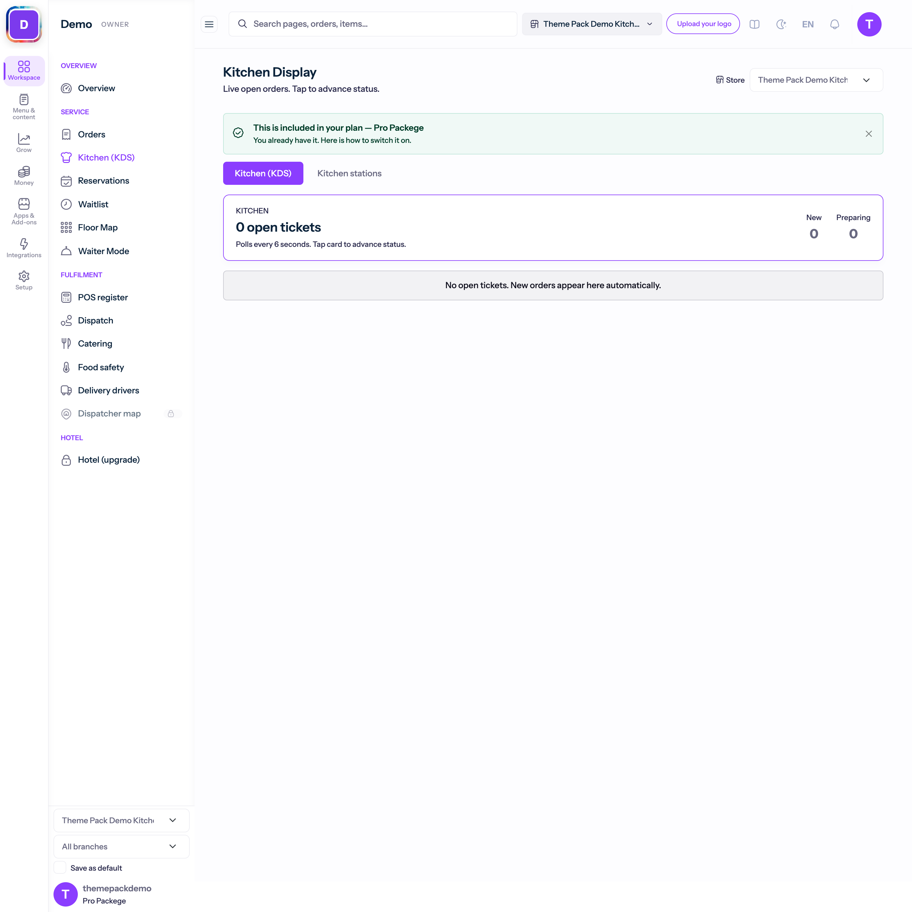

# Kitchen display system (KDS)

The kitchen display system (KDS) turns incoming orders into live tickets your kitchen can work from a screen, instead of paper dockets. Open it from the dashboard sidebar under **Kitchen (KDS)**. A companion **Kitchen stations** page lets you split a menu across grill, fryer, bar, and other prep areas.

This page explains the daily kitchen board, how to set up stations, how multi-kitchen routing works, and what the advanced item-level features do.

## The kitchen board

The **Kitchen (KDS)** page shows every open ticket as a card. It automatically polls for new orders every 6 seconds, so you can leave it running on a screen in the kitchen and it stays current without a refresh.

Each ticket card shows:

- The order number, plus the customer-facing token **Number** badge when the
  order-status board is in use.
- The table number (or the merged party's table list), or the customer name
  (or "Walk-in" if neither is set).
- Every item with its quantity, chosen variant, any choice-group selections
  (marked with a »), and any item note.
- How many minutes ago the order came in, with the store's prep-time target
  as a "~Nm" hint when one is set.
- A **Play voice note** button (with the transcript underneath) when the
  customer attached a voice note, and a **Curbside** badge — switching to
  "Curbside · ARRIVED" when the guest checks in.

A sound rings when a genuinely new ticket appears, so the kitchen does not
have to watch the screen.

At the top of the board a strip shows the total open ticket count and separate counts for **New** and **Preparing** orders.

To move a ticket along, tap the button on the card:

- **Start** moves a new ticket to preparing.
- **Ready** moves a preparing ticket to ready.

This is the whole-ticket ("basic") flow: one button advances the entire order through new to preparing to ready to delivered, stamping the matching time (preparing, ready, and completed) as it goes. When a ticket is bumped past ready it leaves the board.

If there are no open orders you see "No open tickets. New orders appear here automatically." Parked or held POS orders never reach the kitchen board, and an order that is voided on the POS leaves the board.

### Scheduled orders

Pre-orders scheduled for later appear in a separate **Scheduled orders** strip above the board rather than as live tickets. They are released to the kitchen automatically at fire time, or you can press **Release now** on a row to fire one early.

Use the restaurant selector at the top of the page to switch which restaurant's kitchen you are viewing. If you have selected a branch in the sidebar, the board only shows that branch's orders.

## Kitchen modes: basic and advanced

Each restaurant has a kitchen mode, stored per restaurant: **basic** (the default) or **advanced**.

- **Basic** is the whole-ticket board described above.
- **Advanced** adds item-level tickets, kitchen stations, expediting, coursing, prep-time targets, and analytics.

Advanced mode changes what the polling data returns: ready tickets stay visible so an expo can assemble them, and each item carries its own status, station, colour, and prep-time target.

Note: the kitchen board screen itself currently renders the basic whole-ticket layout. The advanced item-level behaviours are surfaced through the **Staff app** phone kitchen view and the **Kitchen analytics** page rather than a separate desktop board (see below). There is a backend setting to switch a restaurant into advanced mode, but the dashboard does not yet expose a button for it — see [Gaps](#what-is-not-built-yet).

## Kitchen stations

Open **Kitchen stations** from the sidebar to route menu items to specific prep areas. Each station only sees its own items, so the grill screen never shows drinks and the bar never shows steaks.

To add a station, pick a restaurant, then fill in:

- **Name** — for example Grill, Fryer, Bar.
- **Colour** — a colour swatch used to tag the station's tickets.
- **Target (min)** — the prep-time target for aging colours and on-time analytics (1 to 240 minutes, default 10).
- **Branch** — leave as "All branches" for a restaurant-wide station, or pick one branch to make it branch-specific.
- **Expo** — mark a station as the expediting/pass station.

You can edit any station later to rename it, change its colour or target, switch it active or inactive, or move it to a different branch. Deleting a station unassigns its items — they fall back to the default kitchen view — so nothing is lost.

### Assigning items to stations

Below the station list is the **Assign items to stations** panel. For each menu item you pick which station cooks it:

- With no branch selected you are setting the **restaurant-wide default** station for that item.
- With a branch selected in the sidebar you are setting a **per-branch override** — useful when one branch prepares a dish at the bar and another at the grill. Leave an item on "Default" to keep using the restaurant-wide assignment.

## Multi-kitchen routing

When an order is placed, each line is routed to a station automatically using this priority:

1. A per-branch override for that item and branch, if one exists.
2. The item's restaurant-wide default station.
3. No station (the item goes to the default/expo view).

Routing is resolved at the moment the order is created, so each order item keeps the station it was sent to even if you re-assign menu items later. The item's course number is also stored at this point.

## Coursing (fire and hold)

Menu items can carry a course number (1 to 9), set when you edit the item. Course 1 fires immediately when the order is placed. Later courses are held — they are recorded on the ticket but not sent live to their station until they are fired, so starters and mains don't hit the kitchen at the same time.

Firing a held course stamps it live so its items appear at their stations. The firing action exists in the system but is not yet surfaced as a button on the kitchen board — see [Gaps](#what-is-not-built-yet).

## Item-level tickets, bump and recall

In advanced kitchens, each order item moves through its own status: **queued**, **preparing**, **ready**, **served**.

- **Bump** advances one item forward one step.
- **Recall** undoes a bump, moving the item back one step and clearing the time it recorded.

As items are bumped, the order's overall status re-syncs from its items: the order becomes preparing once any item is in progress, ready only when every item is ready or served (so the expo knows it can plate up), and delivered once every item is served.

Today this item-level bump and recall is used from the **Staff app** phone kitchen view. A cook opens the staff app, sees the open items for their station (either the station they are pinned to or a chosen station), and taps to bump each item forward or recall it. The staff view also shows an all-day tally counting open units per item across all tickets. See [Staff app](staff-app.md) for how staff sign in and which permissions they need (the kitchen view requires the KDS permission).

## Kitchen analytics

The **Kitchen analytics** page (reachable at the kitchen analytics URL, with an "Open KDS" link back to the board) reports how your kitchen is performing over the last day, 7 days, or 30 days:

- **Avg ticket time** — average minutes from order placed to ready.
- **Avg item prep** — average minutes an item spends being prepared.
- **On-time rate** with **On time / Caution / Late** buckets, measured against each station's target: within 60% of target is on time, up to target is caution, over target is late.
- **Orders in the last 15 and 30 minutes** — current kitchen load.
- **Slowest items** by average prep time.
- **By station** average prep time.

This is the data that stations, targets, and item-level timing feed into, so it is most meaningful once you are routing items to stations with sensible targets.

## What is not built yet

- **Mode switch in the dashboard.** A restaurant can be set to advanced mode in the backend, but there is currently no button on the kitchen page to switch modes. The kitchen board renders the basic whole-ticket layout for every restaurant.
- **Desktop advanced board.** Station tabs, per-item bump, aging colours, all-day counts, sound, and keyboard bumping are described in the design but the desktop board does not yet render them. Item-level bump and recall are available through the [Staff app](staff-app.md) phone view.
- **Fire-course button.** Held courses can be fired by the system, but no button on the board triggers it yet.

Stations, per-branch routing, item-level status tracking, and the analytics report are all built and working.

## Related pages

- [Staff app](staff-app.md) — the phone kitchen view used for item-level bump and recall.
- [Branches](branches.md) — branch-scoped stations and per-branch routing.
- [Menu items](menu-items.md) — set an item's course and default station.
- [Orders](orders.md) — the order statuses the board advances through.
- [Analytics](analytics.md) — sales and scan analytics alongside kitchen performance.
