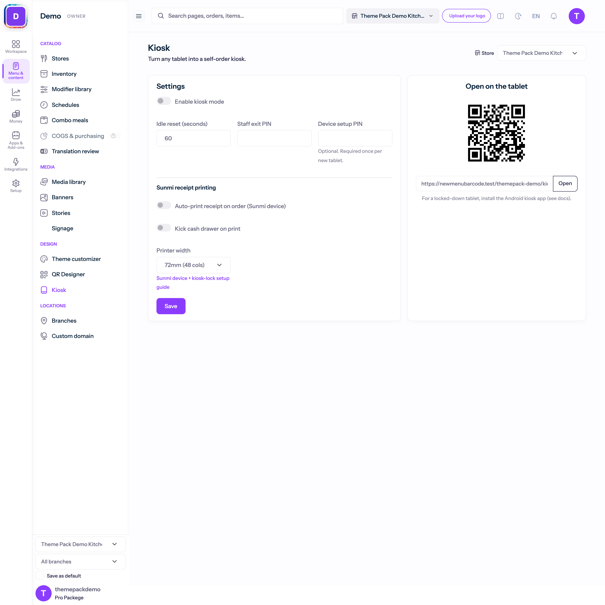

# Self-order kiosk



Kiosk mode turns any tablet into a self-order terminal. The tablet opens a
full-screen attract screen for your restaurant; a customer taps it, orders from
your normal storefront in kiosk mode, and the screen resets itself after a
period of inactivity so the next customer starts clean.

This page covers the owner-facing settings. For mounting a Sunmi device and
locking Android down around the kiosk, see the [Sunmi kiosk integration
guide](../integrations/sunmi-kiosk.md).

## Opening the settings page

There is no sidebar link. Open it directly at:

```
/kiosk-settings
```

You can also reach it from the **Ticket and receipt printing** page — it has a
**Kiosk** button in its action row.

Use the store picker in the action bar to switch restaurant. There is no branch
selector.

## Settings

The left card is the settings form. Press **Save** to store them.

- **Enable kiosk mode** — the master switch. The public kiosk URL only serves
  while this is on; with it off, the URL returns "not found".
- **Idle reset (seconds)** — how long the kiosk waits before returning to the
  attract screen. Accepts 15 to 3600 seconds; the field defaults to 60, and the
  kiosk never uses less than 15 even if a smaller value is stored.
- **Staff exit PIN** — up to 12 characters. A member of staff enters this to
  leave kiosk mode on the tablet. The PIN is verified on the server, not in the
  browser. If you leave it blank, the exit check can never succeed.
- **Device setup PIN** — up to 12 characters, optional. When set, a new tablet
  must be unlocked with it once before it will run the kiosk. Also verified
  server-side; blank means the setup check can never succeed.

### Sunmi receipt printing

These three settings only matter on a Sunmi device with a built-in printer:

- **Auto-print receipt on order (Sunmi device)** — print a receipt as soon as
  an order is placed at the kiosk.
- **Kick cash drawer on print** — open the attached cash drawer when a receipt
  prints.
- **Printer width** — **72mm (48 cols)** or **58mm (32 cols)**. The link under
  this field opens the Sunmi device and kiosk-lock setup guide.

## Opening the kiosk on the tablet

The right card shows the kiosk address and a QR code for it, rendered in your
store's QR design (it falls back to a plain code if the QR designer is not
available to you — see [QR codes](qr-codes.md)).

The kiosk URL is:

```
/{your-store-slug}/kiosk
```

Copy the link into the tablet's browser, or scan the QR code with the tablet.
**Open** launches it in a new tab from the dashboard.

On the tablet the kiosk shows an attract screen for your restaurant. Tapping it
opens your normal storefront with kiosk mode on, so the menu, prices, modifiers
and checkout are exactly the ones your other customers see. For a properly
locked-down terminal that cannot be exited to the Android home screen, install
the kiosk app described in the Sunmi guide.

## Turning it on

Kiosk mode is a gated feature. The kiosk URL serves only when all three of
these hold:

- the platform kill-switch for `kiosk` is on (a superadmin setting — it ships
  **off** by default);
- the store owner's plan includes it (`kiosk` is plan-gated; check your plan's
  feature list);
- **Enable kiosk mode** is on for that restaurant.

Any failure returns a plain "not found" page — an anonymous visitor is never
told whether the store exists, whether the platform allows kiosks, or what plan
the merchant is on. The dashboard settings page itself is blocked by the first
two checks. See [Plans and billing](plans-billing.md).

## Related pages

- [Sunmi kiosk integration guide](../integrations/sunmi-kiosk.md) — hardware, Android lock task mode, and printing.
- [Ticket and receipt printing](printing.md) — the wider printing setup.
- [QR codes and sharing](qr-codes.md) — the branded QR design used for the kiosk code.
- [Point of sale (POS)](pos.md) — the staff-operated till, as opposed to a self-order kiosk.
