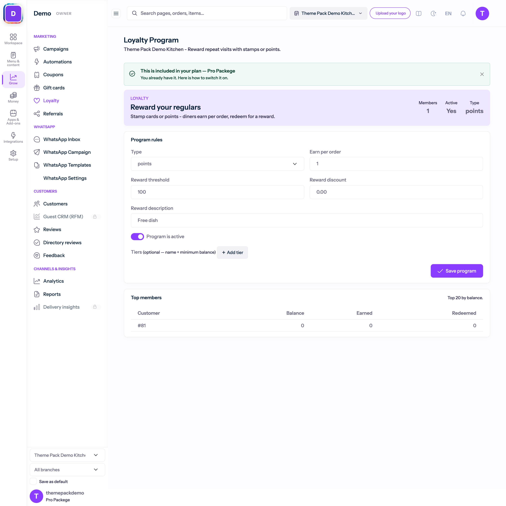

# Loyalty stamps

The loyalty program rewards repeat customers with a digital stamp card or a
points balance. Signed-in customers earn automatically every time they place
an order through your menu page, watch their progress fill up on screen, and
redeem a reward once they reach the threshold you set. This guide covers
setting up the program, how earning and redeeming work, and what your
customers see.

## Opening the loyalty page

Click **Loyalty** in the dashboard sidebar (gift icon). The page is titled
**Loyalty program** and is owner-only.

If you own more than one restaurant, the sidebar link opens the program of
your first restaurant. Each restaurant has its own separate program at its
own address (`.../restaurant/<id>/loyalty`).

A header strip at the top shows three live numbers:

- **Members** — how many accounts show in the Top members list below
  (counts up to 20, matching that list).
- **Active** — whether the program is currently switched on.
- **Type** — stamps or points.

## Setting up the program

Fill in the **Program rules** form and click **Save program**:

1. **Type** — choose **stamps** (one stamp per order, classic "buy 9 get 1"
   card) or **Points** (points scale with how much the customer spends).
2. **Earn per order** — only used for points programs: the customer earns
   this many points per 100 of your currency spent (1 to 1000). For example,
   an earn rate of 5 gives 5 points on a 100.00 order and 12 points on a
   250.00 order (fractions round down). Stamps programs ignore this field
   and always give exactly one stamp per order.
3. **Reward threshold** — how many stamps or points unlock the reward
   (1 to 9999). Default is 10.
4. **Reward discount** — an optional discount amount recorded with each
   redemption. Note that this value is stored and logged but is not
   automatically taken off a future order — see
   [Redeeming](#how-customers-redeem) below.
5. **Reward description** — up to 200 characters, shown to customers on the
   stamp card, for example "Free coffee with 10 stamps".
6. **Program is active** — tick this to switch the program on. New programs
   start switched off; nothing is shown to customers and no stamps are
   earned until you activate it.

You can edit the rules at any time. Changing the threshold takes effect
immediately for everyone, including customers part-way through a card.

## How customers earn

Earning is automatic — there is nothing to scan or hand out:

- The customer must be **signed in** to a customer account on your menu
  page when they place the order. Guest orders do not earn.
- When the order is placed, the program credits one stamp (stamps type) or
  the calculated points (points type, based on the order total including
  delivery, tax and tip, after any coupon discount).
- Each order can only ever be credited once, even if something is retried
  behind the scenes, so balances cannot be inflated by duplicates.

Every earn and redeem is written to a permanent ledger, and each account
also tracks its lifetime totals.

## How customers redeem

When a customer's balance reaches the reward threshold, a **Redeem Reward**
button appears on their stamp card. Clicking it:

1. Checks the balance on the server (a customer can never redeem more than
   they have).
2. Deducts the full threshold from their balance and writes a ledger entry.
3. Shows the confirmation "Reward redeemed! Enjoy your reward."

Redemption does not apply a discount to an order by itself — the reward is
whatever your **Reward description** promises, and your staff honour it in
person when the customer shows the confirmation. The reward discount amount
you configured is recorded in the activity log for your records. Redeem
requests are rate-limited to 10 per minute per customer to prevent abuse.

## What customers see

The stamp card appears on your public menu page, but only when the program
is **active** and the customer is **signed in**. It is currently built into
the **Aurora** and **Nebula** menu themes; other themes do not show it yet.

In Aurora the card appears on the order confirmation screen ("Order
placed!") and shows:

- **Your Loyalty Balance** — the current stamp or point count.
- Progress toward the reward — a row of stamp dots that fill in as stamps
  are earned (stamps type) or a progress bar (points type), plus the reward
  description, for example "7 / 10 stamps to earn: Free coffee".
- The **Redeem Reward** button once the threshold is reached.

Behind the scenes the card also has access to the customer's last ten
ledger entries (earns and redeems with timestamps).

## Tracking members

Below the settings form, the **Top members** card lists your top 20 loyalty
accounts by current balance, with columns for the customer, their balance,
and their earned and redeemed totals. Members appear here after their first
earn; the list is empty until then.

Every settings change and every redemption is also recorded in the activity
log with the restaurant it belongs to.

## Tips

- Keep the threshold realistic for your visit frequency — a 10-stamp card
  suits a coffee shop, while a sit-down restaurant may prefer 5.
- Write the reward description exactly as staff should honour it; it is the
  only instruction the customer and your team see at redemption time.
- Because guest orders never earn, promote customer sign-in on the menu
  page if you want the program to gain traction.

## Related pages

- [Orders](orders.md) — how orders come in and where loyalty earning hooks
  into the order flow.
- [Dashboard overview](dashboard-overview.md) — where Loyalty sits in the
  sidebar.
- [QR codes](qr-codes.md) — getting customers onto your menu page in the
  first place.
