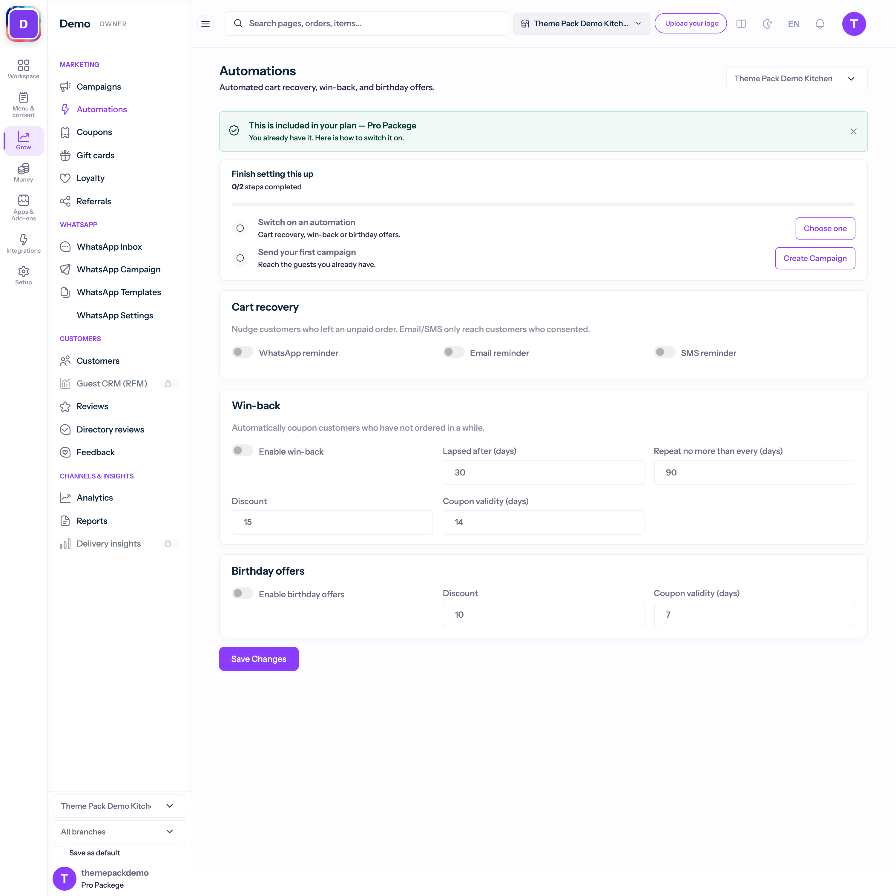

# Marketing automations

Automations are three recurring campaigns the platform runs for you in the
background: nudging customers who abandoned a cart, winning back customers who
have stopped ordering, and sending a birthday discount. You set the rules once
and the platform does the sending on a schedule.

Marketing automation is a paid feature. If your plan does not include it, the
sidebar shows a locked **Automations** entry instead of the page. A platform-wide
switch also governs all three — if it is off, nothing is sent regardless of your
settings here.

## Opening the page

Click **Automations** in the sidebar under **Grow → Marketing**. The page is
titled **Automations**; use the store selector in the page header to switch
restaurant. Settings are per restaurant.

Change what you need and click **Save** at the bottom — one button saves
all three sections.

## Cart recovery

Reminds a customer who created an order but never paid for it. There are three
channel switches:

- **WhatsApp reminder**
- **Email reminder**
- **SMS reminder**

The sweep runs **hourly** and picks up unpaid orders that are at least 30
minutes old and no more than 24 hours old. Each order is nudged **once and only
once**, on every channel that is both switched on and permitted.

The message names your restaurant, quotes the order number, and links to that
order's tracking page so the customer can finish paying.

Consent rules decide which channels actually fire:

- **WhatsApp** — needs the switch on and a phone number on the order.
- **Email** — needs the switch on, a recognised (signed-in) customer with an
  email address, and that customer's marketing consent. The email carries an
  unsubscribe link.
- **SMS** — needs the switch on, a phone number, and a recognised customer with
  SMS consent. **Guest orders never get an SMS.** The message ends with "Reply
  STOP to unsubscribe."

## Win-back

Automatically coupons customers who have not ordered in a while.

- **Enable win-back** — the master switch for this restaurant.
- **Lapsed after (days)** — how long since their last order before they count as
  lapsed. Default 30, range 1 to 3650.
- **Repeat no more than every (days)** — the minimum gap between win-back
  offers to the same person. Default 90, range 1 to 3650.
- **Discount %** — the coupon's percentage. Default 15, range 1 to 100.
- **Coupon validity (days)** — how long the coupon lasts. Default 14, range 1
  to 365.

The sweep runs daily at **10:00**. For each eligible customer it creates a
single-use percentage coupon with a code beginning `WB`, expiring at the end of
the validity window, and delivers it by email and/or SMS. Only customers with
marketing or SMS consent are contacted, and the same customer is never nudged
twice inside the frequency window even if the job re-runs.

## Birthday offers

Sends a customer a discount coupon on their birthday, once a year.

- **Enable birthday offers** — the master switch for this restaurant.
- **Discount %** — default 10, range 1 to 100.
- **Coupon validity (days)** — default 7, range 1 to 365.

The sweep runs daily at **09:00** and creates a coupon with a code beginning
`BDAY`. A customer who has already been sent this year's offer is skipped, so
re-running never double-sends. The message reads "Happy Birthday! Enjoy N% off
your next order with code …, valid until …".

Customers only qualify if they have given you a birth date and consented to
marketing.

## Where the coupons show up

Win-back and birthday coupons are real coupons on your account, so they appear
on the [Coupons](coupons.md) page alongside the codes you create by hand, and
they are redeemed the same way at checkout. They are percentage coupons with a
usage limit of 1.

## Scope and limits

- Every setting is per restaurant. Switching stores in the header switches which
  restaurant you are configuring.
- The three sweeps run on the platform's schedule, not on demand — there is no
  "send now" button on this page.
- Cart recovery reaches guests only over WhatsApp; win-back and birthday offers
  only ever reach signed-in customers with consent.

## Related pages

- [Campaigns](campaigns.md) — one-off broadcasts you compose and send yourself.
- [Coupons](coupons.md) — where the generated codes appear.
- [Customers](customers.md) — consent flags, birth dates and last-order dates.
- [WhatsApp](whatsapp.md) — connecting the WhatsApp channel and its templates.
