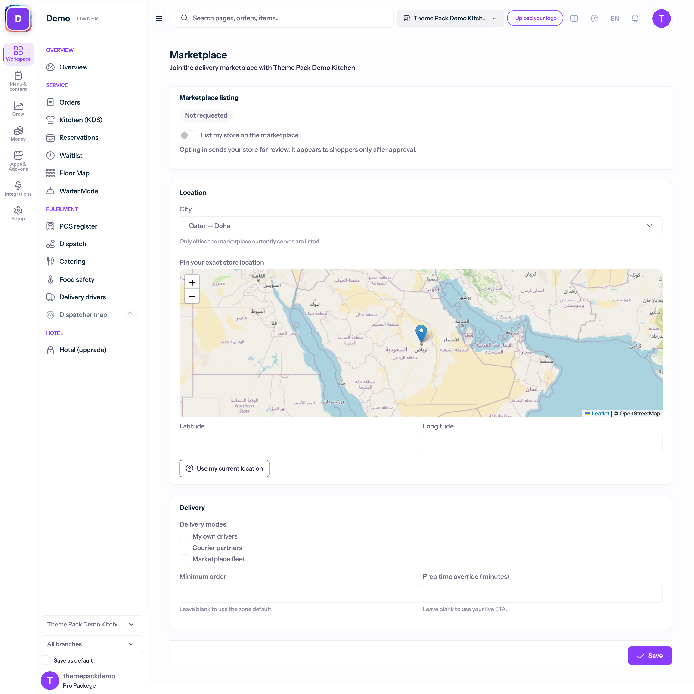

# Marketplace listing (delivery marketplace)

The delivery marketplace is the platform's multi-store shopping surface:
diners browse nearby stores, fill a cart per store, and order for delivery
or pickup. Listing your store there is a per-store opt-in with a short
review step. This page covers opting in, setting your location and delivery
options, the approval lifecycle, and cashing out your earnings.

This is **not** the theme marketplace (where you buy storefront themes) —
for that, see [Storefront themes and customizer](themes.md).

## Opting in

1. Open **Stores** in the sidebar and find the store you want to list.
2. Press its **Marketplace** button to open **Marketplace Settings**.
3. Turn on **List my store on the marketplace** and press **Save**.

Opting in sends your store for review; it appears to shoppers only after
approval. The page always shows where you stand:

- **Not requested** — you have not opted in yet.
- **Pending review** — submitted and waiting for the marketplace team.
- **Approved — live on the marketplace** — shoppers can see and order from
  your store.
- **Rejected** — fix your details and save again to re-apply.
- **Suspended by the marketplace team** — your listing is temporarily off;
  contact your platform provider.

You can switch **List my store on the marketplace** off at any time to leave
the marketplace; your settings are kept for when you return.

## Location and zones

The marketplace is organised by city and, inside each city, by delivery
zones. On the same settings page:

- **City** — only cities the marketplace currently serves are listed. If
  your city is missing, it is not covered yet.
- **Pin your exact store location** — drag the map pin onto your store, or
  press **Use my current location**. The **Latitude** and **Longitude**
  fields fill in from the pin.

The zones available to your store follow the city you pick — choosing a
city refreshes the zone list automatically. Zones decide which shoppers see
your store and what delivery defaults apply.

## Delivery options

- **Delivery modes** — tick any combination of:
  - **My own drivers** — you deliver with your own team.
  - **Courier partners** — connected courier services carry the order.
  - **Marketplace fleet** — the marketplace's own fleet delivers for you.
- **Minimum order** — the smallest basket you accept from the marketplace.
  Leave blank to use the zone default.
- **Prep time override (minutes)** — a fixed prep time to quote shoppers.
  Leave blank to use your live estimate (see the ETA section in
  [Managing orders](orders.md)).

## Getting paid and cashing out

Your marketplace earnings are credited to your platform wallet. To cash out:

1. Open **Wallet** in the sidebar.
2. If payouts on your platform run through Stripe, connect your payout
   account first (the wallet page walks you through it).
3. In the withdraw form, enter an **Amount** up to your available balance
   and submit.

The amount leaves your wallet immediately when you request the withdrawal,
and is paid out after review — the wallet page confirms with "Withdrawal
requested. It will be paid out after review." If your balance is too low the
request is refused and nothing is deducted.

## Related pages

- [Wallet and credits](wallet.md) — your balance, top-ups, and withdrawal
  history.
- [Delivery and drivers](delivery.md) — running your own delivery operation.
- [Managing orders](orders.md) — where marketplace orders arrive, and the
  automatic prep-time estimate.
- [Business Directory listing](directory.md) — the browse-only directory
  listing, separate from the ordering marketplace.
- [Storefront themes and customizer](themes.md) — the theme marketplace,
  a different feature with a similar name.
