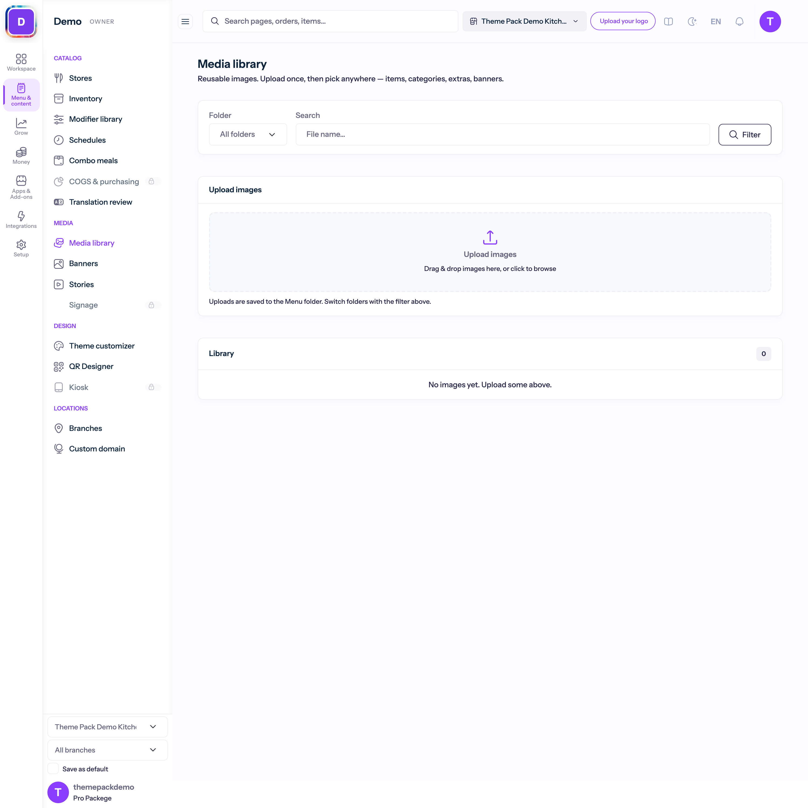

# Media library

The media library is one shared place for all the images your restaurant
uses — dish photos, category images, modifier icons, and promo banners.
Upload an image once, then pick it anywhere instead of re-uploading the same
file for every item. Open **Media library** in the dashboard sidebar (the
image icon, near Banners and Modifier library).

If you run more than one restaurant, each restaurant has its own separate
library. Pick the restaurant from the dropdown at the top of the page first;
images uploaded under one restaurant are not visible to another.

## Folders

Every image lives in a folder that describes what it is for. The folders are:

- **Menu** — dish and product photos.
- **Category** — images shown on category cards.
- **Extra** — icons or photos for modifiers and extras.
- **Variant** — images for item variants (sizes, options).
- **Banner** — promo and hero images for the storefront slider.
- **Other** — anything that does not fit the above.

Folders are just labels for filtering — an image in any folder can still be
picked anywhere. When you open the picker from a specific screen (for example
from a menu item), it opens on the matching folder so you see the most
relevant images first.

## Upload images

1. Open **Media library** and select the restaurant.
2. In the **Upload images** card, choose the folder the images belong to.
3. Click the file field and select one or more images. You can select many at
   once.
4. Click **Upload**. The button shows how many files you picked.

Accepted formats are JPG, PNG, WebP, and GIF, up to 8 MB per file. Every
uploaded image is added to the **Library** grid below, newest first.

You can also upload straight from the picker dialog on other screens (see
[Reuse images anywhere](#reuse-images-anywhere)) — anything you upload there
lands in the same library.

## Browse and search

The **Library** card shows every image as a thumbnail with its original file
name and folder tag. A count badge shows how many images match the current
view.

To find a specific image:

- Use the **Folder** dropdown to show only one folder, or **All folders**.
- Type part of the file name in the **Search** box and click **Filter**.

The search matches the original file name you uploaded, so descriptive file
names make images easier to find later.

## Reuse images anywhere

Wherever an image is needed — menu items, categories, modifiers and extras,
and banners — you pick from this same library instead of uploading each time.
Click **Choose image** (or the equivalent picker button on that screen) to
open the **Pick from library** dialog. In the dialog you can:

- Search by file name.
- Click a thumbnail to select it (a check mark appears).
- Select several at once where multiple images are allowed, such as an item's
  photo gallery.
- Upload new files on the spot with the **Upload** button inside the dialog.

Click **Use selected** to attach the chosen image(s). Because the same file is
reused rather than copied, updating your library keeps things tidy and avoids
duplicate uploads.

Screens that use the shared picker include your menu items and their
galleries, menu categories, the modifier and extras library, and storefront
banners. See [Menu items](menu-items.md), [Menu categories](menu-categories.md),
and [Banners and daily specials](banners.md) for how images appear on each.

## Delete an image

Click the trash icon on a thumbnail and confirm. The image is removed from the
library immediately.

The underlying file is only deleted from storage if no other library entry
still points to the same file. Deleting a library entry does not automatically
remove the image from items or banners that already use it, so check those
screens if you no longer want the image to appear.

## Image optimization

You do not need to resize or compress images before uploading — the system
does it for you. When you upload, every image is:

- **Resized** down to a maximum width of 1200 pixels (keeping its aspect
  ratio) so oversized phone or camera photos do not bloat your menu.
- **Converted to WebP** at 85% quality, a modern format that looks the same as
  JPG or PNG but downloads much faster on phones.
- **Lazy-loaded** in the library and picker grids, so thumbnails only load as
  you scroll.

This keeps your public menu fast to load, which matters most on mobile
connections. Uploading a large JPEG is fine — it is optimized automatically.

If your restaurant is set up with its own cloud storage (S3-compatible), the
optimized files are stored there and served from your CDN; otherwise they are
stored on the platform. Either way the optimization is the same.

## Branding images

Your logo and cover image are part of your restaurant's branding and are
uploaded from their own settings screens rather than the media library, but
they go through the same automatic resizing and WebP optimization. See
[Getting started](getting-started.md) for where to set them.

## Tips

- Give files clear names before uploading (for example `margherita-pizza.jpg`)
  so search finds them later.
- Put images in the right folder on upload — it makes the picker default to
  the images you want on each screen.
- Upload in batches: select every photo for a new menu section at once, then
  attach them to items from the picker.
