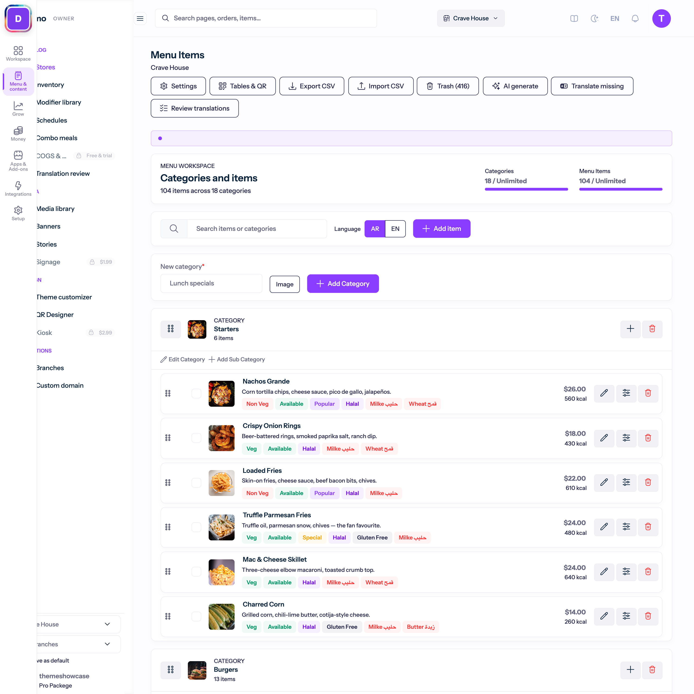

# Categories and menu sections

Your menu is organised on two levels. **Categories** (and optional
sub-categories) group your dishes — Starters, Mains, Desserts — and control
the order they appear in. **Menu sections** are the larger building blocks of
the public menu page itself — hero banner, category bar, specials rails, and
the main menu — which you can reorder or hide per restaurant.

This page covers both. For adding the dishes themselves, see
[Getting started](getting-started.md).

## Open the menu editor

1. In the sidebar, go to **Menu & content → Catalog → Stores** and open the restaurant.
2. Open its **Menu** page (`/stores/{store}/menu`).

The top of the page shows two usage meters: **Categories** and **Menu items**,
each as "used / limit" against your plan (or "Unlimited" when your plan has no
cap). When a limit is reached, the add buttons are replaced by an
**Upgrade plan** button.

Note: if the restaurant uses the flipbook (image) template, this page manages
uploaded menu images instead of categories and items.

## Add a category

1. In the **New category** form near the top of the menu editor, type a name
   (for example "Lunch specials").
2. Optionally click **Image** to pick a category image from your media
   library.
3. Click **New category**.

The category appears as a card in the list below, ready to receive items via
its **+** (Add Menu Item) button.

## Add a sub-category

Each category card has an **Add Sub Category** expander:

1. Open it, type a name (for example "Desserts"), and submit.
2. The sub-category appears inside its parent card with its own item list and
   its own add-item button.

Sub-categories count against the same category limit as top-level categories.
One level of nesting is supported (a sub-category cannot have its own
sub-categories).

## Rename a category or change its image

1. On the category card, open the **Change category** expander.
2. Change the name, and use **Image** / **Remove** to change or clear the
   category image.
3. Click **Save**.

If your menu has multiple languages, the language buttons in the menu toolbar
control which language you are editing. Renaming a category while a
non-default language is selected saves a translation for that language only;
the original name stays as it is. Categories still missing a translation show
an "Untranslated" badge, and AI-generated translations show an "AI · review"
badge until you confirm them.

## Reorder categories

Drag a category card by the grip handle on the left of its header and drop it
where you want it. The new order saves automatically and is exactly the order
diners see on the public menu. Items inside a category can be dragged into
order the same way.

## Delete a category

Click the trash button on the category (or sub-category) card. Deleting a
category permanently deletes all menu items inside it, so move items first if
you want to keep them: select items with their checkboxes and use the
**Move to…** dropdown in the bulk action bar at the bottom of the page.

## How categories appear on the public menu

On the modern menu templates (Aurora, Nebula, Pulse, Crave, Glow, Matcha):

- A **category bar** of chips appears near the top — "All" plus one chip per
  category. Tapping a chip filters the menu to that category.
- Each category renders as its own titled section, in your drag order, with
  sub-categories as smaller sub-headings inside the parent section.
- Categories (and sub-categories) with no visible items are hidden
  automatically, so an empty "Winter menu" never shows to diners.
- Only items marked active are shown; sold-out items are labelled "Sold Out"
  and cannot be added to the cart.

## Reorder or hide storefront sections

Beyond categories, you can reorder the big sections of the public menu page
itself:

1. Go to **Menu & content → Catalog → Stores**, open the restaurant, and click **Edit**.
2. Open the **Design** tab and scroll to **Public menu section order**.
3. Use the up/down arrows to reorder sections, and the **Visible** checkbox to
   hide a section entirely.
4. Save the page.

The five sections are:

- **Hero section** — the cover image, logo, restaurant name, and contact
  details at the top of the menu.
- **Category bar & sort** — the category chips plus the sort buttons
  (Default, Price up/down, Popular).
- **Daily specials** — a "Today's Specials" rail. It only renders when at
  least one item has the **Daily special** flag ticked in the item editor.
- **Featured / specials** — an automatically curated "Chef's Specials" rail
  built from your menu; it only renders when there are enough items.
- **Main menu** — the full category-by-category item listing.

The order and visibility are saved per restaurant. If you never touch this
setting, the menu uses the standard order shown above. The setting applies to
the modern templates listed earlier; the classic and flipbook templates keep
their own fixed layout.

## Plan limits

- The number of categories (including sub-categories) is capped by your plan.
- The menu item limit applies **per category**, not across the whole menu, so
  splitting a large menu into more categories also spreads the item allowance.
- When you hit a limit you will see "Limit exceeded, please upgrade your
  membership." — upgrade your plan or buy an add-on under
  **Apps & Add-ons → Extensions**.

## Related pages

- [Getting started](getting-started.md) — creating a restaurant and your
  first menu item.
- [Dashboard overview](dashboard-overview.md) — plan usage meters and
  navigating the sidebar.
