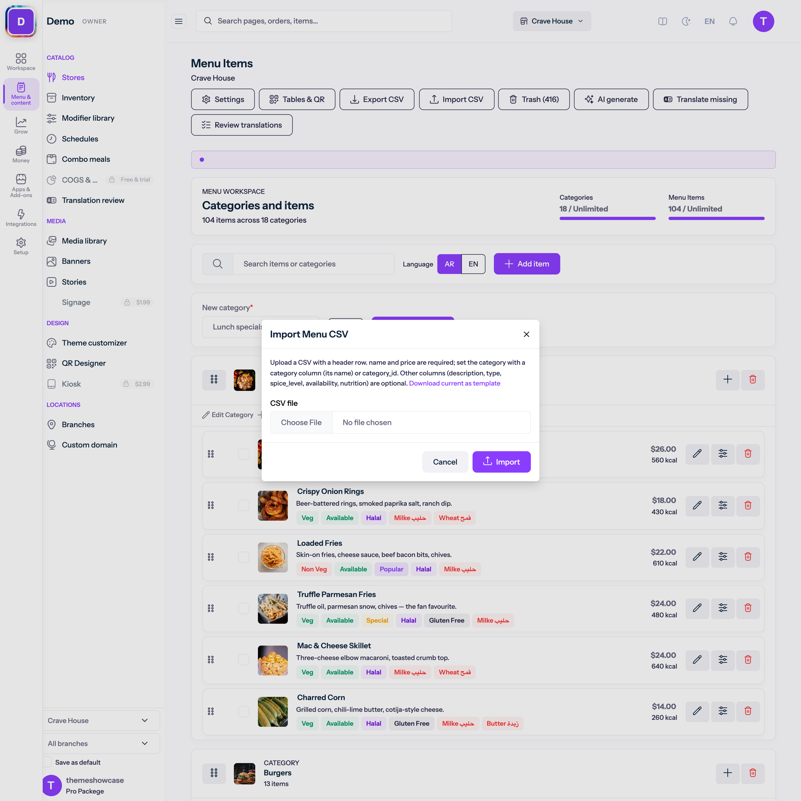

# Menu import and export (CSV)

You can download your whole menu as a CSV spreadsheet and upload an edited
CSV to add or update many items at once. This is the fastest way to build a
large menu, do bulk price changes, or move a menu between systems.

Both tools live in the menu workspace: open **Stores** in the sidebar,
find the restaurant, and click **Change menu**. At the top of the page you will
see the **Export CSV** and **Import CSV** buttons, next to **Tables & QR** and
**AI generate**.

Only plain CSV files are supported. Excel files (.xlsx) are not — if your
menu is in Excel, use "Save as CSV" first.

## Export your menu

Click **Export CSV**. Your browser downloads a file named
`menu-<restaurant>-<date>.csv` containing every menu item, ordered by
category and position. The file is UTF-8, so Arabic and other non-Latin
text opens correctly in Excel and Google Sheets.

Each row is one item with these columns:

- `id` — the item's internal number. Keep it if you plan to re-import
  (see updating below).
- `category_id` — the number of the category the item belongs to.
- `name`, `description`, `price` — the basics, in your menu's default
  language.
- `type` — `veg` or `nonveg`.
- `active` — `1` (shown on the menu) or `0` (hidden).
- Dietary flags — `is_vegan`, `is_halal`, `is_gluten_free`, `is_popular`,
  `is_sold_out`, `is_daily_special`, each `1` or `0`, plus `spice_level`
  (a number).
- Availability — `available_from`, `available_to`, `available_days`.
- Nutrition — `calories`, `protein`, `carbs`, `fat`, and `allergies`.

If your menu has more than one language, the export also adds a pair of
columns per extra language, for example `name_ar` and `description_ar` for
Arabic. See translations below.

There is no separate blank template. The intended workflow is: export your
current menu (even if it is nearly empty), fill in or edit rows in a
spreadsheet, and import the file back. The import dialog links to the same
export as **Download current as template**.

## Import a CSV

1. Click **Import CSV** at the top of the menu workspace.
2. In the dialog, choose your CSV file (2 MB maximum) and click **Import**.
3. You get back a summary: how many items were imported, how many were
   updated, and how many rows were skipped — with the row number and reason
   for each skipped row (up to the first ten) so you can fix the file.

The first line of the file must be a header row using the column names from
the export. A leading byte-order mark (added by some spreadsheets, and by
this platform's own export) is handled automatically. For each data row:

- **`name` and `price` are required.** A row with an empty name or a negative
  price is skipped and reported (for example, "Row 4: skipped — a name and a
  non-negative price are required."), and the rest of the file still imports.
- You can set the category two ways: a numeric `category_id`, or a
  `category` column with the category **name**. A name that does not exist
  yet is created for you; a `category_id` must belong to one of this
  restaurant's categories or that row is skipped and reported. A row with no
  category imports as an uncategorised item.
- All other columns are optional and default sensibly (`type` falls back to
  `veg`, `active` to `1`, flags to off).
- Rows with a different number of cells than the header (a stray comma, a
  trailing delimiter, a ragged spreadsheet export) are lined up against the
  header rather than aborting the import, and blank lines are ignored.
- Descriptions may contain simple formatting tags (bold, italics, lists);
  anything else is stripped.
- Imported items get the placeholder image. Photos cannot be set by CSV —
  add them per item afterwards, see [Managing menu items](menu-items.md).

Items are created immediately on upload. There is no preview or dry-run
step, so check the file before importing — a safe habit is to export first
so you have a snapshot you can restore from.

## Updating existing items instead of adding duplicates

Matching is done on the `id` column only:

- A row **with an `id`** that belongs to one of this restaurant's items
  **updates** that item (all columns in the row overwrite the current
  values).
- A row with a blank or unknown `id` **creates a new item**.

So the round-trip workflow is: export, edit prices or descriptions in the
spreadsheet without touching the `id` column, and re-import. Nothing is
duplicated. To add new dishes in the same file, add rows and leave their
`id` cells empty.

The import never deletes items. Remove items in the dashboard, either one
by one or with the bulk-select tools in the menu workspace.

## Translations in the CSV

If your menu has extra languages, the export includes `name_<code>` and
`description_<code>` columns (for example `name_ar`, `description_fr`). On
import these fill the item's translations for those languages. When you
update an existing item, languages present in the file are overwritten and
languages not in the file are kept.

If you would rather not fill translations by hand, the
[AI menu generator](ai-menu-generator.md) page describes the AI translate
tool that fills missing translations automatically.

## Common errors and limits

- **"Invalid CSV file."** — the file has no readable header row. Make sure
  it is a real CSV (comma separated) and the first line contains the column
  names.
- **"Row N: category X not found."** — that row used a `category_id` that
  does not exist on this restaurant. The row is skipped; the rest still
  import. Use the `category` name column instead to have it created for you.
- **"Row N: skipped — a name and a non-negative price are required."** — that
  row was missing a name or had a negative price. Fix the named row and
  re-import.
- **"Menu item limit reached."** — your plan's menu item limit was hit
  mid-import. Items up to the limit were created; the rest of the file was
  not processed. Updates to existing items do not count against the limit.
  Upgrade your plan or delete items, then re-import the remaining rows.

The summary reports the number of rows skipped and lists the reason for each
(up to the first ten), so you rarely have to guess why a count looks low.
- **File rejected on upload** — the file must have a `.csv` or `.txt`
  extension and be 2 MB or smaller. Split very large menus into several
  files.

## Related pages

- [Managing menu items](menu-items.md) — the item dialog and every field
  the CSV columns map to.
- [Menu categories](menu-categories.md) — create the categories you will
  reference by id.
- [AI menu generator](ai-menu-generator.md) — build a menu from a photo or
  a description instead of a spreadsheet.
