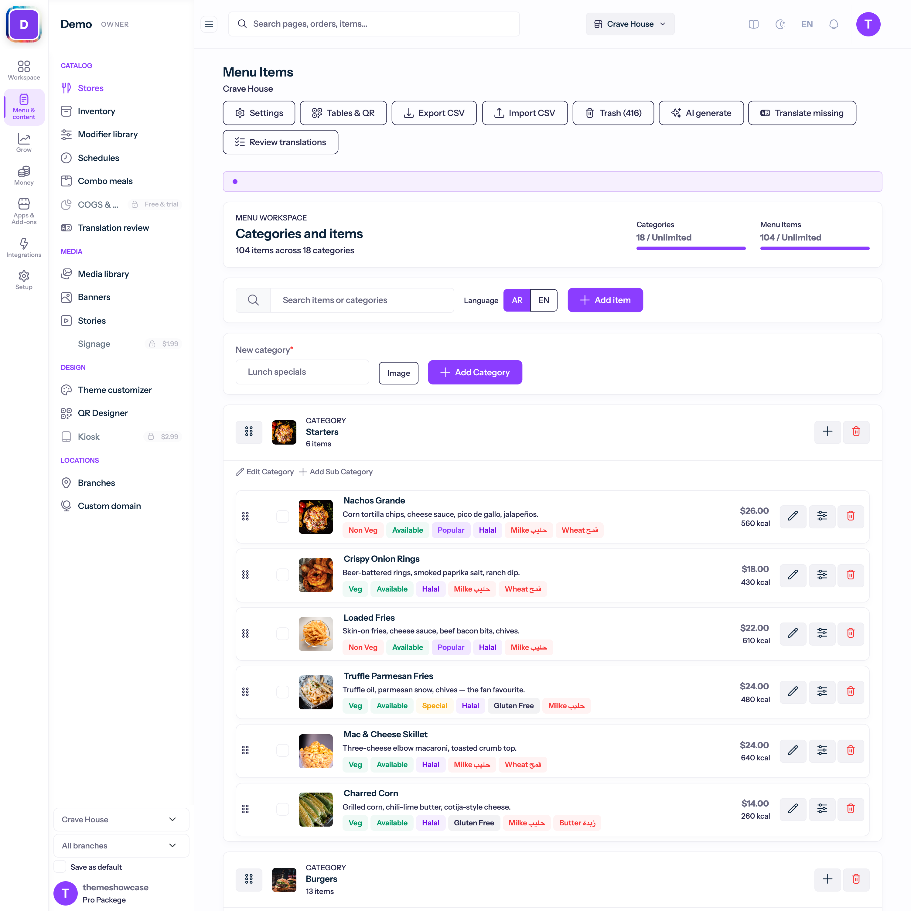

# Managing menu items

Menu items are the dishes and drinks customers see on your public menu. You
manage them in the menu workspace: open **Stores** in the sidebar, find
the restaurant, and click **Change menu**. The page is titled "Menu items" and
shows your categories with the items inside each one.

At the top of the workspace you will see counters for **Categories** and
**Menu items** used against your plan (for example "12 / 50", or "Unlimited").
When you reach a limit, the **Add item** button is replaced by **Upgrade
plan**. There is also a search box that filters items and categories as you
type. For an overview of plan meters, see [Dashboard
overview](dashboard-overview.md).

Items always live inside a category, so create at least one category first
(the **New category** button at the top of the workspace).

## Add or edit an item

Click **Add item** (top right) or the **Add item** button inside a category to
open the item dialog. To change an existing item, click the pencil (Edit) icon
on its row. The dialog has these fields:

- **Name** and **Price** — required. Price accepts decimals.
- **Description** — optional, up to 5,000 characters (see formatting below).
- **Type** — Veg or Non Veg. This shows as a green or red badge on the menu.
- **Spice level** — a number for how spicy the dish is.
- **Image** and **Gallery** — see photos below.
- **Dietary** — Vegan, Halal, Gluten free, Popular, and Daily special
  checkboxes.
- **Nutrition (optional)** — Calories, Protein (g), Carbs (g), Fat (g).
- **Scheduled availability (optional)** — a From/To time window plus
  day-of-week checkboxes.
- **Kitchen (optional)** — Course number and Prep time in minutes, used by
  the kitchen display.
- **Inventory (optional)** — Track inventory, Stock quantity, and Low stock
  alert threshold.
- **Available** — untick this to hide the item from the public menu entirely
  (it shows an "Unavailable" badge in the builder).

Click **Save**. The list refreshes and the item appears in its category with
badges summarising its state (Available, Sold Out, Popular, Special, Vegan,
Halal, Gluten Free, and so on).

To delete an item, click the trash icon on its row and confirm. To manage its
variants and paid extras, click the sliders (Extras & variants) icon.

## Item photos

Each item has one main image and an optional gallery:

- **Main image** — uploaded from the item dialog's **Image** field. PNG or
  JPG, up to 2 MB. It is resized automatically and used as the item's
  thumbnail on your menu.
- **Gallery (up to 5)** — extra photos picked from your media library with
  **Add from library**. Customers see the gallery when they open the item's
  detail view. Remove a gallery photo with the small × on its thumbnail.

If you leave the image empty a default placeholder is used.

## Descriptions and formatting

The description box is a plain text field, but simple formatting is kept when
the menu renders: bold, italics, paragraphs, line breaks, and bulleted or
numbered lists (the HTML tags `<b>`, `<strong>`, `<em>`, `<i>`, ` `, `
`,
`<ul>`, `<ol>`, `<li>`, ``). Anything else — including scripts — is
stripped automatically for safety, so you cannot break your menu by pasting
formatted text. There is no formatting toolbar; type the tags directly or
paste pre-formatted text.

On menu cards the description is shortened to a short preview; the full text
shows in the item's detail view.

## Dietary tags and badges

Besides the required Veg / Non Veg type, you can tick:

- **Vegan**, **Halal**, **Gluten free** — dietary badges shown on the item's
  card and detail view on the public menu.
- **Popular** and **Daily special** — highlight badges.
- **Spice level** — shows as a heat indicator on themes that support it.

If your restaurant has "dietary filters" enabled in its settings, customers
can filter the menu by these tags. Allergy icons are managed separately on the
item and come from the platform's allergy list.

## Nutrition and calories

Fill in **Calories** (kcal) and, optionally, **Protein**, **Carbs**, and
**Fat** in grams. These only appear on the public menu when filled in — empty
fields stay hidden, so there is no clutter for items you have not measured.
In the menu builder, an item's calorie count shows next to its price.

There is no separate portion-size field; if you want to state a portion,
include it in the item name or description.

## Sold out (86) items

A sold-out item stays visible on the public menu with a **Sold Out** badge,
but customers cannot order it — if an order is submitted that includes a
sold-out item, the server drops that item from the order.

Sold-out is driven by inventory tracking:

- Turn on **Track inventory** on the item and set a **Stock quantity**. When
  stock reaches zero from orders, the item is marked sold out automatically.
- Restock it on the **Inventory** page in the sidebar — entering a stock
  quantity above zero clears the sold-out flag.
- The Inventory page also shows each tracked item's state (OK, Low, or Sold
  out) and lets you enable tracking on every item at once.

Staff can also flip an item's sold-out state from the staff app, and it can be
toggled through the developer API. Note that the item edit dialog itself has
no sold-out switch, and saving an item from the edit dialog clears its
sold-out flag — so after editing a dish that ran out, mark it sold out again
via inventory or the staff app.

## Scheduled availability

Use **Scheduled availability** in the item dialog to limit a dish to certain
hours — for example a breakfast item from 07:00 to 11:00. Set the **From** and
**To** times. The dialog also shows day-of-week checkboxes (Mon–Sun), but
per-day scheduling is not applied yet and ticking a day can stop the item from
saving — restrict by the time window only for now.

On the public menu the time window shows as a small clock chip on the item's
card. Newer menu themes (such as Crave, Glow, and Matcha) also grey the item
out and prevent adding it to the cart outside its window; older themes show
the window as information only. Availability windows are a display feature —
they do not block an order on the server the way sold-out does.

## Reordering with drag and drop

Every category and item row has a grip handle on its left edge. Drag a row up
or down and drop it — the new order saves automatically, no Save button
needed, and the public menu follows the same order.

- Items can be dragged within their own category. To move an item to a
  different category, use the bulk **Move to…** action instead.
- Categories can be dragged to reorder the whole menu.
- Variants and extras on the item's Extras & variants page can be reordered
  the same way.

## Bulk actions

Each item row has a checkbox. Tick one or more items and a toolbar appears at
the bottom of the page showing how many are selected, with these actions:

- **Activate** / **Deactivate** — show or hide the selected items on the
  public menu.
- **Duplicate** — create a copy of each selected item (named "… (Copy)") in
  the same category, including its variants and extras.
- **Move to…** — pick a category from the dropdown to move the selection.
- **Delete** — remove the selected items after a confirmation. Their images
  are cleaned up too.
- **Clear** — deselect everything.

Bulk actions work on up to 200 items at a time and only ever touch items in
the restaurant you are editing.

## Duplicating an item or a whole restaurant

- **One item** — select it and use the bulk **Duplicate** action described
  above. The copy carries its variants and extras along.
- **A whole restaurant** — on the **Stores** list, use the clone action
  on a restaurant's card. A **Clone store** dialog confirms "This will create a
  full copy", then copies the restaurant with all categories, subcategories,
  items, modifiers, and extras under a new name and web address. A clone
  counts against your plan's restaurant limit, so it is blocked with an
  upgrade prompt if you are at the cap.

## Related tools

The menu workspace toolbar also offers **Export CSV** and **Import CSV** for
editing your menu in a spreadsheet, **AI generate** for building a menu from a
photo or description, and **Translate missing** for filling in menu
translations with AI. Each works on the same items described on this page.
