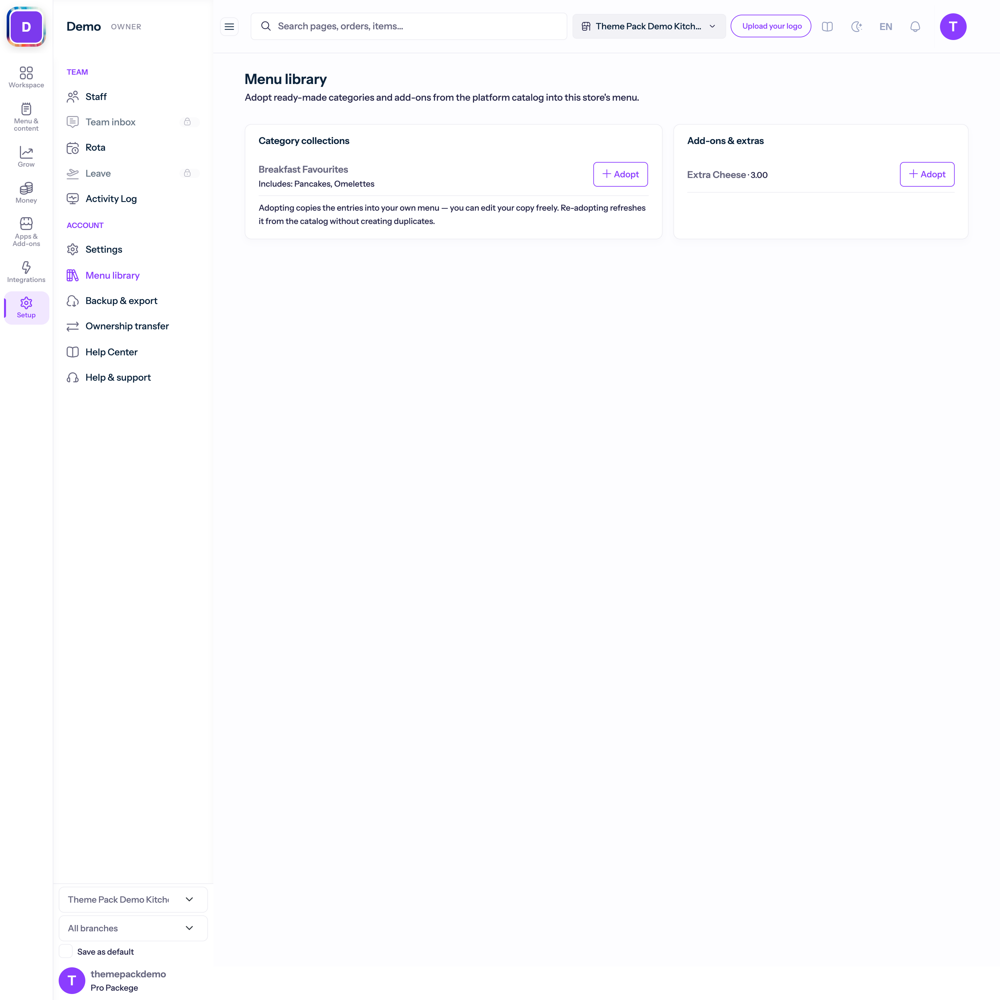

# Menu library (platform catalog)

The platform curates a ready-made catalog of menu categories (with their
items) and common extras. Instead of typing a standard menu from scratch,
you can browse this catalog and adopt entries straight into your own menu.
Open **Menu library** in the dashboard sidebar under **Setup → Account**
(books icon); the page also lives at `/platform-catalog` on your dashboard
domain. It works on
the store currently selected in the dashboard store switcher. Only the
store's owner can adopt.

## Browsing and adopting

The page lists the catalog in two parts:

- **Categories** — curated menu categories, including sub-categories, each
  bundling ready-made items.
- **Extras** — common add-on groups (toppings, sides, options).

Click **Adopt** on an entry to copy it into your current store's menu. After
adopting a category the confirmation shows how many items were created and
how many existing ones were updated; adopted entries land in your normal
menu editor immediately, ready to reprice, photograph, translate or delete
like anything you created yourself.

## Copy-on-adopt

Adoption is a **copy**, not a link:

- Once adopted, the entry is yours. Later edits the platform makes to its
  catalog never change your copy, and your edits never touch the catalog.
- Adopting the same entry again refreshes/updates your copy from the current
  catalog version — the created/updated counts in the confirmation tell you
  what happened.

Only catalog entries the platform has marked active are shown; the catalog's
contents are curated by the platform administrator.

## Related pages

- [Managing menu items](menu-items.md) — editing what you adopted.
- [Categories and menu sections](menu-categories.md) — organising it.
- [AI menu generator and menu scan](ai-menu-generator.md) — another fast way
  to build a menu, from a photo or description.
